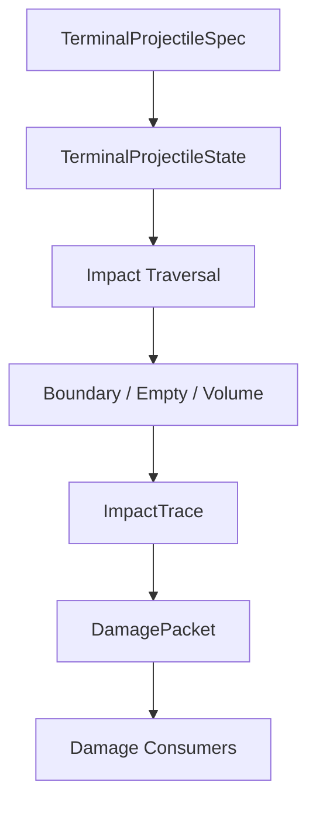

# WIP12A 공통 종말탄도 기틀 — 설계 기준

상태: 구현 계약 및 검증 기준  
기준 소스: `Aegis_SIM_v48_WIP12A.html`  
회귀 기준: `archive/v48/WIP11C/Aegis_SIM_v48_WIP11C.html`

## 1. 목적

WIP12A는 함포탄, 기관포탄, 대함미사일 탄두와 향후 탄도탄 탄두가 동일한 종말탄도 상태·결과 계약을 사용하도록 공통 기반을 만든다.

이 단계의 핵심은 모든 탄체에 하나의 관통 공식을 강제하는 것이 아니다. 공통화할 대상은 충돌 전후 상태, traversal, 기록과 피해 전달 파이프라인이며 실제 판재 관통 계산은 충돌 regime에 맞는 solver를 선택한다.

> 모든 탄체가 하나의 관통식을 사용하는 것이 아니라, 하나의 관통 상태·결과 계약을 사용한다.

> 빈 공간에는 저항이 없으며, 경계와 실제 물질 볼륨만 탄체 상태를 변화시킨다.

## 2. WIP12A 범위

### 포함

- `TerminalProjectileSpec`
- 가변 `TerminalProjectileState`
- `BoundarySurface`와 `DamageVolume` 계약
- ordered impact traversal
- `BOUNDARY`, `EMPTY`, `DAMAGE_VOLUME` 구분
- thin ductile plate solver의 최초 구현
- solver 선택 interface
- 잔존 속도·질량·coherent mass·무결성·yaw·방향 편향
- 도탄, 정지, 부분 관통, 완전 관통, 탄체 파쇄의 분리
- 시간 기반 신관 진행
- `ImpactTrace`, `BoundaryImpactResult`, `DamagePacket`
- 진단용 대표 탄체 6종
- 기존 ASM 관통 결과를 보존하는 compatibility adapter
- damage patch 계약 정의와 diagnostic-only fixture
- 기존 WIP11B/WIP11C ASM 결과 exact regression

### 제외

- 실제 함포 발사와 포탑·탄창 운용
- 외탄도와 바람·공기저항·분산
- 해상사격 FCS
- 새 함선 또는 중장갑함의 실전 투입
- 정교한 homogeneous/KC face-hardened armor 공식의 실전 활성화
- persistent damage patch ledger
- damage patch의 작전 snapshot codec·revision migration
- 코리올리, 포신 마모, 탄약 온도

## 3. 계층과 책임



- 종말탄도 커널은 관통·파쇄·신관·폭발 위치와 피해 패킷만 계산한다.
- 커널은 승조원 사상, 장비 HP, 침수, 화재 상태를 직접 변경하지 않는다.
- 각 대상 subsystem이 `DamagePacket`을 소비해 실제 상태를 갱신한다.
- 3D는 `ImpactTrace`와 적용 결과를 읽어 파괴구·스폴·폭발을 표시할 뿐 계산 권위자가 아니다.

## 4. 탄체 정적 명세

외탄도 전체 데이터를 끌고 오지 않고 함체에 접촉하는 순간부터 필요한 정보만 정의한다.

```js
TerminalProjectileSpec = {
  id: 'TEST_127_SAP',
  sourceClass: 'DIAGNOSTIC_SIM_TUNED',

  geometry: {
    caliberM: 0.127,
    lengthM: 0,
    noseShape: 'OGIVE',
    capType: 'NONE'
  },

  body: {
    massKg: 0,
    penetratorMassKg: 0,
    materialId: 'SHELL_STEEL',
    hardness: 0,
    shatterResistance: 0,
    ductility: 0
  },

  payload: {
    type: 'SAP_HE',
    explosiveMassKg: 0,
    incendiaryMassKg: 0,
    fragmentModelId: null
  },

  fuze: {
    type: 'BASE_DELAY',
    armMode: 'IMPACT',
    delayS: 0
  },

  terminal: {
    modelFamily: 'SHELL',
    integrityModel: null,
    crushModel: null
  }
};
```

`massKg`와 `penetratorMassKg`는 반드시 분리한다.

- AP탄은 전체 질량 중 큰 비율이 coherent penetrator로 남을 수 있다.
- 대함미사일의 총 질량 전체를 완전한 관통체로 취급하지 않는다.
- 미사일 기체, 날개, 연료계통과 엔진은 충돌 중 찌그러지거나 분리될 수 있다.
- 폭약량과 관통체 질량은 같은 값이 아니며 서로 대체하지 않는다.

## 5. 가변 탄체 상태

관통에너지 하나만 권위 상태로 저장하지 않는다. 에너지는 질량과 속도에서 파생한다.

```js
TerminalProjectileState = {
  position: { x: 0, y: 0, z: 0 },
  direction: { x: 1, y: 0, z: 0 },
  bodyAxis: { x: 1, y: 0, z: 0 },

  speedMps: 0,
  massKg: 0,
  coherentMassKg: 0,

  integrity01: 1,
  spinRadS: 0,
  elapsedS: 0,

  fuze: {
    armed: false,
    functioning: true,
    delayRemainingS: 0
  }
};
```

파생값:

```text
kineticEnergyJ = 0.5 × massKg × speedMps²
coherentEnergyJ = 0.5 × coherentMassKg × speedMps²
momentumNs = massKg × speedMps
yawRad = acos(dot(direction, bodyAxis))
```

경계 통과 뒤에는 다음 판정을 위해 상태를 계속 이어간다.

- 속도 감소
- 총질량과 coherent mass 감소
- 탄체 무결성 저하
- yaw 증가
- 진행방향 편향
- 신관 손상·기폭·불발 상태

`direction`은 속도 방향이고 `bodyAxis`는 탄체 종축이다. 둘은 항상 정규화된 3D 벡터이며 `yawRad`는 두 벡터의 내적으로 계산하는 파생값이다. 스칼라 yaw만 저장하면 편향 방향을 잃으므로 권위 상태로 사용하지 않는다. `spinRadS`는 schema 자리는 갖지만 WIP12A thin-plate 계산에는 사용하지 않는다.

모든 traversal 좌표는 `SHIP_LOCAL_METRES`이며 world-to-ship 변환은 커널 진입 전에 끝낸다. surface normal도 정규화한다. `obliquityDeg`는 `0° = 판재 법선 정면충돌`, `90° = 완전 grazing`으로 정의한다.

## 6. 표적 공간 계약

### BoundarySurface

외판, 장갑판, 갑판, 격벽, 수밀문과 방화문처럼 실제 판재 경계를 나타낸다.

필수 정보:

- surface ID와 국부 좌표
- 재질 profile ID
- 실제 두께와 유효 잔존두께
- 보강재·구조 역할 계수
- 외판/강력갑판/일반벽/수밀벽/문 등의 boundary kind
- 수밀·방화 속성
- 파편 라이너와 아라미드 속성
- 현재 손상과 diagnostic damage patch 참조

### DamageVolume

엔진, 발전기, VLS, 배관 뭉치, 연료탱크와 전자장비처럼 실제 물질이 차지하는 체적을 나타낸다.

- 방 크기 AABB의 앞면 전체를 강철판으로 취급하지 않는다.
- 장비 체적은 자체 재질과 `volumetricResistance`를 가질 수 있다.
- 빈 방은 `DamageVolume`이 아니며 에너지를 소모하지 않는다.
- 장비 충돌 결과도 직접 상태를 바꾸지 않고 `DamagePacket`에 기록한다.

### CrewExposureVolume

승조원 점유 공간은 탄체 저항을 갖는 `DamageVolume`과 분리한다.

- 승조원 구역 자체는 projectile resistance가 0이다.
- 직접 탄도 corridor, plug/spall과 탄두 파편 corridor만 기록한다.
- 실제 사상 판정은 crew damage consumer가 수행한다.
- 사람이 있다는 이유만으로 탄체가 감속하거나 관통력이 줄지 않는다.

## 7. Ordered traversal

```text
BOUNDARY → EMPTY → DAMAGE_VOLUME → EMPTY → BOUNDARY
```

### EMPTY

- 속도·질량·관통능력 손실 없음
- 거리와 현재 속도로 비행시간만 진행
- 신관 timer 진행
- 중력 등 외탄도 효과는 WIP12A traversal 안에서 새로 적분하지 않음

### BOUNDARY

- 충돌 regime 선택
- 판재 solver 실행
- 속도, 질량, coherent mass, integrity, yaw와 방향 갱신
- hole, plug, rear spall과 파편 기록

### DAMAGE_VOLUME

- 실제 물질이 있는 거리에서만 volumetric work 소비
- 기관, 발전기, VLS와 연료탱크의 파괴·파편·화재 후보 기록
- 긴 미사일과 작은 AP탄의 단면·질량·형상 차이를 반영

기존 `continuousWorkMJPerM` 개념은 삭제하지 않고 `volumetricResistanceMJPerM` 계열로 제한한다. 빈 공간에는 적용하지 않는다.

### Event-driven 재질의

최초 ray에서 후보를 한 번 정렬한 목록을 최종 traversal로 사용하지 않는다. BVH/AABB는 다음 접촉 후보를 찾는 가속 구조일 뿐이다.

```text
현재 state
→ 현재 direction으로 다음 contact 검색
→ 가장 이른 event 처리
→ direction/bodyAxis/speed/fuze 갱신
→ 갱신된 state로 BVH/AABB 재질의
```

첫 판에서 편향되거나 도탄하면 최초 직선에 있던 경계 대신 새 경로의 경계가 선택돼야 한다. 같은 거리의 접촉은 `BOUNDARY → VOLUME → stable ID` 순으로 결정하고, 위치 epsilon·시간 epsilon·최대 event 수·최대 경로 길이로 무한 재접촉을 막는다.

## 8. Solver 선택

solver는 무기 이름이 아니라 탄체 상태와 표적 경계의 충돌 regime으로 선택한다.

초기 registry:

- `THIN_DUCTILE_PLATE`
- `LIGHT_STRUCTURE`
- `HOMOGENEOUS_ARMOR`
- `FACE_HARDENED_ARMOR`
- `VOLUME_CRUSH`

WIP12A에서 authoritative하게 활성화할 것은 현대 함정용 `THIN_DUCTILE_PLATE`와 필요한 경량 구조/volume 경로다. 나머지는 interface와 명시적 미구현 결과를 제공하고 검증되지 않은 상수로 흉내 내지 않는다.

같은 127 mm SAP라도 6 mm 상부구조 외벽은 thin plate solver를 사용하고, 향후 100 mm 균질 장갑판은 homogeneous armor solver를 사용한다. 미사일도 동일한 선택 규칙을 따른다.

얇은 판재 solver의 개념 입력:

```text
Resistance = material work
           × F(thickness / caliber)
           × F(projectile hardness / target hardness)
           × F(nose shape)
           × F(obliquity)
           × F(projectile integrity and yaw)
```

406 mm APC와 300 mm KC face-hardened belt가 필요해질 때 thin plate 식에 보정상수를 계속 붙이지 않는다. 별도 검증된 solver를 추가한다.

## 9. 경계 충돌 결과

```js
BoundaryImpactResult = {
  traversalOutcome: 'RICOCHET' | 'STOPPED' | 'PARTIAL' | 'PERFORATED',
  projectileFailure: 'INTACT' | 'DEFORMED' | 'FRACTURED' | 'SHATTERED',
  plateFailureMode: 'NONE' | 'DENTING' | 'DUCTILE_HOLE' | 'PLUGGING' |
                    'PETALING' | 'CRACKING' | 'SPALL_ONLY',

  stateBefore: null,
  stateAfter: null,

  incidence: {
    obliquityDeg: 0,
    normal: { x: 0, y: 0, z: 0 },
    effectiveThicknessM: 0
  },

  plate: {
    materialProfileId: null,
    thicknessM: 0,
    perforated: false,
    holeAreaM2: 0,
    plugMassKg: 0
  },

  projectile: {
    massLossKg: 0,
    coherentMassLossKg: 0,
    integrityLoss: 0,
    yawAddedRad: 0,
    deflectionRad: 0
  },

  secondary: {
    plugFragments: null,
    rearSpall: null,
    debris: null
  }
};
```

`traversalOutcome` 의미:

- `RICOCHET`: 탄체가 비교적 coherent한 상태로 방향을 바꿔 계속 비행할 수 있음
- `STOPPED`: 경계 앞 또는 내부에서 정지
- `PARTIAL`: 완전 관통과 정지 사이, 탄체 일부가 판 내부나 후면으로 돌출
- `PERFORATED`: 경계를 완전히 통과하며 잔존 상태로 다음 traversal 진행

`projectileFailure`는 독립 축이다. 따라서 `PERFORATED + SHATTERED`와 `RICOCHET + FRACTURED`가 모두 표현 가능하다. `SHATTERED`이면 탄체 coherent mass가 급감하고 대형 파편·잔해가 생성된다.

도탄과 shatter를 합치지 않는다. AP cap, 표적 경도, 고속·고경사 충돌은 특히 shatter 판정에 영향을 준다.

각 경계·volume 결과에는 진단용 `ImpactBudget`을 남긴다.

```js
ImpactBudget = {
  kineticBeforeJ: 0,
  kineticAfterJ: 0,
  workIntoPlateJ: 0,
  debrisKineticJ: 0,
  deformationLossJ: 0,
  unresolvedDissipationJ: 0,
  massBeforeKg: 0,
  massAfterKg: 0,
  shedMassKg: 0,
  momentumBeforeNs: { x: 0, y: 0, z: 0 },
  momentumAfterNs: { x: 0, y: 0, z: 0 },
  targetImpulseNs: { x: 0, y: 0, z: 0 }
};
```

fixture는 `massAfter + shedMass ≈ massBefore`, 모델링된 에너지 총합이 충돌 전 운동에너지를 넘지 않는지, 운동량 closure 오차가 허용치 안인지 검사한다. 이는 정밀 연속체 해석이 아니라 에너지나 질량을 창조하는 튜닝 오류를 잡는 ledger다.

## 10. 신관과 기폭 위치

신관 지연은 거리로 미리 환산하지 않고 실제 traversal 시간으로 진행한다.

```text
경계 충돌
→ 속도 감소
→ 빈 공간 이동시간 누적
→ 장비 체적 충돌과 추가 감속
→ delayRemainingS가 0이 된 실제 위치에서 기폭
```

각 구간에서는 경계 접촉, volume 진입·이탈, projectile stop과 fuze expiry의 시간을 비교해 가장 빠른 사건을 처리한다. 빈 공간 중간에서 신관 시간이 먼저 끝나면 다음 격벽까지 이동하지 않고 그 위치에서 기폭한다. volume 안에서는 감속을 포함한 시간-거리 해를 사용한다.

동시 사건 규칙은 결정적이다.

- 경계 접촉과 신관 만료가 같은 시각이면 경계 충돌 결과를 먼저 계산하고 접촉점에서 기폭한다.
- volume exit와 신관 만료가 같으면 exit 상태를 확정한 뒤 그 위치에서 기폭한다.
- projectile stop과 신관 만료가 같으면 정지 상태를 확정한 뒤 기폭한다.

초기 상태:

- 정상
- 고장/DUD
- armed/unarmed

후속 확장:

- 충돌 손상
- 조기기폭
- base/nose fuze 차이
- 다중 안전장치와 arming 조건

## 11. ImpactTrace와 DamagePacket

`ImpactTrace`는 traversal 전체를 재현 가능한 순서로 기록한다.

- 시작 탄체 상태
- 접촉한 경계와 volume 순서
- 각 충돌 전후 상태
- 빈 공간 이동거리·경과시간
- 신관 상태 전이
- 최종 정지·도탄·기폭 위치
- hole, plug, rear spall과 생성 파편

`DamagePacket`은 최소 다음 채널을 분리한다.

```js
DamagePacket = {
  impactEventId: null,
  sourceProjectileId: null,
  targetEntityId: null,
  directPenetration: [],
  plugAndSpall: [],
  warheadFragments: [],
  blast: [],
  thermalIncendiary: [],
  breaches: [],
  structuralImpulse: [],
  crewExposure: []
};
```

`ImpactTrace`와 `DamagePacket`은 같은 `impactEventId`를 사용한다. 적용 adapter는 이 ID를 idempotence key로 사용해 동일 packet의 중복 적용을 거부한다.

- 아라미드는 직접 관통 저항에 단순 합산하지 않고 plug/spall과 파편 채널을 감쇠한다.
- 수밀격벽이 탄체를 완전히 막지 못해도 잔존 상태와 파괴구에 따라 침수 전파 능력은 별도로 판정한다.
- 관통 solver가 `crew.kill()`, `addModuleDmg()` 또는 `flood.addHole()`을 직접 호출하지 않는다.
- `wip12aApplyDamagePacket()`만 기존 침수·구조·승조원·장비 consumer로 전달하며, 계산-only 실행은 authoritative 상태를 바꾸지 않는다.

## 12. Damage patch 계약

WIP12A에서는 interface와 diagnostic fixture만 정의한다.

```js
BoundaryDamagePatch = {
  surfaceId: null,
  localU: 0,
  localV: 0,
  radiusM: 0,
  remainingThickness01: 1,
  holeAreaM2: 0,
  crackSeverity: 0,
  residualStrength01: 1
};
```

20–57 mm 연속 피격이 같은 판재를 매번 새 강판으로 취급하지 않도록 후속 단계에서 누적 ledger를 활성화한다. WIP12A에서는 persistent authoritative state, snapshot codec과 revision compatibility를 추가하지 않는다.

## 13. 기존 ASM 호환

Kh-35U와 Kh-32는 먼저 새 공통 API의 adapter를 통과시키되 내부 계산은 WIP11B/WIP11C의 검증된 관통 경로를 호출한다.

```text
ASM terminal state
→ Generic Terminal Ballistics API
→ LEGACY_ASM_PENETRATION_COMPAT
→ 기존 결과
```

WIP12A에서 빈 공간 저항 제거 또는 신규 thin plate solver를 기존 ASM에 즉시 강제하지 않는다. ASM migration은 신규 포탄 fixture와 kernel이 안정화된 후 별도 단계에서 결정한다.

보존 대상:

- Kh-35U/Kh-32 관통·폭발 결과
- DUD 경로
- 입·출구 파괴구
- 침수·충격량 전달
- WIP11B/WIP11C 같은-seed exact regression
- 전투 RNG 상태와 호출 순서

## 14. 대표 진단 탄체

초기 fixture:

| 탄체 | 주 검증 목적 |
|---|---|
| `TEST_12P7_AP` | 얇은 판·소형 coherent penetrator |
| `TEST_30_AP` | 반복 가능한 판재 관통과 잔존속도 |
| `TEST_30_HEI` | 얕은 관통·파편·소이 채널 분리 |
| `TEST_76_SAP` | 지연신관과 구획 내부 기폭 |
| `TEST_127_HE` | 외부/얕은 기폭과 큰 파편·폭압 |
| `TEST_127_SAP` | 복수 경계 traversal과 내부 기폭 |

모두 `sourceClass: DIAGNOSTIC_SIM_TUNED`로 표시한다. 실제 특정 제조사 탄약 제원으로 주장하지 않으며, 각 탄체마다 도탄·정지·부분 관통·완전 관통·shatter 경계를 별도 매트릭스로 검사한다.

## 15. 성능 원칙

- 피격 순간에만 traversal을 수행한다.
- 모든 구획을 매 fixed tick 전수조사하지 않는다.
- BVH/AABB로 현재 경로 주변의 다음 경계·volume 후보만 축소하고, 상태 변화 뒤 다시 질의한다.
- 실제 통과한 경계와 물질 volume만 순서대로 검사한다.
- 수천 개 파편을 물리 객체로 만들지 않고 파편 원뿔과 확률 밀도로 계산한다.
- 기관포 근접 탄착의 live patch 병합은 후속 ledger 단계로 미룬다.

## 16. 필수 검증 계약

### 정적

- 계약 schema와 단위 명시
- solver registry의 명시적 fallback/미구현 거부
- EMPTY에서 에너지·질량·integrity 불변
- DamagePacket 계산과 적용 분리
- 렌더링·진단 난수의 전투 RNG 비간섭

### 결정적 fixture

- 각 대표탄 정상·도탄·정지·부분·관통·shatter 경계
- 첫 경계 손상이 두 번째 경계 결과에 이어짐
- yaw 증가에 따른 후속 관통 저하
- 빈 공간에서 속도 손실 없이 신관 시간만 진행
- volume에서만 volumetric work 소비
- 정상기폭과 DUD
- 아라미드가 직접 관통보다 spall/fragment를 감쇠

### 회귀

- WIP11B/WIP11C ASM same-seed exact parity
- 기존 침수·구조·승조원·VLS 피해 회귀
- 작전 snapshot export/import와 거부 시 zero-mutation 불변
- 1×, 8×, 16× 결과 일치와 64× 과부하 계측

## 17. 완료 기준

WIP12A 완료는 다음 조건을 모두 만족해야 한다.

1. 공통 spec/state/result/trace/packet 계약이 코드와 진단 API에 존재한다.
2. thin plate와 volume traversal이 대표 6종 fixture에서 동작한다.
3. EMPTY 구간이 관통능력을 소비하지 않는다.
4. 시간 기반 신관이 감속과 복수 경계를 반영한다.
5. 기존 ASM은 compatibility adapter를 통해 기존 결과를 보존한다.
6. persistent damage patch, 실제 발사, 외탄도와 FCS가 실수로 활성화되지 않는다.
7. 정적·결정적·브라우저 회귀와 체크섬·상태 문서 갱신이 끝난다.
