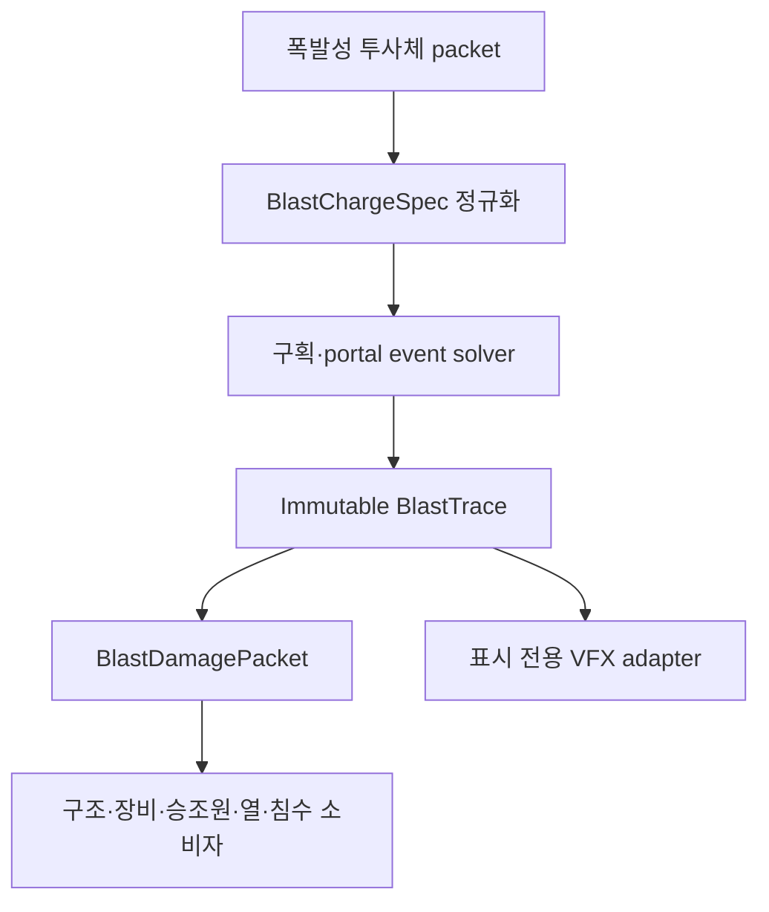

# WIP12E 범용 구획 폭발 구현·검증 계획

## 1. 현재 판정

- 시작 기준 `main`: `97de0e1459e4f111e21b5bed163decc6ce782c32`
- 병합 결과 `main`: `c18a51433d767f56ccd1bb4ff30388dfe91505d3`
- WIP12E PR: `#30`, merged at `2026-09-20T04:50:00Z`
- WIP12D PR: `#29`, merged at `2026-09-19T16:44:41Z`
- 기준 HTML: `Aegis_SIM_v48_WIP12D.html`
- 기준 HTML SHA-256: `8ae85b69e28e71e54137ede0fd6110bbfa358fea7b04c2a88446bf3d44f7a90c`
- 작업 브랜치: `feat/v48-wip12e-compartment-blast`
- 캐시 우회 구현 후보: `Aegis_SIM_v48_WIP12E_REV5_NAVAL_ARMOR_FUZE_COUPLING.html`
- 권위 기본값: `COMPARTMENT_BLAST_AUTHORITY`
- 현재 상태: revision 5 naval armor·fuze·external blast coupling, 전용 Chromium·2D/3D 회귀, 전체 Actions 및 `main` 병합 완료

`REV5`는 캐시 우회용 후보 식별자이며 WIP 번호는 계속 WIP12E다.

WIP12E는 특정 미사일의 폭발 반경을 키우는 패치가 아니다. 모든 폭발성 투사체가 같은 물리 입력 계약으로 진입하고, 한 번 계산한 구획별 압력·충격량·폭풍·열·파편 trace를 구조, 장비, 승조원, 화재, 침수 및 시각화가 각각 소비하는 권위 전환이다.

### 1.1 revision 2 실기 피드백과 교정

첫 후보를 Kh-32로 직접 시험한 결과 다음 결함이 확인됐다.

- 대형 내부 폭발인데도 점화 구획이 지나치게 적었다.
- surface rupture가 실제 피격점 대신 cell face 중심에 생길 수 있었다.
- 최초 관통 입구가 내부 폭발 뒤에도 작은 관통구로 남았다.
- 통계적 case fragment 피해가 수치로만 존재하고 실제 외피 천공으로 남지 않았다.
- 상부구조나 연돌의 hole은 침수 geometry가 받아들이지 않으면 3D 손상에서도 사라졌다.

revision 2는 이를 다음처럼 교정한다.

- 현재 projectile entry를 외부 vent로 추적하고, 내부 pressure/hot-product panel work로 원래 좌표의 `BLAST_ENTRY_BLOWOUT`을 확대한다.
- entry가 속한 동일 외판 면에는 별도 중심점 rupture를 만들지 않고 entry blowout 하나가 권위를 가진다.
- 반대편/주변 외판은 source 또는 portal 위치를 해당 면에 투영한 국부 좌표에서 pressure rupture를 만든다.
- case fragment의 plate work를 별도 원장으로 닫고 `BLAST_FRAGMENT_PERFORATION`을 실제 좌표·면적·법선과 함께 만든다.
- WIP12D macro residual crossing과 WIP12E breach를 flood acceptance와 무관하게 persistent solved-damage scar로 보존한다.
- 고온 생성물의 혼합 온도와 구획별 가연물 profile을 사용해 대형 내부 폭발의 직접 및 인접 구획 점화를 늘리되, pressure만으로 발화시키지는 않는다.

### 1.2 revision 3 KH-32 crash와 연속 파열 교정

두 번째 후보를 실제 KH-32로 시험하자 명중 즉시 게임 루프가 정지했다. 실제 Chromium 재현 결과 `wip12eNearestExteriorSurface()`가 격리 VM에만 주입된 `wip12aDistance()`를 호출해 `ReferenceError`를 발생시킨 것이 직접 원인이었다. 본편에 존재하는 vector primitive만 사용하도록 교체하고 static contract에서 테스트 전용 의존성을 금지했다.

같은 live hit를 추적하면서 아래 물리 결함도 확인했다.

- legacy source shape의 head만 topology 안에 있고 peak/tail `81.2%`가 밖에 있어, 500 kg TNT-equivalent charge의 에너지 대부분이 어떤 cell에도 seed되지 않았다.
- projectile entry는 외곽 cell에 묶이고 detonation cell과 직접 연결되지 않아, 입구로 되돌아오는 압력은 수 J 수준이었다.
- 외판 failure가 개별 surface point에 머물러 사용자가 요구한 폭발 범위 전체의 연속 찢김을 표현하지 못했다.
- 내부 portal failure는 짧은 pressure animation 뒤 사라져 영구 손상으로 보이지 않았다.
- topology surface와 표시 mesh 사이 좌표 차이가 기존 ±6 m ray 범위를 넘으면 solved rupture가 실제 geometry cut으로 붙지 않았다.

revision 3은 topology 밖 source fraction을 물리 detonation cell로 귀속하고 내부 seed 합을 `1.0`으로 정규화한다. entry에는 길이·개구면적 기반 projectile wound channel을 부여한다. 폭발 반경과 모든 exterior surface의 직접 교차를 별도로 계산해 aperture와 damaged footprint를 분리한 면적 보존 타원형 tear를 만든다. 실패한 door/bulkhead는 `BLAST_INTERNAL_TEAR`로 기록되며 내부 보기에서 ragged rim, aperture, bent flap, radial crack이 영구 표시된다. 외판 표시 adapter는 blast rupture/fragment에 한해 양방향 최대 24 m를 탐색하고 topology point에 가장 가까운 실제 mesh 교점을 절삭한다.

### 1.3 revision 4 실제 피해·2D 표시·영구성 교정

revision 3을 실기 시험한 뒤 3D 파괴는 커졌지만 2D 인디케이터와 실제 구획·장비 피해가 충분히 커지지 않았고, 함교 반복 피격에도 SPY가 쉽게 정지하지 않으며, 오래된 파괴구가 최근 96개 제한과 표시 수명 때문에 사라지는 문제가 확인됐다.

revision 4는 아래처럼 교정한다.

- 구획 solver의 물리 응답을 `core`로 두고, TNT 질량의 세제곱근으로 정한 약간 넓은 `fringe` 안에 yield/range shock floor를 둔다.
- 실제 적용 피해는 solved channel response와 floor의 최댓값이며 두 값을 더해 에너지를 중복 계산하지 않는다.
- pressure trace가 도달한 cell만 floor 적용 대상이므로 bulkhead/portal 차폐를 건너뛰지 않는다.
- 상세 구획과 모든 등록 physical equipment target에 같은 packet을 전달한다. 민감 전자장비, 중기계, 보호 위험물 및 일반 장비는 별도 응답 profile을 쓴다.
- SPY, bridge, combat, mast 및 hangar family가 실제 module HP와 operational state를 갱신한다.
- generic packet commit 뒤 미정의 변수 때문에 예외가 나던 `vlsCellDamage` 반환을 실제 계산값에 연결했다.
- hot products는 도달 cell 안에서 coarse damage-control zone을 먼저 다양화하고 최대 16개 후보로 분산한다.
- `solvedDamageScars.slice(-96)` 제한과 age fade를 제거하고, 2D 상면·측면에도 전체 persistent scar를 그린다.
- `wip12eRev4DamageCouplingStatus()`와 `wip12eRev4TwoDScarAudit()`으로 실제 장비 피해와 2D source/drawn parity를 감사한다.

### 1.4 revision 5 장갑·신관·외부폭압 결합

revision 4 이후 남은 문제는 “고폭탄이 외판에 닿았을 때”를 관통/비관통으로 구분할 장갑 및 신관 경계가 약하다는 점이었다. 특히 전함·중순양함급 장갑을 고려하면 큰 탄두라고 해서 항상 외피 구멍과 내부 hot-gas path를 만드는 것은 잘못이다. 반대로 구축함급 얇은 외판은 탄체 자체가 관통하지 못했더라도 접촉 고폭의 압력과 충격량으로 파열될 수 있어야 한다.

revision 5는 다음을 추가한다.

- 구조강·균질 장갑·표면경화 장갑을 material profile별 RHA-equivalent 값으로 정규화한다.
- homogeneous/face-hardened naval armor solver를 활성화한다.
- 지연신관 최소 판재 자극을 `8 / 12 / 20 mm RHAe` profile로 분리한다.
- RHAe만 보지 않고 normal velocity, normal impulse, plate work, obliquity 및 projectile survival을 모두 통과해야 delay clock을 시작한다.
- 비관통 표면 결과를 `SCORCH / DENT / CRATER`, 관통을 `PERFORATED`로 구분한다.
- 비관통 외부폭발은 hot-gas direct path와 임의 구멍을 금지하고 제한된 shock, rear spall 및 compartment fatigue만 결합한다.
- 외부폭발의 reflected pressure, positive impulse 및 plate work가 얇은 외판의 두께·강도·유효 면적을 이기면 `EXTERNAL_BLAST_BLOWOUT`을 실제 opening으로 만든다.
- plate failure work는 기존 vented blast energy에서 structural work로 재분류해 원장을 보존한다.
- 외부 기폭 후 projectile entry 또는 blast blowout으로 들어온 hot products는 internal hot-gas cap 안에서 실제 도달 구획으로 재분배한다.
- Kh-32와 Kh-35U 모두 `ANTI_SHIP_DELAY_8`을 사용하되 탄체와 탄두의 고유 물성은 그대로 유지한다.

이 모델은 `SIM_TUNED_RHA_EQUIVALENT_NORMALIZATION_NOT_CERTIFIED_FUZE_DATA`다. 신관 profile의 숫자는 관통 보장 두께가 아니라 작동 자격을 위한 최소 판재 자극이다.

## 2. 기존 경로 재추적

### 2.1 WIP12D까지의 ASM 경로

1. ASM 종말 충돌이 `computeAsmBlastEffects()`로 특정 탄두의 폭발량을 만든다.
2. `buildWip101ChainBlastSources()`가 진행방향을 따라 legacy head/peak/tail source를 만든다.
3. `computeWip101BlastDamageFromSources()`가 고정 scalar damage budget을 부품에 분배한다.
4. 이 결과가 모듈 HP, 침수/파괴구, 종강도, 승조원 및 VLS 소비자에 각기 전달된다.
5. WIP07 승조원 모델은 별도의 portal 전파 근사를 다시 계산한다.
6. WIP12D 잔존체 보충 경로는 폭발을 재생하지 않지만, primary blast 자체는 여전히 legacy scalar authority다.

문제는 구조 피해와 승조원 피해가 같은 폭발을 서로 다른 공간 모델로 해석하고, 문·격벽 파괴나 외부 vent가 하나의 에너지 원장으로 연결되지 않는다는 점이다.

### 2.2 공통 탄도 packet 경로

`wip12aApplyDamagePacket()`은 포탄·로켓·기타 투사체가 공유할 수 있는 진입점이지만, WIP12D까지는 구획 폭압의 단일 authoritative trace를 만들지 않았다. 따라서 carrier가 달라도 폭발 payload가 같으면 동일 결과가 나와야 한다는 범용성 계약을 직접 보장하지 못했다.

### 2.3 WIP12E 이후 경로

미사일, 로켓, 포탄이라는 이름은 solver 분기에 사용하지 않는다. 폭발물 질량, TNT 등가, 케이스 질량, 기폭 등급, 매질, 위치, 속도 및 관통 개구부만 물리 입력이다.

## 3. 구현된 데이터 계약

### 3.1 `BlastChargeSpec`

| 필드군 | 의미 |
|---|---|
| charge | explosive mass, TNT equivalent, case mass |
| detonation | detonation class와 modeled energy fraction |
| environment | `AIR`, `INTERNAL_AIR`, `NEAR_SURFACE` 등 매질 |
| provenance | 입력 출처와 공개 정확도 수준 |
| confidence | `SIM_TUNED` 등 모델 신뢰도 표시 |

동일한 `BlastChargeSpec`, topology, 기폭 위치 및 event ID에는 carrier 종류와 관계없이 같은 physics hash가 생성된다.

### 3.2 `BlastTrace`

- source cell과 도달 시간
- cell별 incident/reflected peak pressure
- positive impulse와 positive-phase duration
- dynamic pressure/blast wind
- quasi-static hot-gas/thermal state
- portal propagation 및 문·격벽 failure
- exterior surface load, 실제 breach 및 vent jet
- 원래 피격점의 entry backblast blowout과 projectile wound channel
- 폭발 반경과 외판의 직접 교차, `tearLengthM`/`tearWidthM`/`damagedAreaM2` footprint
- door/bulkhead의 영구 `BLAST_INTERNAL_TEAR`
- 결정적 case-fragment surface perforation
- fragment/spall 기대량과 structural shock
- hard-cap 사용량과 종료 사유
- 입력/흡수/배출/잔류/절단 에너지 원장
- air-blast 및 fragment perforation 각각의 closure error
- 결정적 physics/determinism hash

### 3.3 `BlastDamagePacket`

- `structureLoads`
- `equipmentLoads`
- `crewPressureExposure`
- `crewFragmentExposure`
- `thermalHotGas`
- `newBreaches`
- `ventJets`
- `secondaryIgnitionCandidates`

breach row는 `kind`, `impactRole`, `source`, `replacesOpeningId`, `exactArea`, `outwardEjection`, `tearAxis`, `tearLengthM`, `tearWidthM`, `damagedAreaM2`를 보존한다. 따라서 entry blowout, pressure rupture, 내부 격벽 tear, case-fragment hole이 consumer에서 하나의 점형 `BLAST_SURFACE_RUPTURE`로 뭉개지지 않는다.

모든 채널은 같은 `impactEventId`와 `blastTraceHash`를 공유한다. consumer는 event ID 중복을 거부한다.

### 3.4 `NavalArmorFuzeContract`

| 필드군 | 의미 |
|---|---|
| material | 실제 두께, 항복강도, RHAe 계수, homogeneous/face-hardened 분류 |
| fuze qualification | 최소 RHAe, normal velocity, normal impulse, plate work, 최대 obliquity |
| surface response | `SCORCH`, `DENT`, `CRATER`, `PERFORATED`와 잔존 두께·rear spall |
| external coupling | 비관통 shock, projectile-entry direct path, external-blast blowout |
| applicability | missile, rocket, shell 공통이며 carrier-name branching 금지 |

신관 arming과 impact qualification은 분리된다. 비행 중 안전장치가 풀렸더라도 판재 자극이 profile을 만족하지 못하면 delay clock은 시작하지 않는다. `ANTI_SHIP_DELAY_8`은 불충분한 접촉에서 superquick external fallback을 허용하지만, 그 외 지연신관 profile은 설정된 fallback에 따라 DUD가 될 수 있다.

## 4. 구획·portal solver

### 4.1 topology adapter

- WIP12C의 138-space 상세 구획을 immutable cell로 변환한다.
- 명시적 portal을 우선 사용하고, 누락된 인접면은 결정적 inferred bulkhead로 보완한다.
- 외판 surface와 기존 관통·잔존체·침수 opening을 별도 보존한다.
- 내부 기폭에서 source-shape sample이 topology 밖에 있어도 그 fraction을 실제 detonation cell로 귀속하고 seed 합을 `1.0`으로 정규화한다.
- 현재 projectile entry/exit opening에는 detonation cell을 향한 wound channel과 길이·면적 기반 pressure transmission을 붙인다.
- `CREW_EXPOSURE`는 점유 정보일 뿐 전파 저항으로 사용하지 않는다.

### 4.2 event propagation

- 사건은 quantized arrival time, event priority, cell ID, portal/surface ID로 안정 정렬한다.
- source cell의 incident front와 reflected load를 먼저 확정한다.
- 열린 portal은 면적, 방향 및 transmission으로 다음 cell에 남은 pulse를 전달한다.
- 닫힌 문·격벽은 peak, impulse 및 잔존 강도로 failure를 판정한다.
- failure 뒤에는 이미 소모된 front가 아니라 남은 positive-phase 에너지만 새 portal로 전달한다.
- 기존 exterior opening은 같은 사건에서 즉시 vent하며, 새 외판 rupture도 이후 잔여 pulse를 배출한다.
- cell graph와 별도로 detonation point에서 폭발 반경 안의 exterior surface를 직접 교차시켜 넓은 pressure footprint를 만든다.
- surface failure의 개구 면적은 vent/flood authority이고, 더 넓은 `damagedAreaM2`는 찢김·좌굴 presentation authority다.
- 내부 portal failure는 비침수 `BLAST_INTERNAL_TEAR`로 남고 후속 pulse는 새 통로를 통해 전달된다.
- case fragment는 radial surface intersection과 barrier attenuation을 거쳐 반대편·주변 외피에 실제 작은 천공을 만든다.

### 4.3 hard caps

| 자원 | 상한 |
|---|---:|
| 방문 cell | 96 |
| portal event | 384 |
| surface load | 512 |
| dynamic breach | 64 |
| time slice | 32 |
| vent jet | 32 |
| ignition candidate | 24 |
| presentation keyframe | 256 |

상한에 닿으면 `TRUNCATED_BY_BUDGET`으로 종료하고 `clippedByBudget`, 사용량 및 discarded energy를 남긴다. 한 cell에서 fan-out하는 portal도 남은 전역 budget을 초과하지 않는다.

### 4.4 에너지 bookkeeping

화학 에너지는 air-blast, case/fragment, thermal 및 미모델링 몫으로 먼저 분할된다. air-blast 원장은 다음 항목을 합산한다.

- pressure work
- structural absorption
- vented energy
- retained thermal/gas energy
- unresolved residual
- truncation discard

각 단계에서 가용 에너지를 초과하는 전달은 clamp한다. WIP12D 잔존체에 이미 배정된 chemical coupling은 blast 원장에 다시 더하지 않는다.

case fragment는 `fragmentKineticJ = fragmentPerforationWorkJ + fragmentResidualEnergyJ`로 별도 폐합한다. entry blowout work는 기존 vent energy와 source-cell absorbed panel energy에서만 재분류하며, air-blast 총량을 새로 만들지 않는다. 확대 뒤 남은 vent energy는 실제 entry normal의 outward jet으로 유지한다.

## 5. 권위와 소비자 연결

### 5.1 mode

| mode | 동작 |
|---|---|
| `LEGACY_SCALAR_BLAST_COMPAT` | 기존 scalar 피해를 권위로 유지 |
| `COMPARTMENT_BLAST_SHADOW` | trace를 만들지만 상태는 legacy가 변경 |
| `COMPARTMENT_BLAST_AUTHORITY` | WIP12E packet만 primary blast 상태를 변경 |

기본값은 authority다. legacy와 신규 blast를 동시에 적용하는 경로는 차단했다.

### 5.2 적용 순서

1. 충돌/기폭 결과를 확정한다.
2. WIP12E trace와 packet을 순수 계산한다.
3. `damageFloodImpactV48Wip12E()`가 event ID를 수락한 경우에만 authoritative mutation을 시작한다.
4. 구조·모듈·구획·승조원·VLS 소비자가 동일 packet의 자기 채널만 읽는다.
5. WIP12B terminal event는 `WIP12E_BLAST_OBSERVED_ALREADY_APPLIED`로 기록해 재적용하지 않는다.
6. WIP12D residual supplement는 기존처럼 기계적 잔존체와 실제 구멍만 적용하고 blast를 재생하지 않는다.

VLS 소비자가 damage/flood idempotence 수락 전에 상태를 바꾸던 순서 문제도 함께 수정했다.

### 5.3 구조·침수

- 종강도 모델은 scalar 폭약량 대신 structural shock와 surface load를 받는다.
- 외판 surface failure는 `BLAST_SURFACE_RUPTURE`, 원래 입구 확대는 `BLAST_ENTRY_BLOWOUT`, case fragment 천공은 `BLAST_FRAGMENT_PERFORATION`으로 구분한다.
- 외부 접촉 고폭이 얇은 외판 자체를 파열시키면 `BLAST_EXTERNAL_BLOWOUT`으로 구분한다. 이는 탄체 관통구가 아니라 pressure/impulse plate failure가 만든 entry다.
- 내부 door/bulkhead failure는 `BLAST_INTERNAL_TEAR`이며 침수구가 아니다.
- 파열은 원형 점이 아니라 surface tangent span과 rupture demand가 정한 면적 보존 타원 footprint다. 개구보다 넓은 주변 판재 찢김·좌굴 면적을 별도 기록한다.
- entry blowout은 원래 entry opening을 대체하며 같은 위치에 두 opening을 만들지 않는다.
- 작은 fragment hole은 hydraulic minimum으로 부풀리지 않고 exact area를 유지한다.
- 상부구조 hole이 flood geometry 밖이어도 solved-damage scar와 외부 3D hole은 보존한다.
- WIP12D residual shell crossing도 정확한 crossing 위치에서 persistent physical hole이 된다.
- opening의 종류, 위치, 면적, 법선 및 surface ID를 보존한다.
- 두꺼운 장갑이 외부폭발을 버티면 surface response와 구조 충격만 남고 flood opening, direct hot-gas path 및 fake scar hole은 만들지 않는다.

### 5.4 장비·VLS

- 민감 전자장비, 보호된 위험물 저장, 중기계 및 일반 장비가 서로 다른 응답 profile을 사용한다.
- pressure/impulse, fragment/spall, structural shock, hot gas를 분리해 적용한다.
- `core` solved response와 `fringe` yield/range floor 중 큰 값만 사용해 큰 탄두의 실효 범위를 확보하면서 중복 가산을 피한다.
- floor는 trace가 도달한 cell 안에서만 작동하므로 닫힌 bulkhead 뒤 장비에 거리 기반 피해를 순간이동시키지 않는다.
- SPY, bridge, combat, mast, hangar를 포함한 모든 등록 physical target을 순회하며 module HP와 operational state를 실제로 갱신한다.
- 매핑되지 않은 raw system ID를 임의 target으로 만들어 손상시키는 fallback은 허용하지 않는다.
- cook-off 후보는 event hash 기반 결정성을 사용하며 전투 RNG를 소비하지 않는다.

### 5.5 승조원

- WIP07의 별도 `propagateBlast()` 재계산을 authority mode에서 사용하지 않는다.
- cell pressure/impulse, dynamic pressure, fragment 및 hot gas를 독립 채널로 읽는다.
- 문·격벽 뒤 차폐는 이미 `BlastTrace`에 반영된다.
- 인원 배치는 결과의 노출 대상만 바꾸며 압력 전파 자체를 바꾸지 않는다.

### 5.6 화재

- 일반 pressure만으로 자동 발화하지 않는다.
- hot-product temperature, exposure, energy density, fragment assist와 구획 가연물 profile이 동시에 ignition candidate를 결정한다.
- 대형 내부 폭발은 source hot-gas budget의 제한된 일부를 반경 안의 인접 가연 구획에 거리·가연물 하중으로 재분배하고 source에서 같은 양을 차감한다.
- 외부에서 기폭했더라도 projectile entry 또는 `EXTERNAL_BLAST_BLOWOUT`이 만든 direct gas path가 있으면, 내부로 실제 결합된 hot-gas 몫만 도달 구획에 재분배한다. Kh-32 live 회귀는 이 경로에서 5개 구획 점화를 만든다.
- 대형 charge가 연료·기계·전기·탄약 구획에 임계 온도 이상으로 직접 유입되면 사건 hash와 무관하게 확정 점화한다. 그 외 후보는 event hash 기반 결정적 확률을 사용하며 combat RNG를 소비하지 않는다.
- 점화 후보는 24개로 제한하고 coarse damage-control cell당 가장 강한 후보 한 건만 적용해 중복 화재를 막는다.

## 6. 시각효과

렌더러는 이미 계산된 presentation snapshot만 읽고 피해나 난수를 계산하지 않는다.

- 시각적 fireball은 TNT 등가의 세제곱근 scale과 presentation multiplier를 사용한다.
- 별도 shockwave sphere가 시간에 따라 fireball보다 멀리 확장된다.
- 실제 exterior opening normal을 따라 hot gas, smoke 및 debris vent jet이 나온다.
- 내부 기폭 시 원래 입구는 solved area만큼 바깥 방향의 큰 파괴구가 되고, 같은 면의 임의 중심점 hole과 중복되지 않는다.
- pressure rupture, case-fragment perforation 및 WIP12D residual crossing은 flood 모델의 수용 여부와 무관하게 정확한 좌표의 persistent hole로 표시된다.
- topology surface point는 실제 표시 mesh에 양방향 투영되고, 가장 가까운 교점에 area-preserving ellipse cut이 붙는다.
- pressure footprint는 aperture보다 긴 장축 방향으로 외판이 연속적으로 찢어진다. cosmetic morphology는 solved 면적을 보존한다.
- authoritative hole 반경은 cosmetic blast morphology가 다시 부풀리지 않는다.
- 해수면 근처 기폭은 물기둥, spray 및 확장 ring을 만든다.
- 내부 보기에서는 cell shell과 portal failure를 instanced batch로 표시한다.
- transient pressure batch가 사라진 뒤에도 `BLAST_INTERNAL_TEAR`는 ragged rim, 검은 aperture, 휘어진 flap 및 방사 균열로 영구 표시된다.
- 기본 외부 보기에서는 내부 pressure volume이 숨겨진다.
- render-frame geometry query는 0이며, VFX는 authoritative 결과에 피드백하지 않는다.

시각 효과를 크게 보이게 하는 multiplier는 물리 pressure 반경이나 피해를 바꾸지 않는다.

## 7. 범용 폭발성 무기 연결 규칙

새 폭발성 무기는 별도 blast solver를 추가하지 않는다. 기존 terminal packet에 아래 정보만 제공한다.

1. `explosiveMassKg`
2. `tntEquivalentKg` 또는 환산 계수
3. `caseMassKg`
4. `detonationClass`
5. 기폭 위치와 매질
6. projectile velocity/penetration opening
7. projectile fuze qualification profile과 armor material profile

미사일, 로켓 및 포탄 fixture가 같은 charge 입력에서 같은 trace hash를 내는 계약 테스트가 포함되어 있다. 무기별 차이는 fuze, 관통, 탄두 구성 및 기폭 위치에서 생기며 label 분기에서 생기지 않는다.

Kh-32와 Kh-35U는 모두 `ANTI_SHIP_DELAY_8` profile을 사용한다. 두 무기의 결과 차이는 각자의 impact mass, speed, warhead explosive/case mass, hardness, 형상 및 실제 접촉 geometry에서 나온다. 포탄이나 로켓도 `LIGHT_DELAY_8`, `NAVAL_SHORT_DELAY_12`, `HARD_TARGET_DELAY_20` 또는 `DIRECT_ACTION` 중 알맞은 profile을 지정해 같은 경로에 들어온다.

## 8. 진단과 테스트

### 8.1 내장 API

- `wip12eCompartmentBlastContract()`
- `wip12eCompartmentBlastDiagnostics()`
- `wip12eBlastFixtureDiagnostics()`
- `wip12eBlastAuthorityProbe()`
- `wip12eBlastIdempotenceProbe()`
- `wip12eBlastBudgetProbe()`
- `wip12eBlastPerformanceProbe()`
- `wip12eKh32BlastShadowComparison()`
- `wip12eCompartmentBlast3DAudit()`
- `wip12eRev4DamageCouplingContract()`
- `wip12eRev4DamageCouplingStatus()`
- `wip12eRev4TwoDScarAudit()`
- `wip12eRev5NavalArmorFuzeContract()`
- `wip12eRev5NavalArmorFuzeDiagnostics()`
- `wip12eRev5DamageCouplingStatus()`
- `wip12eRev5TwoDScarAudit()`

### 8.2 fixture

- open air
- sealed cell
- open portal
- closed door hold
- closed door failure with remaining-pulse propagation
- breach vent
- projectile entry backblast blowout, 동일 면 중복 rupture 억제 및 outward vent 보존
- topology 밖 source fraction의 detonation-cell 귀속과 internal seed normalization
- projectile wound channel을 통한 entry backblast pressure 전달
- exterior direct pressure footprint와 internal door/bulkhead tear
- case-fragment physical perforation과 fragment-energy closure
- 대형 내부 폭발의 2개 이상 구획 hot-product ignition
- multi-cell alternate route
- DUD zero-state
- idempotence
- 1×/8×/16× exact invariant
- 30 mm HEI, 76 mm SAP, 127 mm HE/SAP, rocket HE, missile HE generic adapters
- cell/portal/breach hard-cap stress
- 8/12/20 mm RHAe 신관 자극 경계와 grazing rejection
- homogeneous/face-hardened armor 비관통 및 no-fake-hole
- 외부 500 kg HE의 thin-skin blowout과 thick-RHA hold 대조
- `EXTERNAL_BLAST_BLOWOUT` opening, plate-work energy closure 및 direct hot-product path
- Kh-32/Kh-35U 공통 `ANTI_SHIP_DELAY_8` live adapter

### 8.3 현재 통과 결과

- inline JavaScript parse: PASS
- REV5 static contract: `18/18 PASS`
- REV5 armor/fuze diagnostics: `16/16 PASS`
- core selftest failures: `0`
- core blast, generic fixture 및 hard-budget diagnostics: PASS
- 8/12/20 mm threshold, direct-action, grazing rejection: PASS
- homogeneous/face-hardened armor stop-without-hole: PASS
- thin external blowout, thick RHA hold 및 external plate-work energy closure: PASS
- Kh-32/Kh-35U 공통 신관 profile과 missile/rocket/shell carrier contract: PASS
- dynamic breach cap: 정확히 `64`
- portal event cap: 정확히 `384`
- 두 cap 종료 사유: `TRUNCATED_BY_BUDGET`
- combat RNG: unchanged
- REV5 실제 Chromium Playwright: `3/3 PASS`, console/page error `0/0`
- 실제 WebGL 3D: entry/remote rupture actual cut `29/29`, 내부 transient trace와 persistent tear PASS
- 함교 generic 1/2/3-hit SPY 누적·정지 회귀: PASS
- scar `114`, 130 simulation seconds 영속 및 2D 상면/측면 parity: PASS

3D 회귀는 geometry 작업을 프레임별 제한 시간으로 나눠 완료되는 것까지 기다린 end-to-end 검사다. REV5 구현은 commit `c07120e3d03276e8bc67fbceb2dbd11632fa3689`로 원격 WIP12E branch에 반영됐다. 원격 HTML blob `beb9b090b23e73444439128d104cc39378d4fc64` 전체를 다시 읽어 `3,260,140 bytes`와 SHA-256 `b1a95c30dd05d5da61fc89a4a7f6e291f42564079659931d82a929bdfd0d54a4`가 일치함을 확인했다. CI 연결 commit `61c3c4a985e198f90117808ea6ced30a12e06302` 뒤 PR #30 Actions run #99의 전체 `30`개 job이 성공했고, merge commit `c18a51433d767f56ccd1bb4ff30388dfe91505d3`로 `main`에 병합됐다.

## 9. 실제 브라우저 검증 결과와 병합 상태

Chromium으로 아래 항목을 실제 실행했다.

1. 페이지 로드, core selftest failure `0`, console/page error `0`: PASS
2. 8/12/20 mm RHAe 경계, direct-action 및 grazing rejection: PASS
3. homogeneous/face-hardened 장갑 비관통과 no-fake-hole: PASS
4. 500 kg 외부폭발의 thin-skin blowout과 thick-RHA hold 대조: PASS
5. seed `481232`, 100 km Kh-32 live impact: PASS
6. seed `481235`, 100 km Kh-35U live impact: PASS
7. WIP12E authority와 crew/structure/flood shared trace: PASS
8. 원래 Kh-32 피격 좌표의 entry blowout, exterior pressure rupture와 fragment perforation: PASS
9. 외부 entry를 통한 hot-product transfer와 5개 planned ignition: PASS
10. 내부 transient cell/portal batch 및 영구 `BLAST_INTERNAL_TEAR`: PASS
11. cap, energy closure, determinism 및 RNG isolation: PASS
12. generic 함교 폭발 1/2/3회에 따른 SPY 누적 피해와 operational cutoff: PASS
13. scar `114`개의 130초 후 영속 및 2D 상·측면 전수 표시: PASS

live Kh-32 결과는 명중 시각 `92.78333333333333 s`, 첫 접촉 `전방연돌`, boundary mode `EXTERNAL_DETONATION_THROUGH_ENTRY`, 피해 physical module `41`, 피해 상세 구획 `15`, breach `36`, planned ignition `5`다. air closure error는 약 `0.0043 J`이고 combat RNG는 변하지 않았다.

live Kh-35U 결과는 명중 시각 `345.81666666666666 s`, 첫 접촉 `선체(전방구획)/좌현`, 피해 physical module `25`, 피해 상세 구획 `17`, breach `64`, planned ignition `2`다. 이 무기도 `ANTI_SHIP_DELAY_8` 판정기를 거쳐 같은 generic blast consumer를 사용했다.

함교 중심의 동일 generic `500 kg TNT + 250 kg casing` packet을 반복 적용한 결과 1발 뒤에는 SPY 네 면이 모두 작동하고, 2발 뒤에는 전방 두 면이 `80%` 손상 임계값을 넘어 정지하며, 3발 뒤에는 네 면 모두 `100%` 손상·정지했다. 세 번째 폭발 뒤 scar 수는 96을 넘고 최초 scar도 130 simulation seconds 뒤 2D·3D에 남았다.

환경의 외부 CDN 요청 제한 때문에 3D 테스트에서는 로컬 Three.js 파일을 요청에 route했다. 앱 코드와 물리 결과는 변경하지 않았고 renderer/mesh path는 실제 코드를 그대로 실행했다. audit 결과는 entry blowout `1`, exterior rupture `28`, fragment perforation `4`, internal tear `2`, 외부 actual cut `29/29`, persistent internal tear `2/2`다. 이후 PR #30에서 기존 회귀와 WIP12E 신규 회귀를 함께 실행해 Actions `30/30 SUCCESS`를 확인했다.

## 10. 브랜치 반영·승격 순서

1. 완료: 이 문서, 상태 문서, REV5 계약 테스트 및 Playwright 스펙을 WIP12E branch에 커밋했다.
2. 완료: `Aegis_SIM_v48_WIP12E_REV5_NAVAL_ARMOR_FUZE_COUPLING.html`을 같은 branch에 반영했다.
3. 완료: 원격 HTML 전체 blob의 SHA-256과 크기가 manifest와 일치함을 확인했다.
4. 완료: `package.json`과 workflow를 REV5 정적 계약·브라우저 회귀에 연결했다.
5. 완료: Actions와 저장소 전체 기존 브라우저 회귀 `30/30`을 통과했다.
6. 완료: PR #30을 `main`에 병합했다.
7. 캐시 혼동 방지를 위해 검증된 REV5 파일명은 유지했다. canonical `Aegis_SIM_v48_WIP12E.html` 별칭 승격은 별도 변경으로만 수행한다.

## 11. 비범위와 모델 한계

- full CFD/Navier–Stokes가 아니다.
- 수중 폭발, bubble pulse 및 hull whipping은 구현하지 않는다.
- 파편을 무제한 개별 rigid body로 만들지 않는다.
- 공개되지 않은 실제 탄두 내부 구성이나 함체 강도를 정확값으로 주장하지 않는다.
- pressure/failure 계수는 `SIM_TUNED`이며 향후 공개 자료 기반 fixture로 교정해야 한다.
- RHAe material factor와 8/12/20 mm 신관 profile은 비교 가능한 simulation axis이며 실제 탄약·장갑 제조사의 인증값이 아니다.
- synthetic thin/thick external-blast fixture는 경계 분기와 보존 검증용 stress case이지 전함 장갑 관통표가 아니다.
- 새로운 다단 VLS cook-off 연쇄는 별도 단계다.
