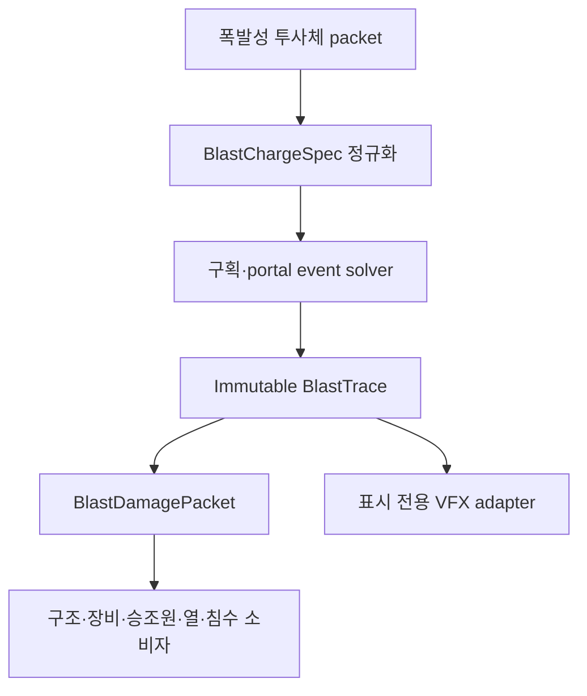

# WIP12E 범용 구획 폭발 구현·검증 계획

## 1. 현재 판정

- 기준 `main`: `97de0e1459e4f111e21b5bed163decc6ce782c32`
- WIP12D PR: `#29`, merged at `2026-09-19T16:44:41Z`
- 기준 HTML: `Aegis_SIM_v48_WIP12D.html`
- 기준 HTML SHA-256: `8ae85b69e28e71e54137ede0fd6110bbfa358fea7b04c2a88446bf3d44f7a90c`
- 작업 브랜치: `feat/v48-wip12e-compartment-blast`
- 구현 후보: `Aegis_SIM_v48_WIP12E.html`
- 권위 기본값: `COMPARTMENT_BLAST_AUTHORITY`
- 현재 상태: 코드와 정적/격리 VM 검증 완료, 실제 브라우저·전체 기존 회귀 및 GitHub HTML 업로드 잔여

WIP12E는 특정 미사일의 폭발 반경을 키우는 패치가 아니다. 모든 폭발성 투사체가 같은 물리 입력 계약으로 진입하고, 한 번 계산한 구획별 압력·충격량·폭풍·열·파편 trace를 구조, 장비, 승조원, 화재, 침수 및 시각화가 각각 소비하는 권위 전환이다.

## 2. 기존 경로 재추적

### 2.1 WIP12D까지의 ASM 경로

1. ASM 종말 충돌이 `computeAsmBlastEffects()`로 특정 탄두의 폭발량을 만든다.
2. `buildWip101ChainBlastSources()`가 진행방향을 따라 legacy head/peak/tail source를 만든다.
3. `computeWip101BlastDamageFromSources()`가 고정 scalar damage budget을 부품에 분배한다.
4. 이 결과가 모듈 HP, 침수/파괴구, 종강도, 승조원 및 VLS 소비자에 각기 전달된다.
5. WIP07 승조원 모델은 별도의 portal 전파 근사를 다시 계산한다.
6. WIP12D 잔존체 보충 경로는 폭발을 재생하지 않지만, primary blast 자체는 여전히 legacy scalar authority다.

문제는 구조 피해와 승조원 피해가 같은 폭발을 서로 다른 공간 모델로 해석하고, 문·격벽 파괴나 외부 vent가 하나의 에너지 원장으로 연결되지 않는다는 점이다.

### 2.2 공통 탄도 packet 경로

`wip12aApplyDamagePacket()`은 포탄·로켓·기타 투사체가 공유할 수 있는 진입점이지만, WIP12D까지는 구획 폭압의 단일 authoritative trace를 만들지 않았다. 따라서 carrier가 달라도 폭발 payload가 같으면 동일 결과가 나와야 한다는 범용성 계약을 직접 보장하지 못했다.

### 2.3 WIP12E 이후 경로

미사일, 로켓, 포탄이라는 이름은 solver 분기에 사용하지 않는다. 폭발물 질량, TNT 등가, 케이스 질량, 기폭 등급, 매질, 위치, 속도 및 관통 개구부만 물리 입력이다.

## 3. 구현된 데이터 계약

### 3.1 `BlastChargeSpec`

| 필드군 | 의미 |
|---|---|
| charge | explosive mass, TNT equivalent, case mass |
| detonation | detonation class와 modeled energy fraction |
| environment | `AIR`, `INTERNAL_AIR`, `NEAR_SURFACE` 등 매질 |
| provenance | 입력 출처와 공개 정확도 수준 |
| confidence | `SIM_TUNED` 등 모델 신뢰도 표시 |

동일한 `BlastChargeSpec`, topology, 기폭 위치 및 event ID에는 carrier 종류와 관계없이 같은 physics hash가 생성된다.

### 3.2 `BlastTrace`

- source cell과 도달 시간
- cell별 incident/reflected peak pressure
- positive impulse와 positive-phase duration
- dynamic pressure/blast wind
- quasi-static hot-gas/thermal state
- portal propagation 및 문·격벽 failure
- exterior surface load, 실제 breach 및 vent jet
- fragment/spall 기대량과 structural shock
- hard-cap 사용량과 종료 사유
- 입력/흡수/배출/잔류/절단 에너지 원장
- 결정적 physics/determinism hash

### 3.3 `BlastDamagePacket`

- `structureLoads`
- `equipmentLoads`
- `crewPressureExposure`
- `crewFragmentExposure`
- `thermalHotGas`
- `newBreaches`
- `ventJets`
- `secondaryIgnitionCandidates`

모든 채널은 같은 `impactEventId`와 `blastTraceHash`를 공유한다. consumer는 event ID 중복을 거부한다.

## 4. 구획·portal solver

### 4.1 topology adapter

- WIP12C의 138-space 상세 구획을 immutable cell로 변환한다.
- 명시적 portal을 우선 사용하고, 누락된 인접면은 결정적 inferred bulkhead로 보완한다.
- 외판 surface와 기존 관통·잔존체·침수 opening을 별도 보존한다.
- `CREW_EXPOSURE`는 점유 정보일 뿐 전파 저항으로 사용하지 않는다.

### 4.2 event propagation

- 사건은 quantized arrival time, event priority, cell ID, portal/surface ID로 안정 정렬한다.
- source cell의 incident front와 reflected load를 먼저 확정한다.
- 열린 portal은 면적, 방향 및 transmission으로 다음 cell에 남은 pulse를 전달한다.
- 닫힌 문·격벽은 peak, impulse 및 잔존 강도로 failure를 판정한다.
- failure 뒤에는 이미 소모된 front가 아니라 남은 positive-phase 에너지만 새 portal로 전달한다.
- 기존 exterior opening은 같은 사건에서 즉시 vent하며, 새 외판 rupture도 이후 잔여 pulse를 배출한다.

### 4.3 hard caps

| 자원 | 상한 |
|---|---:|
| 방문 cell | 96 |
| portal event | 384 |
| surface load | 512 |
| dynamic breach | 64 |
| time slice | 32 |
| vent jet | 32 |
| presentation keyframe | 256 |

상한에 닿으면 `TRUNCATED_BY_BUDGET`으로 종료하고 `clippedByBudget`, 사용량 및 discarded energy를 남긴다. 한 cell에서 fan-out하는 portal도 남은 전역 budget을 초과하지 않는다.

### 4.4 에너지 bookkeeping

화학 에너지는 air-blast, case/fragment, thermal 및 미모델링 몫으로 먼저 분할된다. air-blast 원장은 다음 항목을 합산한다.

- pressure work
- structural absorption
- vented energy
- retained thermal/gas energy
- unresolved residual
- truncation discard

각 단계에서 가용 에너지를 초과하는 전달은 clamp한다. WIP12D 잔존체에 이미 배정된 chemical coupling은 blast 원장에 다시 더하지 않는다.

## 5. 권위와 소비자 연결

### 5.1 mode

| mode | 동작 |
|---|---|
| `LEGACY_SCALAR_BLAST_COMPAT` | 기존 scalar 피해를 권위로 유지 |
| `COMPARTMENT_BLAST_SHADOW` | trace를 만들지만 상태는 legacy가 변경 |
| `COMPARTMENT_BLAST_AUTHORITY` | WIP12E packet만 primary blast 상태를 변경 |

기본값은 authority다. legacy와 신규 blast를 동시에 적용하는 경로는 차단했다.

### 5.2 적용 순서

1. 충돌/기폭 결과를 확정한다.
2. WIP12E trace와 packet을 순수 계산한다.
3. `damageFloodImpactV48Wip12E()`가 event ID를 수락한 경우에만 authoritative mutation을 시작한다.
4. 구조·모듈·구획·승조원·VLS 소비자가 동일 packet의 자기 채널만 읽는다.
5. WIP12B terminal event는 `WIP12E_BLAST_OBSERVED_ALREADY_APPLIED`로 기록해 재적용하지 않는다.
6. WIP12D residual supplement는 기존처럼 기계적 잔존체와 실제 구멍만 적용하고 blast를 재생하지 않는다.

VLS 소비자가 damage/flood idempotence 수락 전에 상태를 바꾸던 순서 문제도 함께 수정했다.

### 5.3 구조·침수

- 종강도 모델은 scalar 폭약량 대신 structural shock와 surface load를 받는다.
- 외판 surface failure만 `BLAST_SURFACE_RUPTURE` opening이 된다.
- 내부 door/bulkhead failure는 침수구가 아니다.
- 동일 event/surface/breach serial은 한 번만 opening으로 등록한다.
- opening의 종류, 위치, 면적, 법선 및 surface ID를 보존한다.

### 5.4 장비·VLS

- 민감 전자장비, 보호된 위험물 저장, 중기계 및 일반 장비가 서로 다른 응답 profile을 사용한다.
- pressure/impulse, fragment/spall, structural shock, hot gas를 분리해 적용한다.
- cook-off 후보는 event hash 기반 결정성을 사용하며 전투 RNG를 소비하지 않는다.

### 5.5 승조원

- WIP07의 별도 `propagateBlast()` 재계산을 authority mode에서 사용하지 않는다.
- cell pressure/impulse, dynamic pressure, fragment 및 hot gas를 독립 채널로 읽는다.
- 문·격벽 뒤 차폐는 이미 `BlastTrace`에 반영된다.
- 인원 배치는 결과의 노출 대상만 바꾸며 압력 전파 자체를 바꾸지 않는다.

### 5.6 화재

- 일반 pressure나 inert fragment만으로 자동 발화하지 않는다.
- hot-gas exposure와 실제 취약 장비/연료/전기/탄약 volume이 동시에 성립할 때만 ignition candidate가 된다.
- 기존 WIP12C의 희박하고 bounded한 발화 정책을 유지한다.

## 6. 시각효과

렌더러는 이미 계산된 presentation snapshot만 읽고 피해나 난수를 계산하지 않는다.

- 시각적 fireball은 TNT 등가의 세제곱근 scale과 presentation multiplier를 사용한다.
- 별도 shockwave sphere가 시간에 따라 fireball보다 멀리 확장된다.
- 실제 exterior opening normal을 따라 hot gas, smoke 및 debris vent jet이 나온다.
- 해수면 근처 기폭은 물기둥, spray 및 확장 ring을 만든다.
- 내부 보기에서는 cell shell과 portal failure를 instanced batch로 표시한다.
- 기본 외부 보기에서는 내부 pressure volume이 숨겨진다.
- render-frame geometry query는 0이며, VFX는 authoritative 결과에 피드백하지 않는다.

시각 효과를 크게 보이게 하는 multiplier는 물리 pressure 반경이나 피해를 바꾸지 않는다.

## 7. 범용 폭발성 무기 연결 규칙

새 폭발성 무기는 별도 blast solver를 추가하지 않는다. 기존 terminal packet에 아래 정보만 제공한다.

1. `explosiveMassKg`
2. `tntEquivalentKg` 또는 환산 계수
3. `caseMassKg`
4. `detonationClass`
5. 기폭 위치와 매질
6. projectile velocity/penetration opening

미사일, 로켓 및 포탄 fixture가 같은 charge 입력에서 같은 trace hash를 내는 계약 테스트가 포함되어 있다. 무기별 차이는 fuze, 관통, 탄두 구성 및 기폭 위치에서 생기며 label 분기에서 생기지 않는다.

## 8. 진단과 테스트

### 8.1 내장 API

- `wip12eCompartmentBlastContract()`
- `wip12eCompartmentBlastDiagnostics()`
- `wip12eBlastFixtureDiagnostics()`
- `wip12eBlastAuthorityProbe()`
- `wip12eBlastIdempotenceProbe()`
- `wip12eBlastBudgetProbe()`
- `wip12eBlastPerformanceProbe()`
- `wip12eKh32BlastShadowComparison()`
- `wip12eCompartmentBlast3DAudit()`

### 8.2 fixture

- open air
- sealed cell
- open portal
- closed door hold
- closed door failure with remaining-pulse propagation
- breach vent
- multi-cell alternate route
- DUD zero-state
- idempotence
- 1×/8×/16× exact invariant
- 30 mm HEI, 76 mm SAP, 127 mm HE/SAP, rocket HE, missile HE generic adapters
- cell/portal/breach hard-cap stress

### 8.3 현재 통과 결과

- static + isolated VM contract: `38/38 PASS`
- core diagnostics: `14/14 PASS`
- fixture diagnostics: `10/10 PASS`
- authority probe: `4/4 PASS`
- idempotence probe: `4/4 PASS`
- hard-budget probe: `5/5 PASS`
- dynamic breach cap: 정확히 `64`
- portal event cap: 정확히 `384`
- 두 cap 종료 사유: `TRUNCATED_BY_BUDGET`
- 64회 solver 평균: 약 `2 ms/impact` (실행별 소폭 변동)
- combat RNG: unchanged

수치는 현재 실행 환경의 격리 VM 결과이며 브라우저 프레임 성능 수치로 해석하지 않는다.

## 9. 실제 브라우저에서 반드시 남은 검증

현재 환경에는 Chromium/Chrome 실행 파일이 없고 허용된 네트워크에서 Playwright 브라우저 다운로드도 완료되지 않았다. 따라서 아래 항목은 통과했다고 선언하지 않는다.

1. 페이지 로드, core selftest failure `0`, console/page error `0`
2. seed `481232`, 100 km Kh-32 live impact
3. WIP12D flight/impact/잔존체/구멍/해수 진입 golden 보존
4. WIP12E authoritative trace와 crew/structure/flood consumer hash 일치
5. 같은 seed exact 및 DUD blast trace `0`
6. 외부 shockwave/fireball/해수면 효과/vent jet 표시
7. 내부 모드 cell/portal batch visibility와 3D audit
8. 전체 기존 Playwright 회귀

`tests/compartment-blast-wip12e.spec.js`에 위 browser acceptance를 준비했다.

## 10. 브랜치 반영·승격 순서

1. 이 문서, 상태 문서, 계약 테스트 및 Playwright 스펙을 branch에 커밋한다.
2. `Aegis_SIM_v48_WIP12E.html`을 GitHub UI/정상 git 전송으로 수동 업로드한다. 큰 HTML을 contents API나 base64 우회로 전송하지 않는다.
3. 업로드 뒤 원격 파일 SHA-256이 manifest와 일치하는지 다시 확인한다.
4. 그 다음 commit에서 `package.json`, workflow, README 및 프로젝트 지침을 WIP12E로 전환한다.
5. Actions와 실제 브라우저 전체 회귀를 실행한다.
6. 실패가 없을 때만 상태를 `완료`로 바꾸고 PR을 연다.

## 11. 비범위와 모델 한계

- full CFD/Navier–Stokes가 아니다.
- 수중 폭발, bubble pulse 및 hull whipping은 구현하지 않는다.
- 파편을 무제한 개별 rigid body로 만들지 않는다.
- 공개되지 않은 실제 탄두 내부 구성이나 함체 강도를 정확값으로 주장하지 않는다.
- pressure/failure 계수는 `SIM_TUNED`이며 향후 공개 자료 기반 fixture로 교정해야 한다.
- persistent damage patch와 새로운 다단 VLS cook-off 연쇄는 별도 단계다.
