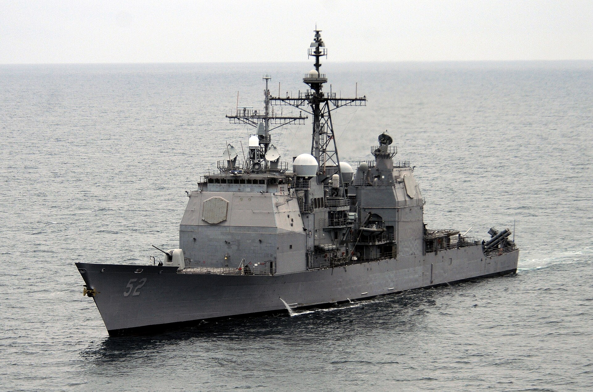
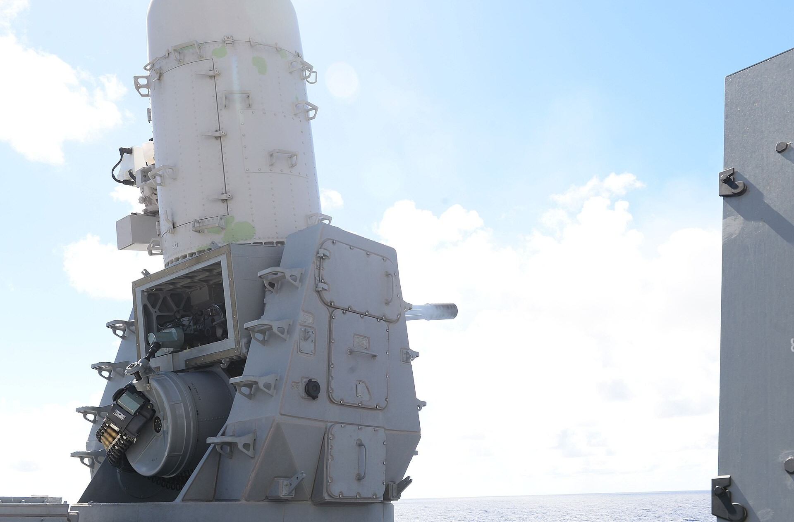
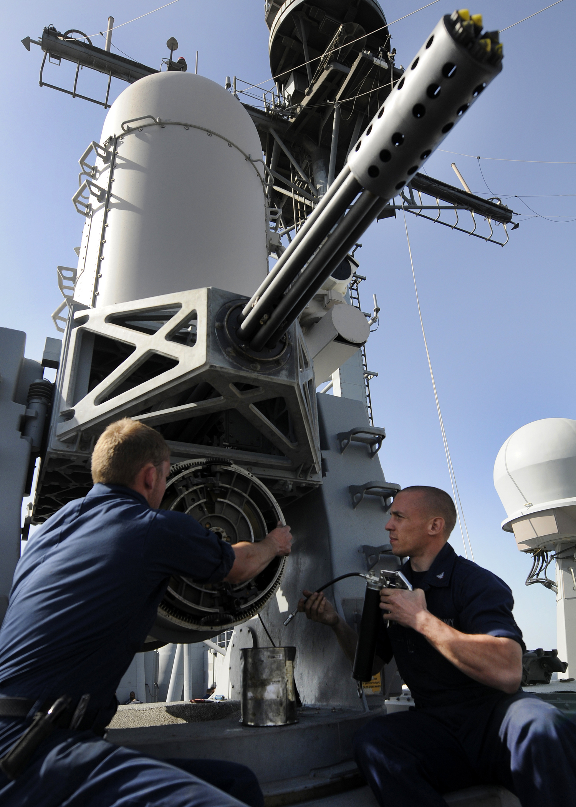

# CG-52 공개 자료 대조 — 좌표 보정 승인 근거 아님

공개 사진은 미 해군 촬영 원본의 Wikimedia Commons 배포본이다. 출처·캡션·날짜·라이선스·다운로드 SHA는 `public/photo-downloads.json`, `public/broadside-downloads.json`에 보존했다. 이번에 확인한 자료로 **실함 정면 사각 각도는 미확인**이다.

| 확인 항목 | 공개 근거 | 게임 등록값과 판단 |
|---|---|---|
| 전폭 | [USS Bunker Hill, 일반 제원](https://en.wikipedia.org/wiki/USS_Bunker_Hill_(CG-52)): 55ft / 16.8m | 프로파일 16.76m는 반올림 차이 범위에서 부합. 이것만으로 상부구조물의 국부 폭이 맞다는 뜻은 아니다. |
| 개장 후 외관·설치 부근 | [미 해군 110917-N-BC134-315](https://commons.wikimedia.org/wiki/File:US_Navy_110917-N-BC134-315_The_guided-missile_cruiser_USS_Bunker_Hill_(CG_52)_transits_the_Pacific_Ocean._Bunker_Hill_is_conducting_a_three-week_co.jpg), 2011-09-17 | 함교 뒤, 높은 중앙부 구조물 측면의 팰렁스 배치는 모델의 중앙부/양현 배치와 정성적으로 맞는다. 원근 사진이므로 x=3.14m, y=±6.06m, z=18.3721m의 정확성을 인증하지 않는다. |
| 팰렁스와 인접 구조물 | [미 해군 140905-N-GW918-004](https://commons.wikimedia.org/wiki/File:Sailors_fire_Phalanx_close-in_weapons_system_140905-N-GW918-004.jpg), 2014-09-05; [120206-N-BC134-044 정비 사진](https://commons.wikimedia.org/wiki/File:US_Navy_120206-N-BC134-044_Sailors_aboard_the_guided-missile_cruiser_USS_Bunker_Hill_(CG_52)_perform_maintenance_on_a_close-in_weapons_system.jpg), 2012-02-06 | 가까운 구조물·마스트가 존재함은 보인다. 함 전체 좌표 원점, 실제 사계 한계, 구조물 국부 폭을 역산할 수 있는 정사영/축척은 없다. |
| 퇴역 시기 모습 | [미 해군 CG-52 퇴역식 사진](https://commons.wikimedia.org/wiki/File:Crew_of_the_USS_Bunker_Hill_(CG_52)_stand_at_attention_during_the_ship%E2%80%99s_decommissioning_ceremony.jpg), 2023 | 선수 정면 사진은 인원·구조물에 가려 설치점 비교에 불충분. 최종 배치 좌표의 근거로 쓰지 않았다. |
| 실함 정면 사각 | 위 공개 사진 및 접근 가능한 자료 | **미확인**. 모델에서 얻은 ±1.1°를 실함 수치로 표기하지 않는다. |
| 상부구조물 국부 폭 | 접근 가능한 사진 | **미확인**. 모델 `DECKHOUSE:0`의 전체 bounding box 폭 16.830m는 여러 높이·앞뒤 구조를 합친 외접 폭이다. CIWS 높이에서 함교 폭이라는 뜻이 아니다. |

게임 좌표는 +X 선수, +Y 우현, +Z 상방인 함 로컬 미터다. 두 마운트 사이 간격 12.12m는 모델 측정값이며 공개 제원이 아니다. 원본 등록의 출처는 `CG52_VIEWER5_SI_V1 / OFFLINE_SI_REGISTRATION`이다. 실제 메시를 실행 중 물리에 되먹이지 않는다. 원시 값: [`evidence/geometry-metadata.json`](evidence/geometry-metadata.json), [`analysis/arc-summary.json`](analysis/arc-summary.json).

공개 탄두 질량 약 145kg은 [Kh-35 일반 제원](https://en.wikipedia.org/wiki/Kh-35)의 탄두 조립체 질량이다. 이번 게임의 실제 폭발 커널 입력 `90kg TNT equivalent + 45kg casing`은 별도의 `SIM_TUNED` 게임 값이다. 145kg 전체를 폭약량으로 취급하거나, 단발 피해를 보고 폭약량을 변경하지 않았다. 원본 페이지 해시: `public/kh35-source.json`; 실제 입력: `analysis/damage-cases.json`의 `charge`와 `ledger`.

NavSource와 Navy fact-file 직접 접근은 각각 502/403으로 실패했고, DVIDS 검색 응답도 빈 내용이었다. 이 자료를 확인했다고 주장하지 않는다. 접근 기록은 `public/fetch.json`에 보존했다. 치수가 있는 최종 개장형 배치도가 확보되기 전에는 마운트 좌표 이동이나 구조물 폭 축소를 제안 수치로 확정할 수 없다.
