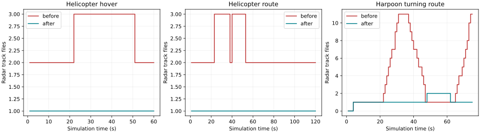
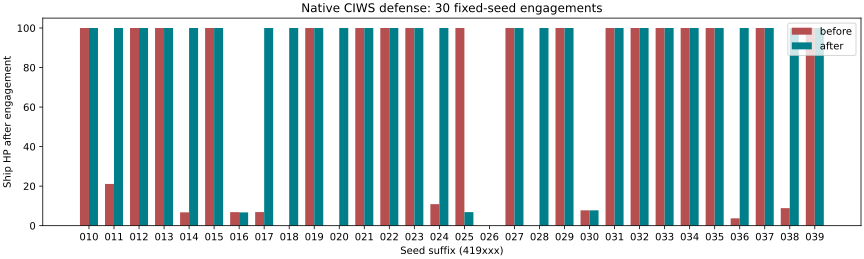

# FRIENDLY_CONTACT_A 수정 후보 보고서

**검토 필요: 시드 419025에서 기존 요격 → 피격 1건이 남는다. 이 결과를 승인하거나 기대값을 갱신하지 않았다. main 및 cg-turret-a에는 병합하지 않는다.**

## 기준과 산출물

사용자 지정 미병합 cg-turret-a `6d306849f290f987cd39c31c901adb4478b07edd`의 CG_TURRET_A HTML을 기준으로 했다. ciws-dmg-a의 진단·원시 자료는 그대로 보존했다. 작업 브랜치: `friendly-contact-a`.

- 원본 SHA-256: `af105075c65bf9c8774c8b1d347273476e53a3a5869c12387b2cd8d46824d933`
- 수정 HTML: `Aegis_SIM_v48_WIP_FRIENDLY_CONTACT_A.html`
- 수정 SHA-256: `cfc74427e3d30efafec187c3fd99924f5063e74d8dbe3f8e36caebd68d149cda`
- 원본 HTML 수정 없음. 게임용 SIM_TUNED 모델이다.

사용자가 확인한 표시는 **번호가 붙은 레이더 트랙**이다. ESM 방위선/신호원 생성 경로는 변경하지 않았다.

## 1. 수정 내용

### CIWS 아군탄 보호 오염

기존 c55SensorSweep는 기존 파일과 새 측정의 거리만 비교해 연관했다. 적 ASM을 추적하던 파일에 자함 RAM 측정이 들어가면 `ownFireEvidence`가 OR로 남았다. 이후 적 ASM 측정이 다시 들어와도 FRIEND 보호가 남아 Phalanx/추가 RAM 사격이 막혔다.

자함이 발사 사실을 아는 유도탄의 센서 측정과 비자함탄 측정을 같은 로컬 파일에 넣지 않게 했다. 기존 `src.own` 입력을 센서 경계에서만 사용한다. 자함/NPC의 두 C55 문맥에 같은 한 줄 조건을 적용했다. 조종기가 적 truth를 보고 보호를 해제하거나, 아군탄 보호를 삭제하는 방식이 아니다. RAM을 쐈으니 Phalanx가 무조건 기다리게 하는 규칙도 추가하지 않았다.

### Harpoon/헬기 공중 트랙 반복 생성

공통 EKF에 들어오는 2D 수상 관측에는 고도가 없다. 기존 코드는 이 관측의 수면 기준 8m를 고도 제약으로 적용하고, 과거 수상 기여 하나가 남아도 계속 수상 파일로 취급했다. 저방사속도·빔 직각 부근에서 이 경로가 선택되면 빠른 Harpoon의 기존 AIR 파일을 배제해 새 파일을 반복 생성했다. 헬기는 수상/공중 경로가 같은 반사체를 나눠 가지며 고도 제약과 재생성이 반복됐다.

실제로 수용된 3D AIR 관측의 fixed-step 시각을 보존한다. 기존 TRACK_HARD_TTL 동안 그 증거가 유효하면 2D 기여가 관측 고도·수직속도·수직 공분산을 수면 사전값으로 강제 축소하지 않게 한다. 2D만으로 시작한 파일도 실제 3D 관측과 기존 NIS 관문으로 연관할 수 있게 했다. 방위·거리·도플러·고도 관측과 기존 공분산을 사용하며, 서로 분리 관측된 표적은 기존 일대일 연관을 유지한다.

자함과 NPC observer 경로에 같은 차원 계약을 적용했다. 미관측 위치 보충, truth ID/owner를 이용한 파일 병합, 항법/KF 이득 조정, 숫자 오프셋 보정, 단순 심볼 숨김을 추가하지 않았다. 센서·발사 권한·IFF·Harpoon 무데이터링크 규칙은 기존 것을 사용한다. 새 메타데이터는 일시적 트랙에만 있으며 작전 저장 스키마를 바꾸지 않는다.

## 2. 실제 fixed-tick 재현 결과

CG-52, seed 419010, 다른 함/항공기 자동 생성 없음. 헬기는 검증된 세이브로 초기 공중 상태를 만들고 이후 실제 운동·레이더·IFF를 사용했다. Harpoon은 native 경로 입력·발사·비행 경로다. 트랙을 강제로 생성하지 않았다.

| 조건 | 신규 파일 생성 | 최대 동시 파일 | 마지막 파일 |
|---|---:|---:|---:|
|HELO_HOVER_60S|3 → 1|3 → 1|2 → 1|
|HELO_ROUTE_120S|4 → 1|3 → 1|2 → 1|
|HARPOON_ROUTE_75S|22 → 2|11 → 2|11 → 1|

진행 중 말한 Harpoon 24회는 거부된 업데이트까지 포함한 요청 기록 수였다. 최종 표는 **생성에 성공한 파일 22개**만 센다.

Harpoon에 남은 두 번째 파일은 47.7667s의 실제 재획득이다. 기존 파일의 관측 공백 약 2.45s, 4D NIS 101.1로 기존 일반/재획득 관문을 넘는다. 이전 파일은 기존 코스팅 수명 후 사라져 마지막에는 1개다. 위치 NIS만 작다는 이유로 도플러 조건을 버리거나, 관문을 넓혀 같은 번호를 강요하지 않았다. 실제 관측 단절 후 재획득까지 항상 한 번호로 유지한다는 보장은 하지 않는다.

## 3. CIWS 30회와 신규 결과 차이

원래 D1 조건 유지: DDG-119, bearing 90°, Kh-35U 1발/11km, seed 419010~419039, MANUAL, 함포 AutoAA OFF, 실제 1/60s fixed tick. 진입 표적 소실 시 종료한다. 장기 침몰 예측 시험으로 해석하지 않는다.

| 항목 | 기준 | 수정 후보 |
|---|---:|---:|
| 피격 사례 | 12/30 | 8/30 |
| HP 0 | 4 | 1 |
| 20mm 탄 소모 총합 | 183 | 1208 |
| RAM 소모 총합 | 75 | 99 |

피격 회피로 바뀐 시드: [419011, 419017, 419018, 419028, 419036]. 기존 무피격에서 피격으로 바뀐 시드: **[419025]**. 전체 30건의 HP·탄 소모는 `analysis/ciws30.csv`에 있다.

419025에서 RAM 1~4의 발사/종료 시점은 기준과 같다. 수정 후에는 막혀 있던 Phalanx가 32.3667s부터 사격하고, 34.55s에 BODY 명중 DAMAGED를 기록한다(표적 seeker 손상 57.8, warhead NORMAL). 기준 RAM 5는 36.9333s에 KILL, 후보 RAM 5는 37.05s SEA_IMPACT 후 38.1333s 함 피격이다.

같은 시드를 성분별로 분리 시험한 결과 **CIWS 수정만 적용해도 피격**, 레이더 차원 계약만 적용하면 기존처럼 무피격이다. 보호 오염 해소로 실제 사격·피해·전역 RNG 소비와 후속 교전이 달라진 다무장 상호작용이다. seeker 손상과 RNG 분기 중 어느 하나만 단독 원인이라고 단정하지 않는다. 이를 보상하려고 Pd/Pk·탄도·사격 우선순위·피해 RNG를 조정하지 않았다. 이 사례는 검토 대상으로 남긴다.

기존 HP 0 네 시드(419018/20/26/28)를 추가 계측했다. 396개 보호 연관 기록에서 비자함탄 측정이 자함탄 보호 파일로 들어간 횟수 **0**. 자함탄 보호 파일은 유지된다. 4건 모두 일반 D1과 추가 계측의 전체 결과/RNG 서명이 동일했다. 남는 419026 HP 0은 이번 변경으로 해결한 것으로 주장하지 않는다.

## 4. 계약·격리 검증

- 9개 관측 계약 검사: 9/9. 실제 3D 파일에 수면 제약 적용하지 않음, 빠른 접선 방향 이동의 2D 기여 수용, 2D→3D 동일 ID 수용, NIS 밖 관측 거부, 분리된 두 물체 일대일 연관을 확인했다.
- DDG 이동 헬기 90s도 1개 파일 유지. IFF OFF는 UNKNOWN, IFF ON은 실제 응답으로 FRIEND. 새 강제 아군 예외 없음.
- AUTO+IFF ON 이동 90s: 단일 파일, FRIEND 유지, VLS/ESSM/CIWS 탄약 소모 0.
- Harpoon 발사 10s 뒤 EMCON, 60s까지 비행: ship picture는 NOT_OBSERVED/position=null, dataLink=false, telemetryAvailable=false. 실제 비행은 계속된다. 미관측 실제 위치를 표시하지 않는다.
- Harpoon 계측 ON/OFF에서 최종 트랙·시간·RNG·매초 관측/물리 기록 동일.
- AST 비교: 허용한 10개 기존 함수와 추가 2개 도우미 외 변경 0. 보호 대상으로 지정한 142개 RF/프로파일/KF/유도·신관·Pk/표 데이터 심볼 byte 동일. `build.py`의 역치환으로 목록 밖 전체 JS byte 동일도 확인했다.
- 실제 비동기 ENV_D status: match=true, rows=120, changedNativeFunctions=[], recalculationRequired=false. ENV 전체 재측정은 하지 않았다.

## 5. 기존 회귀 실행 결과

아래는 원시 종료 코드다. 실행 실패/과거 UI 계약 문제를 합격으로 바꾸지 않는다. 초기 잘못된 테스트 준비와 재시도 기록은 DEVELOPMENT.md에 있다.

| 시험 | exit | 벽시계 s |
|---|---:|---:|
|isar-native|0|99.8|
|emcon-native|0|67.9|
|emcon-ui|1|52.1|
|harpoon-f1|1|77.0|
|helicopter-flight|1|296.9|
|sov-native|0|58.3|
|harpoon-clock|0|117.3|
|sov-casualty|0|76.1|
|sov-visual|0|82.8|
|sov-deployment|0|128.6|
|webgl8|0|370.6|
|ui213|-15|562.4|
|paired-current|1|226.6|

APS-153, ISAR 함급/시계/UI의 먼저 완료된 원시 결과는 `evidence/domain/`에 있다. EMCON native는 통과했지만 과거 EMCON UI는 MAP_E에서 제거된 #lockBtn의 bounding box를 요구한다. 이 테스트는 현재 UI의 합격 증거로 사용하지 않는다. Helicopter-flight/Harpoon F1 첫 재실행의 Target crashed 로그도 보존한다. 기대값·허용 오차 갱신 0이며, **기존 전체 420건이 모두 통과했다고 주장하지 않는다.** 현재 UI/실제 WebGL 및 paired 결과는 원시 자료와 추가 검수 기록을 함께 확인한다.

## 6. 변경 범위와 남은 점

`changes.diff`, BUILD.json, SCOPE.json에 실제 변경과 해시가 있다. CG의 포탑 형상·원점, 무장 성능, 함정 피해/침수/파랑, ESM, 레이더 RF 계수, KF 행렬/이득, PN/Kappa, 신관/파편/Pk, 세이브 스키마와 회귀 기대값은 수정하지 않았다. HTML의 압축 JS와 포장 체크섬을 함께 다시 만들었다.

두 반복 생성 원인과 C55 보호 오염을 수정한 검토용 빌드다. 실제 관측 공백의 재획득, 419025 결과 악화, 남은 기존 HP 문제, 완료하지 못한 과거 UI 검수는 구분해 남긴다. 기준 브랜치/main 병합·release/tag 생성 없음. 다운로드는 HTML 전용 ZIP과 검증 자료 ZIP을 별도로 제공한다.

## 추가 검수 요약

기존 도메인 420건의 최종 집계: **404 통과 / 2 관측 상태 정확 비교 차이 / 14 구형 EMCON UI 요구로 미완료**. native 13개 suite는 364/364이고 paired 42개 중 40개가 동일하다. 현재 UI 213건과 실제 WebGL 29개 검사는 별도 집계다.

무표적 120초 native truth SHA는 양쪽 모두 `bc09d108079c46897aab41878397c3e5888443d3db3becbf2f006abd7ae4110f`로 동일하다. 기존/후보 모두 live #lockBtn 및 quick LOCK DOM은 없고 retired-node는 있다. 과거 EMCON UI의 bounding-box 요구가 이번 변경으로 사라진 것이 아님을 확인했다.

CG_TURRET_A와 현재 paired 비교는 6조건 × 7개 단언 중 observer 정확 상태 2개만 다르다. idle/damaged는 양 함정 모두 동일. raid에서도 physical state, 전역 RNG, HP, 잔여 VLS, 전체 표적 상태와 사건은 같다. DDG/CG의 관측 수·분류·공분산·스케줄러 차이는 원시 JSON 및 `analysis/paired-observer-delta.json`에 보존했다. 기대값은 갱신하지 않았다.

UI 213 재실행: {"exit": 0, "elapsedS": 533.9609464050154, "assertionChanges": 0, "backend": "existing docs/pip/B/browser_backend.py CPU Canvas2D + actual WebGL"}

브라우저 crash 사례 순차 재실행: {"rows": [{"suite": "harpoon-f1", "exit": 0, "elapsedS": 95.29333378601586}, {"suite": "helicopter-flight", "exit": 0, "elapsedS": 388.9889208159875}], "elapsedS": 484.2825180980144}

자연 탐지 → LOCK → 정식 VLS → 전체 fixed tick → 실제 WebGL 8발의 기존 29개 단언은 통과했다. 이는 8발 모두 격추했다는 뜻이 아니라, 기존 관문·비행·ON/OFF 대조 단언의 결과다. 개별 요격/비명중은 원시 webgl8 결과를 참고한다.
