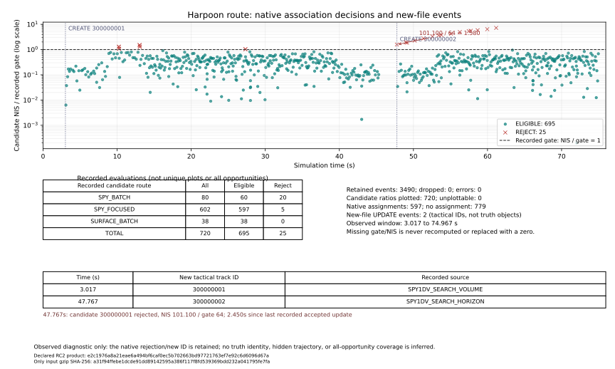

# Baseline Audit + TRACK-A 보고서

보고서 생성: 2026-11-01T21:03:13+09:00 (Asia/Seoul).
**TRACK-A 동작 보존 검수: PASS. 전체 releaseApproved=false.**
**419025의 이전 성공→피격은 상속된 FAIL이며, CG→friendly paired observer 2건은 미승인 KNOWN_DELTA다. TRACK-A 동등성 PASS는 이 문제의 해결·기대값 승인·최종 CLOSED를 뜻하지 않는다.**

## 1. 기준, 독립 산출물, 단계 분리

|항목|고정 값|
|---|---|
|기준|friendly-contact-a@4ba64ba0cace9124497a710d00df1b174984ffdc|
|작업 브랜치|track-a-contract-trace|
|기준 HTML/SHA|Aegis_SIM_v48_WIP_FRIENDLY_CONTACT_A.html / cfc74427e3d30efafec187c3fd99924f5063e74d8dbe3f8e36caebd68d149cda|
|최종 RC2 HTML|Aegis_SIM_v48_WIP_TRACK_A.html|
|최종 RC2 SHA-256|e2c1976a8a21eae6a494bf6caf0ec5b702663bd97721763ef7e92c6d6096d67a|
|내장 호환 모듈 SHA-256|b5fc75792e4bc7f05b7dc8f7e67f0195af3240b2f4a9aeb04b0b8bf85daf1810|
|Baseline Audit 커밋|7e7ba089a689a0c876e5c99881d4631127a2a491|
|RC1 구현 커밋|34c29992b2160428bf823136a6b765a546a1e34e|
|RC2 metadata 보정 소스 커밋|bae3cb3da79ba8de74220c9b53e99d7b884becea|

이번 구현은 Baseline Audit와 TRACK-A뿐이다. [TRACK_AUDIT.md](TRACK_AUDIT.md)는 실제 packed index13·원 module·소유자·차원·쓰기/읽기·틱 순서·소비자·legacy 정보 경계 debt를 대조했다. [TRACK_CONTRACT.md](TRACK_CONTRACT.md)는 호환 view와 진단 계약, [FUTURE_STAGES.md](FUTURE_STAGES.md)는 **TRACK-B/C/D DESIGN_ONLY**다. 새 연관 알고리즘·수명 정책·식별 승계·네트워크 융합·OODA/새 전술 AI는 구현하지 않았다.

제품은 기존 packed asset을 유지하고 index13 JS·포장 metadata/체크섬을 build.py로 재생성한 독립 HTML이다. 생성 HTML만 손으로 편집하지 않았다. HTML 전용 ZIP과 검증·보고서 ZIP은 별도로 제공하며 root의 게시/readback 자료에서 원격 URL·체크섬을 확인한다. PR 생성·main/기준 브랜치 병합·release/tag는 하지 않는다.

## 2. 실제 변경과 보존 범위

기존 payload와 모든 owner TrackStore를 유지한 채, 제공된 관측만 정규화하는 detached diagnostic view와 기본 OFF의 bounded trace를 붙였다. trace는 기존 실행에서 **이미 계산한** NIS·거리·gate·채택/거부·이전/다음 상태를 복사한다. trace를 위해 native selector/EKF/producer를 다시 호출하지 않는다.

- 관측 view: sourceSensor, receiver인 observerShip, measuredAtS/receivedAtS, measuredFields, 관측 모델·차원, 실제 제공 noise/P, quality/domain evidence, 기존 보고 source/sequence와 independence 미상을 구분한다.
- 추적: 자함 SPY/SPQ/surface·NPC observer·C55 두 문맥·Hawklink/Link16의 기존 candidate/update 지점. C55는 거리(m) gate이며 가짜 NIS를 만들지 않는다.
- 관측 성분과 연관에 적용된 성분을 분리한다. 예를 들어 surface plot은 거리·방위·실제 방사속도의3성분일 수 있지만 position-only assignment는2성분이며 고도는 미관측이다.
- ESM/IFF/APS/ISAR는 입력·생성 단계의 설명이 일부 연결됐다. 해당 센서의 모든 연관/수명/식별 판정이 trace된 것은 아니다.
- 기본 trace OFF, 기본 ring1024, configure16~4096. overflow는 오래된 진단만 덮어쓰며 dropped를 기록한다. configure/clear는 진단 상태만, snapshot은 deep copy만 반환한다.

SCOPE는 기존 상위 심볼 16개에서 허용한 trace 훅 차이와 신규 진단 심볼 14개만 확인한다. **보호 심볼189 byte 동일**, forbiddenChanged=0, 역치환 후 목록 밖 전체 JS byte 동일이 기준이다. `SCOPE.json`, `BUILD.json`, `hook-locations.json`, `changes.diff`가 범위 증거다.

변경한 기존 상위 심볼:

`electronicAcceptPlotsF`, `ingestOffboardIsarF2`, `apsContactStepF`, `heloMeasureIffRepliesE`, `observerAcceptPlotsC`, `acceptOffboardC`, `networkAcceptReportG`, `networkReconcileG`, `createWeaponContextD`, `spyBestPlotForTrackV31`, `spyGlobalAssignmentsV36`, `surfaceAssignmentsPreferEstablishedWip13B14`, `updateSensorTrackMeasurement`, `spq9bBestTrackForPlotV34`, `spq9bAcceptAnonymousPlotsV34`, `c55SensorSweep`.

RF Pd/Pfa/SNR/RCS/클러터·센서 hardware profile, EKF 행렬/이득/관측 kernel, 함체/파랑/피해, PN/Kappa/추진·공력/신관/파편/Pk, 무장 재고/발사대·사각, 기존 IFF/ROE·수동 동의·FCS gate, Harpoon DL=0, 세이브 스키마·기대값·허용 오차는 바꾸지 않았다. 분류·identity·threatStatus·authority를 새로 합치거나 승격시키지 않는다.

## 3. 측정 차원·원점·가정·수명의 계약

|경로|실제/보고 성분|분리한 가정·파생량|
|---|---|---|
|AIR radar|r/az/el/rdot 4D|x/y/z는 polar 변환값; 추가3관측 아님|
|surface / BridgeMaster|r/az + 제공된 실제rdot:2/3D; BridgeMaster2D|8m·el/losUz·초기 속도는 prior/placeholder|
|C55 local RF|r/az/el3D|rx/ry/rz는 변환; 속도·CPA·TTI는 filter-derived|
|optical|Cartesian position3D update|radialMps=0은 Doppler 관측 아님|
|APS-153|measured range/az2D|XY는 nav+기하 변환, z는 해면 prior|
|ESM|bearing1D+sigma/방사체 증거|거리·좌표 생성0|
|IFF|제공된 noisy 기하+인증 bit|bit는 기하 차원이나 새 발사권한 아님|
|ISAR|길이/높이분포/마스트 등 특징|위치/P는 evidence gate; 새 위치hit 아님|
|Hawklink PLOT|reported Cartesian3D/P/time|upstream 물리 차원은 수신 schema만으로 미상|
|Link16 TRACK/SELF|sender filter estimate6D 또는 자기 nav 보고|독립6D 원시 관측 아님; SELF z8/vz0 가정|
|NETWORK_RECONCILE|CI 융합 추정치와 stateAtS|새 관측/수신 아님: measuredAtS와receivedAtS는null|

receiver origin/velocity는 실제 payload의 자기 장비 상태만 SI로 보존한다. 누락 원점·잡음·공분산·성분을 own truth나 고정22m/0으로 채우지 않는다. 실제 측정0과 미상null을 구분한다. geometry/filter estimate/report vector 길이가 실제 센서 독립 차원과 같다는 가정을 하지 않는다.

기존 friendly의 `_radar3dAirStepFC`는 수용된 local AIR update의 시각이며 유효기간은 기존 TRACK_HARD_TTL **16초**다. 2D hit는 이를 freshen하지 않는다. 만료 뒤 prior가 다시 적용될 수 있는 기존 정책과 기존 classification/lifecycle/drop·재획득을 그대로 두었다. A metadata가 TTL·P·가정 적용 조건을 개선한 것처럼 바꾸지 않는다.

## 4. RC1 발견 사항과 RC2 재검증 경계

RC1 `34c2999`/HTML `2fbe5392ac5f69fb2c2b4a42efd76eb7a3fc1ec0b4d8253748c1fb0be4caded5`에서는 native364와 friendly 대비 paired42가 통과했지만, 후속 metadata 검토에서 NETWORK_RECONCILE의 합성 추정 epoch `now`가 실제 measuredAt/receivedAt처럼 설명되는 문제가 발견됐다. **행동이 같다는 검사만으로 관측 설명의 정확성까지 증명되지 않는다.**

RC2 `bae3cb3`는 reconcile의 CANDIDATE/ASSIGNMENT 두 event에 measuredAtS:null, receivedAtS:null을 명시하고 reported.stateAtS=now로 바꿨다. native 연관·융합·발사 결과를 수정한 것이 아니라 diagnostic metadata의 의미를 바로잡았다. 최종 node52와 실제 native ingress47에는 두 event의 unknown 측정·수신 시각 및 추정 epoch가 포함된다.

RC1 자료는 `evidence/rc1-candidate/`, `evidence/regression/RC1/`의 historical/not-final로 보존했다. RC1의406 PASS, performance, allocation 또는 출처를 최종 RC2 fresh 검증으로 합산하지 않는다. 최종 SHA e2c1976a…67a에서 runtime와 광역 회귀를 다시 실행하며, 이 보고서의 완료 판단도 최종 SHA와 authoritative VALIDATION이 모두 맞을 때만 바뀐다.

## 5. 검수 집계 — 비교 기준과 증거 등급을 분리

|검사|상태|수치|범위|
|---|---|---|---|
|정적 보호 범위|PASS|189/189 동일; 범위 외0|SCOPE.json|
|순수 adapter unit|PASS|52/52|fixture-only; 기존420에 더하지 않음|
|최종 runtime 종합|PASS|allTasksComplete=true 확인|실제 제품 함수; 최종 SHA/allTasksComplete 확인|
|native13|PASS|364/364|기존 단언 그대로|
|friendly→TRACK-A paired|PASS|42/42|새 metadata의 동작 보존 비교|
|현재 UI|PASS|213/213|기존 UI와 별도 집계|
|자연 탐지→정식VLS→실제WebGL|PASS|29/29,8발|8발 전부 격추했다는 뜻 아님|
|구형 EMCON UI|INCOMPLETE|14|제거된#lockBtn 요구. RC1 시도 보존; RC2 PASS 아님|
|CG→friendly observer 비교|KNOWN_DELTA|2|기대값 미승인·미갱신|
|기존419025 성공→피격|FAIL(상속)|1시드|A가 수정/승인한 결과 아님|

기존 기준의420은 **404 PASS + 2 observer KNOWN_DELTA(미승인) + 14 INCOMPLETE**다. 최종 friendly→TRACK-A의 native364와 paired42가 모두 동일하면 새 비교는 **406 PASS + 14 INCOMPLETE =420**이다. 이는 기존 CG→friendly 차이2건을 새 승인 기대값으로 바꾼 것이 아니다. unit52, ingress47, UI213, WebGL29, 재현/성능 반복을 이420에 중복 추가하지 않는다.

세 자연 재현의 baseline은 hover60s, route120s 각각 신규/최대/최종1/1/1, Harpoon75s는2/2/1이다. Harpoon의 추가1회는 실제 공백 후 재획득이며 강제 동일번호·truth 위치 보충·심볼 숨김으로 없애지 않는다. 최종 후보가 이 결과·트랙 평균/P·분류·identity/권한·age/hit·global/private RNG·물리 상태와 같은지는 runtime summary의 actual-product OFF/ON 비교를 본다.

native ingress47은 실제 게임의 익명 관측/수신 함수를 직접 호출하는 **component fixture**다. baseline OFF / 후보 OFF / 후보 ON의 세 실행을 비교하지만, 이를47×3개의 독립 자연 RF 시험 또는 실제 격추로 부풀리지 않는다. Hawklink의 지연/replay/미래·invalid covariance/truth field 차단, ESM 거리 생성0, ISAR 새 hit/권한0, 네트워크 separate store/반복 fix·CI/display 연결 등을 명시된 fixture 범위에서 확인한다. 실제 수신 인증·transport의 모든 실패 분기를 검증했다고 주장하지 않는다.

후속 근접 다표적 교차·ID swap·false alarm 통계·반사체 도플러 분리·IFF expiry/계보·모든 network 순환 상관은 TRACK-B~D의 독립 검증 대상이다. A의 작은 one-to-one fixture를 전체 신뢰성 개선의 완료로 해석하지 않는다.

### 최종 runtime 증거 인덱스

|항목|기록 상태|증거|
|---|---|---|
|ciws30|PASS|d1-equivalence.json|
|naturalRepro3|PASS|reproduction-off.json|
|traceQueryAndPrivacy|PASS|trace-on.json|
|fixedClock|PASS|harpoon-clock/ui-clock.json|
|autoIff|PASS|auto-iff-equivalence.json|
|idle120|PASS|idle-equivalence.json|
|nativeSensorNetworkIngress|PASS|native-ingress.json|
|ownerIndependenceAndAllocation|PASS|allocation-and-owners.json|
|performance|PASS|performance.json|

### Harpoon 연관 진단 타임라인

최종 trace3490개(dropped0)에서 후보720개와 CREATE2회를 직접 표시했다. eligible695·reject25이며, 두 번째 CREATE는47.767초다. 이전 파일의 같은 payload 후보는 NIS101.099764/gate64로 거부됐다. 그림은 기록된 기회만 보여주며 모든 RF 시도나 모든 거부 분기를 망라하지 않는다. CSV와 plot_trace.py로 재현할 수 있고, truth나 native 판정을 재계산하지 않는다.

## 6. 419025 — 원인 계측과 미해결 결과

원래 D1 조건을 유지했다: DDG-119, bearing90°, Kh-35U1발/11km, seeds419010~419039, MANUAL, 함포 AutoAA OFF, native1/60s. fresh baseline30은 과거 friendly의 전체 전투/물리/전역·private RNG 서명과30/30 동일했고 피격8·HP0 1·20mm1208·RAM99다. 이를 이전CG 원본의 피격12→8 개선으로 덮어 전체승인하지 않는다.

|419025 자료|피격/HP|20mm/RAM|결과|
|---|---|---|---|
|CG 원본|0/100|0/5|RAM5 KILL36.9333s|
|friendly 기준|1/6.846598842629405|68/5|RAM5 SEA_IMPACT37.05s, 함피격38.1333s|
|TRACK-A 요구 결과|friendly와 동일해야 함|계수·발사 타이밍 보정0|동등성 통과해도 상속FAIL 미해결|

추가 사후 계측은 ordinary run의 전체 상태/RNG 서명과 동일했다. 34.55s Phalanx BODY DAMAGED에서 전역 RNG가 **4262938539→3399989146→3066683312**, 정확히2회 소비됐다. source-key/file 전이, 해당 사건 전후 RNG·실제 behavior flag와 이후 RAM RF/IR 기록을 별도 AFTER_ACTION_TRUTH_TEST_ONLY 자료에 두었다. 이 자료는 정규화 view·분류·AI·발사 입력으로 들어가지 않는다.

seeker 손상57.8은 hard-failure 임계100보다 작고, 구조손상23.159299938972417은 지연 구조붕괴 검사 문턱30보다 작다. 실제 기록의 seekerFailed=false, guidanceNORMAL, engineStopped=false, fins1/availableG12이므로 hard seeker failure 또는 구조붕괴 난수 루프를 원인으로 단정하지 않는다. 이전에는 없던 추가 사격·명중이 global stream과 후속 측정에 영향을 준 코드 경로를 확인한 것이다.

최초 같은 시각 RAM RNG 차이는34.55s, 뚜렷한 후속 IR 각도 차이는34.5667s, RF/IR 측정 유무 차이는35.65s다. 그 이전에도 약1e-12world의 위치와1e-13rad 수준의 각도 반올림 차이가 있어 “명중 전 모든 geometry가 bit-identical”이라고 쓰지 않는다. 최종 RNG 값은 종료 틱이 다르므로 그 자체를 인과 증명으로 사용하지 않는다. 이 증거만으로 단일 후속 원인을 완전히 분리했다고도 주장하지 않는다.

원시/요약: `evidence/baseline/trace419025{,-cg}.json`, `trace419025-phalanx-rng-summary.json`, `trace419025-same-epoch-comparison.json`, `trace419025-measurement-divergence.json`, `d1-summary.csv`. 최종 후보의30시드/trace OFF↔ON 동등성은 `evidence/candidate/`를 별도로 본다. 피해 RNG·Pk·방어 우선순위·발사 간격·PN/기동 한계를 만져419025를 살리지 않았다.

## 7. paired observer의 두 비교

CG→friendly의 DDG raid874경로, CG raid43경로 변화에는 실제 관측 수·스케줄러·분류·평균/공분산 차이가 있다. 로그 키가 늘어난 metadata-only 차이가 아니다. 해당 fixture 끝의 물리·전역 RNG·HP·VLS·표적 사건은 같지만, 모든 장래 전투가 같다는 보장은 아니다. 원래 기대값은 그대로 두고 KNOWN_DELTA(미승인)를 보존한다.

friendly→TRACK-A는 다른 비교다. 기존 observer state·private RNG·scheduler까지 그대로 같아야 하며 새 진단만 제외할 수 있다. 기존 관측 평균/P·분류·RF counters를 비교에서 제거해 PASS를 만들지 않는다. 최종42/42 PASS가 있더라도 앞의 CG history 두 차이를 승인·제거한 것이 아니다.

## 8. 성능·메모리·연관 비용의 해석

성능은 신뢰할 수 있는 속도 향상으로 선언하지 않는다. 다음은 최종 SHA의 native fixed-tick wall time(CPU 비용 대용)과 통계적 heap 자료다. 두 번의 fresh-page 반복,30초 warmup,2400틱 측정, 둘째 반복의 순서 반전 조건을 보존하고 느린 baseline/outlier도 제거하지 않는다. 별도 브라우저·호스트 경합의 영향을 통제한 하드웨어 CPU benchmark가 아니다.

|반복|제품|trace|평균 ms/tick|p95 ms/tick|트랙 수|live heap Δ bytes|
|---|---|---|---|---|---|---|
|0|baseline|OFF|1.816|2.800|1~1|22768780|
|0|candidate|OFF|1.889|3.000|1~1|19275972|
|0|candidate|ON|2.080|3.400|1~1|28147064|
|1|candidate|ON|1.939|3.200|1~1|40659348|
|1|candidate|OFF|1.817|2.800|1~1|-483876|
|1|baseline|OFF|2.559|3.800|1~1|21087452|

live heap Δ는 CDP used heap의 전후 차이일 뿐 총 할당량이 아니며 GC에 따라 음수도 가능하다. 위 증감·평균만으로 안정적 speedup이나 성능 승인을 선언하지 않는다.

반복0의 baseline 대비 평균 증감은 OFF 3.99%, ON 14.53%다. 반복1에서는 뒤에 실행된 baseline이 더 느렸다. 느린 표본을 지우거나 두 반복의 음수 평균 증감을 속도 향상으로 해석하지 않는다. 진단 ON의 추가 비용은 관측한 값 그대로 검토 대상으로 남기며 자동 승인하지 않는다.

|제품|trace|sampling 할당 추정 bytes|sample수|함수별 평가 횟수|owner1회/tick|
|---|---|---|---|---|---|
|baseline|OFF|1079907604|32895|air:0, surface:21, surfacePosition:21, cartesian:0|True|
|candidate|OFF|1086366836|33093|air:0, surface:21, surfacePosition:21, cartesian:0|True|
|candidate|ON|1087738180|33131|air:0, surface:21, surfacePosition:21, cartesian:0|True|

HeapProfiler sampling은 통계적 할당량 추정이며 정확한 할당 byte/count가 아니다. native DDG+아군CG의 각 owner600틱은 실제 함별 observer 횟수로 검증한다. 연관 kernel pass-through counter의 inclusive 시간은 중첩되므로 합산하지 않는다. 예를 들어 surfacePosition21 + 그 내부 surface21을 고유 후보42개라고 세지 않는다. 계측 wrapper 비용은 일차 unwrapped CPU 표와 분리하며 종료 뒤 native 함수 복원/ENV status도 확인한다.

## 9. 정보 비누수와 trace coverage의 한계

새 normalizer와 before/after snapshot은 whitelist만 복사한다. 검사한 기록에서 target truthRef/objectId/rfId/faction/owner/INS·seeker 실제값 등 금지 키0을 요구한다. diagnostic M#는 payload-object를 상관시키는 WeakMap 번호이고 target identity나 독립 새 fix의 증명이 아니다. 게임 RNG·전술 ID allocator·truth resolver를 재사용하지 않는다.

그러나 **프로젝트 전체의 기존 정보 경계 문제가 해결됐다고 선언하지 않는다.** TRACK_AUDIT의 legacy truth index/resolver, RWR/target-side coupling, resource counter truthRef, C55 proxy physical ID/WeakMap 경계, 수상 IFF의 명시 expiry 부재와 network lineage 손실은 그대로 감사 debt다. A가 이를 정규화 필드로 퍼뜨리지 않은 것과, 기존 체계를 수정·검증해 완전히 제거한 것은 다르다.

IFF/APS/ISAR 및 ESM의 생성/ingress 훅은 producer-only 부분이 있으며 모든 후보·거부·expiry·식별 승계를 추적하지 않는다. 입구 전에 끝나는 mask/no-attempt, transport/auth 실패·network sanity/모호성의 모든 조기 반환은 완전 trace로 보장하지 않는다. payload에 없는 원 측정 covariance·독립 계보도 “모름”으로 남는다. `snapshot()`이 기존 lazy 생성기·association·품질 갱신 helper를 호출해 그 빈칸을 메우지 않는다.

## 10. B~D 설계와 남은 판단

- TRACK-B: 차원별 시간 정렬·게이트·일대일/모호성·C55 분리의 shadow 비교부터. 임계값 일괄 완화·강제 동일 ID·MHT/JPDA 전면 교체는 하지 않는다.
- TRACK-C: 기존 lifecycle/관측 나이·독립 hit·근거 시각/만료/재획득 승계를 detached view부터 검증. IFF 보호·수동 식별을 임의 삭제/승격하지 않는다.
- TRACK-D: 함별 store와0.5 CI를 유지하며 중복·순환·상관·consumer 접근을 검증. SHARE-only를 FCS/CEC 발사권한으로 바꾸지 않고 OODA/새 AI 점수를 넣지 않는다.

자세한 위험·순서·종료 조건은 FUTURE_STAGES.md에 남겼다. 이번 commit에 B/C/D 정책을 섞지 않았다. 419025, observer 미승인 차이, legacy UI14, 부분 trace coverage와 성능 표본 한계가 남아 있으므로 releaseApproved=true, all regressions green, final CLOSED를 선언하지 않는다.

## 11. 실행·자료 위치

재현 명령은 README.md를 따른다. baseline_runner.py/verify_runtime.py는 기존 fixture·단언을 바꾸지 않고 제품 경로와 출력만 분리하며, 단일 단계 선택 실행은 해당 output의 기존 제출 증거를 보존한 뒤 해야 한다. 각 command·exit code·wallS·제품 SHA는 `baseline-execution.json`, `evidence/baseline/additional-execution.json`, `evidence/candidate/*execution.json`, `evidence/regression/*-execution.json`에 있다. 초기 환경 실패·RC1 supersede 기록은 DEVELOPMENT.md에서 구분한다.

|자료|의미|
|---|---|
|VALIDATION.json|root가 작성한 최종 승인/진행 상태의 authoritative 집계|
|TRACK_AUDIT.md / audit-*.md/.json|actual packed/source 경로·소유자·차원·틱·consumer 감사|
|TRACK_CONTRACT.md / TEST_MATRIX_A.md|관측 계약·단위시험·증거 등급|
|BUILD.json / SCOPE.json / hook-locations.json / changes.diff|실제 변경·보호 범위·재현 빌드|
|evidence/baseline/|이번 작업의 fresh 고정 기준·419025 같은 시각 계측|
|evidence/candidate/RUNTIME_SUMMARY.json|최종 RC2 native 동등성·trace·privacy·성능|
|REGRESSION_RESULTS.json / evidence/regression/|최종 RC2 native13·paired·UI·WebGL; 미완료 별도|
|evidence/rc1-candidate/ / evidence/regression/RC1/|RC1 historical, 최종 RC2 PASS로 합산 금지|
|FUTURE_STAGES.md|B/C/D DESIGN_ONLY|
|REMOTE_READBACK.json 등 게시 기록|root가 GitHub 게시 뒤 원격 다운로드/체크섬을 기록|
