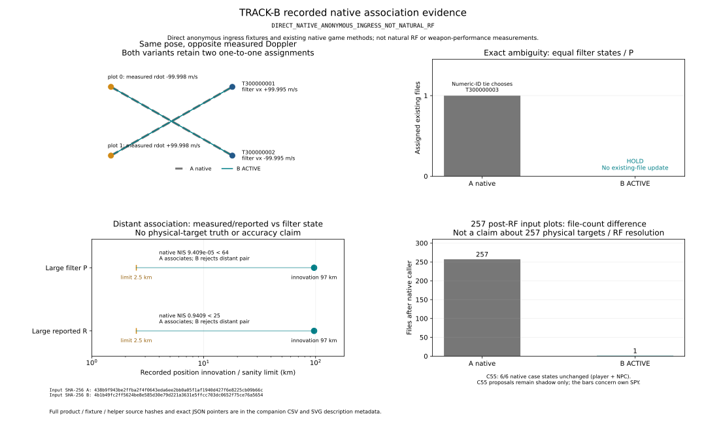
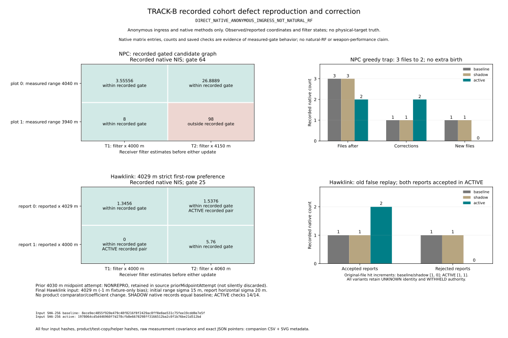

# TRACK-B 보고서

현재 단계: **INCOMPLETE** · 증거 정리: **완료** · 전체 종료: **INCOMPLETE** · releaseApproved: **false**.

선언한 live 구현 계약은 PASS지만, 원래 paired4건과 D1 signature1건은 원인 계측 후에도 사용자 미승인 strict FAIL이다. 증거 수집 완료와 단계 승인·전체 TRACK-B closure를 구별한다. C55/SPQ AIR 등 SHADOW-only 범위와 기존 미해결 항목도 남아 있다.

TRACK-A 위의 연관 변경과 진단 범위만 다룬다. 원래 기대값·허용 오차를 갱신하지 않으며, OODA·새 전술 AI·TRACK-C/D를 구현하지 않는다. 기존 419025 피격 FAIL, CG→friendly observer 2건 미승인 KNOWN_DELTA, 구형 EMCON UI14 INCOMPLETE를 승인하거나 해결했다고 표시하지 않는다.

## 빌드와 증거의 연결

| 항목 | 값 |
| --- | --- |
| 기준 | ee960db / TRACK-A e2c1976a…96d67a |
| ACTIVE SHA-256 | 0b3e5ad90324f10057f2e500692f4f56b020ddc4f12db16423bf4d258a38e4c6 |
| SHADOW SHA-256 | e9af30d8d71209f9eb45d72de58ca509efd261d7126d89ab626e2873d182995d |
| 실제 HTML byte와 BUILD 일치 | True |
| authoritative VALIDATION | INCOMPLETE (증거 완료) |
| main/기준 브랜치 병합·release/tag | 수행하지 않음 |

SHADOW/ACTIVE는 build-time 정책이다. 진단 ON/OFF는 알고리즘 mode·RF·EKF·IFF·교전 권한을 바꾸지 않는다. 실제 적용 경로, SHADOW로 남긴 경로, 보호 심볼의 세부 사항은 IMPLEMENTATION_PLAN/OWN_NPC_AUDIT/C55_AUDIT/NETWORK_AUDIT와 scope 증거를 함께 읽어야 한다.

## 검증 현황

| 검증 | 상태 | 범위 |
| --- | --- | --- |
| 제품 checksum | PASS | ACTIVE/SHADOW 실제 bytes와 BUILD |
| 보호 범위 | PASS | SCOPE.json |
| 직접 native 익명 관측 통합 | PASS | 자연 RF·실제 전투로 세지 않음 |
| 원래 광역 회귀 | FAIL | 364 native +42 paired; legacy14 별도 INCOMPLETE |
| runtime A/SHADOW/ACTIVE | FAIL | 원본 D1/자연3/진단/시계/IFF/idle/owner·비용 |

| 원래 lane | 실행/통과/기대 | 미승인 또는 미완료 |
| --- | --- | --- |
| native13 | 364/364/364 | 기존 assertion 그대로 |
| paired | 38/42 | 모든 원시 state leaf 차이 보존 |
| 신규 strict FAIL | paired-track-a | 자동 승인 없음 |
| 미실행 fresh suite | 없음 | 빈칸을 PASS로 처리하지 않음 |
| 구형 EMCON UI | 14 INCOMPLETE | retired #lockBtn 기대값 불변 |

| variant | task | 상태 | exit |
| --- | --- | --- | --- |
| baseline | d1 | PASS | 0 |
| baseline | repro | PASS | 0 |
| baseline | trace | PASS | 0 |
| baseline | auto-iff | PASS | 0 |
| baseline | idle | PASS | 0 |
| baseline | clocks | PASS | 0 |
| baseline | performance | PASS | 0 |
| baseline | allocation | PASS | 0 |
| shadow | d1 | PASS | 0 |
| active | d1 | FAIL | 1 |
| active | repro | PASS | 0 |
| active | trace | PASS | 0 |
| active | auto-iff | PASS | 0 |
| active | idle | PASS | 0 |
| active | clocks | PASS | 0 |
| active | performance | PASS | 0 |
| active | allocation | PASS | 0 |
| shadow | repro | PASS | 0 |
| shadow | trace | PASS | 0 |
| shadow | auto-iff | PASS | 0 |
| shadow | idle | PASS | 0 |
| shadow | clocks | PASS | 0 |
| shadow | performance | PASS | 0 |
| shadow | allocation | PASS | 0 |

## 신규 B 검증과 보호 범위 상세

| 검사 | 결과 | 구분 |
| --- | --- | --- |
| 보호 심볼 | 189/189 byte 동일 | SCOPE.json |
| 중첩 보호 커널 | 161/161 byte 동일 | nested 합산 성능 지표 아님 |
| solver unit | 47/47 PASS | 현재 association 모듈 SHA 일치 필요 |
| native 익명 관측 통합 | PASS | 23 group, 자연 RF·전투 증거 아님 |
| NPC/Hawklink cohort 보충 | PASS | 별도 직접 native fixture |

신규 unit/native/cohort 단언을 기존 domain420에 더하지 않는다. 직접 native fixture는 실제 기존 연관·필터·소비 함수를 호출하지만 자연 RF 발생률이나 실제 전투 성공을 대신하지 않는다. ACTIVE 모듈 SHA: `3a4bac5b74c03033490e92f5d3d69cadd4e4214309e7479afcdfe3c5cf954e46`.

| ACTIVE 진단 | 통과 | 검사 | query 상태 무변경 | ENV match |
| --- | --- | --- | --- | --- |
| OFF | 84 | 84 | True | True |
| ON | 90 | 90 | True | True |

| 제품 OFF/ON | fixture 수 | 각 fixture 상태/private RNG 동일 | 최종 상태 동일 |
| --- | --- | --- | --- |
| shadow | 23 | True | True |
| active | 23 | True | True |

SHADOW 원래 native 기록 동일: True. C55의 진단 ON 전용8항목은 원시 SHADOW ON 열로 보고했다. 이 보고 열 수정은 raw 점수·상태·소스·기대값을 변경하지 않았다. 근거: [native SUMMARY](evidence/native-integration/SUMMARY.json).

### NPC·Hawklink 실제 소비 경로 보충

| 제품 | NPC 연관 | NPC 신규 | NPC 파일 | Hawk 접수 | Hawk 거부 | Hawk 파일 |
| --- | --- | --- | --- | --- | --- | --- |
| baseline | 1 | 1 | 3 | 1 | 1 | 2 |
| shadow | 1 | 1 | 3 | 1 | 1 | 2 |
| active | 2 | 0 | 2 | 2 | 0 | 2 |

ACTIVE 신규 검사 14/14 PASS. 실제 기준 경로에서 NPC greedy trap과 Hawklink sequential false-replay가 재현됐다. ACTIVE는 원래 두 파일을 각각 한 번 갱신하고 원 측정 시각·owner 독립성·identity/authority 무승격을 유지했다. SHADOW의 원래 native 결과/private game RNG는 A와 같았다. 이 결과는 자연 RF·실제 전투 시험이 아니다.

새 B 계약의 대조 검사에서 A/SHADOW는 각각 5/14였고 ACTIVE는 14/14다. 이는 기존 회귀 기대값을 바꾼 점수가 아니라 새 계약을 같은 실제 native 경로에 적용한 결과다.

최초4030m midpoint 시험은 부동소수 변환 때문에 결함을 재현하지 못해 attempts에 보존했다. 최종 보충 fixture는 보고 위치만1m 옮긴4029m로 원래 sequential 선택을 명확히 만들었다. 제품 comparator·계수·Pd/Pk는 바꾸지 않았다. 접근자 오류 시도와 재현 실패도 숨기지 않았으며 원래 native 통합 helper를 고쳐 통과시킨 것이 아니다. [보충 SUMMARY](evidence/cohort-supplement/SUMMARY.json) · [PROVENANCE](evidence/cohort-supplement/PROVENANCE.json).

## 검증 그림

관측 차원·연관·모호성 보류의 직접 native 결과. 직접 익명 관측 fixture이며 자연 RF 발생률·실제 전투 격추율 그림이 아니다. 원래 JSON source pointer와 제품/helper/source SHA는 [CSV](evidence/figures/native-association.csv)에 기록되어 있다. 46개 CSV행의 현재 제품/source JSON SHA를 확인했다. 생성 도구: `plot_association.py`.

- SVG SHA-256: `db152cf3677f225d1f6306c8cc17f07f5d7b7d73d5b08da36a34de4753db6c3c`
- CSV SHA-256: `169ceb232c04a51b3dc3bc414bfb350c27f759c59324f6141b7468ccd4fae352`

NPC·Hawklink cohort의 실제 원래 경로와 ACTIVE 비교. 직접 익명 관측 fixture이며 자연 RF 발생률·실제 전투 격추율 그림이 아니다. 원래 JSON source pointer와 제품/helper/source SHA는 [CSV](evidence/figures/cohort-proof.csv)에 기록되어 있다. 229개 CSV행의 현재 제품/source JSON SHA를 확인했다. 생성 도구: `plot_cohort.py`.

- SVG SHA-256: `3681f21871874e9312fbd4aaef40573a6bde70c2c2d4130fd0fafa5cfb38e835`
- CSV SHA-256: `5e13395a4ea68f8b33aa01fc1c93c201078664fb74bf74317619f941b1017782`

## 원래 회귀 총계와 신규 strict 실패

원래 domain420: **402 PASS / 4 strict FAIL / 14 INCOMPLETE** = native364 +paired38/42 +retired UI14. 기존 기준값·허용 오차 갱신0. fresh16개 suite는 모두 실행됐고 pending은 []다. 실행 시간 2420.8초 (40.35분). aggregate exit1은 paired4 strict FAIL 보존 때문이다.

| 별도 lane | 결과 | 상태 |
| --- | --- | --- |
| UI | 213/213 | PASS |
| 자연 탐지→LOCK→정식 VLS→fixed tick→실제 WebGL | 8발/29/29 단언 | PASS |

WebGL29 PASS는8발 모두 격추라는 뜻이 아니다. 이 숫자를 domain420에 중복 더하지 않는다. 최초 CG→friendly404/observer2 미승인/legacy14 이력도 이번402/4/14와 별도로 남는다.

| 원래 실패 단언 | 상태 |
| --- | --- |
| DDG_119_LATE_FLIGHT_IIA:raid:samePhysicalState | FAIL ·기대값 불변·승인 없음 |
| DDG_119_LATE_FLIGHT_IIA:raid:sameExistingObserverState | FAIL ·기대값 불변·승인 없음 |
| CG_52_LATE_TICONDEROGA:raid:samePhysicalState | FAIL ·기대값 불변·승인 없음 |
| CG_52_LATE_TICONDEROGA:raid:sameExistingObserverState | FAIL ·기대값 불변·승인 없음 |

| 함정 | HP A→B | VLS A→B | global RNG A→B | observer 변경 leaf |
| --- | --- | --- | --- | --- |
| DDG_119_LATE_FLIGHT_IIA | 100→100 | [90, 90] | 2134102897→2134102897 | 950 |
| CG_52_LATE_TICONDEROGA | 100→100 | [115, 115] | 2134102897→2134102897 | 875 |

| 함정 | heel rad A→B | effective GM m A→B | 최종 mass/CG 동일 | water kg A→B |
| --- | --- | --- | --- | --- |
| DDG_119_LATE_FLIGHT_IIA | 0.0005609569352→0.0005623081835 | 0.02571404552→0.02948008109 | True | 0→0 |
| CG_52_LATE_TICONDEROGA | -0.005414938109→-0.005416285734 | -0.01638265256→-0.01593939339 | True | 0→0 |

아래 별도 계측으로 관측된 원인 경로는 확인했으며 strict FAIL은 미승인으로 유지한다. full inventory·module damage·최종 mass/CG·global RNG는 같지만 실제 heel/흘수/부력/GM과 observer 값은 다르다. 모든2259 leaf 차이를 보존했으며 물리 차이를 metadata로 제외하지 않는다. 원래 기대값·허용 오차는 바꾸지 않는다. 초기 PAIRED_DELTA_REVIEW의 원인 대기 표기는 최초 endpoint 기록이고, 후속 원인 증거는 아래 자료로 별도 연결한다.

**32초 endpoint 한계:** 두 함 모두 이때 HP100·물0이고,8발 Kh-32가 모두 alive이며 intercept 기록은 비어 있다. 이는 전체 습격의 최종 격추·생존 동일을 입증하지 않는다.8발 요격 성공으로 표현하지 않는다. AFTER_ACTION truth는 사후 비교에만 쓰고 실시간 소비자에 연결하지 않는다. [전후 검토](PAIRED_DELTA_REVIEW.json) · [모든 leaf diff](evidence/regression/paired-state-deltas.json.gz).

### 별도 원인 계측의 실패 시도

| 시도 | 상태 | 구간 | 실패 내용 | 해당 원인 확정 | 제품 코드 변경 |
| --- | --- | --- | --- | --- | --- |
| 1 | INCOMPLETE | Retrieve whole passive timeline after original raid expression completed | Playwright Page.evaluate: Target crashed | False | False |
| 2 | INCOMPLETE | After successful compact timeline retrieval, static/runtime source assertion | Tool compared existing final pipeline wrapper with base function SHA | True | False |

첫 시도는 원래 raid 실행 후 큰 cache/timeline을 가져오던 중 browser target이 죽어 INCOMPLETE다. 같은 A 실행 구간의 host OOM counter 증가1은 별도 환경 관측이며 제품 결함 원인으로 확정하거나 승인하지 않는다. bounded scalar/chunk 읽기로 계측 도구를 재시도한다. 두 번째 시도는 기존 최종 pipeline wrapper와 base 함수의 서로 다른 SHA를 비교한 도구 검사 오류로, 실제 base reference와 기존 outer wrapper를 각각 비교하도록 고쳤다. 두 시도 모두 원래 fixture 명령·제품 코드는 바꾸지 않았으며 최종 원인 증거나 PASS로 세지 않는다. [시도1](evidence/paired-cause/ATTEMPT_1_FAILURE.json) · [시도2](evidence/paired-cause/ATTEMPT_2_FAILURE.json).

## Runtime 도구 수정 이력과 진행 한계

초기 도구 a151ee2a…b7f75는 async `__ENV_D__.status()`의 Promise를 기다리기 전에 `.match`를 읽어 변경 없는 TRACK-A 자연3에서도 ENV check만 거짓 실패했다. 원래 결과·query·상태는 일치했다. root 승인으로 원래 A처럼 전체 Promise 결과를 기다린 뒤 **같은 match===true 조건**을 검사하도록 고쳤다. 현재 도구 SHA는 `a173e069a62db844baa4d0dfd298e43209749c93dab5580deaecc30b76905523`이다. 전체 resolved ENV status와 worker별 실제 loaded-controller/source receipt를 저장한다. 제품·ENV hash 기준·기대값을 완화하지 않았다.

잘못된 async guard의 REPRO/TRACE 시도·초기 source/provenance·로그는 `evidence/runtime/attempts/async-env-guard-a151/`와 재시도 snapshot에 남겼다. D1 PASS의 초기 script는 da73163에서 복구 가능하고 `original_script()` 함수는 수정 전/후 byte 동일(SHA `a54b4bb5f08c8502f385973ba1f82a342b84a75d51a8e8b769681295f46557c4`)이다. 과거 거짓 실패를 제품 수정 성과나 승인된 결과로 세지 않는다.

### ACTIVE D1의 현재 관측 차이

현재 완성된 JSONL 30/30시드, worker 완료=True. 원래 strict 결과 **FAIL**, 동일 signature 29/30. 원래 signature가 다른 시드와 원시 사후 결과를 아래에 모두 남긴다. 결과가 같다는 이유로 signature 기대값을 바꾸거나 승인하지 않는다.

| 시드 | A signature SHA | ACTIVE signature SHA | 피격 | HP | CIWS 소모 | 종료 s | A 사후 결과 | ACTIVE 사후 결과 |
| --- | --- | --- | --- | --- | --- | --- | --- | --- |
| 419012 | b96b4f5dd36fb03524bc3db3c456a7f2ecb400e4c75a041d268eeb47efbcd991 | 3610fbd8fb2c21702b18d26641c840bfd15391863fdf52d054e74c64a289e8cd | 0→0 | 100→100 | 3→3 | 30.6333→30.6333 | ['INTERCEPT_KILL'] | ['INTERCEPT_KILL'] |

원문: `evidence/runtime/active/friendly/ciws-d1.jsonl(.gz)` · `worker-d1-receipt.json`. 전송 압축 뒤에는 RAW_COMPRESSION.json의 원문/gzip 해시로 연결한다. 내부 CMS/트랙 차이의 관측된 원인 경로는 아래 별도 계측과 연결하며 원래 strict FAIL은 미승인으로 유지한다.

## 미승인 strict 차이 5건의 원인 계측

### Paired 4건 — 실제 연관 보류에서 적재 이력과 선체 응답으로

| 함정 | 첫 native HOLD tick/s | 첫 추정 변화 post-tick/s | private SPY RNG 첫 차이 | VLS 차이 tick | mass 차이 tick | A/SHADOW 동일 | 계측 OFF/ON 동일 |
| --- | --- | --- | --- | --- | --- | --- | --- |
| DDG_119_LATE_FLIGHT_IIA | 194/3.233333 | 195/3.250000 | 213/3.550000 | 528 | 529 | True | True |
| CG_52_LATE_TICONDEROGA | 197/3.283333 | 198/3.300000 | 204/3.400000 | 528 | 529 | True | True |

| 함정 | native 두 matching 합 차이(NIS) | 보류 plot | 선택 수 | 거리/radial sanity |
| --- | --- | --- | --- | --- |
| DDG_119_LATE_FLIGHT_IIA | 0.04868061886531372 | [0, 1] | 0 | True |
| CG_52_LATE_TICONDEROGA | 0.5153520159868759 | [0, 1] | 0 | True |

DDG ΔNIS0.04868061886531372, CG0.5153520159868759는 기존 B ambiguity 기준1보다 작아 두 plot이 HOLD됐다. 실제 이미 계산된 native candidate/return을 한 번의 pass-through에서 복사했고 RF/NIS/solver를 추가 실행하지 않았다. 첫8개 edge는 원래 gate64와2500m/180m/s sanity를 모두 통과했다. 첫 원인은 sanity 거부나 component 크기 제한이 아니다.

관측된 순서는 **모호한 대안 보류 → local 평균/P·갱신/scheduler 이력 변화 → 기존 표적/발사 일정 변화 → 기존 적재 ledger/선체 해석기 응답**이다. 두 함에서 SAM2가 A tick528(8.8초)에서 B tick540(9.0초)으로 늦어졌다. A는528에 기존 SM-2 적재708kg을 먼저 소비하고 B는 유지했으며, 다음529tick에서 기존 mass/CG·GM0·heel/draft가 처음 달라졌다. 그 이전 기록된 물리 스칼라는 같았다.

32초 최종 mass/CG·GM0·global RNG가 다시 같아도 적분기는 다른 적재 시점의 이력을 보존한다. flood-door world 높이와 갑판에 붙은 cold 헬기 좌표, 자세에서 파생된 effectiveGMM도 따라 달라진다. 최종 effectiveGMM 차이는 GM0 계수 변경이 아니다. 계수·기대값·허용 오차 조정 없이 원인 경로를 확인했지만 paired4 FAIL은 계속 미승인이다.

원래32초6page는 각1921행(초기+1920tick), A/SHADOW 및 계측 OFF/ON 동등성, 원래 archive와 endpoint5항목·native source SHA를 검증했다. DDG 넓은 ON 기록은10MiB 목표를 넘어선 시험 기록 폭 제한도 공개했다. 후속120초는3.0–3.8초 candidate만 자세히 기록하고1Hz scalar로 줄였으며 과거 실패 시도를 숨기지 않았다. [원인 보고서](PAIRED_CAUSE_RESULTS.md) · [32초 SUMMARY](evidence/paired-cause/SUMMARY.json) · [실제 native edge](evidence/paired-cause-120/CRITICAL_NATIVE_EDGES.json).

### 새120초 연장 관측 — 완료된 전투가 아님

| 함정 | SAM/RAM 발사 A→B | VLS 셀 A→B | HP | 침수 m³ | native 요격 사건 | ASM 상태 |
| --- | --- | --- | --- | --- | --- | --- |
| DDG_119_LATE_FLIGHT_IIA | 17→16 | 82→85 | 100→100 | 0→0 | 0→0 | 8 Kh-32 +13 Kh-35U 모두 alive |
| CG_52_LATE_TICONDEROGA | 15→19 | 110→106 | 100→100 | 0→0 | 0→0 | 8 Kh-32 +13 Kh-35U 모두 alive |

연장4건은 원래 설정에서 horizon만1920→7200tick으로 바꾼 별도 신규 시험이다.32초 checkpoint24/24가 원래 실행과 정확히 같았고 275.490초에 완료했다. 두 함 모두 module damage0·NORMAL이지만, 최초8발과 뒤에 스폰한13발이 모두 살아 있고 요격/체계피격/함선피격 사건0이다. **최종 전투가 해결됐거나 요격 성능이 보존됐다고 주장할 수 없다.** 자원 차이는 그대로 보고하고 새120초 검사를 원래420/42 기대값에 합산하지 않는다.

일부 SAM에 native `_deathReason`가 없어 WEAPON_END를 완전 분류했다고 주장하지 않는다. 누락 사건이나 alive=false만으로 격추를 만들지 않는다. [120초 결과](evidence/paired-cause-120/OUTCOME_REVIEW.json) · [SUMMARY](evidence/paired-cause-120/SUMMARY.json) · [horizon-only diff](evidence/paired-cause-120/horizon-only.diff).

### D1 seed419012 — 파일 제거가 아닌 기존 CMS cue 순서 변화

계측한29.0초 첫 프레임부터 A/B에 두 canonical 파일이 모두 있었다. 두 번째는 VISUAL·1hit이고29–30.65초 창에 CREATE가 없다. “B가 두 번째 파일의 생성을 없앴다”는 초기 가설은 자료와 맞지 않는다. 앞선 생성 이력과 두 파일의 실제 물리 표적 동일성은 이 창으로 증명하지 않으며 duplicate 제거라고 쓰지 않는다.

| native tick1796 동일 SPY 관측의 후보 | AIR4D NIS |
| --- | --- |
| track300000001 | 1.4913444179610076 |
| track300000002 | 1.1536789827861333 |
| 대안 차이 | 0.33766543517487424 |

같은 관측·gate64 안에서 A는 작은 NIS의002를 갱신했고, B는 대안 차이0.33766543517487424가 기존 기준1 이하여서 OWN_SPY_GLOBAL/AMBIGUOUS_ASSOCIATION HOLD를 기록했다. post-tick1797부터 평균/P·freshness와 캐시 cue 값이,1800부터 cue 순서와 실제 mount cue가 달라졌다. 이어 focused 재방문과 VISUAL/SPQ 기여 이력도 달라졌다. metadata-only 차이가 아니다.

| 최종 frame1838 실제 캐시 | native1순위 | TTI s | native2순위 | TTI s |
| --- | --- | --- | --- | --- |
| A GUN | 002 | 6.976145618993533 | 001 | 7.0423472604731465 |
| B GUN | 001 | 7.000081519721263 | 002 | 7.024040628315056 |
| A RAM | 002 | 6.989602928597308 | 001 | 7.050597368522857 |
| B RAM | 001 | 7.003378644115532 | 002 | 7.033123797618139 |

기존 native C55는 이미 만들어 정렬한 CMS cue의 첫 trackId를 cuedTarget에 넣는다. 실제 사격용 음수 로컬 파일은 GUN -5500001/RAM -5500002로 A/B 같았고, 캡처99프레임의 로컬 추정·보호·무장 상태도 같았다. 최종 after의 차이는 두 mount cue002→001뿐이다. 사후 CMS 거리 replay와 실제 관측된 선택은 ANALYSIS에서 구분했다.

양쪽 모두 RAM3발/GUN0발, 피격0·HP100·생존,30.633333초에 같은 결과였다. 마지막 RAM PROX_DETONATION_KILL·최근접4.747193334345742m·global RNG3594350424도 같다. 전체30시드 전투 결과/자원은 같지만 signature29/30의 strict FAIL은 미승인이다. 이 결과를 모든 private RF 상태·장래 전투 불변으로 확장하지 않는다.

A/B 계측은 각 원래 OFF signature와 정확히 일치하고 query/상태·private RNG 무변경, 금지 진실 필드0·fault/overflow0을 확인했다. 원래 diagnostic.js의 두 wrapper는 결과 수집 후 최초 참조만 복원하고 추가tick 없이 awaited ENV match를 확인했다. 복원 전 guard 실패도 보존했다. 모든 원시 차이를 남겼으며 일부 cue만 설명한 것이 원시 diff 삭제는 아니다. [원인 보고서](SEED419012_CAUSE_REPORT.md) · [ANALYSIS](evidence/seed419012-cause/ANALYSIS.json) · [실행 영수증](evidence/seed419012-cause/EXECUTION.json).

## 최종 단독 성능 관측

동시 브라우저가 없는 preflight를 확인하고 두 lease를 전체 측정 동안 독점한 순차9구성이다. CPU는30초 warmup+2400tick, allocation은 두 owner120tick warmup+600tick이다. 반복 순서를 뒤집었고 원시 샘플을 제외하지 않았다. 총 151.946초, 측정 검수 PASS. 기존 concurrent-host cost/raw sampling 자료는 지우지 않고 NOT_FINAL_FOR_COST_ASSESSMENT로 구분한다.

| 제품 | 반복 | 진단 | 평균 ms/tick | median | p95 | live heap 변화 B |
| --- | --- | --- | --- | --- | --- | --- |
| A | 0 | OFF | 1.9067 | 1.8 | 2.9 | 7263280 |
| B | 0 | OFF | 1.8593 | 1.7 | 2.9 | 41300564 |
| B | 0 | ON | 1.9342 | 1.8 | 3 | 15507928 |
| B | 1 | ON | 1.9153 | 1.8 | 3 | 21250992 |
| B | 1 | OFF | 1.835 | 1.7 | 2.8 | 41792432 |
| A | 1 | OFF | 1.8347 | 1.7 | 2.9 | 146500 |

| 제품 | 진단 | 두 owner 각tick | GC 포함 sampling 추정 B | sample 수 |
| --- | --- | --- | --- | --- |
| A | OFF | 600 | 1091086792 | 33235 |
| B | OFF | 600 | 1090727088 | 33225 |
| B | ON | 600 | 1091883456 | 33259 |

| 검수 | 값 |
| --- | --- |
| allNineRunsComplete | True |
| allNativeChecksPass | True |
| cpuBodyTrackPAndPrivateRngExactAcrossAllConfigs | True |
| allocationBodyTrackPAndPrivateRngExactAcrossAllConfigs | True |
| browserErrorsZero | True |
| browsersClosed | True |

CPU 주 측정은 원래 함수를 감싸는 kernel timer 없이 실제 fixed tick을 실행했다. 별도 allocation sample은 GC로 수거된 객체도 포함하도록 major/minor 옵션을 켰다. 이는 통계적 총할당 추정이며 정확한 byte/count가 아니다. live heap delta는 GC 때문에 음수가 될 수 있는 순수 live 변화로 총 churn이 아니다. 원시 profile·tick samples·preflight·source hashes를 모두 남겼다.

allocation에서 부모 surfacePosition21회가 각각 중첩 surface를1회 호출했다. 이 inclusive 호출/시간은 겹치므로42개의 고유 candidate나 총CPU로 합산하지 않는다. AIR/cartesian은0회여서 해당 kernel이나 dense raid 스트레스를 포괄 검증했다고 쓰지 않는다. A/B 및 진단 OFF/ON의 body·track/P·private RNG 동등성은 위 검수 범위다. 성능 수치를 자동 승인하거나 신뢰할 수 있는 속도 향상으로 단정하지 않는다. [최종 SUMMARY](evidence/cost-final/SUMMARY.json) · [ASSESSMENT](evidence/cost-final/ASSESSMENT.json) · [COST_FINAL](COST_FINAL.md) · [PROVENANCE](evidence/cost-final/PROVENANCE.json) · [독점 lease](evidence/cost-final/LEASE.json).

| CPU 반복 | B OFF vs A OFF 평균 % | B ON vs B OFF 평균 % |
| --- | --- | --- |
| 0 | -2.4868 | +4.0247 |
| 1 | +0.0182 | +4.3732 |

두 반복에서 B OFF는 -2.4868%/+0.0182%, 진단 ON 추가분은 +4.0247%/+4.3732%였다. 관측한 두 반복의 값이며 통계적 유의성이나 일반적인 속도 향상을 주장하지 않는다. 원시 샘플 제외0, 최종 측정 구간 resource event 변화 없음. 이전 동시 호스트/retained-only sampling 자료는 [runtime 비용 해석](evidence/runtime/COST_CONTEXT_NOT_FINAL.json)에 따로 보존한다.

## 차이와 비용의 해석

원래 strict 검사 실패는 FAIL로 보존한다. 변경된 observer·상태·공분산·분류·identity·freshness·private RNG를 제거해 동일하다고 만들지 않는다. 자연 재현의 원시 결과와 AFTER_ACTION_TEST_ONLY 전체 관련 track/observer 사본은 비교 전에 저장한다. 같은 제품의 trace OFF/ON 및 snapshot 조회 순수성과, ACTIVE의 외국/NPC 연관에서 생긴 A 대비 변화는 서로 다른 검사다. 변화의 원인 검증 전 자동 KNOWN_DELTA/PASS 승격은 하지 않는다.

CPU 평균·median·p95는 shared host의 raw proxy다. 모든 반복과 outlier를 유지하고 신뢰할 수 있는 속도 향상으로 단정하지 않는다. nested kernel timing/counter는 겹치므로 합산하지 않는다. live heap delta는 총 할당량이 아니며 heap sampling은 통계적 추정이다.

## 이력과 남은 항목

RC0(79a098a8…)는 실제 native contract에서 own-SPY 연결 누락3건이 발견된 실패 후보다. 해당 기록은 attempts 아래 historical로 보존한다. 이 agent의 RC0 broad lane은 브라우저를 시작하기 전에 중단되어 NOT_EXECUTED이며, RC0 파일을 새 후보의 회귀 PASS로 재사용하지 않는다. 초기 5σ proposal과 최종 2500m/180m/s hard cap도 구분한다.

미해결 원래 전투 손실과 observer 차이는 TRACK-B 검수 통과만으로 승인되지 않는다. paired4+D1 signature1의 관측된 원인 경로는 후속 계측으로 확인했지만 기대값을 갱신하지 않았고 사용자 승인 전까지 FAIL을 유지한다. C55/SPQ AIR의 interleaved 경로처럼 SHADOW에 남은 범위는 live batch 완료라고 표현하지 않는다. TRACK-C/D 설계는 후속 단계이며 이번 완료 판단에 포함하지 않는다.

실행 명령과 재현 조건은 README.md / REGRESSION_PLAN.md / TEST_PLAN.md를 따른다. 이 생성기는 test result·원래 기준·제품·checksum을 수정하지 않고 REPORT.md만 쓴다.
