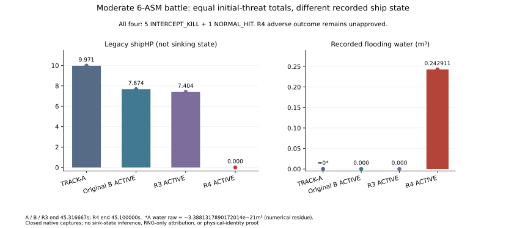
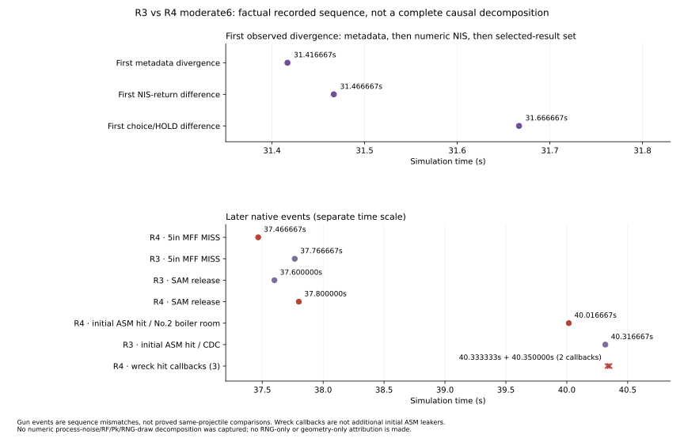
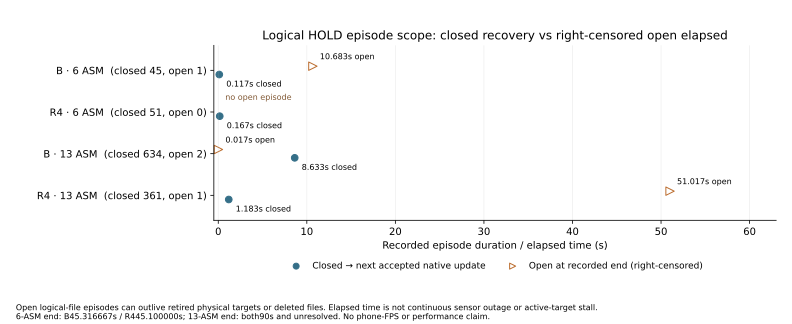

# TRACK-B 안정화 최종 검토 — INCOMPLETE / ACTIVE 승격 보류

연관 함수와 native 통합의 범위별 기능 검사는 통과했지만, 실제 전투 안정화는 통과하지 못했다. **6기 전투의 피해 악화와 개별 초기 표적의 격추→명중 유출을 확인했으므로 ACTIVE 적용·병합·기대값 갱신을 권고하지 않는다.** 기존 B를 소비하는 SHADOW와 검증용 ACTIVE를 구분해 제공한다. main과 기준 브랜치에 이 작업을 반영하지 않았다.

## 변경 범위

기준은 `track-b-association@1d925540…`, 작업은 `track-b-stabilization-a`다. [DECISIONS.md](DECISIONS.md), [changes.diff](changes.diff), [FINALIZER_PATCH.json](FINALIZER_PATCH.json)에 실제 변경과 보존 경계를 기록했다.

- δ=1과 원 NIS/dummy/native winner는 유지한다. 같은 차원·관측 시각의 기존 H/P/R에서 얻는 S 증거로 기존 HOLD만 추가 해소한다. hit/identity/truth 보너스나 고정 좌표 보정을 넣지 않았다.
- 큰 연결 성분은 원 전역 native 최적해를 먼저 구한다. 하한으로 증명된 edge와 작은 잔여 성분만 해소한다. C=0·완전 매칭·양축≤16이면 기존 정확 검사를 추가 실행한다. 실제 R2의18개 큰 그래프 중 불필요한35회 pair 보류를 해소했고 기존 수용 손실0을 확인했다. 35개 고유 표적이라는 뜻은 아니다.
- 입력 복사는 필요한 필드만 읽는다. 실제 새로운 입력은 내부 track 번호, 익명 관측, receiver 소유 추정/P·시각·기존 NIS와 S다. 실제 표적 id/team/profile/truth 참조를 연관 비용이나 식별 근거로 사용하지 않는다. 사후 물리 참조 감사는 게임·UI·AI로 되먹이지 않는다.
- 다른 파일의 재획득 task가 정상 수용 파일에 새 재획득 상태를 만드는 오류를 최소 수정했다. 이미 재획득 중인 파일·자기 대상·실제 miss·기존2회 복구는 보존한다. RF·EKF 수식/계수·IFF·ROE·FCS·AI·무장/피해/함정 물리·RNG 함수·저장 스키마는 변경하지 않았다. 상태가 바로잡혀 후속 Q 선택·스케줄·난수 소비 분기가 달라지는 것까지 전체 상태 불변이라고 주장하지 않는다.
- C55·SPQ AIR는 계속 **SHADOW-only / 미완료**다. >16 비인증 성분·비완전 큰 성분·>128 계산 상한도 남아 있다. 이들을 완성 기능으로 세지 않는다.

두 HTML의 기존 `__TRACK_B__.mode`는 호환성을 위해 ACTIVE다. 새 후보의 소비 여부는 `__TRACK_B__.stabilizationMode`로 확인한다. ACTIVE SHA `48b023c580db02b08f165fa7ac68f973734d82e8fb4daa5981dcc90b7e04e4ab`, SHADOW SHA `3c7d2490e7e0d6fe94452e43d8f22132fbdd8add83986208bf7173068c478444`. 실제 packed main/함수·모드·역변환·외부 assets 보존은 [SOURCE_PROOF.json](SOURCE_PROOF.json), [SCOPE.json](SCOPE.json), [MODE_PAIR_PROOF.json](MODE_PAIR_PROOF.json)에 고정했다.

## 기능·회귀 검수

새 bounded 검사28/28, 원 정책39/39, actual packed finalizer 격리3096/3096씩 통과했다. 격리 검사는 의존성 count stub을 사용하며 실제 게임 회귀와 합산하지 않는다. 실제 native는19/19·추가23/23·메타데이터18/18, OFF84/84·ON90/90·cohort14/14·포화44/44 통과했다. [NATIVE_RESULTS.md](NATIVE_RESULTS.md) 참조.

원 B47은46/47, 원 R2 residual15는14/15다. 계산 정책 확장 차이지만 원 FAIL 그대로 보존하며 기대값을 바꾸지 않았다. source 설명만으로 승인하지 않는다.

광역 회귀17job을 현재 HTML에서 새로 실행했다. 도메인 실측 **400/406**, 실패6이며, 별도 구형 EMCON UI14는 INCOMPLETE로 남겨 요청 분모420을 설명한다. 원 native13개 suite **364/364**, paired **36/42**다. 다른 후보 통과로 대체하지 않았다.

| suite | 판정 | 통과/원 단언 | 실패 |
|---|---|---:|---|
| paired-track-a | FAIL | 36/42 | DDG_119_LATE_FLIGHT_IIA:raid:samePhysicalState, DDG_119_LATE_FLIGHT_IIA:raid:raidInventoryDeltaBounded, DDG_119_LATE_FLIGHT_IIA:raid:sameExistingObserverState, CG_52_LATE_TICONDEROGA:raid:samePhysicalState, CG_52_LATE_TICONDEROGA:raid:raidInventoryDeltaBounded, CG_52_LATE_TICONDEROGA:raid:sameExistingObserverState |
| ui213 | PASS | 213/213 | — |
| d1 | FAIL | 29/30 | seed419012 |
| webgl8 | PASS | 29/29 | — |
| aps153 | PASS | 20/20 | — |
| helicopter-flight | PASS | 85/85 | — |
| isar-classes | PASS | 8/8 | — |
| isar-native | PASS | 36/36 | — |
| isar-clock | PASS | 12/12 | — |
| isar-ui | PASS | 38/38 | — |
| emcon-native | PASS | 27/27 | — |
| harpoon-f1 | PASS | 46/46 | — |
| sov-native | PASS | 30/30 | — |
| harpoon-clock | PASS | 24/24 | — |
| sov-casualty | PASS | 13/13 | — |
| sov-deployment | PASS | 15/15 | — |
| sov-visual | PASS | 10/10 | — |

원시·모든 leaf 차이·실제 실행 source pin은 [REGRESSION_RESULTS.json](REGRESSION_RESULTS.json)에 있다. WebGL29개 assertion을8개 격추로 표현하지 않는다. D1은 A와29/30, 기존 B/R1과30/30 서명 동일이며 선택 전투/자원 요약30/30 동일이다. 419012는 미승인 유지, 419025는 HP6.846598842629405·피격1인 기존 실패다.

별도로 현재 R4에서 원6page smoke를 새로 실행했다. 상태는 **PASS**이며 원 Harpoon/헬기3사례·auto IFF·fresh idle before/after120초를 포함한다. 원 체크는 `{'reproThreeOriginalCasesComplete': True, 'reproOriginalExecutorPassed': True, 'autoIffOriginalChecksPass': True, 'idleBothFreshOriginalChecksPass': True, 'strictAvailableNativeAndStateComparisonsExact': True, 'allOriginalWorkersExitedZero': True}`다. [SMOKE_RESULTS.md](SMOKE_RESULTS.md), [원시 결과](evidence/smoke/SMOKE_RESULTS.json) 참조. 120초 무표적 truth SHA는 `bc09d108079c46897aab41878397c3e5888443d3db3becbf2f006abd7ae4110f`, RNG12002로 기존 A/B와 동일했다. 과거 full observer/P snapshot이 없는 비교를 통과로 만들지 않았고, 추가 smoke 결과를 도메인420에 더하지 않았다.

paired는 상태/observer4건에 VLS 잔탄 동등 비교2건이 추가 실패했다. 이름은 `raidInventoryDeltaBounded`지만 원 HELI wrapper의 실제 조건은 잔탄 **완전 일치**다. A/B/R1→R4의 잔탄은 DDG90→89, CG115→114로 각각 SM-2 한 발 차이다. 32초 HP100·침수/모듈 피해0·초기 Kh-32 8기 생존이며 종결 전투가 아니다. [PAIRED_FIRST_PHASE_REVIEW.md](PAIRED_FIRST_PHASE_REVIEW.md) 참조. 원인 설명이나 자원 차이라는 이유만으로6건을 승인하지 않았다. 과거 observer2 차이와 구형 UI14도 새 회귀와 섞지 않았다.

## 실제 탐지부터 종말 결과까지

초기 canonical track0에서 native RF→트랙 갱신→기존 AUTO→정식 무장/비행/피해를 실행했다. TRACK-A·기존 B의 동결된 참조와 현재 SHADOW/ACTIVE를 비교했다. 참조 재사용과 fresh 실행을 [BATTLE_RESULTS.json](BATTLE_RESULTS.json)에 구분했다. 새10page 중 일반/6기8page는 초기 위협 전부 종말+5초로 종료했고,13기2page는90초에 미종결이다. 원래32초·120초 paired를 전투 완료로 세지 않았다.

| 모드 | 사례 | 종료 상태 | legacy HP | 침수 m³ | 초기 물리 결과 |
|---|---|---|---:|---:|---|
| R4_SHADOW | DDG_CONVERGING_2 | QUALIFYING_COMPLETED_BATTLE | 100.0000 | 0.000000 | {'INTERCEPT_KILL': 2} |
| R4_ACTIVE | DDG_CONVERGING_2 | QUALIFYING_COMPLETED_BATTLE | 100.0000 | 0.000000 | {'INTERCEPT_KILL': 2} |
| R4_SHADOW | CG_MULTIPLE_3 | QUALIFYING_COMPLETED_BATTLE | 100.0000 | 0.000000 | {'INTERCEPT_KILL': 3} |
| R4_ACTIVE | CG_MULTIPLE_3 | QUALIFYING_COMPLETED_BATTLE | 100.0000 | 0.000000 | {'INTERCEPT_KILL': 3} |
| R4_SHADOW | DDG_BEARING_CROSSING_2 | QUALIFYING_COMPLETED_BATTLE | 100.0000 | 0.000000 | {'INTERCEPT_KILL': 2} |
| R4_ACTIVE | DDG_BEARING_CROSSING_2 | QUALIFYING_COMPLETED_BATTLE | 100.0000 | 0.000000 | {'INTERCEPT_KILL': 2} |
| R4_SHADOW | NATURAL_SATURATION_6 | QUALIFYING_COMPLETED_BATTLE | 7.6744 | 0.000000 | {'INTERCEPT_KILL': 5, 'NORMAL_HIT': 1} |
| R4_ACTIVE | NATURAL_SATURATION_6 | QUALIFYING_COMPLETED_BATTLE | 0.0000 | 0.242911 | {'INTERCEPT_KILL': 5, 'NORMAL_HIT': 1} |
| R4_SHADOW | NATURAL_SATURATION_13 | INCOMPLETE_NOT_DECISIVE | 0.0000 | 61.031512 | {'INTERCEPT_KILL': 7, 'NORMAL_HIT': 5, 'ALIVE': 1} |
| R4_ACTIVE | NATURAL_SATURATION_13 | INCOMPLETE_NOT_DECISIVE | 0.0000 | 35.612449 | {'INTERCEPT_KILL': 6, 'ALIVE': 4, 'NORMAL_HIT': 3} |

일반 DDG2·CG3·교차2의 ACTIVE는 초기 전부 격추, HP100·침수0이다. 그러나 6기 전투는 기존 B HP7.6743694457/침수0에서 R4 HP0/침수0.2429106335로 악화됐다. 총5격추+1명중은 같아도 초기 ASM8은 명중→격추, ASM12는 **격추→명중 유출**로 바뀌었다. 모듈 피해 증가도 보존했다. HP0을 회복 불가능 침몰로 확대하지 않는다. R4 종료는 irreversible-loss가 아니라 초기 위협 종말+5초였다.

추가 계측에서31.4167초 타 파일 task의 메타데이터 처리만 처음 갈렸고, 직후 x/P는 같았다. 기존 예측/관측 소비 뒤31.4667초 NIS·수정된 x/P,31.6667초 선택/HOLD가 달라졌다. 이후 함포 효과 시각,37.6초 기존 FCS_QUALITY 거부, SAM 순서와 실제 피격 대상/구획이 달라졌다. 후기 SAM 지연 하나나 RNG 하나로 피해를 설명하지 않는다. 수식·계수는 보존했고 결과를 맞추는 재조정은 하지 않았다.

[인과 보고서](evidence/battle-six-cause/RESULTS.md), [정적 소비 경로](evidence/battle-six-cause/STATIC_PATH.md)에 직접 측정과 추론을 구분했다. 추가 operational guard는 제품별18/18이다. 추가 literal event 비교5건의 `performance.now()` 표시 시각 차이는 FAIL 원본과 모든 leaf를 보존하고 별도 분류했다. 실제 Q/pre-NIS 전체 prior·난수 draw별 기여량은 계측하지 않았으므로 수치 분해를 주장하지 않는다.

13기에서는 기존 B 초기1기 생존, R4는4기 생존이다. 대부분 자함을 지나 멀어지고 있어4기 현재 접근 위협/영구 무해화 어느 쪽으로도 단정하지 않는다. 양쪽 종료가 미완료이며 모듈 손상 차이도 미승인이다. HOLD 수 감소나 침수 총량 감소가 이 한계를 상쇄하지 않는다.

## HOLD·식별·정보 비누수의 검증 범위

SHADOW5사례는 기존 B native/passive/RNG/실제 선택·보류와 같았다. ACTIVE13 관측 구간은 foreign 정상 수용의 새 재획득 진입0/70, 확대6기 구간은0/249다. 기존 miss 경로와 이미 재획득 중인 파일 처리는 유지했다. 실제 predicate와 관찰 범위는 원시 lifecycle 자료에 고정했다.

HOLD→다음 수용이 관찰된 종료 episode와, 트랙 소실/종말/관찰 종료로 우측 검열된 open episode를 분리했다. open elapsed를 전체 업데이트 중단 시간으로 해석하지 않는다. 1Hz sensorAge·초기5초 lineage·실제 global 반환은 있으나 모든90초 native UPDATE epoch를 보존한 자료는 아니다.

논리적 일대일 위반은 현재 캡처에서0이다. 이것은 **물리 ID 교환·오병합·중복0 증명이 아니다**. 기존 표본의 최근접 물리 참조 변경과 겹침 후보는 사후 기술 통계이며, RF 반사체→전체 측정 lineage·KF epoch가 부족하다. 해당 세 물리 지표는 UNKNOWN이다. [MEASUREMENT_GAP_AUDIT.md](MEASUREMENT_GAP_AUDIT.md)와 원 잔차 CSV를 제공한다. 이 자료에 표적 truth를 게임 트랙·UI·AI로 되먹이는 경로는 없다.

## 성능과 실행 환경

현재 두 제품의 실제 native fixed-tick 비용을 독점 브라우저에서5구성×2회 역순·각2400tick으로 새로 측정했다. 비교 가능 여부는 **True**, 측정 판정은 **PASS**, 실행시간은 **222.48초**다. 상태가 달라진 표본을 숨기거나 outlier를 제거하지 않았다.

표의 OFF/ON은 진단 기록 OFF/ON이며, 후보 정책의 ACTIVE/SHADOW 소비 모드와 다르다. 기본 게임의 기록 OFF 표본과 기록을 켠 부하를 구분한다.

| 구성 | 평균 tick ms | 기존 B 대비 평균 |
|---|---:|---:|
| track-a-off | 1.8963 | +1.09% |
| old-b-off | 1.8757 | +0.00% |
| r4-shadow-off | 1.8601 | -0.84% |
| r4-active-off | 1.7962 | -4.24% |
| r4-active-on | 2.4536 | +30.81% |

[비용 보고서](COST_REPORT.md), [원시 비용](evidence/cost-r4/SUMMARY.json) 참조. 짧은2반복·headless CPU proxy이며 폰 FPS·GPU·총 할당량 측정으로 확대하지 않는다. 동일 R3/R4 모듈의 실제18 graph microbenchmark는 shared-host p95 최대약1.62ms였고, dense13/16 exact tie는p95약1.76/2.60ms다. 이는 독점 브라우저 비용과 별도다. 큰128성분의 과거 CPU 지연 한계도 해결됐다고 주장하지 않는다.

CG 초기 readiness 도중 renderer crash1건은 실행 전 INCOMPLETE 영수증으로 보존하고 미실행6page만 fresh process로 재개했다. 해당 기간 OOM counter 증가를 별도 기록했으며 재개는 추가 증가0이었다. 기존 누적 OOM을0으로 감추거나 제품 전투 실패/성공으로 바꾸지 않았다. 작업 소유 임시 캐시의 lossless 압축과 Git object repack은 source·raw·refs를 바꾸지 않고 메모리 여유를 회복하기 위한 것이었다.

## 완료 판정과 남은 항목

**TRACK-B INCOMPLETE. ACTIVE 승격·병합·기대값 갱신은 보류한다.** 함수/native 검증, 실제 종료 전투 추가, >12 입력 처리 및 작업 소유권 오류의 재현·수정은 검증 자료로 남긴다. 하지만 새 ASM12 유출/피해 악화, 미승인 strict 차이, 물리 ID 지표 공백, 미완성 경로를 남긴 채 안정화 완료로 세지 않는다.

다음 검토는 TRACK-B 안에서 해당7파일 전투의 RF→측정→연관 사후 lineage와 불필요한 HOLD 여부를 직접 구분하는 것이다. 사후 진단만으로 식별을 강제하거나 PN·EKF·RF·AI/무장·피해 계수를 조정하는 방향은 승인하지 않았다. TRACK-C/OODA는 구현하지 않았다. 기존 기대값 승인 필요 항목과 실제 피해 퇴행은 구별해 검토해야 하며, 이 보고서는 어느 쪽도 자동 승인하지 않는다.

원본 B와 R1/R2/R3 소스·HTML·실패/미실행 자료는 보존했다. [VALIDATION.json](VALIDATION.json)이 최종 기계 판정이다. HTML은 별도 ZIP, diff·도구·R2/R3/R4 원시 로그·최신 그림은 REPORT ZIP으로 제공한다. 이전 R1 evidence 폴더는 GitHub 단일 파일100MiB 제한 때문에 HISTORICAL_EVIDENCE ZIP으로 분리했으며 원본을 바꾸거나 생략하지 않았다. [묶음 안내](REPORT_ARCHIVES.md)와 각 ZIP manifest에 경로를 기록했다. 체크섬과 원격 readback은 별도 artifact manifest에 기록한다.

작업 도중 원격 main은 별도 PR62 merge로8fdd…→7079… 이동했으나, 이 작업에서는 main에 쓰거나 재기준화하지 않았다. 지정된 B 기준을 유지했다. [EXTERNAL_REF_AUDIT.json](EXTERNAL_REF_AUDIT.json)에 관측 사실을 분리했다.
