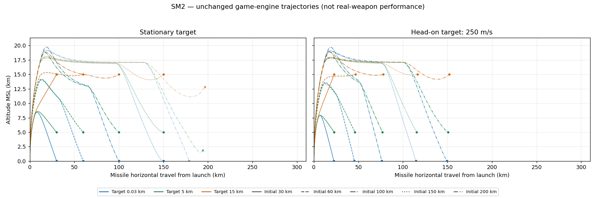
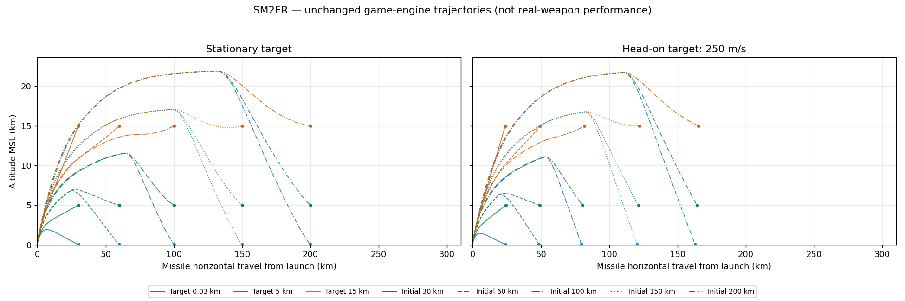
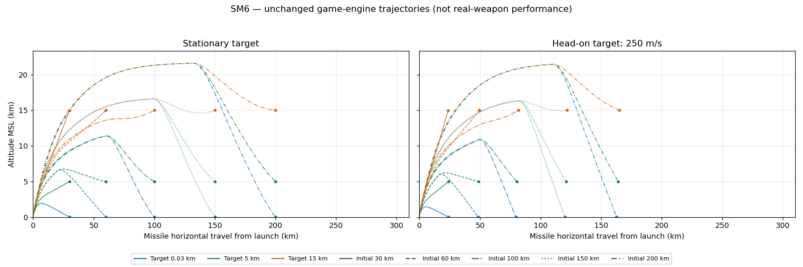
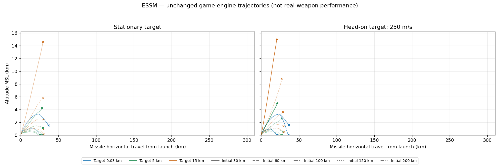

# ENV_A 게임 엔진 진단 결과

프로파일 SHA-256: `df8a7d55ce17160c978cd3cb7600f190aa524f03e1b1de9c6d41c035aef10ed0`

정지·해면 발사 / 오차 없는 지속 표적 정보 / 기존 비행·유도·로프트·신관 코드. 실제 장비 성능과 비교하지 않는다. `≥300`은 검사 상한이며 실제 최대 거리 확정을 뜻하지 않는다.

최대 거리 96조합, 궤적 120사격. 각 궤적은 10Hz이며 마지막 종료 샘플을 추가했다. 단계 구간은 이 10Hz 관측에 기반하므로 경계 시각의 분해능은 0.1초다.

이분 탐색 후 더 먼 모든 정수 km를 검사해 비단조 성공 구간을 누락하지 않았다. 범위 내부의 모든 거리에서 성공한다는 뜻은 아니다.

## SM-2MR (SM2)

단위: 최초 사격 거리 km. 표적 고도는 MSL.

| 고도 | 정지 | 접근 250m/s | 접근 680m/s | 이탈 250m/s |
|---|---:|---:|---:|---:|
| 30m | 158 | 244 | ≥300 | 15 |
| 1000m | 168 | 260 | ≥300 | 28 |
| 5000m | 176 | 262 | ≥300 | 36 |
| 10000m | 182 | 264 | ≥300 | 54 |
| 15000m | 184 | 255 | ≥300 | 90 |
| 20000m | 180 | 229 | 298 | 128 |

## SM-2ER (SM2ER)

단위: 최초 사격 거리 km. 표적 고도는 MSL.

| 고도 | 정지 | 접근 250m/s | 접근 680m/s | 이탈 250m/s |
|---|---:|---:|---:|---:|
| 30m | 257 | ≥300 | ≥300 | 24 |
| 1000m | 280 | ≥300 | ≥300 | 42 |
| 5000m | ≥300 | ≥300 | ≥300 | 54 |
| 10000m | ≥300 | ≥300 | ≥300 | 68 |
| 15000m | 281 | ≥300 | ≥300 | 221 |
| 20000m | 285 | ≥300 | ≥300 | 254 |

## SM-6 (SM6)

단위: 최초 사격 거리 km. 표적 고도는 MSL.

| 고도 | 정지 | 접근 250m/s | 접근 680m/s | 이탈 250m/s |
|---|---:|---:|---:|---:|
| 30m | 284 | ≥300 | ≥300 | 24 |
| 1000m | ≥300 | ≥300 | ≥300 | 42 |
| 5000m | ≥300 | ≥300 | ≥300 | 56 |
| 10000m | ≥300 | ≥300 | ≥300 | 72 |
| 15000m | ≥300 | ≥300 | ≥300 | 244 |
| 20000m | ≥300 | ≥300 | ≥300 | 280 |

## ESSM

단위: 최초 사격 거리 km. 표적 고도는 MSL.

| 고도 | 정지 | 접근 250m/s | 접근 680m/s | 이탈 250m/s |
|---|---:|---:|---:|---:|
| 30m | 27 | 67 | 113 | 11 |
| 1000m | 25 | 60 | 99 | 12 |
| 5000m | 27 | 39 | 63 | 13 |
| 10000m | 28 | 41 | 66 | 14 |
| 15000m | 29 | 40 | 62 | 15 |
| 20000m | 27 | 36 | 53 | 15 |

## 실패 사유

{'SEA_IMPACT': 4, 'LOW_SPEED': 25}

`LOW_SPEED`: 기존 Mach 0.5 종료 조건, `SEA_IMPACT`: 해면 충돌, `MAX_LIFE`: 기존 수명 제한. `PROX_DETONATION_AIRCRAFT`인데 성공이 아니면 근접신관은 작동했으나 기존 항공기 파괴 거리 조건을 만족하지 않은 것이다.

마지막 성공/첫 실패의 실제 거리·사유·최근접 거리·종말 속도는 [envelope-table.json](results/envelope-table.json)에, 연소 종료·최고 고도·종말 속도는 [trajectory-summary.csv](results/trajectory-summary.csv)에 기록했다.

## 동일 경로와 격리

원본241개 함수의 본문을 그대로 복사하고 독립 어휘 공간에 놓았다.88개 설정값을 분리했다. 격리 경계77개는 [의존성 명세](dependencies.json)와 [경계 설명](boundaries.json)에 기록했다. 비행·유도·로프트·신관의 근사 모델을 새로 만들지 않았다.

기존 수직 발사/관내 이동·피치오버를 사용한다. 발사 기준은MSL0m·정지·무경사, 기존 일반 항공기 점 표적의 직선 등속 운동이다. 이상적 RF 표적 상태를 입력하므로 센서 수평선·조사기 자원·DL 단절·EW를 배제한다. RNG·항법 seed·환경 입력을 고정하고 사격마다 독립 상태를 초기화한다. 자세한 값은 [재현 설명](README.md)에 있다.

실제 게임 함수에 같은 입력을 적용한 폐기용 게임 월드의 미사일과 비교했다.362개 궤적 샘플의 시각/위치/고도/속도/Mach 오차는 모두0이며 기존 신관 결과도 같다. 이 검증은 사용자 플레이 월드에서 실행하지 않는다. 독립 진단은 사용자 월드 배열에 미사일을 삽입하지 않는다.

게임 시작 시 진단을 실행하지 않는다. `window.__ENV_A__.status()`가 표와 현재 프로파일·복사 함수 일치를 검사하고, 설정 변경 시 ‘재계산 필요’를 반환한다. `case()`/`run()`은 명시 호출할 때만 계산한다. 전체 API는4개 Worker를 사용한다. 이번에는 표를 지도나 발사 판정에 연결하지 않았다.

## 실패 사유와 비단조 구간

120개 궤적: 성공91, `LOW_SPEED`25, `SEA_IMPACT`4. 최대 거리 표96행 중36행은 검사 상한300km에서도 성공했다. 나머지60행의 바로 다음1km 실패는 `LOW_SPEED`23/`SEA_IMPACT`21/`PROX_DETONATION_AIRCRAFT`16이다. 마지막 종류는 신관은 작동했지만 기존 항공기 파괴 거리 조건을 만족하지 않은 결과다. 성공 판정을 느슨하게 바꾸지 않았다.

거친 탐색에서12행의 성공/실패가 단조롭지 않았다. 이분 탐색값보다 먼 정수 km를 모두 확인해 가장 먼 성공을 검증했다. **표의 최대 거리 안쪽을 통째로 명중 영역으로 간주하면 안 된다.** MAP_B에서 원 하나를 그리기 전에 실패 구간을 어떻게 나타낼지 판단해야 한다.

12000회가 넘는 사격 호출이 필요했다. 원시JSON에 마지막 성공/첫 실패의 실제 종료 상태를 보존했으며, 요약JSON은 인접1km 거리와 사유를 담는다.300km 이상 한계는 조사하지 않았다.

## 로프트에서 관찰한 사례 — 수정하지 않음

- SM-2ER,150km·고도30m 정지 표적:86.1초에 `CLIMB→DIVE`, `CRUISE` 관측 없음. 최고17.068km, 해당 계획 선반 약17.737km. 요격은 성공했다.
- SM-6, 같은 조건:87.7초에 `CLIMB→DIVE`, `CRUISE` 관측 없음. 최고16.597km, 해당 계획 선반 약17.239km. 요격은 성공했다.
- SM-2MR,200km·고도30m 정지 표적: 최고19.232km까지 상승했지만 약259초에 해면 충돌로 실패했다. 계산된158km 한계 바깥 사격이다.
- ESSM,150km·고도15km 정지 표적: B4는 `DIRECT`, 최고 약1.435km 후 약77.4초에 `LOW_SPEED`. 계산된29km 범위 바깥이다. 고고도 선반이 나타나지 않은 원거리 실패 사례로 기록한다.
- B4의 `DIRECT`만으로 모든 상승 유도를 껐다고 해석할 수 없다. SM-2MR30km·고도5km 정지 표적은 `DIRECT` 표시여도 기존 다른 상승/유도 경로에 따라 최고8.583km에 이른다.

단계 구간은10Hz 관측으로 경계 오차 최대 약0.1초다. 각 사례의 연소 종료 시각·거리·고도·속도, 종말 속도/Mach·최근접 거리와 전체 단계 구간은 CSV에 있다. 비행·로프트·유도·신관·프로파일은 변경하지 않았다.

## 파일

- `results/*-trajectories.svg`/`.png`: 미사일별 그래프, 표적 고도별 색, 정지/접근250m/s 구분.
- `results/trajectories-10hz.csv.gz`:10Hz 원시 궤적. 리포트ZIP에는 해제된CSV도 넣는다.
- `results/trajectory-summary.csv`:120사격의 연소 종료/최고 고도/종말 속도/성공·실패.
- `results/loft-phase-intervals.csv`:모드·단계 시간 구간.
- `results/envelope-table.json`, `ENVELOPE_TABLE_A.json`:96조합의 최대 최초 사격 거리와 마지막 성공/첫 실패 근거.
- `results/results.json.gz`:결정적 전체 원시 결과. `.receipt.json`은 실행 시간을 별도로 기록한다.

검수E1–E4와 실행 시간은 아래 최종 검증 절에 기록한다.

CSV의 `burnoutStatus=NOT_REACHED_BEFORE_TERMINATION`은 요격/종료가 최종 연소 종료보다 먼저였음을 뜻한다. 이때 연소 종료 수치 칸은 해당 없음이며, 결과/종료 사유는 별도 열에 기록한다.

그래프의 색은 표적 고도, 선 모양은 최초 사격 거리다. 계산 범위 바깥 사격은 흐린 선으로 보존하고 요약CSV에서 ‘도달 불가’로 표시한다. 원 표식은 성공, ×는 실패다.

직접 `file://` 열기 추가 검사는 관리형 Chromium의 관리자 정책(`ERR_BLOCKED_BY_ADMINISTRATOR`)으로 차단되어 검수 합계에서 제외했다. 정책 우회는 시도하지 않았다. 동일 HTML bytes를 HTTPS 경로에서 실행한 전체 기능 검사와 ZIP 압축 해제 bytes 검사를 제공하며, 실제 단말의 파일 열기/Worker 환경은 이 관리형 브라우저에서 검증하지 못했다.

## 전체 재계산의 결정성

두 독립 프로세스의 결과는 **44,221,270bytes 전체 일치**, SHA-256 `a67b0f939509c32266a14f38c33bf69e08e45be6b4bce4ec1cd96150efd44ef4`다. 각 실행12005사격,4 Worker. 첫 실행47분42.481초, 두 번째91분19.952초였다. 여러 UI/회귀/브라우저 진단이 동시에 실행된4vCPU 환경의 wall time이며, 단독 실행 비용이나 실폰 속도로 일반화하지 않는다. 캡슐을 사격마다 새로 만들던 실행과 Worker별로 재사용한 실행도 같은 결과를 냈다.

## 최종 검수 E1–E4

| 항목 | 결과 |
|---|---|
| E1 | 전체 두 실행44,221,270bytes/SHA-256 동일. 각12005사격·96행·120궤적 |
| E2 | 전체 공개Worker API 실행 전후 게임 월드·RNG·틱 상태 동일. before/after `d9efcf8a56eed9318d84585593bf9e97ea9196b9aac20779f7aca16c90a37fad` |
| E3 | 실제 게임 월드와 독립 모델362샘플 비교. 시각/좌표/고도/속도/Mach 최대 오차 모두0, 신관 결과 동일 |
| E4 | 최대 거리96조합·궤적120조합 모두 결과/사유 존재. 마지막 성공/다음1km 실패 또는300km상한 근거 모두 있음 |

**25/25 assertions,5 suites PASS**, 페이지 오류0. 원시 영수증은 [검증 합계](evidence/verification-summary.json)에 있다. 프로파일 변경 경고도 실제 설정 변경/복원으로 확인했다.241개 복사 함수 원문은 최종 빌드와 모두 일치한다.

브라우저의 전체4 Worker 공개API 실행은 5829.184초(97.15분)였다. 동일한4vCPU에서 다른 검증과 병행한 비용이다. 시작 시 자동 실행하지 않으며, 플레이 프레임 예산에 넣는 기능이 아니다.

공개Worker 실행은 표 내장 전 후보에서 시작했고 엔진 캡슐·진단 suite·프로파일은 최종과 동일하다. 그 초기 runner의 HTML 해시는 종료 시 파일을 다시 읽은 값이어서 loaded-build 증거로 사용하지 않는다. 이 메타데이터 한계와 원시 영수증을 함께 보존한다. 최종 HTML 자체의 경로 비교·프로파일 검사는 별도 영수증으로 확인했다.

브라우저와Node의 전체 결과 JSON 해시는 같지 않다. 서로 다른V8 런타임의 수치 결과 동일성을 주장하지 않는다. E1은 같은 오프라인 환경의 두 실행 기준이다.

최종 Chromium에서96행의 마지막 성공/다음 실패156경계를 재실행해 모든 성공·실패 사유가 일치했다. Node 대비 최근접 거리 차이 최대2.16878390802e-08m, 종말 속도 차이 최대1.54523149831e-09m/s였다. 작은 런타임 수치 차이에도 이번1km 표 경계는 동일하다.
