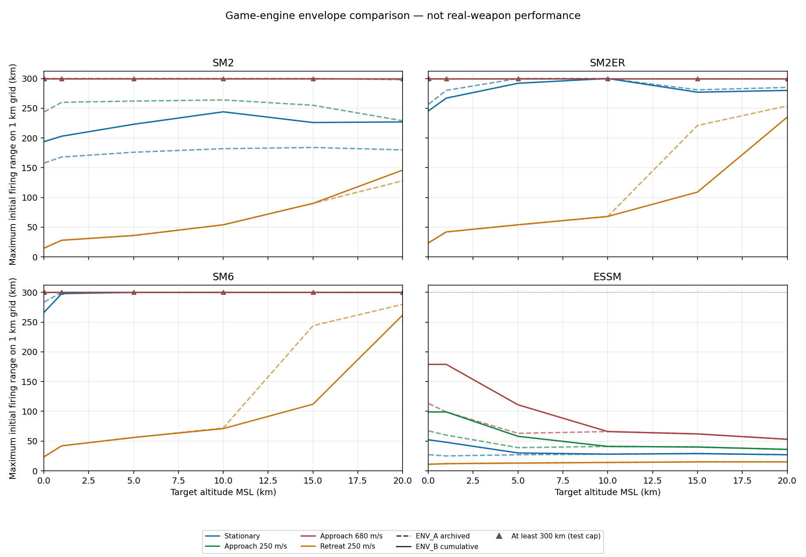

# ENV_B — 누적 ALL4_TERM 재측정

프로파일 SHA-256: `f50d26e39ca3f231525dcf9a0923edd352fc2cd228f52e5deadff29e760a8108`

모든 값은 실제 게임 코드로 계산한 가상 모델 결과다. 실물 성능과 비교하지 않는다. 이 표는 지도/발사 관문에 연결하지 않았다.

독립 2회 각각 11,458사격, 96개 최대 거리 조합 + 120개 궤적. 원시 JSON 46,068,182bytes가 비트 단위로 동일하다.
원시 결과 SHA-256: `f1ef0bc338144158ae029155b922114482b4a3e276eaa642c94964e04a7f9963`

벽시계 실행 시간: 2213.627s / 1898.751s. 각 4 workers, 두 실행 일부 중첩 및 브라우저 검사 병행. 전용 CPU 성능으로 일반화하지 않는다.

| 검수 | 결과 |
|---|---|
| E1 독립 전체 결과 동일 | PASS · 46,068,182 bytes |
| E2 분리 계산 월드/RNG/틱 불변 | PASS · 5개 게임/사본 비교 조건 |
| E3 동일 네이티브 경로 | PASS · 5,894샘플 · time/x/y/z/speed/Mach 최대 오차 0 |
| E4 표·궤적 빈칸 | 0 · 96조합/120사격 |
| 최종 Chromium 경계 재실행 | 151개 모두 동일 성공/실패·사유 |
| Node/Chromium 최대 최근접 차이 | 5.28886312523e-09m |
| Node/Chromium 최대 속도 차이 | 1.54523149831e-09m/s |
| 런타임 소스·표 해시/변경 경고 | PASS · 246개 네이티브 함수, 설정 변경 시 재계산 경고 |

[전체 표·4종 궤적 그래프](results/REPORT_ENV_B.md) · [전후 96조합 CSV](results/comparison.csv) · [구판 ENV_A](../A/REPORT.md)

## 전후 비교

정지 표적 기준. 단위 km. `≥300`은 검사 상한에서 성공한 하한이며 숫자 300을 실제 최대치로 해석하지 않는다.

| 기종 | 고도 | ENV_A 구판 | ENV_B 누적본 |
|---|---:|---:|---:|
| SM2 | 30m | 158 | 194 |
| SM2 | 1000m | 168 | 203 |
| SM2 | 5000m | 176 | 223 |
| SM2 | 10000m | 182 | 244 |
| SM2 | 15000m | 184 | 226 |
| SM2 | 20000m | 180 | 227 |
| SM2ER | 30m | 257 | 246 |
| SM2ER | 1000m | 280 | 267 |
| SM2ER | 5000m | ≥300 | 292 |
| SM2ER | 10000m | ≥300 | ≥300 |
| SM2ER | 15000m | 281 | 277 |
| SM2ER | 20000m | 285 | 280 |
| SM6 | 30m | 284 | 267 |
| SM6 | 1000m | ≥300 | 298 |
| SM6 | 5000m | ≥300 | ≥300 |
| SM6 | 10000m | ≥300 | ≥300 |
| SM6 | 15000m | ≥300 | ≥300 |
| SM6 | 20000m | ≥300 | ≥300 |
| ESSM | 30m | 27 | 52 |
| ESSM | 1000m | 25 | 48 |
| ESSM | 5000m | 27 | 30 |
| ESSM | 10000m | 28 | 28 |
| ESSM | 15000m | 29 | 29 |
| ESSM | 20000m | 27 | 27 |

## 관찰한 변화와 한계

- MR/ESSM의 기존 시험용 로프트 상한 완화와 네 종류의 동적 선반 재계획을 모두 적용했다. MR/ESSM의 일부 거리 증가는 이 수정과 함께 나타난다.
- ER/SM-6도 기존 한계를 유지한 채 재계획에 참여하면서 모든 조건이 좋아지지는 않았다. 고도 15km·250m/s 이탈 표적은 ER 221→109km, SM-6 244→112km다. 요청한 ALL4 코드·수치를 바꾸어 결과를 맞추지 않았다.
- 120개 궤적 결과: 명중 94, LOW_SPEED 23, SEA_IMPACT 2, BATTERY_EXHAUSTED 1. 이상 유도 정보가 지속되므로 RF 기반 비명중 종료가 개입한 성능표가 아니다. 실제 RF 조건의 종료는 별도 게임 회귀에 있다.
- 거친 탐색에서 비단조 성공 구간 10행을 관찰했다. 더 먼 모든 정수 km를 검사하여 전역 1km 격자 최대를 확인했다. 범위 안의 모든 거리에서 명중한다는 뜻은 아니다.
- 기존 ENV_A 코드·표·원시 결과는 동일 Git blob으로 유지한다. 신판 계산의 이상 RF 관측 기록이 기존 이상 유도 비행 자체를 바꾸지 않는지도 60궤적 비교로 확인했다.
- 연소 종료, 최고 고도, 종말 속도, 최근접 거리, 로프트 단계 구간과 10Hz 샘플은 results의 CSV/JSON에 있다. 저장소의 큰 원시 파일은 gzip이고 리포트 ZIP에서는 읽을 수 있게 풀어서 수록한다.
- 자연 비행 전원 480초를 실물 수명/도달 거리로 해석하지 않는다. SM-6 480초는 사용자 지정 게임 시험값이다.
