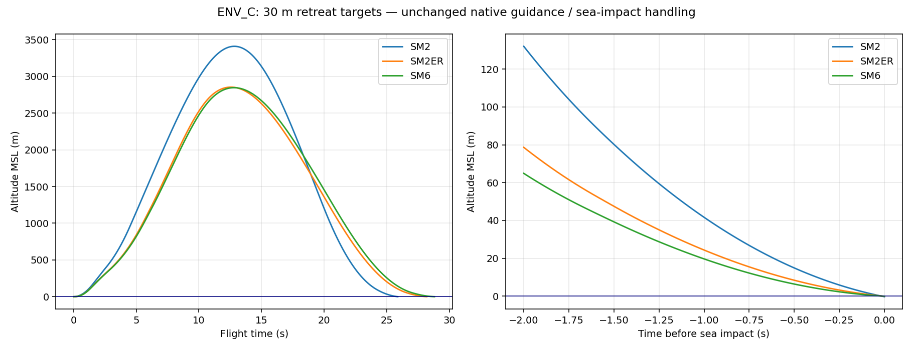

# 저고도 해면 충돌 조사 — 수정 없음

실제 게임 함수/60Hz 적분을 그대로 사용한 분리 진단이다. 표적은 처음 +X에 두고 이탈은 +X250m/s, 횡단은 +Y250m/s(사격선과90°)로 이동한다. 레이더/데이터링크/조사기는 기존 ENV 이상 조건이다. 전장·센서 truth로 전술 정보를 생성하지 않는다. 진단의 실제 위치·속도는 사후 원인 분석 전용이다.

## 제시한 이탈3건

| 기종 | 최초거리 | 변경 전 속도/최근접 | 정렬 후 속도/최근접 | 결과 | 최초 하강: 시각/고도 | 당시 상태/명령 |
|---|---:|---:|---:|---|---|---|
| SM2 | 16km | 928.845m/s / 1066.110m | 928.845m/s / 1066.110m | SEA_IMPACT | 12.850000s / 3408.994m | DIRECT/DIRECT/KAPPA_MIDCOURSE · pitch-rate -0.095221rad/s · Kappa az -95.993m/s² |
| SM2ER | 25km | 1193.281m/s / 1544.594m | 1193.256m/s / 1544.303m | SEA_IMPACT | 12.566667s / 2853.236m | DIRECT/DIRECT/KAPPA_MIDCOURSE · pitch-rate -0.057059rad/s · Kappa az -78.796m/s² |
| SM6 | 25km | 1168.154m/s / 1434.678m | 1168.144m/s / 1434.550m | SEA_IMPACT | 12.816667s / 2845.709m | DIRECT/DIRECT/KAPPA_MIDCOURSE · pitch-rate -0.055092rad/s · Kappa az -74.280m/s² |

최초 하강은 vz가 양수/0에서 음수로 바뀐 첫60Hz 스텝으로 정의했다. 실제 하강 명령은 정점 이전부터 나오므로 하강 시작시각과 명령 시작은 같지 않다. 전체60Hz 명령/속도/자세 로그와 마지막2초는 raw JSON에 있다.

## 횡단18건

| 기종 | 표적고도 | 10km | 20km | 40km |
|---|---:|---|---|---|
| SM2 | 30m | INTERCEPT_SUCCESS · 1080.7m/s · CPA 2.9m | INTERCEPT_SUCCESS · 848.4m/s · CPA 1.7m | SEA_IMPACT · 502.1m/s · CPA 3109.9m |
| SM2 | 200m | INTERCEPT_SUCCESS · 1082.5m/s · CPA 2.9m | INTERCEPT_SUCCESS · 856.3m/s · CPA 2.9m | LOW_SPEED · 169.9m/s · CPA 678.7m |
| SM2ER | 30m | SEA_IMPACT · 1323.2m/s · CPA 211.1m | SEA_IMPACT · 1320.2m/s · CPA 494.7m | SEA_IMPACT · 815.2m/s · CPA 3040.3m |
| SM2ER | 200m | SEA_IMPACT · 1316.9m/s · CPA 184.5m | SEA_IMPACT · 1128.6m/s · CPA 185.3m | INTERCEPT_SUCCESS · 657.9m/s · CPA 2.7m |
| SM6 | 30m | SEA_IMPACT · 1293.8m/s · CPA 164.8m | SEA_IMPACT · 1306.4m/s · CPA 303.3m | SEA_IMPACT · 830.5m/s · CPA 3100.0m |
| SM6 | 200m | SEA_IMPACT · 1294.7m/s · CPA 161.2m | SEA_IMPACT · 1057.3m/s · CPA 162.5m | INTERCEPT_SUCCESS · 680.0m/s · CPA 0.5m |

횡단 결과: {'INTERCEPT_SUCCESS': 6, 'SEA_IMPACT': 11, 'LOW_SPEED': 1}. 30m뿐 아니라200m 횡단 표적 일부에서도 충돌한다. 정렬 전후21건의 성공/실패 사유는 모두 같았다. ER/SM-6의 launch 계획 정규화가 달라져 미세한 궤적 차이는 있으며 byte-identical 궤적이라고 주장하지 않는다.

## 코드 경로와 원인 추정

1. `_wip79KappaPipState`는 관측 예측점과 terminal velocity 조건을 구성한다. `PIP_LOS` 고각과 표적 수평 속도 반대 방향의 terminal vector를 사용한다. 이탈·횡단에서 이 terminal vector 요구는 큰 자세 변화를 요구할 수 있다. `computeKappaMidcourseAccelV2` → `applyAccelCommandToAutopilotV1` → `updateSamSixDofLiteDynamics`로 하강 명령이 전달된다. 측정된 실제 Kappa az와 cmdOmegaPit는 표/JSON에 있다. 이것만으로 terminal-vector 정책을 단일 원인이라고 확정하지 않는다.

2. 제시한3건은 `DIRECT`여서 B4 shelf/DIVE 전환으로 생긴 충돌이 아니다. 하강 시작은 KAPPA_MIDCOURSE이며, 충돌 직전에는 ENDGAME/PN 경로로 넘어가 이미 상승 명령을 내고 있다. 속도는 충분하지만 하강 속도를0으로 돌리기 전에 수면을 통과한다. 40m 아래 진입 때도 cmdOmegaPit는 양수다. 힘·모멘트·자세 응답 지연과 이전에 쌓인 하강 운동량을 함께 고려해야 한다.

3. `_samSeaClearanceRateGuard`의 예측 고도/seaMargin 보호는 `isESSM`인 경우에만 활성이다. SM2MR/ER/SM6는 해당 분기로 들어가지 않는다. 계획의 seaMarginM14 같은 값이 존재해도 이3종에 연속적인 해면 회피 보호를 제공하는 것은 아니다.

4. `applyAccelCommandToAutopilotV1`의 soft guard는 고도<40m, vz<-5m/s, time-to-sea<0.5s일 때 하강 pitch 명령만 감쇠한다. 이미 상승 명령인 상태에서는 적용되지 않으며, 강제 상승력/위치 보정은 없다. 이3건의 최종 softGuard=false는 이 조건과 일치한다.

5. `updateMissileBodyB3`의 실제 6DOF 경로는 적분 후 z<0 && !vlsPhase이면 즉시 SEA_IMPACT로 종료한다. 그 다음의 Math.max(0,z)는 사전 고도 하한이나 해면 회피가 아니다. target PIP z>=0 clamp도 미사일의 실제 궤적을0 위에 강제로 고정하지 않는다.

결론은 추적 정보 소실이나 속도 부족이 아닌, 해당 저고도 기하의 하강/회복과 기존 해면 보호 적용 범위 문제다. 정확한 제어법 보완 여부는 별도 사용자 결정 사항이며 이번에는 유도·고도하한·해면 판정을 변경하지 않았다.

원문 코드: [native-engine.js](../native-engine.js)에서 위 함수명을 검색하면 현재 게임에서 그대로 복사한 코드가 나온다. 모든 네이티브 함수의 변경0은 RANGE_A 정적 감사로 별도 확인했다.
