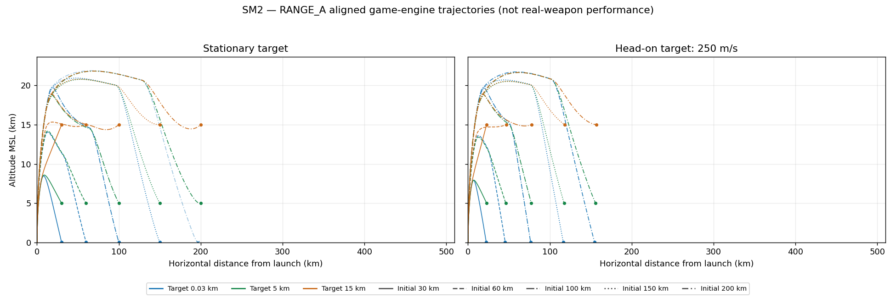
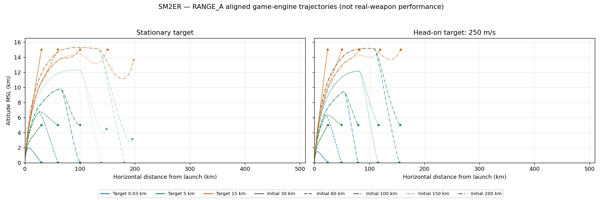
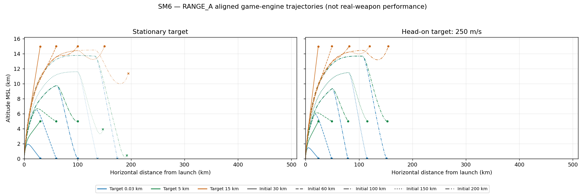
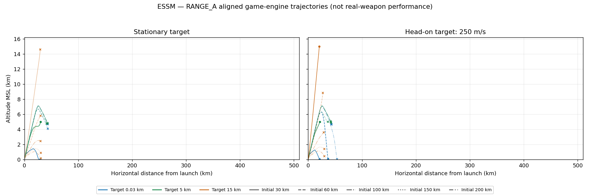

# ENV_C 게임 엔진 진단 결과

프로파일 SHA-256: `a481e469fc7201c626c243b6669a215f0feafbd608b4af10ab65b4ebf5574a61`

정지·해면 발사 / 오차 없는 지속 표적 정보 / 기존 비행·유도·로프트·신관 코드. 실제 장비 성능과 비교하지 않는다. `≥500`은 검사 상한이며 실제 최대 거리 확정을 뜻하지 않는다.

최대 거리 96조합, 궤적 120사격. 각 궤적은 10Hz이며 마지막 종료 샘플을 추가했다. 단계 구간은 이 10Hz 관측에 기반하므로 경계 시각의 분해능은 0.1초다.

이분 탐색 후 더 먼 모든 정수 km를 검사해 비단조 성공 구간을 누락하지 않았다. 범위 내부의 모든 거리에서 성공한다는 뜻은 아니다.

## SM2

단위: 최초 사격 거리 km. 표적 고도는 MSL.

| 고도 | 정지 | 접근 250m/s | 접근 680m/s | 이탈 250m/s |
|---|---:|---:|---:|---:|
| 30m | 194 | 302 | 493 | 15 |
| 1000m | 203 | 326 | ≥500 | 28 |
| 5000m | 223 | 341 | ≥500 | 36 |
| 10000m | 244 | 364 | ≥500 | 54 |
| 15000m | 226 | 375 | ≥500 | 90 |
| 20000m | 227 | 362 | ≥500 | 146 |

## SM2ER

단위: 최초 사격 거리 km. 표적 고도는 MSL.

| 고도 | 정지 | 접근 250m/s | 접근 680m/s | 이탈 250m/s |
|---|---:|---:|---:|---:|
| 30m | 119 | 356 | ≥500 | 24 |
| 1000m | 136 | 393 | ≥500 | 42 |
| 5000m | 138 | 416 | ≥500 | 54 |
| 10000m | 135 | 456 | ≥500 | 67 |
| 15000m | 327 | 491 | ≥500 | 107 |
| 20000m | 241 | ≥500 | ≥500 | 182 |

## SM6

단위: 최초 사격 거리 km. 표적 고도는 MSL.

| 고도 | 정지 | 접근 250m/s | 접근 680m/s | 이탈 250m/s |
|---|---:|---:|---:|---:|
| 30m | 121 | 321 | ≥500 | 24 |
| 1000m | 135 | 412 | ≥500 | 42 |
| 5000m | 135 | 447 | ≥500 | 56 |
| 10000m | 132 | 496 | ≥500 | 69 |
| 15000m | 179 | ≥500 | ≥500 | 109 |
| 20000m | 286 | ≥500 | ≥500 | 188 |

## ESSM

단위: 최초 사격 거리 km. 표적 고도는 MSL.

| 고도 | 정지 | 접근 250m/s | 접근 680m/s | 이탈 250m/s |
|---|---:|---:|---:|---:|
| 30m | 52 | 99 | 179 | 11 |
| 1000m | 48 | 99 | 179 | 12 |
| 5000m | 30 | 58 | 111 | 13 |
| 10000m | 28 | 41 | 66 | 14 |
| 15000m | 29 | 40 | 62 | 15 |
| 20000m | 27 | 36 | 53 | 15 |

## 실패 사유

{'SEA_IMPACT': 6, 'LOW_SPEED': 29, 'BATTERY_EXHAUSTED': 1}

`LOW_SPEED`: 기존 Mach 0.5 종료 조건, `SEA_IMPACT`: 해면 충돌, `BATTERY_EXHAUSTED`: 비행 전원 소진. `PROX_DETONATION_AIRCRAFT`인데 성공이 아니면 근접신관은 작동했으나 기존 항공기 파괴 거리 조건을 만족하지 않은 것이다.

마지막 성공/첫 실패의 실제 거리·사유·최근접 거리·종말 속도는 [envelope-table.json](envelope-table.json)에, 연소 종료·최고 고도·종말 속도는 [trajectory-summary.csv](trajectory-summary.csv)에 기록했다.
