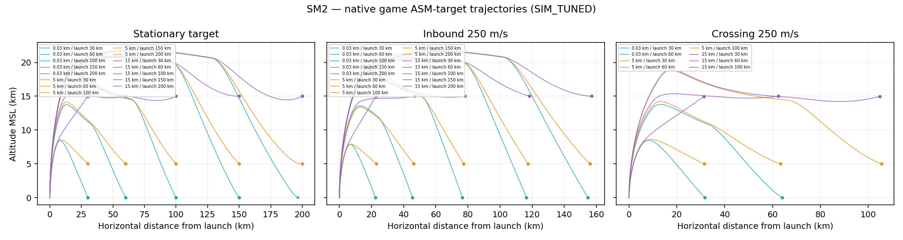
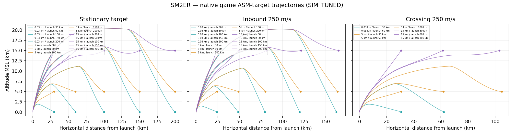
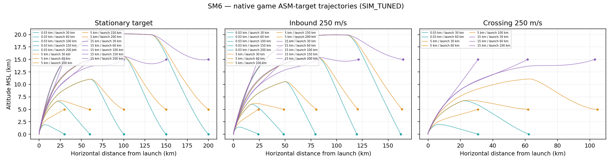
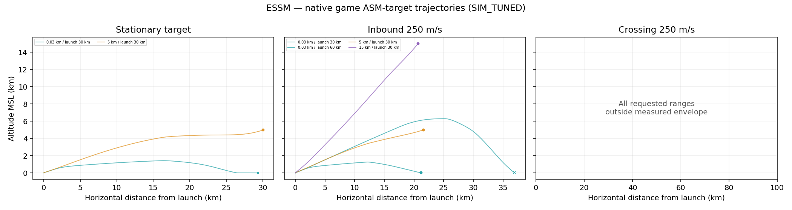

**REG_K: 성공→실패 0건, 실패→성공 2건. 게임 코드·계수 수정 없음.**

# REG_K + ENV_D

기준 KAPPA_PIP_LOS_A / `kappa-pip-los-a`의 `80b6514`. 비교 기준 RANGE_RECOVERY_A. 이 문서의 모든 사거리는 SIM_TUNED 게임 엔진 계산값이며 실제 무기 성능이 아니다.

## 1. 전체 회귀 및 이전 기준과의 차이

|검사|RANGE_RECOVERY_A|KAPPA_PIP_LOS_A|
|---|---:|---:|
|도메인15묶음|420 / PASS|420 / PASS|
|UI|88 / PASS|88 / PASS|
|종료기|16 / PASS|16 / PASS|
|자연탐지→LOCK→정식VLS→fixed tick→실제WebGL8발|29 / PASS|29 / PASS|

종료기 표의16은 검수 항목 수다. 실제 사격은 정상 ON/OFF240발, 대체 지원36발, RF 소실·재획득·미획득, 배터리8발, 정식 VLS4발을 포함한다. 원래 자연 탐지 검사의8발을 보존하고, ON/OFF 양쪽 모두 실제 WebGL 프레임을 확인하는8발도 별도로 실행했다. 추가 native validation60조건과 전체 사격 조건은 원시 evidence/reg-k에 보존했다.

무표적120초 truth/RNG hash 동일: True. 사격 비교 376건 중 결과·최근접·비행시간 등 차이 176건. 전체 조건과 전후 값은 [REG_K_ALL_CHANGES.csv](REG_K_ALL_CHANGES.csv), 상세는 [REG_K_RESULTS.json](REG_K_RESULTS.json).

### 성공→실패
없음.
### 실패→성공
- {"suite": "normals-release", "condition": {"weapon": "SM6", "rangeKm": 240, "altM": 15000, "seed": 12002, "enabled": false, "samples": false}, "before": {"success": false, "reason": "SEA_IMPACT", "closestM": 386.66651485861024, "fuzeMissM": null, "flightTimeS": 222.2666666667357, "reacquired": false}, "after": {"success": true, "reason": "PROX_DETONATION_AIRCRAFT", "closestM": 46.83879600828302, "fuzeMissM": 40.514150125549264, "flightTimeS": 165.96666666669088, "reacquired": false}}
- {"suite": "normals-release", "condition": {"weapon": "SM6", "rangeKm": 240, "altM": 15000, "seed": 12002, "enabled": true, "samples": false}, "before": {"success": false, "reason": "SEA_IMPACT", "closestM": 386.66651485861024, "fuzeMissM": null, "flightTimeS": 222.2666666667357, "reacquired": false}, "after": {"success": true, "reason": "PROX_DETONATION_AIRCRAFT", "closestM": 46.83879600828302, "fuzeMissM": 40.514150125549264, "flightTimeS": 165.96666666669088, "reacquired": false}}

전투120초(SM-6 100km/5km/접근250/seed12002)는 hash가 달라졌다. 별도 종료까지 관찰한 결과는 다음과 같다.

|버전|120초 시 최근접(m)|최종 종료 사유|발사 후 종료(s)|
|---|---:|---|---:|
|recovery|971.039|TERMINAL_MISS_POST_CROSS|108.083333|
|current|4789.554|TERMINAL_MISS_POST_CROSS|95.833333|

최종 targetAlive와 단계 로그는 REG_K_RESULTS에 보존했다. 이 사례의 결과 변화도 교정하지 않았다. 기존 종료기 수집기의 첫 임시 호출은 validation 파일이 아직 준비되지 않아 실패했고, 원래 검사를 변경하지 않고 파일 준비 뒤 재실행했다. 제한 소켓 환경에서의 브라우저 시동 실패는 별도 infra 로그에 구분했으며 게임 실패에 합산하지 않았다.

## 2. 실행 비용

초기 v0 진단은 fixed-tick 외부에서 부착되는 WIP112 계통 손상 observer가 빠져1칸 완료 시점에 중단·무효화했다. 그 결과는 evidence/diagnostic-v0-incomplete-hooks에 보존하고 최종 표에서 제외했다. 이후 native observer + 원문 ASM damage-prefix로 다시 동등성을 검증하고 실행 전 비용도 재측정했다. 정식 전수는 이 보정본1회다.

실행 전 보고: 214,510발, 5.03시간(4코어, 실측80발 기반,25%여유). 축소안 예상 73,307발/1.68시간. 예상6시간 이내여서 축소안을 사용하지 않았다.
실측: 본 측정 175,955발/4.988시간, 경계·궤적·과거 경계 확인 2,357발/0.068시간. 전체 스윕은1회뿐이다. 모든 시드에서 native 비행을 독립 실행했으며 Pk만 재추첨하는 궤적 재사용은 하지 않았다.

## 3. ASM 기준 사거리표

각 칸: **바깥 / 안쪽 km · 요격점 평균(바깥 / 안쪽) km**. 요격점은 발사 원점에서 native SAM 효과 발생 위치까지의 수평 거리이며, 같은 고정틱의 표적 위치 거리도 별도 기록한다. 바깥 요격점 평균은 효과 발생 발, 안쪽 평균은 KILL/STRUCT_FAIL 발만 사용한다. 경계 JSON에는 두 집계와5발 원본을 함께 기록했다. 바깥은5발 중1발 이상 효과, 안쪽은5km부터 모든5km 지점에서3발 이상KILL/STRUCT_FAIL. 0km는 이 정의를 만족하는 연속 구간이 없다는 뜻이다. 500km는 측정 상한이다. 모든 경계의5발 결과, 요격점 평균·최소·최대는 [ENV_D_TABLE.csv](ENV_D_TABLE.csv)와 [ENVELOPE_TABLE_D.json](ENVELOPE_TABLE_D.json).

안쪽 범위가 0인 기본 표 칸은 37개다. 첫 5km 지점에서 기준을 못 채우면 더 먼 거리에서 성공하더라도 안쪽 범위는 0이다. 500km 상한 도달 칸은 501km를 추정하거나 사격하지 않았고 다음 경계는 없음으로 기록했다.

### SM2

|고도(m)|정지|접근250|접근680|이탈250|횡단250|
|---:|---:|---:|---:|---:|---:|
|30|203/195 · 203.0/195.0|320/300 · 238.1/224.9|499/0 · 258.4/—|31/30 · 48.5/45.8|84/80 · 89.8/85.3|
|1000|210/210 · 210.0/210.0|327/325 · 242.6/241.3|500/500 · 258.7/258.7|32/30 · 49.6/44.8|92/90 · 98.2/96.1|
|5000|228/225 · 228.0/225.0|342/340 · 254.3/252.9|500/500 · 261.2/261.2|45/45 · 69.3/69.3|170/170 · 179.1/179.1|
|10000|248/245 · 248.0/245.0|364/350 · 270.8/262.2|500/0 · 264.6/—|55/55 · 86.3/86.3|201/200 · 212.5/211.2|
|15000|264/0 · 264.0/—|376/0 · 281.2/—|500/0 · 267.1/—|150/90 · 223.3/137.1|222/220 · 235.0/232.5|
|20000|264/0 · 264.0/—|364/0 · 274.5/—|500/0 · 266.8/—|160/0 · 237.8/—|232/0 · 245.6/—|

원 = native 효과 발생, × = 효과 없음. 색은 표적 고도이며 각 곡선의 발사 거리는 범례에 표시했다.

### SM2ER

|고도(m)|정지|접근250|접근680|이탈250|횡단250|
|---:|---:|---:|---:|---:|---:|
|30|259/245 · 259.0/245.0|387/365 · 303.8/288.4|500/0 · 295.4/—|43/35 · 60.7/46.6|76/75 · 79.8/78.7|
|1000|275/275 · 275.0/275.0|404/400 · 316.6/313.8|500/500 · 297.3/297.3|46/45 · 65.4/62.8|83/80 · 87.3/83.9|
|5000|302/300 · 302.0/300.0|431/425 · 338.0/333.8|500/0 · 300.9/—|56/55 · 79.9/77.3|243/240 · 251.3/247.8|
|10000|336/330 · 336.0/330.0|471/0 · 369.0/—|500/5 · 304.0/3.6|66/65 · 96.5/93.4|285/285 · 295.3/295.3|
|15000|371/365 · 371.0/365.0|500/0 · 393.3/—|500/5 · 306.0/6.1|234/105 · 320.2/150.6|322/0 · 334.5/—|
|20000|392/0 · 392.0/—|500/0 · 396.1/—|500/0 · 307.4/—|257/0 · 351.4/—|351/0 · 364.7/—|

원 = native 효과 발생, × = 효과 없음. 색은 표적 고도이며 각 곡선의 발사 거리는 범례에 표시했다.

### SM6

|고도(m)|정지|접근250|접근680|이탈250|횡단250|
|---:|---:|---:|---:|---:|---:|
|30|267/265 · 267.0/265.0|387/385 · 307.7/306.3|500/0 · 301.2/—|40/40 · 56.5/56.5|80/75 · 84.2/78.5|
|1000|298/295 · 298.0/295.0|433/430 · 341.3/339.2|500/500 · 303.2/303.2|46/45 · 65.6/63.1|87/85 · 91.6/89.4|
|5000|328/325 · 328.0/325.0|465/465 · 366.8/366.8|500/0 · 306.4/—|58/55 · 83.4/76.5|269/265 · 277.9/273.4|
|10000|368/365 · 368.0/365.0|500/500 · 395.9/395.9|500/5 · 309.2/3.8|70/65 · 104.0/91.2|314/310 · 325.0/320.3|
|15000|412/405 · 412.0/405.0|500/0 · 399.9/—|500/0 · 311.1/—|263/110 · 357.4/160.0|358/0 · 371.3/—|
|20000|443/0 · 443.0/—|500/0 · 401.9/—|500/0 · 312.4/—|293/0 · 399.1/—|397/0 · 412.1/—|

원 = native 효과 발생, × = 효과 없음. 색은 표적 고도이며 각 곡선의 발사 거리는 범례에 표시했다.

### ESSM

|고도(m)|정지|접근250|접근680|이탈250|횡단250|
|---:|---:|---:|---:|---:|---:|
|30|52/25 · 52.0/25.0|99/35 · 53.4/24.1|179/30 · 53.8/15.1|11/10 · 17.7/15.6|17/15 · 18.7/16.1|
|1000|48/25 · 48.0/25.0|99/95 · 53.0/51.7|179/175 · 53.4/52.8|12/10 · 20.5/15.5|18/15 · 20.0/16.1|
|5000|30/30 · 30.0/30.0|58/55 · 35.9/34.5|111/0 · 39.3/—|13/10 · 21.7/15.6|20/20 · 22.2/22.2|
|10000|28/25 · 28.0/25.0|41/0 · 27.0/—|65/0 · 26.5/—|14/10 · 24.5/16.6|22/20 · 24.6/22.0|
|15000|29/25 · 29.0/25.0|39/0 · 25.9/—|61/0 · 25.3/—|15/15 · 28.6/28.6|23/20 · 26.3/22.5|
|20000|27/25 · 27.0/25.0|35/0 · 22.8/—|52/0 · 20.8/—|15/15 · 31.5/31.5|22/20 · 25.8/23.3|

원 = native 효과 발생, × = 효과 없음. 색은 표적 고도이며 각 곡선의 발사 거리는 범례에 표시했다.

## 4. 시드와 다른 ASM 라벨

기준 라벨 Kh-35U. ASM_PROFILES의 다른 라벨은 Kh-32 하나이며 요청한6칸을 동일 절차로 측정했다. 시드 첫 값은 global simRandom(Pk/손상), 두 번째 값은 native INS·신관 파생 스트림의 SIM_SEED_BASE와 scenario seed에 준다. SAM 항법은 BATTLESPACE_SEED만 바꿔서는 달라지지 않으므로 두 스트림을 분리해 직접 공급했다.

|세트|게임 RNG|항법 파생 seed|
|---:|---:|---:|
|1|1831565813|2047861954|
|2|305419896|2654435769|
|3|2271560481|1013904242|
|4|324508639|2779096485|
|5|610839776|1515870810|

5발 CPA 차이의 중앙값은 86.046m, 95백분위는 1913.532m, 최대는 24208.231m이다. 최대 차이 조건은 Kh-35U_ESSM_1000_INBOUND_680 / 194km이며, 그 칸의 바깥 사거리 179km보다 먼 실패 구간이다. 모든 거리별 범위는 results/seed-closest-spread.csv. 예비80발에서도 궤적과 SEA_IMPACT 발생 자체가 달라져 Pk 난수 차이만 있는 조건으로 취급하지 않았다.

|기종|고도|운동|Kh-35U 바깥/안쪽|Kh-32 바깥/안쪽|
|---|---:|---|---:|---:|
|SM2|30|INBOUND_250|320/300|320/300|
|SM2|5000|INBOUND_680|500/500|500/500|
|SM2|15000|STATIONARY|264/0|266/0|
|SM6|30|INBOUND_250|387/385|387/385|
|SM6|5000|INBOUND_680|500/0|500/0|
|SM6|15000|STATIONARY|412/405|412/410|

## 5. 해면 충돌 목록

본 스윕 SEA_IMPACT 38,117발, 경계·궤적 반복·과거 경계 확인·비용 예비 사격을 포함하면 38,570발. origin 열로 출처와 반복을 구분한다. [전체 CSV(gzip)](results/SEA_IMPACT.csv.gz)는 기종·표적 고도·운동·거리·시드·충돌 속도·CPA·하강 시작 시각/모드/단계를 포함한다. 원시 native 결과는 results/cells/*.json.gz. 계수나 판정을 수정하지 않았다.

## 6. ENV_C 과거 결과 및 설계값

ENV_C는 항공기 점 표적 + 이전 수평 종말 방향 계산(HISTORICAL)이고, ENV_D는 실제 ASM 피해 판정 + KAPPA_PIP_LOS_A이다. 표적과 유도 코드가 둘 다 다르다. ENV_C의 fullLoftKm도 ER360/SM-6 450인 반면 현재는 앞선 RECOVERY_A에서 정한240/260을 유지한다. 또한 이번 seed1 항법 파생 seed는2047861954이며, 옛 ENV_C의 실제 SAM 파생 SIM_SEED_BASE1831565813과 다르다(옛 BATTLESPACE_SEED와 구분). 동일 난수의 인과 A/B가 아니므로 사거리 증감을 한 원인으로 단정하지 않는다. 과거96칸 각각의 마지막 성공/다음1km 위치에서 현 코드의 seed1 단일 발도 확인했다. results/followup.json.gz의 historical에 병렬 기록했다. 횡단24칸은 ENV_C 대응 값이 없다.

발사 시 표적 거리 기준이다. 접근 표적의 큰 초기 거리와 실제 비행/요격점 거리를 구분한다.

|기종|설계값(km)|바깥 링 도달|그중 정지 조건|
|---|---:|---:|---:|
|SM2ER|360|14/30|2/6|
|SM6|450|10/30|0/6|

## 7. 결정성·동일 경로·내장 검증

경계 407거리×5발과 궤적30개 재검사: PASS. 궤적 추출 RNG seed 3540656166, 선택id는 evidence/determinism.json. 전체 측정2회 실행은 하지 않았다.
궤적 조건은 기존120 + 지정 횡단4×3×3=36으로 총156칸을 보존했다. 실제 사격 120개, 범위 밖 36칸은 도달 불가로 표시했다. 10Hz CSV와 단계 CSV는 results/ 아래에 있다.
결과는 SAM 종료/표적 퇴역 시점과 같은 fixed tick의 ASM 손상 처리를 기록했다. WIP112 AttachObservers → native SAM → 원문 ASM 손상 prefix 순서를 사용한다. ASM 비행 AI 앞에서만 경계를 끊고, 계통 파편 손상·탄두 상태·동일 틱 구조파괴는 native 경로로 처리한다. 별도 손상 임계값은 만들지 않는다. source prefix와 원 함수 SHA는 diagnostic/native-asm-prefix-proof.json에 있다. 실제 게임/독립 진단6조건(ASM·횡단 포함): 궤적 및 native 피해 결과 오차0. 진단 전후 live world/RNG/tick 변화0. 자세한 조건은 evidence/path.json.
최종 ENV_D HTML의 120초 truth hash는 Kappa 기준과 무표적 True, 전투 True이다. DDG/CG status 일치 True/True; API의 live world/RNG/tick 변화도 0이다.
내장 ENVELOPE_TABLE_D 120칸. native source/profile fingerprint `9eedaab4c23edcb8e2fb06f36b3e9f367517e3724e1d660efe5f3de5b6f00000`. 기존 main JS는 새 데이터·읽기 전용 상태 API 블록을 제거하면 byte 동일이며 실제 게임 함수 변경0. 지도·발사·AI와 연결하지 않았다. 기존 ENV_KAPPA_A의 빈 AIR용 표와 ENV_C 과거 데이터는 그대로 보존했다.

수정된 HTML, 별도 실행 ZIP, 별도 리포트 ZIP을 시험 브랜치에 제공한다. 기존 브랜치/main 병합, PR, Actions 실행 없음. 실제 측정 상한을 넘는 성능이나 다른 seed 분포의 보장으로 해석하지 않는다.
