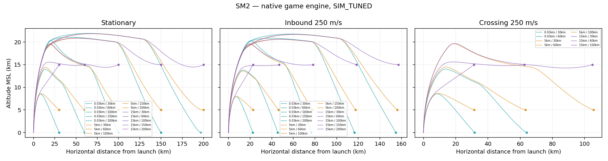
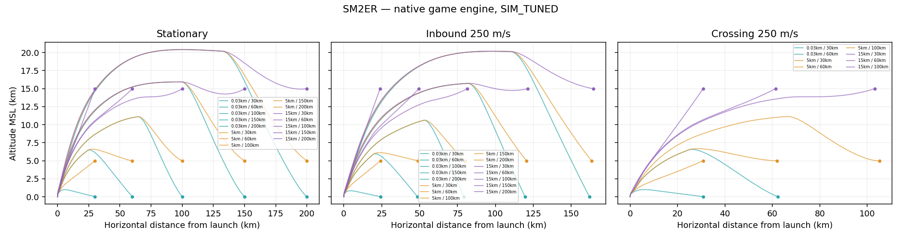
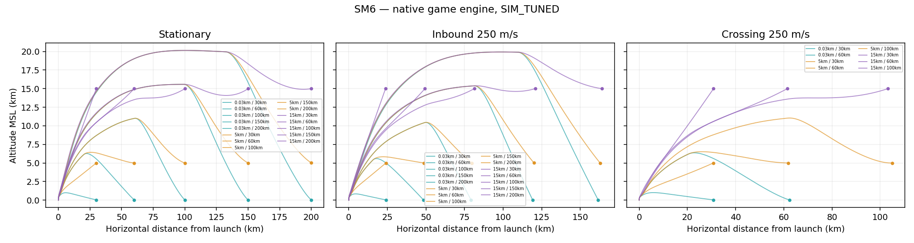
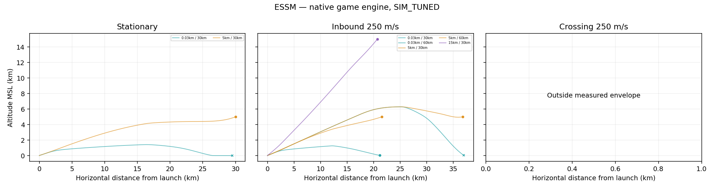

# ENV_D 재측정 A

기준: near-vertical-path-fix-a / 38a4f97527b48027fa64f0673cea14a9c83c116d. 모든 수치는 SIM_TUNED 게임 엔진 계산값이다. 제품 게임 함수·계수 변경은 0이며, 최신 HTML의 ENV_D 데이터/상태 API 블록만 교체했다.

실행 전 예상 209,141발 / 5.80시간(4 workers, 25% 여유). 실측 본 측정 183,370발 / 6.726시간, 후속 2,353발 / 0.092시간. 축소안 미사용. 전체 스윕 1회. 시드 간 비행 재사용 없음.

80발 예비 사격이 전수 검색의 긴 실패 비행 비중을 적게 반영해 실행 시간을 과소 추정했다. 최초 비용 예측은 수정 없이 보존했으며 ACTUAL_COST.json에 실제 비용을 별도 기록했다.

Kh-35U, 고도 30/1000/5000/10000/15000/20000m, 정지/접근250/접근680/이탈250/횡단250m/s. 고정 5시드는 아래와 같다.

|세트|게임 RNG|항법 seed|
|---:|---:|---:|
|1|1831565813|2047861954|
|2|305419896|2654435769|
|3|2271560481|1013904242|
|4|324508639|2779096485|
|5|610839776|1515870810|

각 칸: 바깥/안쪽 km · 요격점 평균(바깥/안쪽) km. 바깥은 5발 중 1발 이상 native 효과, 안쪽은 5km부터 연속 5km grid에서 3발 이상 KILL/STRUCT_FAIL. 0은 첫 연속 구간 없음, 500은 측정 상한. 경계 5발·요격점 최소/최대는 JSON/CSV에 포함.

## SM2

|고도(m)|정지|접근250|접근680|이탈250|횡단250|
|---:|---:|---:|---:|---:|---:|
|30|203/195 · 203.0/195.0|320/300 · 238.3/225.1|500/0 · 259.4/—|31/30 · 48.8/45.9|89/85 · 95.3/90.7|
|1000|212/210 · 212.0/210.0|329/325 · 244.1/241.5|500/500 · 259.0/259.0|33/30 · 53.4/44.8|102/100 · 109.0/106.9|
|5000|228/225 · 228.0/225.0|342/340 · 254.5/253.1|500/0 · 261.6/—|46/45 · 71.6/68.4|172/170 · 181.5/179.0|
|10000|249/245 · 249.0/245.0|365/355 · 271.7/265.5|500/500 · 265.0/265.0|63/60 · 99.5/91.7|202/200 · 213.7/211.0|
|15000|265/260 · 265.0/260.0|377/370 · 282.2/277.7|500/500 · 267.5/267.5|153/90 · 228.9/135.6|223/220 · 236.1/232.4|
|20000|265/260 · 265.0/260.0|365/355 · 275.5/268.9|500/500 · 267.9/267.9|163/160 · 243.3/235.7|233/225 · 246.6/237.3|

## SM2ER

|고도(m)|정지|접근250|접근680|이탈250|횡단250|
|---:|---:|---:|---:|---:|---:|
|30|257/245 · 257.0/245.0|384/360 · 300.7/283.9|500/0 · 293.2/—|42/35 · 59.6/47.2|75/75 · 79.2/79.2|
|1000|274/270 · 274.0/270.0|403/400 · 315.1/312.9|500/500 · 295.7/295.7|45/35 · 64.6/46.7|81/80 · 85.6/84.4|
|5000|299/295 · 299.0/295.0|427/425 · 334.4/332.8|500/0 · 299.2/—|55/55 · 79.5/79.5|242/240 · 250.7/248.2|
|10000|334/330 · 334.0/330.0|469/460 · 366.6/360.8|500/5 · 302.4/3.9|65/65 · 95.6/95.6|284/280 · 294.8/289.9|
|15000|369/365 · 369.0/365.0|500/500 · 392.6/392.6|500/5 · 304.4/6.4|233/105 · 320.7/152.9|320/315 · 332.5/326.6|
|20000|392/385 · 392.0/385.0|500/500 · 396.0/396.0|500/500 · 307.2/307.2|258/255 · 353.8/346.9|351/335 · 364.7/346.8|

## SM6

|고도(m)|정지|접근250|접근680|이탈250|횡단250|
|---:|---:|---:|---:|---:|---:|
|30|265/265 · 265.0/265.0|384/380 · 304.6/301.7|500/0 · 299.0/—|38/35 · 53.3/47.2|79/75 · 83.6/78.8|
|1000|297/295 · 297.0/295.0|431/430 · 339.0/338.3|500/500 · 301.6/301.6|45/45 · 65.0/65.0|85/80 · 89.9/84.0|
|5000|325/325 · 325.0/325.0|461/460 · 363.0/362.3|500/0 · 304.9/—|57/55 · 83.3/77.7|268/265 · 277.3/273.7|
|10000|365/365 · 365.0/365.0|500/500 · 394.7/394.7|500/5 · 307.7/4.1|69/65 · 104.2/92.2|313/310 · 324.4/320.7|
|15000|410/405 · 410.0/405.0|500/500 · 399.4/399.4|500/5 · 309.6/6.6|262/110 · 358.3/163.9|356/355 · 369.4/368.2|
|20000|443/435 · 443.0/435.0|500/500 · 401.9/401.9|500/500 · 312.4/312.4|293/285 · 399.1/382.6|397/395 · 412.1/409.8|

## ESSM

|고도(m)|정지|접근250|접근680|이탈250|횡단250|
|---:|---:|---:|---:|---:|---:|
|30|53/25 · 53.0/25.0|99/30 · 53.4/21.2|179/30 · 53.8/15.1|11/10 · 17.7/15.6|17/15 · 18.6/16.1|
|1000|49/25 · 49.0/25.0|99/95 · 53.0/51.7|179/175 · 53.4/52.8|12/10 · 20.6/15.5|18/15 · 20.0/16.1|
|5000|30/30 · 30.0/30.0|62/60 · 37.6/36.8|116/0 · 40.3/—|13/10 · 21.7/15.6|20/20 · 22.1/22.1|
|10000|28/25 · 28.0/25.0|41/0 · 27.0/—|66/0 · 26.6/—|15/15 · 29.0/29.0|22/20 · 24.6/22.0|
|15000|29/25 · 29.0/25.0|40/0 · 26.4/—|63/0 · 25.7/—|15/15 · 28.6/28.6|23/20 · 26.3/22.5|
|20000|27/25 · 27.0/25.0|37/0 · 23.9/—|55/0 · 21.7/—|15/15 · 31.5/31.5|22/20 · 25.9/23.3|

## 이전 ENV_D 비교

과거 KAPPA_PIP_LOS_A 기준과 바깥 거리 68/120칸, 안쪽 거리 42/120칸이 달라졌다. ENV_D_BEFORE_AFTER.csv 전체 비교를 제공한다. 여러 누적 수정이 함께 반영됐으므로 거리 차이를 한 수정의 효과로 단정하지 않는다.
안쪽 0인 칸 13개(과거 37개).

|기종|고도|운동|과거 바깥/안쪽|현재 바깥/안쪽|
|---|---:|---|---:|---:|
|SM2|30|INBOUND_680|499/0|500/0|
|SM2|30|CROSS_250|84/80|89/85|
|SM2|1000|STATIONARY|210/210|212/210|
|SM2|1000|INBOUND_250|327/325|329/325|
|SM2|1000|OUTBOUND_250|32/30|33/30|
|SM2|1000|CROSS_250|92/90|102/100|
|SM2|5000|INBOUND_680|500/500|500/0|
|SM2|5000|OUTBOUND_250|45/45|46/45|
|SM2|5000|CROSS_250|170/170|172/170|
|SM2|10000|STATIONARY|248/245|249/245|
|SM2|10000|INBOUND_250|364/350|365/355|
|SM2|10000|INBOUND_680|500/0|500/500|
|SM2|10000|OUTBOUND_250|55/55|63/60|
|SM2|10000|CROSS_250|201/200|202/200|
|SM2|15000|STATIONARY|264/0|265/260|
|SM2|15000|INBOUND_250|376/0|377/370|
|SM2|15000|INBOUND_680|500/0|500/500|
|SM2|15000|OUTBOUND_250|150/90|153/90|
|SM2|15000|CROSS_250|222/220|223/220|
|SM2|20000|STATIONARY|264/0|265/260|
|SM2|20000|INBOUND_250|364/0|365/355|
|SM2|20000|INBOUND_680|500/0|500/500|
|SM2|20000|OUTBOUND_250|160/0|163/160|
|SM2|20000|CROSS_250|232/0|233/225|
|SM2ER|30|STATIONARY|259/245|257/245|
|SM2ER|30|INBOUND_250|387/365|384/360|
|SM2ER|30|OUTBOUND_250|43/35|42/35|
|SM2ER|30|CROSS_250|76/75|75/75|
|SM2ER|1000|STATIONARY|275/275|274/270|
|SM2ER|1000|INBOUND_250|404/400|403/400|
|SM2ER|1000|OUTBOUND_250|46/45|45/35|
|SM2ER|1000|CROSS_250|83/80|81/80|
|SM2ER|5000|STATIONARY|302/300|299/295|
|SM2ER|5000|INBOUND_250|431/425|427/425|
|SM2ER|5000|OUTBOUND_250|56/55|55/55|
|SM2ER|5000|CROSS_250|243/240|242/240|
|SM2ER|10000|STATIONARY|336/330|334/330|
|SM2ER|10000|INBOUND_250|471/0|469/460|
|SM2ER|10000|OUTBOUND_250|66/65|65/65|
|SM2ER|10000|CROSS_250|285/285|284/280|
|SM2ER|15000|STATIONARY|371/365|369/365|
|SM2ER|15000|INBOUND_250|500/0|500/500|
|SM2ER|15000|OUTBOUND_250|234/105|233/105|
|SM2ER|15000|CROSS_250|322/0|320/315|
|SM2ER|20000|STATIONARY|392/0|392/385|
|SM2ER|20000|INBOUND_250|500/0|500/500|
|SM2ER|20000|INBOUND_680|500/0|500/500|
|SM2ER|20000|OUTBOUND_250|257/0|258/255|
|SM2ER|20000|CROSS_250|351/0|351/335|
|SM6|30|STATIONARY|267/265|265/265|
|SM6|30|INBOUND_250|387/385|384/380|
|SM6|30|OUTBOUND_250|40/40|38/35|
|SM6|30|CROSS_250|80/75|79/75|
|SM6|1000|STATIONARY|298/295|297/295|
|SM6|1000|INBOUND_250|433/430|431/430|
|SM6|1000|OUTBOUND_250|46/45|45/45|
|SM6|1000|CROSS_250|87/85|85/80|
|SM6|5000|STATIONARY|328/325|325/325|
|SM6|5000|INBOUND_250|465/465|461/460|
|SM6|5000|OUTBOUND_250|58/55|57/55|
|SM6|5000|CROSS_250|269/265|268/265|
|SM6|10000|STATIONARY|368/365|365/365|
|SM6|10000|OUTBOUND_250|70/65|69/65|
|SM6|10000|CROSS_250|314/310|313/310|
|SM6|15000|STATIONARY|412/405|410/405|
|SM6|15000|INBOUND_250|500/0|500/500|
|SM6|15000|INBOUND_680|500/0|500/5|
|SM6|15000|OUTBOUND_250|263/110|262/110|
|SM6|15000|CROSS_250|358/0|356/355|
|SM6|20000|STATIONARY|443/0|443/435|
|SM6|20000|INBOUND_250|500/0|500/500|
|SM6|20000|INBOUND_680|500/0|500/500|
|SM6|20000|OUTBOUND_250|293/0|293/285|
|SM6|20000|CROSS_250|397/0|397/395|
|ESSM|30|STATIONARY|52/25|53/25|
|ESSM|30|INBOUND_250|99/35|99/30|
|ESSM|1000|STATIONARY|48/25|49/25|
|ESSM|5000|INBOUND_250|58/55|62/60|
|ESSM|5000|INBOUND_680|111/0|116/0|
|ESSM|10000|INBOUND_680|65/0|66/0|
|ESSM|10000|OUTBOUND_250|14/10|15/15|
|ESSM|15000|INBOUND_250|39/0|40/0|
|ESSM|15000|INBOUND_680|61/0|63/0|
|ESSM|20000|INBOUND_250|35/0|37/0|
|ESSM|20000|INBOUND_680|52/0|55/0|

## 안쪽 범위가 감소한 조건

아래는 연속 구간 기준이 줄어든 칸이다. 중간 실패점 뒤의 먼 거리에서 다시 성공하더라도 안쪽에 연결하지 않았다. 각 실패점의 5발 로그는 INNER_BREAKS.csv와 원시 JSON에 있다. 계수 보정이나 실패 숨김은 하지 않았다.

|칸|과거/현재 안쪽 km|끊긴 거리 km|KILL/STRUCT_FAIL|5발 종료 사유|
|---|---:|---:|---:|---|
|Kh-35U_SM2_5000_INBOUND_680|500/0|5|1/5|{"TERMINAL_MISS_TRACKED_DIVERGENCE":3,"LOW_SPEED":1,"PROX_DETONATION_KILL":1}|
|Kh-35U_SM2ER_30_INBOUND_250|365/360|365|2/5|{"SEA_IMPACT":3,"PROX_DETONATION_KILL":2}|
|Kh-35U_SM2ER_1000_STATIONARY|275/270|275|0/5|{"LOW_SPEED":5}|
|Kh-35U_SM2ER_1000_OUTBOUND_250|45/35|40|0/5|{"TERMINAL_MISS_TRACKED_DIVERGENCE":5}|
|Kh-35U_SM2ER_5000_STATIONARY|300/295|300|0/5|{"LOW_SPEED":5}|
|Kh-35U_SM2ER_10000_CROSS_250|285/280|285|0/5|{"TERMINAL_MISS_TRACKED_DIVERGENCE":4,"PROX_DETONATION_MISS":1}|
|Kh-35U_SM6_30_INBOUND_250|385/380|385|0/5|{"SEA_IMPACT":5}|
|Kh-35U_SM6_30_OUTBOUND_250|40/35|40|0/5|{"SEA_IMPACT":5}|
|Kh-35U_SM6_1000_CROSS_250|85/80|85|2/5|{"PROX_DETONATION_KILL":2,"PROX_DETONATION_MISS":2,"PROX_DETONATION_DAMAGED":1}|
|Kh-35U_SM6_5000_INBOUND_250|465/460|465|0/5|{"LOW_SPEED":5}|
|Kh-35U_ESSM_30_INBOUND_250|35/30|35|2/5|{"PROX_DETONATION_KILL":2,"PROX_DETONATION_MISS":2,"PROX_DETONATION_DAMAGED":1}|

## 보조 ASM·시드 차이

|기종|고도|운동|Kh-35U 바깥/안쪽|Kh-32 바깥/안쪽|
|---|---:|---|---:|---:|
|SM2|30|INBOUND_250|320/300|320/300|
|SM2|5000|INBOUND_680|500/0|500/0|
|SM2|15000|STATIONARY|265/260|267/265|
|SM6|30|INBOUND_250|384/380|384/380|
|SM6|5000|INBOUND_680|500/0|500/0|
|SM6|15000|STATIONARY|410/405|411/410|

5시드 CPA 범위: 중앙값 74.154m, P95 1830.713m, 최대 24208.231m. 항법 시드가 비행 이력에 영향을 주므로 각 발을 독립 실행했다.

## 해면 충돌·과거 ENV_C·설계값

본 측정 SEA_IMPACT 34,127건. results/SEA_IMPACT.csv.gz에 조건·시드·충돌 속도·CPA·하강 시점/단계를 기록했다. ENV_C 비교는 HISTORICAL 항공기 점 표적/구 유도 코드이며 현재 ASM 결과와 직접 동일시하지 않는다.

|기종|게임 설계값|바깥 도달 칸|정지 도달 칸|
|---|---:|---:|---:|
|SM2ER|360km|14/30|2/6|
|SM6|450km|10/30|0/6|

## 검증

실제 브라우저 함수 281개 해시 일치. 실제 함수/독립 진단 6조건(ASM·횡단 포함) 반환값·궤적 오차 0. 진단 전후 live world/RNG/tick 변화 0. 경계 406거리×5발, 궤적 고정 무작위30개 반복: PASS; 선택 seed 3540656166.
궤적은 기존 120 + 횡단 4×3×3=36, 총 156슬롯을 유지했다. 실제 실행 121, 나머지는 측정 바깥으로 표시했다. 10Hz CSV·단계 CSV·기종별 PNG/SVG 제공.
최종 내장표 120칸. status 일치 DDG/CG: True/True. 120초 무표적/전투 truth hash 동일: True/True. 제품 게임 코드/계수 변경 0. 직전 단계 회귀는 414/420(기존 6 실패), UI88/88, 종료기300발 상태 변화0이며 이번에는 데이터 블록 변경만 검증했다.

main 병합·release/tag 생성 없음. 지도·AI·발사 판정에 표를 연결하지 않았다.
