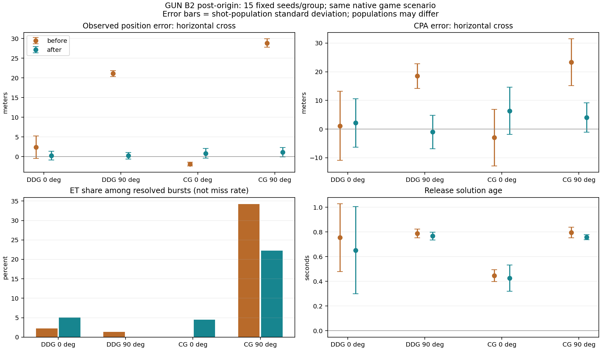

# GUN_B2 — 원점 복구 후 재진단 및 Phase 1 착수 보고

작성: 2026-11-01 02:08 KST

사용자가 병합한 main `cce180255e0f76b804a2ae6a3b6078aec2f9dea8` 위로 gun-b2를 rebase했다. 충돌 0건이다. 요청한 **DDG/CG × 표적 1기 × 0°/90° ×15회 = 60회**를 완료했다. 이번에는 게임을 바꾸지 않았고 B2 산포·사격 정합·신관·파편 기능은 아직 제품에 적용하지 않았다.

**별도 검토: 이전 무피해→피격 1건. DDG 90° seed419023은 HP100→3.6027이며 실제 native 재실행에서도 확인했다.** 아래에서 피해 추첨과 기하를 구별한다. 진단 검수 통과는 이 전투 결과 악화를 자동 승인했다는 뜻이 아니다.

## 재진단 결과

표의 μ±σ는 발별 분포의 평균과 표준편차다. 같은 15시드/조건을 비교하지만 발사·기폭 표본 수는 달라질 수 있다. 표준편차를 평균의 신뢰구간으로 해석하지 않는다.

| 조건 | 발사 전→후 | 관측 측방 오차 μ±σ m 전→후 | 살아 있던 배정 표적 CPA 측방 μ±σ m 전→후 | ET 비율 전→후 |
|---|---:|---|---|---:|
| DDG 0° | 79 → 84 | 2.434 ± 2.854 (n=79) → 0.251 ± 1.100 (n=84) | 1.149 ± 12.032 (n=45) → 2.145 ± 8.437 (n=59) | 2.2% → 5.1% |
| DDG 90° | 100 → 67 | 21.098 ± 0.747 (n=100) → 0.248 ± 0.826 (n=67) | 18.485 ± 4.276 (n=76) → -0.995 ± 5.841 (n=46) | 1.3% → 0.0% |
| CG 0° | 63 → 69 | -1.874 ± 0.475 (n=63) → 0.856 ± 1.253 (n=69) | -2.978 ± 9.873 (n=38) → 6.364 ± 8.253 (n=45) | 0.0% → 4.4% |
| CG 90° | 240 → 104 | 28.848 ± 1.037 (n=240) → 1.159 ± 1.178 (n=104) | 23.310 ± 8.138 (n=111) → 4.060 ± 5.097 (n=45) | 34.2% → 22.2% |

CG 90°의 관측 측방 평균은 28.848m에서 1.159m로 바뀌었다. 수십 m 원점 편향은 크게 줄었다. 함포 함수나 신관 계수를 바꿔 상쇄한 결과가 아니다. 잔여 오차를 0으로 만들기 위한 고정 오프셋·truth 보정도 없다.

| 조건 | 배정 표적 alive-at-burst arrival μ±σ m 전→후 | native ASM arrival μ±σ m 전→후 | 해 나이 μ±σ s 전→후 |
|---|---|---|---|
| DDG 0° | 26.588 ± 87.250 (n=45) → 56.347 ± 182.967 (n=59) | 13.467 ± 6.185 (n=44) → 14.023 ± 6.321 (n=56) | 0.754 ± 0.275 (n=79) → 0.652 ± 0.352 (n=84) |
| DDG 90° | 42.332 ± 92.928 (n=76) → 22.557 ± 54.930 (n=46) | 20.529 ± 5.566 (n=70) → 12.403 ± 3.198 (n=44) | 0.788 ± 0.036 (n=100) → 0.767 ± 0.032 (n=67) |
| CG 0° | 12.002 ± 4.101 (n=38) → 35.784 ± 113.140 (n=45) | 12.002 ± 4.101 (n=38) → 11.535 ± 7.099 (n=43) | 0.447 ± 0.049 (n=63) → 0.426 ± 0.106 (n=69) |
| CG 90° | 266.824 ± 338.590 (n=111) → 170.431 ± 299.645 (n=45) | 22.853 ± 6.657 (n=73) → 10.270 ± 2.108 (n=35) | 0.795 ± 0.043 (n=240) → 0.757 ± 0.020 (n=104) |

배정 표적 arrival은 조회 반경 밖 ET도 포함한 사후 진단값이다. native ASM arrival은 실제 물리 파편 조회 안의 결과다. 두 모집단을 섞지 않는다. ET 분모는 실제 폭발 탄이며, ET를 곧 비명중으로 세지 않는다. 비행 중 시나리오 종료 탄은 검열로 남긴다.

| 조건 | 폭발 전→후 | 비행 중 종료 전→후 | 발사 없음 전→후 |
|---|---:|---:|---:|
| DDG 0° | 45 → 59 | 22 → 20 | 0 → 0 |
| DDG 90° | 76 → 46 | 9 → 21 | 0 → 0 |
| CG 0° | 38 → 45 | 25 → 24 | 0 → 0 |
| CG 90° | 111 → 45 | 18 → 59 | 0 → 0 |

## 잔여 오차와 교전 결과

원점 복구 뒤에도 해 나이·관측 잡음·포신 정렬·표적 기동·탄도 위상의 항이 남는다. 아래는 이전과 같은 CPA 장부 분해다. 항끼리 상관·상쇄가 있으므로 분산 RSS나 원인 기여율 100%로 해석하지 않는다.

| 조건 | 위치관측 cross μ±σ m | 해 시차 cross μ±σ m | 속도관측 cross μ±σ m | 표적운동 cross μ±σ m | 탄도위상 cross μ±σ m |
|---|---|---|---|---|---|
| DDG 0° | 0.364 ± 1.246 (n=59) | 0.432 ± 1.735 (n=59) | 1.724 ± 7.927 (n=59) | -0.261 ± 1.882 (n=59) | -0.115 ± 1.815 (n=59) |
| DDG 90° | 0.497 ± 0.708 (n=46) | -3.413 ± 4.366 (n=46) | 1.464 ± 3.743 (n=46) | -0.475 ± 1.831 (n=46) | 0.933 ± 1.701 (n=46) |
| CG 0° | 1.098 ± 1.239 (n=45) | 0.195 ± 1.004 (n=45) | 5.808 ± 7.712 (n=45) | -0.410 ± 3.637 (n=45) | -0.327 ± 1.001 (n=45) |
| CG 90° | 1.027 ± 1.034 (n=45) | 0.396 ± 3.295 (n=45) | 3.735 ± 4.748 (n=45) | -0.806 ± 1.447 (n=45) | -0.292 ± 1.166 (n=45) |

분해 벡터 합의 최대 잔차는 1.08e-12m다. 이 BASE 60회만으로 해 노후화의 독립 인과 효과나 Phase1 재계산의 개선율을 확정하지 않는다. 과거 B 통제는 잘못된 원점의 C9에서 측정했으므로 새 기준의 개선율로 재사용하지 않는다.

| 조건 | HP 평균 전→후 | HP 최솟값 전→후 | 표적 생존 회차 전→후 |
|---|---|---|---|
| DDG 0° | 100.000 → 100.000 | 100.000 → 100.000 | 0 → 0 |
| DDG 90° | 100.000 → 93.574 | 100.000 → 3.603 | 0 → 0 |
| CG 0° | 100.000 → 100.000 | 100.000 → 100.000 | 0 → 0 |
| CG 90° | 95.854 → 100.000 | 37.814 → 100.000 | 0 → 0 |

동일 시드에서 HP가 더 낮아진 회차는 1건, 이전에는 표적이 종료됐지만 이번에는 살아 있는 회차는 0건이다. 결과를 맞추려 계수를 조정하거나 기대값을 새로 승인하지 않았다. 전체 60개 전후 결과는 `post-origin/evidence/case-comparison.csv`에 있다. `shipHits`/`gunPreCiwsKills` 기존 카운터는 알려진 MISS·id 혼입 문제가 있어 실제 피격·격추 실적처럼 사용하지 않았다.

검토할 회차(전체 값은 summary.json):

- DDG_119_LATE_FLIGHT_IIA, 90°, seed 419023: HP 100→3.6027114315908904; targets [{'id': 2, 'alive': False, 'reason': 'INTERCEPT_KILL'}]→[{'id': 2, 'alive': False, 'reason': None}]

### 피해 악화 1건의 native 확인

C9 native와 병합 AIR native를 같은 입력으로 다시 실행했다. 각각 기존 기록의 결과·RNG·최종 상태와 정확히 일치했다. 실제 함 피격은 0→1회다. 첫 5인치 피해 판정은 다음과 같다.

| 항목 | C9 | AIR_ORIGIN_A |
|---|---|---|
| 첫 기폭 틱 | 1168 | 1167 |
| 첫 파편 Pk | 0.139650 | 0.311257 |
| 첫 피해 난수 | 0.066818 | 0.650782 |
| 결과 | KILL | MISS |

첫 탄의 arrival은 17.177→10.910m로 가까워졌고 Pk도 올라갔지만, 기존 전역 피해 스트림에서 실제로 나온 난수가 달랐다. 기존 applyInterceptResult는 첫 draw<Pk이면 KILL이다. 같은 초기 시드라도 관측·사격 시점과 분기가 바뀌면 같은 피해 draw를 받지 않는다. 이를 기하 정확도가 악화된 사례나 진단 로거의 영향으로 분류하지 않는다. 이후 MISS/DAMAGED가 이어져 적 미사일이 함에 도달했다. 이것은 실제 단일 시드 전투 결과 악화이며 자동 승인하거나 숨기지 않는다. 피해 RNG/Pk와 계수는 수정하지 않았다.

### 남은 CG90 ET의 구체적 오차

살아 있던 배정 표적의 CG90 ET 10발은 CPA 수직 약 29.8~30.6m로 기존 25m 근접 구 안에 들지 못했다. 예: seed419012 MK45-3은 해 나이 0.75초, 캐시 해 Vz=2.7921m/s, 발사 시 관측 Vz=0.0775m/s(사후 truth 0.2523m/s)였다. 포인팅 수직 오차는 0.2219m였지만 이는 오래된 해에 대한 정렬이었다.

그 탄의 CPA 수직 30.1363m 장부는 위치관측 1.0670 + 해 위치 시차 2.5945 + 캐시 속도 차 17.2659 + 표적운동 0.3897 + 탄도위상 8.8192m다. 속도 항에는 오래된 해의 속도도 포함되므로 모두 현재 센서 잡음으로 부르지 않는다. 현재 관측과 캐시 해의 차이를 확인했으므로 Phase1 첫 작업은 발사 순간 정합의 분리 검증으로 잡는다. 효과 크기는 새 A/B 시험으로 확인해야 한다.

[악화 사례 native/RNG 원시 로그](post-origin/evidence/adverse-native.json) · [CG90 ET 10발과 축별 장부](post-origin/evidence/residual-et.json)

## Phase 1 착수 순서

1. **발사 시점 정합부터 분리 검증한다.** 현재 관측 트랙과 현재 trunnion으로 기존 continuation solve를 수행하고 새 해로 포인팅·권한·클리어런스를 재검사한다. 안 맞으면 대기한다. 현재-틱 해에서 나간다는 것을 먼저 증명하고, 새로운 산포/신관을 섞기 전 ON/OFF A/B를 기록한다. truth는 사격통제에 쓰지 않는다.
2. **산포를 독립 스트림으로 보정한다.** serial+SIM_SEED_BASE 기반 전용 xorshift를 사용한다. 16,459m native 무풍 사격 200발 이상에서 지정 σ 44~55m 앵커만 사용한다. 명중률로 역산하지 않는다. MV/고각 분산 배분과 선회 산포는 별도 기록한다.
3. **AIR 전용 대칭 포인팅 창을 분리한다.** 수상 fallback 동작과 수상 식별·FCQ를 유지한다. 관측 불확실성 예산과 포신 정렬 예산을 구별한다. 창을 넓혀 관측 오차를 감추지 않는다. 수상 재정합은 별도 ON/OFF 확인 대상으로 두고 자동 포함하지 않는다.
4. **5인치 전용 탐지 패턴·지연·파편 띠를 세트로 구현한다.** swept 최초 유효 탐지+처리 지연, 통과당 한 추첨/신호 누적, 띠 안 판정을 사용한다. 띠 폭만 줄이는 중간 상태를 출하하지 않는다. SAM의 결정론적 신관·파편 경로와 파라미터는 그대로다.
5. **기능 OFF/ON 회귀 후 실효 링을 측정한다.** OFF 비교 기준은 이제 AIR_ORIGIN_A(4c519…)다. C9 자연 탐지 결과의 byte 동일을 요구하지 않는다. 보호 함수·저장·ENVELOPE_TABLE_D는 그대로 유지한다. 새 Pk 거리 곡선 전에는 링 값을 확정하지 않는다.

현행 재계산은 준비된 발사 기회에서만 수행하고 같은 입력의 중복 호출을 막는다. 포신이 아직 새 해를 따라가지 못할 때 재시도가 필요하므로 “실제 발사 수만큼만 solve” 비용을 가정하지 않는다. 현재-틱 정합을 깨지 않는 입력 revision/틱 캐시를 설계하고 시도 수·시간을 별도로 계측한다.

## 수치와 보존 계약

아래 새 값은 **구현 전 설계안**이다. 아직 제품에 적용한 확정 계수가 아니다. 특히 MV/고각 σ는 앵커 사격 전에는 확정할 수 없다. 기존 Phase0 초안을 자동 승인된 값처럼 바꾸지 않는다.

| 항목 | 착수 기준 / 설계안 | 상태·근거 |
|---|---|---|
| 공칭 포구속도 | 현 823m/s 유지 | 현 게임 값; 지시서 인용 808m/s와 차이만 기록 |
| 산포 앵커 | 16,459m, 사거리 σ 44~55m, ≥200발 | 사용자 지정 계약; 이 재진단은 캘리브레이션 아님 |
| MV σ / 고각 σ | 시작안 0.0015 / 0.10mrad | SIM_TUNED, native 감도로 최종 결정 |
| 분산 배분 / 선회 σ | 시작안 MV80%:고각20% / 0.20mrad | SIM_TUNED; 공개 측정치로 주장하지 않음 |
| AIR 포인팅 반폭 | 신관 반경×0.25 =6.25m 시작안 | SIM_TUNED; 현행 1.5m floor보다 항상 엄격한 것은 아님 |
| release margin | 0.78 유지안 | 관측 불확실성 차감과 정렬 예산의 적용 순서를 먼저 고정 |
| 신관 반경 / 무장거리 / ET | 현 25m / 430m / +0.2s 유지 | 기존 게임 계약 |
| 탐지 환형 중심 / 반폭 / 지연 | 70° / 20° / 0.002s 시작안 | 5인치 전용 SIM_TUNED, swept 기하 검사 |
| 신호 설계점 | 기준 거리 12.5m, 기존 RCS, 0.003s에서 Pd0.9 시작안 | SIM_TUNED 탐지기 설계점; 격추율 맞춤 금지 |
| 파편 띠 반폭 / 밖 Pk | 20° / 0 시작안 | SIM_TUNED; 띠 안 판정과 함께 적용 |
| 자동 범위 / 유효 링 | 9km 유지 / 새 모델 측정 후 제안 | 아직 유효 링 수치 없음 |

지시서가 인용한 DTIC 산포 값은 이전 Phase0의 사용자 지정 앵커다. 이번 턴에 외부 원문을 새로 검증했다고 주장하지 않는다. 신관/띠의 새 수치는 실기 스펙이 아니라 게임용 설계값이다. [기존 전체 초안](PHASE1_PROPOSAL_DRAFT.md)도 보존한다.

## 검증과 산출물

주 행렬 60회, 추가 native 4회, 결정성 반복 2회, 악화 사례 native 2회다. 행렬 424.8초, 동등성 검증 82.5초, 악화 사례 검증 38.4초. CPU headless 진단이며 폰 FPS 수치가 아니다.

| 검증 | 결과 |
|---|---|
| 새 페이지 / 같은 60개 입력 | 통과 |
| 실제 실행 RF·KF·native spawn 소스 | 제품 함수 SHA와 일치 |
| native vs 계측 | 4/4: 결과·RNG·최종 상태 동일(호스트 시간만 제외) |
| 90° 반복 | DDG/CG 2/2: 진단 값 동일(호스트 시간만 제외) |
| 보호 비행 함수 / ENV_D | 281개 변경 0 / byte 동일 |
| 함포 함수 / 제품 HTML | 기존 B1 함포 함수 동일 / 병합 AIR HTML 동일 |
| Phase0 원시 자료 / 승인 기대값 | 변경 0 / 추가 갱신 0 |

[SVG](post-origin/plots/comparison.svg) · [현재 통계](post-origin/evidence/summary.json) · [회차 CSV](post-origin/evidence/case-comparison.csv) · [발별 CSV](post-origin/evidence/shot-comparison.csv) · [시험 규약](post-origin/PROTOCOL.md)

제품 SHA-256: `4c5191753025406697520c63afcc97c116a83c4b6b924a4b605b49233c697eeb`. 새 B2 게임 HTML을 만들지 않았다. 이번 완료 범위는 rebase·60회 재진단·이 착수 보고다. Phase1의 새 기능은 이 보고서 다음 구현 단계이며 아직 들어 있지 않다. gun-b2에 결과를 push하고 원격 readback을 확인한다. main에 추가 병합하거나 release/tag를 만들지 않는다.
