# MAP_A 결과 보고

## 1) 변경 요약

UI_A1 위에 조회·통제·도구·사격 지정 예약 슬롯을 분리했다. 객체 탭은 정보창을 열고, 통제를 얻은 뒤 빈 바다 탭만 항로점을 추가한다. 조회 원은 점선, 통제는 별도 브래킷, 실제 LOCK은 기존 표시를 사용한다. 겹침 후보·우클릭/롱프레스/펜 상황 메뉴·마지막 점 취소·출처별 정보창과 실제 연속 이동 방위 테이프를 추가했다. 3D 전환·창 이동·화면/배율 변경에도 조회와 통제를 유지한다.

기존 입력은 SYS 토글로 복원한다. 원본 canvas pointerup 분기는 byte-exact다. `lockByCursor(trackId)`는 정확한 ID를 지정하는 명시적 정밀추적에만 사용하며 인자 없는 동작은 기존과 같다. 기존 교전 창/버튼과 EMCON·발사 권한, 시간/센서/물리/저장 스키마는 유지한다. 제품의 기존 함수 변경은 7개이며 모델 및 나머지 13개 패킹 블록은 동일하다.

승인된 4건: H는 ‘저장 시 트랙·식별 초기화(기존 정책)’이며 식별 변경 직후 번호 불변을 검사했다. 임의 점 삭제는 ‘마지막 점만 취소 가능’으로 비활성이다. 하푼 마지막 계획 취소는 발사 전 `routeDraft`에만 작용한다. 무DL 하푼 정보는 발사 시각·지정 트랙·고정 계획만 표시하며 현재 위치·시커·INS 상태를 공개하지 않는다.

산출물: `Aegis_SIM_v48_WIP_MAP_A.html`, **18,047,616 bytes**, UI_A1 대비 **+17,772 bytes**. SHA-256: `68c13d352c3e80ab8bae1e08138ee42284c426f7fb7cce24e9d64941b34362b5`.

## 2) 검수 A–P 수치표

**1042/1042 assertions /27 suites PASS, 페이지 오류0**. 모든 검수는 최종 HTML SHA에 연결한 [기계 판독 색인](evidence/verification-summary.json)에 기록한다. seed는 기존 native fixture의 `1831565813`을 사용했다. 소프트웨어 Chromium/WebGL와 DPR 2.8125 에뮬레이션이며 실폰 GPU/FPS 검사가 아니다.

| 항목 | 실행 / 결과 | 증거 |
|---|---|---|
| A 무명령 | 자함·아군함·헬기·트랙·ESM·자함 미사일 등 200회 조회/후보/메뉴. LOCK/PD/EMCON/발사/경로 변화 0. 실제 3D 보기 버튼도 명령 변화 0. 상태 SHA `9c594b8b9a83eb0506a9ac20b19328b1880e17e3f25583093e6983db5847c136`. 무입력 대비 7,200 fixed ticks/120초 truth 상태 해시 동일 | `invariance`, `3d` |
| B 스침 | 15px 드래그·빈바다→객체·두 포인터·핀치 후300ms 선택/경로 변화 0 | `input` |
| C 판정 | 19px 선택 /21px 빈바다, 겹침 후보 우선/명령0. ESM12px 선 판정 | `input` |
| D NAV | 무통제0 /자함 통제1탭1점 /객체 탭0점 /UNDO1점 제거 | `input` |
| E 헬기 | 통제 후 빈바다 ROUTE_APPEND1회, 미통제0회. 통제는 조회와 독립 | `input` |
| F 하푼 | 빈바다+1, 트랙 조회0/경로 보존, 통제 차단 사유 표시. 실제 발사 후 새 계획 작성/Undo에도 기존 미사일 memory·route·INS 변화0 | `input`, `additional` |
| G 정밀추적 | 같은 좌표의 두 트랙 중 정확한 ID 선택. EMCON/방위-only ESM 비활성, 호출0. 장비/섹터 기존 사유 적용 | `additional`, `input`, `static` |
| H 식별/저장 | 식별만 변경/번호 불변. **저장 시 트랙·식별 초기화(기존 정책)**. 불러온 뒤 식별 유지는 검수 제외. 선택/통제 UI 상태는 게임 저장에 없음 | `input`, `preferences` |
| I 출처 | 적 truth 참조/private association·자함 헬기 RF 내부 getter 읽기0. ESM-only x/y/거리 표시0. 실제 radar/Hawklink/SELF 수신 예시 확인 | `additional`, `examples`, 감사 문서 |
| J 메뉴 | RMB·550ms 롱프레스·pen down/chorded move. release 중복 명령0,11px 이동은 메뉴 없이 팬. 너비90px만 남긴 양쪽 도크에서도85/100/130% 메뉴 이탈0 | `input`, `examples`, `bounds` |
| K 임시 연결 | 조회는 lockCursor만 변경, 락/방사 변화0. 기존 수동 LOCK이 그 커서를 사용. no-arg 정밀추적/EMCON 수동지정은 UI_A1과 동일 | `additional`, `legacy`, `static` |
| L 상태 유지 | 2D↔3D·정보창 이동·384×832/832×384·85/100/130%에서 조회/통제 유지. ESC도 통제 유지 | `3d`, `input` |
| M 테이프 | 실제 카메라358.9999999999999°→1.0000000000001°. 000 눈금 +4.06667→−4.06667px. 이동 잔차0.000007px 미만/침로 오차0.000001° 미만. 라벨30° 배수만 | `3d`, `input` |
| N 기존 모드 | NAV/AIM/AIR/하푼 4분기 UI_A1과 동일. no-arg LOCK과 EMCON passive 지정/AUTO LOCK 결과 동일. 원본 pointerup 바이트 동일 | `legacy`, `static` |
| O 회귀 | UI_A1 모바일/창/입력391건, native 컨트롤84개(NAV11/ARM29/FLEET21/AIR13/DEBUG10) 비교15건, 120초/일시정지4건. 기존 헬기·APS·ISAR·EMCON·하푼·SOV·DDG/CG paired420건 재실행. 정적 검사는 MAP_A48건으로 확장 | `ui-a1*`, `regressions`, `static` |
| P 크기 | 1400×900 /832×384 /384×832, DPR2.8125에서 B–D/J 반복 통과. UI_A1 양함종6크기×3배율36조합에서 중심오차0px/재고 잘림0 | `input`, `ui-a1` |

모바일100% 상태 바는 세로42.84375px·가로24px다. 변경된 통제 라벨을 넣어도 기존 높이를 유지한다. 임의 점 삭제/하푼 Undo 테스트는 시간 정지 중 비교하므로 ‘INS 변화0’이 정상 비행 적분을 멈춘다는 뜻은 아니다. 조회 상태는 게임 저장·불러오기와 연결하지 않는다.

## 3) 정보창 예시

실제 native 레이더 측정/수신 포트를 사용한 화면이다. 레이더별 원시 위치를 별도 보존하지 않으므로 융합 위치와 센서 기여·오차를 구분한다. 트랙 번호는 식별 변경으로 바뀌지 않는다.

| 자체 레이더 | Hawklink 링크 | ESM-only |
|---|---|---|
| 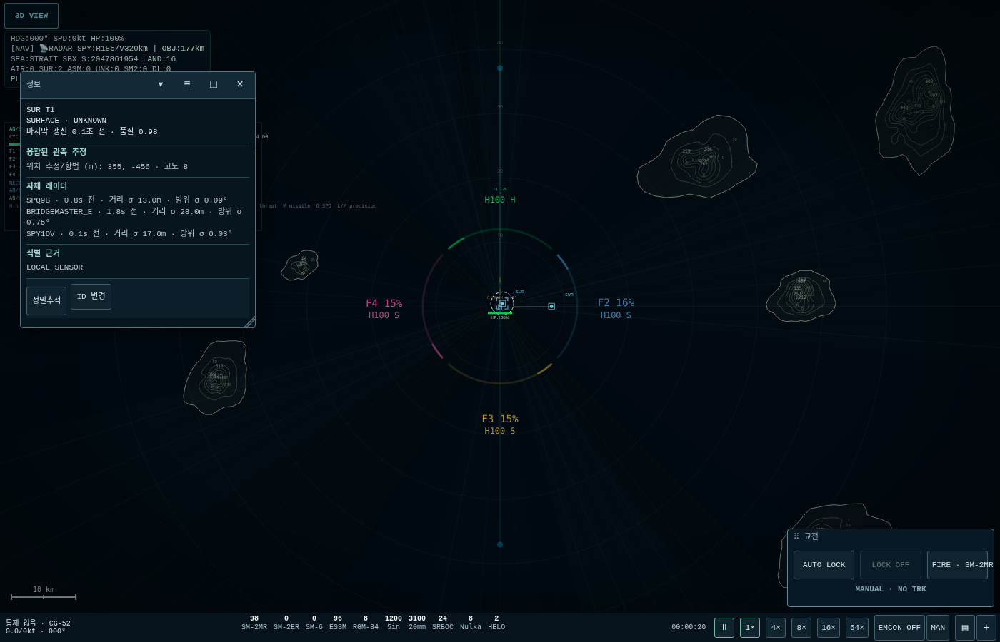 | 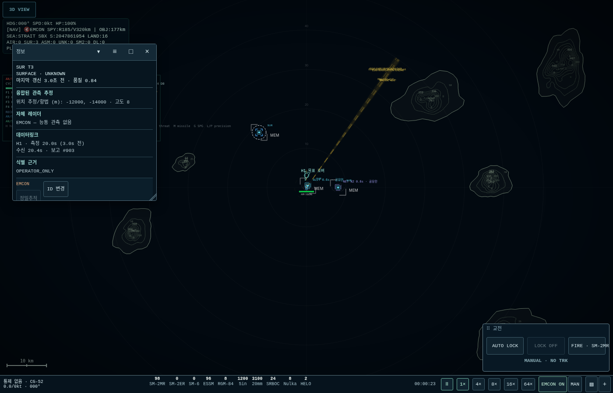 | 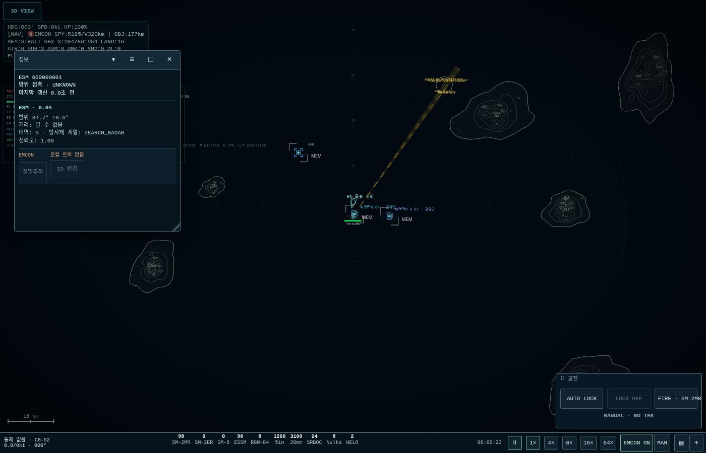 |

| 수신 아군함 | 자함 헬기 | EMCON 중 |
|---|---|---|
| 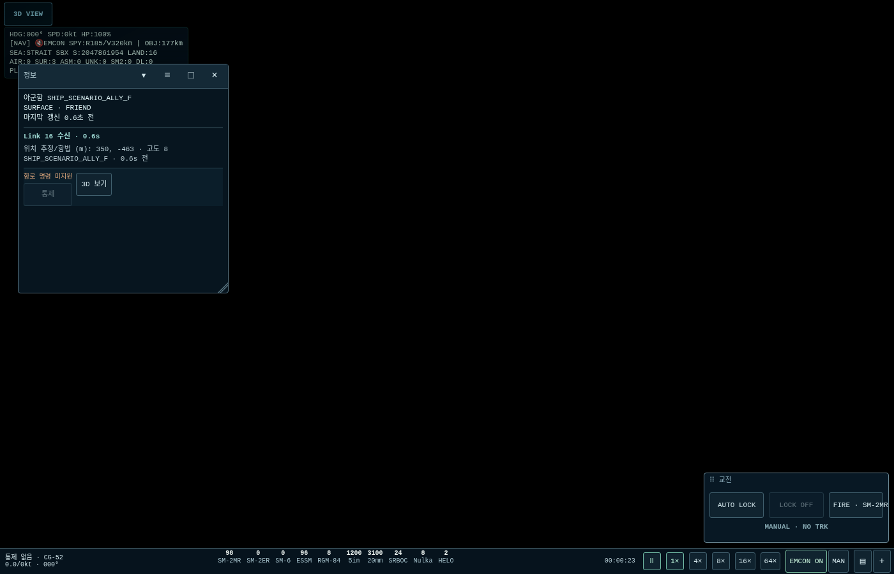 | 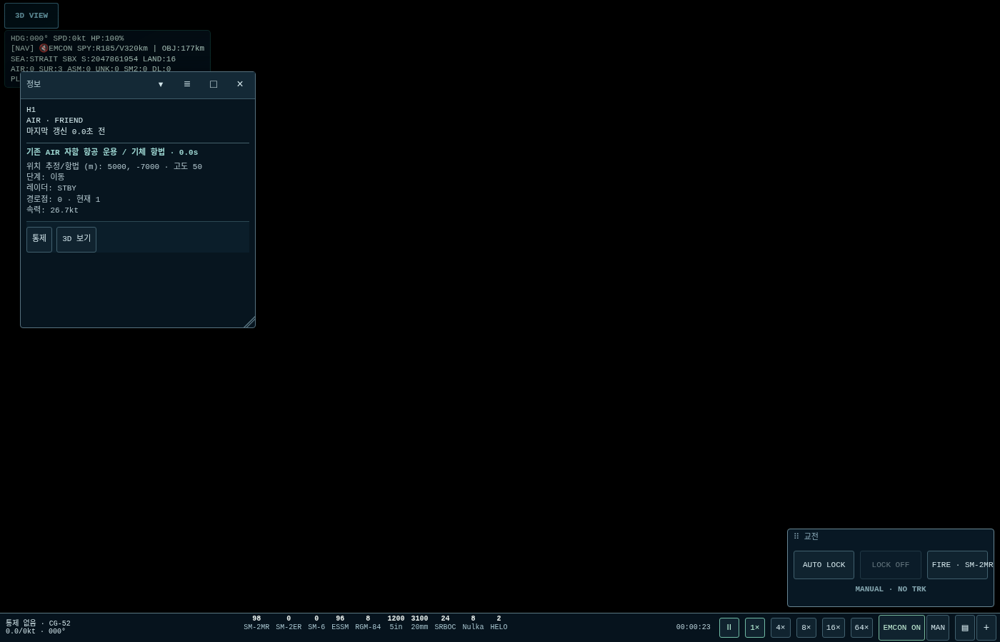 | 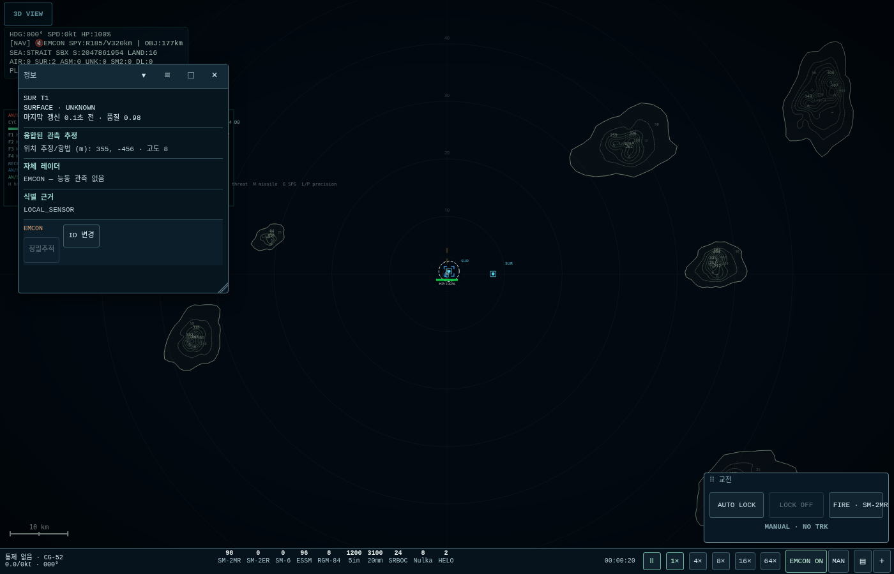 |

추가: [자함 유도탄 MSL STATUS](evidence/examples/info-own-missile.png), [무DL 하푼 발사 기록](evidence/additional/info-harpoon-receipt.png). 하푼 기록에는 현재 위치를 제공하지 않는다.

## 4) 상황 메뉴 예시

| 트랙 | ESM | 아군함 |
|---|---|---|
| 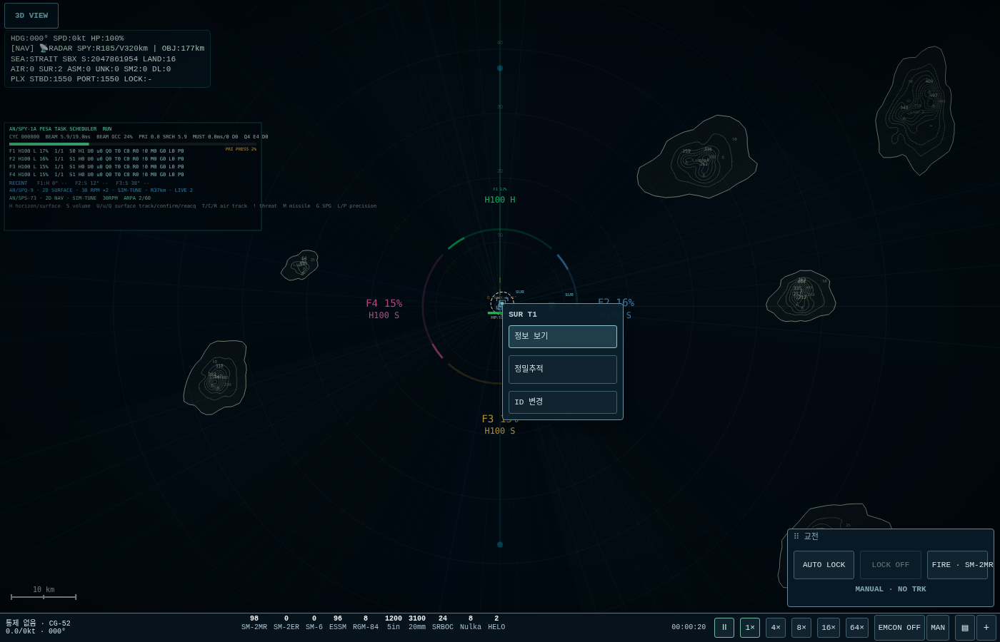 | 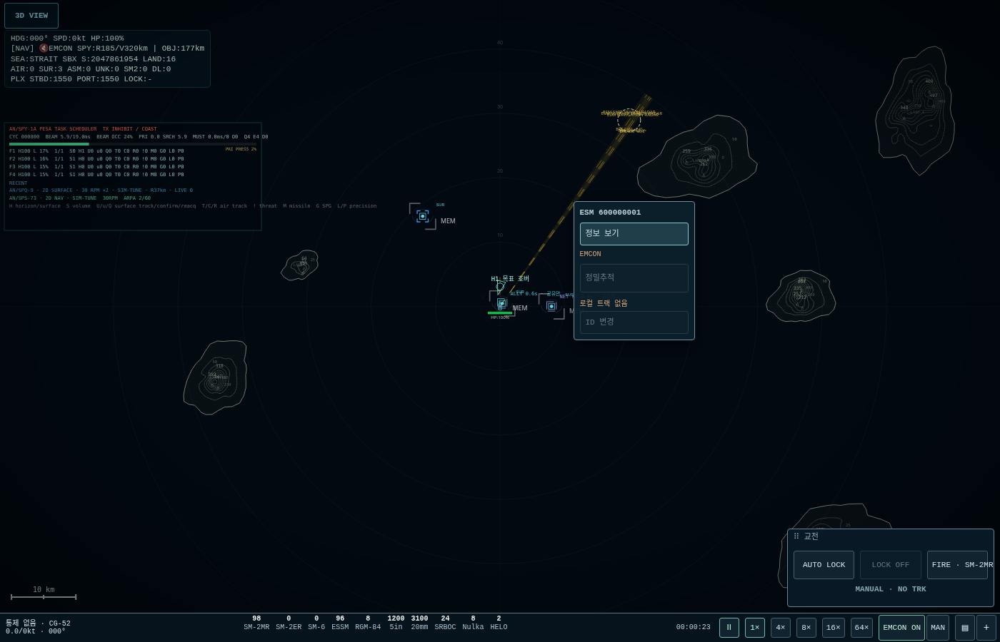 | 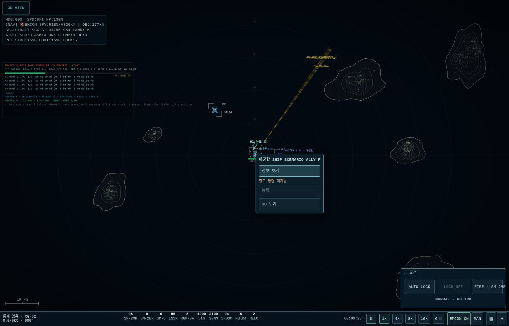 |

| 헬기 | 자함 미사일 | 빈 바다·세로 |
|---|---|---|
| 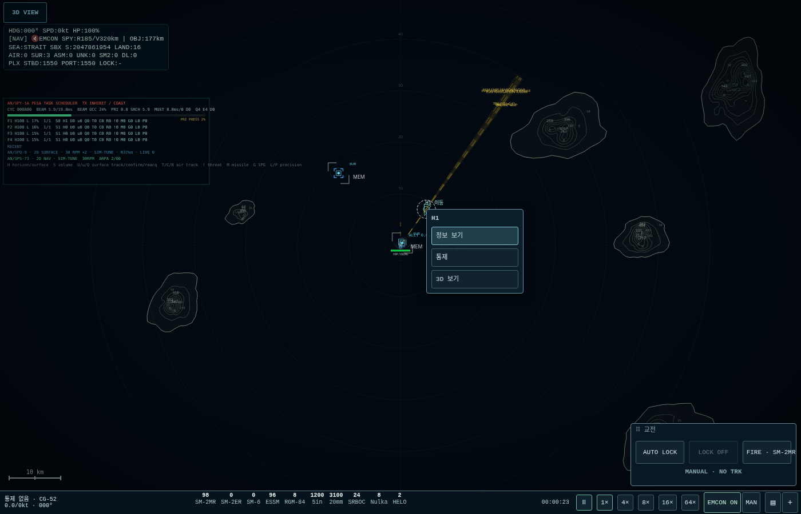 | 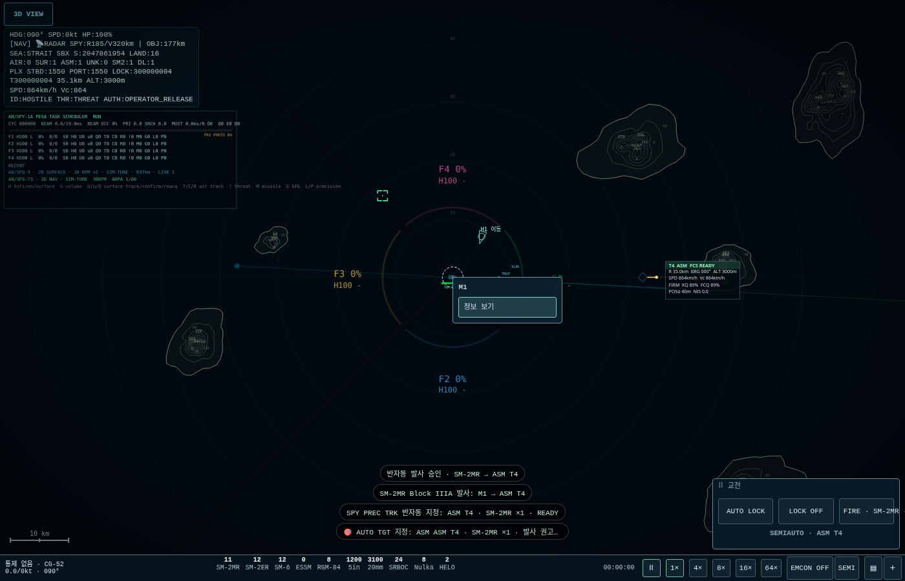 | 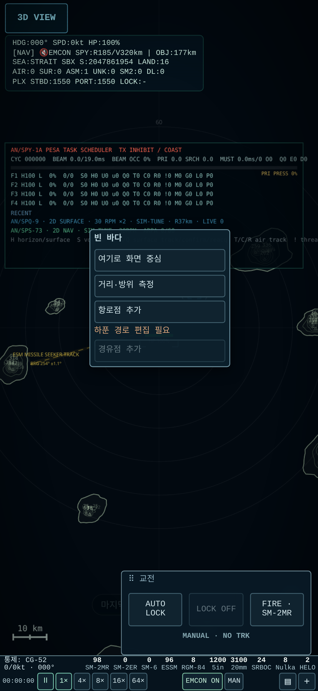 |

다른 크기: [1400×900 빈 바다](evidence/input/menu-sea-1400.png), [832×384 빈 바다](evidence/input/menu-sea-832.png). 비활성 버튼의 이유를 바로 위에 표시한다. 메뉴만 열거나 닫아서는 명령이 나가지 않는다.

## 5) 정보창 데이터 소스

[OBSERVATION_AUDIT.md](OBSERVATION_AUDIT.md)에 필드·소스·코드 위치를 전부 기록했다. 정보창 빌더의 입력은 자함 항법/AIR/자함 유도탄 상태, 관측 트랙과 contributor, offboard 메타데이터/ISAR/IFF, ESM 방위, 수신 Link 16, 자함 계획/발사 영수증이다. 미관측 적 truth 엔티티 직접 참조는0이다. 기존에 연관된 localTrackId/ESM 키만 묶으며 새 연관 규칙은 없다.

## 6) MAP_A_LEGACY_CURSOR_BRIDGE

`observations.js:39–44`, `map.js:20`에 있다. 위치 있는 트랙 조회에서 기존 LOCK 위젯이 사용할 커서만 옮긴다. MAP_B의 사격 지정 상태/작은 발사 버튼을 명시적 trackId로 연결한 뒤 삭제한다. no-arg `lockByCursor()`는 유지한다. 정확한 ID를 넘기는 정밀추적은 이 임시 커서 의존 없이 함수 내부 후보를 해당 ID로 제한한다.

## 7) MAP_B에서 다룰 것 / 남은 범위

- 사격 지정 표적 UI, 무장 플라이아웃·단발/살보·사거리·동적 관문·작은 발사 버튼.
- 하푼 트랙/INS 모드 전환, 새 무장 계획을 중앙 `planningReason()`에 편입, 커서 임시 연결 제거.
- 3D 미니 CIC/2D PiP 입력. 이번에는 2D 메인만 신규 해석한다.
- ROE 단계/별칭, 기존 창 정리와 HUD/SPY·손상 창 편입은 후속 범위다.
- 실제 휴대전화/펜/브라우저 전체화면에서 체감 검수는 남는다. 소프트웨어 WebGL 검수를 실폰 성능으로 해석하지 않는다.

구상서 `AEGIS_SIM_UI_UX_CONCEPT_WIREFRAME_v1.md`는 제공된 파일에서 발견되지 않았다. 상세 MAP_A 지시서와 승인된4건을 기준으로 구현했으며 새로운 정책 충돌은 없다. 수동 workflow는 준비만 하고 GitHub Actions를 실행하지 않는다. 최신 원본 전체를 `map-a`에 올리고 원격 blob을 독립 readback한다. UI_A1 네 파일은 동일 bytes/blob으로 archive한다. main·기존 브랜치 병합/새 PR은 하지 않는다.
