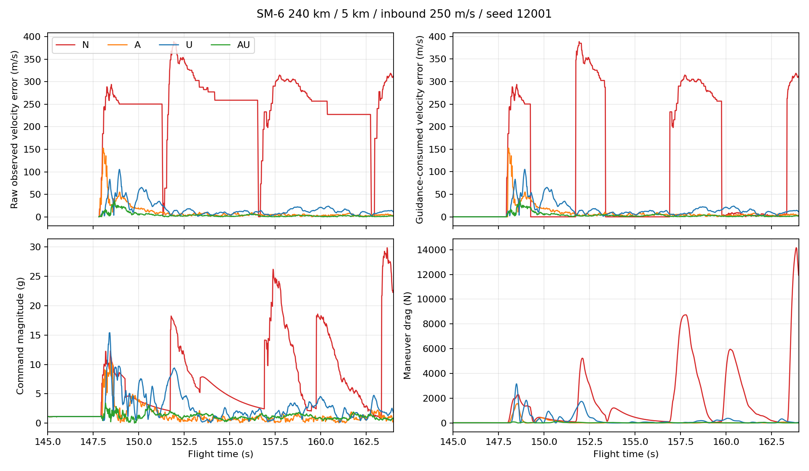

# ARH 측정 계약 수정 A 보고서

## 판정

- **측정 계약 정상화: PASS.** 실제 Chromium에서 SM-6와 ESSM의 공통 RF_V2 경로를 검사했다. 잡음 없는 단일 점의 절대 방위·고각, 시커 중심 독립성, 기존 각도 gate, 생성 잡음 σ와 반환 σ/필터 R이 모두 일치한다.
- **원래 SM-6 240 km 사례 회복: PASS.** 240 km, 고도 5 km, 접근 250 m/s, seed 12001, 종료기 OFF에서 최근접 거리가 `51.308397 m`에서 `1.349768 m`로 줄었고 AIR 판정이 실패에서 성공으로 바뀌었다.
- **관련 회귀: PASS WITH KNOWN BASELINE FAILURES.** 신규 성공→실패는 0건이다. 기존 도메인 6개 exact-state 실패를 그대로 포함해 `414/420`, UI `88/88`이다. 공통 SAM 180발, 자연 RF 28조건, 종료기 300발과 고정 틱 검증에서 새 퇴행이 없었다.

## 기준

| 항목 | 값 |
|---|---|
| 작업 브랜치 시작 | `arh-measurement-contract-a@ef38c738e2d2d3b262d36d3a2001d0e903c969bf` |
| 실제 제품 입력 | `Aegis_SIM_v48_WIP_LAUNCH_HANDOFF_A.html` |
| 입력 크기 / SHA-256 | `18,453,184 bytes` / `e42a2e05b8ff2096dfb334e7b9427cd2cd6da46d567083f06620ffdf35729ed7` |
| 조회한 main | `cb70a637105ce00e7c0619270237cc35a83d39c2` |
| 최종 제품 | `Aegis_SIM_v48_WIP_ARH_MEASUREMENT_FIX_A.html` |
| 최종 크기 / SHA-256 | `18,453,432 bytes` / `900be4a2d146ecf33eff67f1719134b9a93eb58c3dc79fbc9b6a6cc813c3cfab` |

HANDOFF 뒤의 ARH 계약·진단 이력을 포함한 `ef38c73`에서 작업했다. main의 Harpoon E HTML로 되돌리지 않았고 DZT/HANDOFF 누적 변경을 보존했다.

## 변경

제품에서 바뀐 함수는 `_arhV2MonopulseMeasurement` 하나다. 정적 심볼 비교에서 나머지 main-scope 함수는 전부 바이트 동일하다.

### 절대각 계약

네 사분면 Gaussian 응답은 다음 관계를 갖는다.

`delta / sigma = tanh(error * squint / beam²)`

기존 코드는 이 비율에 선형 상수를 곱해 각도 오차로 사용했기 때문에 점의 절대 기하각이 시커 중심 쪽으로 축소됐다. 수정본은 기존 사분면 신호에서 `atanh(delta/sigma) * beam² / squint`로 오차를 역산하고 기존 gate에서 제한한다. 탐지, Pd, 신호 세기, 각도 gate는 바꾸지 않았다.

### 불확실성 계약

기존 각도 난수 draw가 실제로 사용하던 조건부 표준편차는 다음 값이었다.

`noiseBase + glint * lerp(0.45, 1.15, spreadSeed)`

이 값을 `angularNoiseSigmaRad`로 한 번 계산해 기존 두 Gaussian draw에 그대로 쓰고, 동일 값을 도 단위 `azSigmaDeg`와 `elSigmaDeg`로 반환한다. 공분산 생성기는 기존 경로에서 이 반환값을 라디안 분산으로 변환한다. 난수 draw 횟수·순서와 프로파일의 잡음 수치는 바뀌지 않았다.

전체 변경은 [measurement-function.diff](measurement-function.diff)에 있다.

## 브라우저 계약 검사

각 noise case당 사전 고정 허용 오차 3%로 20,000개 표본을 사용했다. 시뮬 틱과 게임 RNG는 움직이지 않았고 진단 난수만 사용했다.

| 조합 | 기종 | 절대각 | 경계 | σ/R | Monte Carlo | 최대 점 오차 | 최대 σ 상대오차 | 경험 σ 상대오차 |
|---|---|---|---|---|---|---:|---:|---:|
| N | SM-6 | FAIL(재현) | FAIL(재현) | FAIL(재현) | FAIL(재현) | 2.619677° | 10.2062 | 10.1461 |
| A | SM-6 | PASS | PASS | FAIL(재현) | FAIL(재현) | 3.11e-14° | 10.2062 | 10.1461 |
| U | SM-6 | FAIL(재현) | FAIL(재현) | PASS | PASS | 2.619677° | 1.66e-13 | 0.00603 |
| AU | SM-6 | PASS | PASS | PASS | PASS | 3.11e-14° | 3.52e-13 | 0.00603 |
| AU | ESSM | PASS | PASS | PASS | PASS | 3.11e-14° | 2.58e-13 | 0.00603 |

SM-6은 기존 ±3.8° gate, ESSM은 해당 fixture에서 ±4.2° 출력을 유지했다. dispatch, decorate, `_arhMeasurementCov`까지 실제 브라우저 함수를 호출했다. 상태 복구, 유한값, 게임 RNG·틱 불변도 통과했다.

## N/A/U/AU 원래 조건 비교

고정 조건은 저장소의 `normal.json[152]` 그대로다. N은 입력 HANDOFF와 전체 반환 객체까지 exact 일치했다.

| 조합 | HTML SHA 앞 12자 | AIR 성공 | 최근접 m | 기폭 시 분리 m | 비행시간 s | 종말 속도 m/s |
|---|---|---:|---:|---:|---:|---:|
| N | `e42a2e05b8f` | 아니오 | 51.308397 | 49.009626 | 173.283333 | 588.337 |
| A | `fda636b66616` | 예 | 7.486601 | 0.639335 | 171.783333 | 710.919 |
| U | `8e4b091d0170` | 예 | 0.383592 | 0.383592 | 171.950000 | 698.446 |
| AU | `900be4a2d146` | 예 | 1.349768 | 0.758506 | 171.800000 | 704.727 |

AU 재실행은 전체 결과 객체와 결정론적 trace 내용 해시가 일치했다. A와 U도 각각 한 발에서 명중했지만 단독 원인 입증으로 해석하지 않는다. 두 결함은 같은 EKF 입력에 상호작용하며 최종 후보는 두 계약을 모두 복원한 AU다.

## 오차와 기동 변화

모든 조합은 `147.816667 s`의 첫 측정/EKF 갱신에서 N과 갈라졌다. 실제 유도 source와 제어·물리 출력이 갈라진 시각은 `147.950000 s`다.

| 147–163 s | N | A | U | AU |
|---|---:|---:|---:|---:|
| raw 속도오차 RMS m/s | 261.178 | 21.977 | 24.719 | 6.732 |
| 유도 소비 속도오차 RMS m/s | 176.188 | 20.692 | 24.080 | 6.556 |
| 명령 RMS g | 9.350 | 2.065 | 3.779 | 1.253 |
| 기동항력 일 MJ | 21.061 | 1.135 | 3.865 | 0.427 |
| 최대 기동항력 N | 8,734 | 1,583 | 3,165 | 129 |

N은 raw 속도오차가 `147.85 s`에 17.985 m/s, `147.95 s`에 85.822 m/s, `148.00 s`에 119.565 m/s로 커졌다. AU는 147–163초 동안 raw·선택 속도오차가 50 m/s에 도달하지 않았다. 측정/EKF 오차가 먼저 줄고, 그 다음 Kappa가 소비한 상태와 명령, 기동항력이 줄었다. PN/APN/ZEM 호출 및 Kappa 이득은 변경하지 않았다.

## 회귀 결과

| 검증 | 결과 | 비고 |
|---|---:|---|
| 원래 5시드 × 종료기 OFF/ON | PASS | 10발, 성공→실패 0, 기존 실패 2건 성공 전환 |
| 공통 SAM | PASS | 180발, effects 170/170·lethal 170/170, 전체 결과 변경 0 |
| 자연 RF | PASS | 28조건, 성공→실패 0·실패→성공 0·브라우저 오류 0; 계측 필드 추가와 RF_V2 수치 변화로 exact 객체는 변경 |
| 종료기 release | PASS | 300발, 성공→실패 0·실패→성공 12·브라우저 오류 0 |
| 종료기 fault/dual/battery/VLS | PASS | 기준 상태 변화 0; SM-6 배터리 480.0167 s 소진 포함 |
| 도메인 | BASELINE | 414/420, 기존 raid exact-state 6건만 실패 |
| UI | PASS | 88/88, page error 0 |
| 고정 틱·배속 | PASS | 정상/사통손상 × 1/8/16/64, 각 3,840틱 상태 exact |
| 정적 심볼 | PASS | 변경 심볼 1개, 나머지 main 함수 byte exact |
| 브라우저 smoke/core | PASS | page/console/core 오류 0 |

종료기 300발에서 바뀐 12건은 SM-6 240 km/5 km 두 조건과 ESSM 35 km/15 km 열 조건의 실패→성공이다. 성공→실패는 없다. 자세한 입력은 [release-comparison.json](release-comparison.json)에 있다.

기존 도메인 실패는 DDG·CG raid 각각의 `samePhysicalState`, `raidInventoryDeltaBounded`, `sameExistingObserverState`다. 이번 수정 전부터 있던 동일한 6건이며 assertion을 삭제하거나 완화하지 않았다.

## 보존 범위와 미실행

- `computeTruePN3D`, `computeAPNCorrectionV1`, `computeZEMCorrectionV1`, `computeKappaMidcourseAccelV2`, 발사 인계, 6DoF 동역학, 신관, 비행 종료, RF 프로파일 함수의 해시는 기준판과 같다.
- 전체 ENV_D 약 175,955발 재측정은 실행하지 않았다. 내장 사거리표는 기존 유도 코드의 역사 자료로 남아 `재계산 필요`를 계속 표시한다.
- SM-6 100 m/20 km 정지 표적의 별도 실패를 이번 수정의 성공으로 주장하지 않는다.
- 이 결과는 게임 엔진의 가상 미사일 모델 검증이다. 실제 무장 성능 인증이나 모든 운용 조건의 명중 보장이 아니다.

원시 증거, 10 Hz trace, CSV, PNG, 각 테스트 JSON은 이 폴더와 보고 ZIP에 포함된다.
