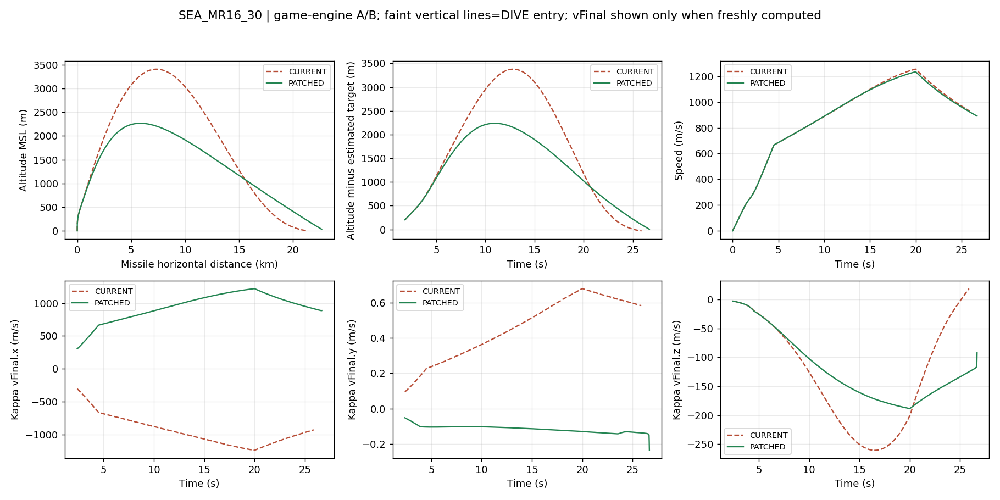
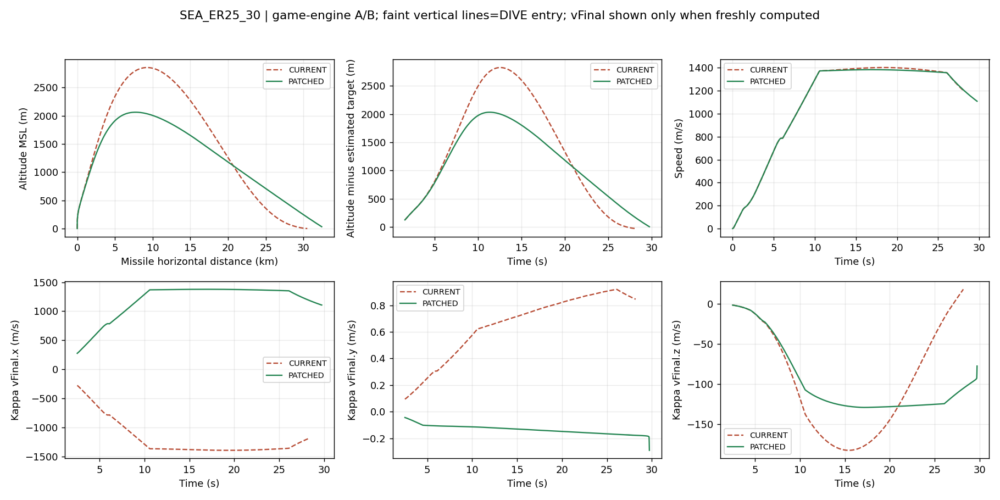
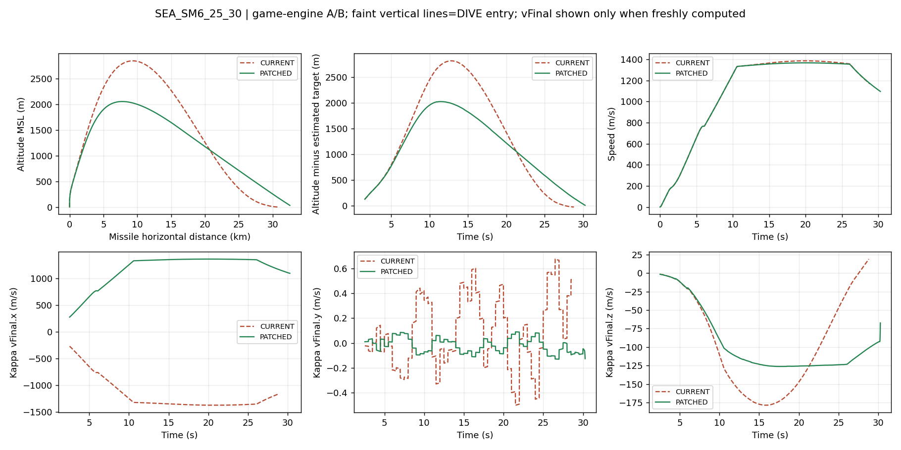
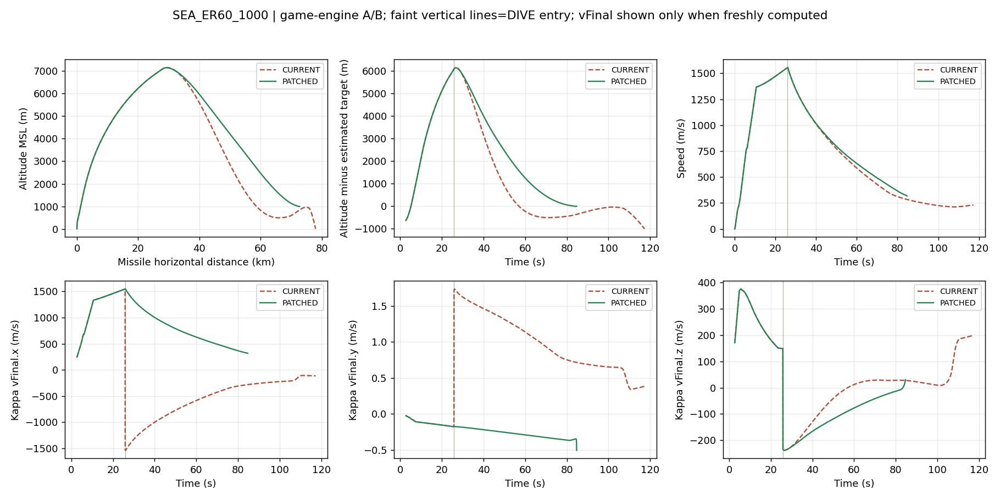
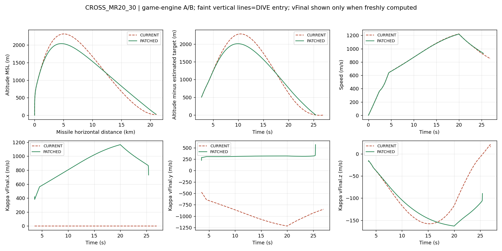
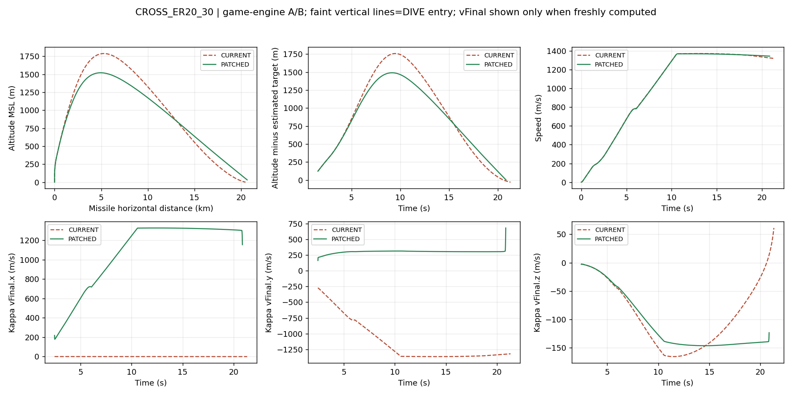
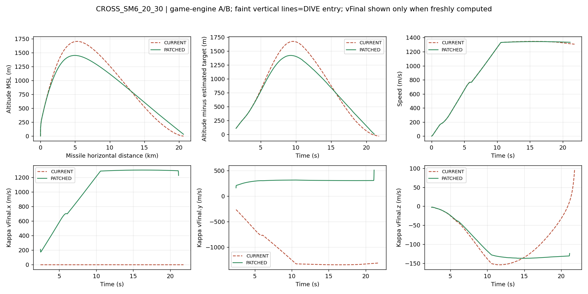
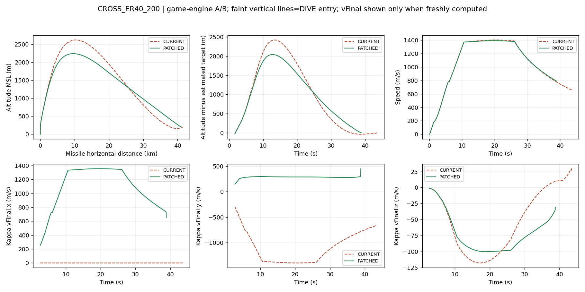
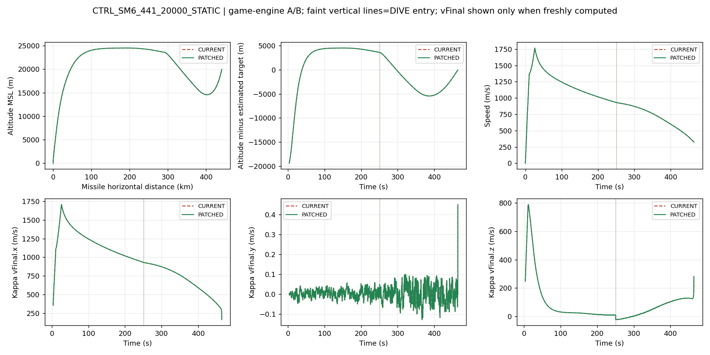

# KAPPA_PIP_LOS_A — 14조건 A/B 시험

**지정 4건의 해면 충돌이 명중으로 바뀌었고, 기존 성공 8건의 성공→실패는 0건이다. 이는 지정 14조건의 제한 검증이며 모든 해면 충돌·기동·사거리의 안정성 보증은 아니다.**

## 1. 기준·변경·금지 항목

기준 브랜치 `range-loft-recovery-a`, 기준 SHA `5af4726113994b4e38bbfe5da8283424f04856fe`. 별도 시험 브랜치는 `kappa-pip-los-a`다. 기존 브랜치/main 병합, 새 PR, Actions 실행은 하지 않는다.

종말 수평 방향을 `-targetState.velMps.x/y`에서 이미 계산한 관측 기반 PIP의 `dx/dy`로 바꿨다. 기존 정규화·gammaF·vFinal 구성·B4 waypoint 처리·Kappa 제어 계산은 보존했다. [실행 코드 diff](game-change.diff)와 [진단 관측 로그 diff](diagnostic-telemetry.diff)를 분리했다.

자함/NPC의 `_wip79KappaPipState` 두 복사본에만 같은 블록을 적용했다. NPC 함수를 감싼 `createWeaponContextD`의 전체 문자열 해시도 달라지지만, 내부 동일 패치 외 변경이 없음을 exact-match 역대조했다. 3,884개 게임 명명 함수를 감사했다.

Dynamic B4, fullLoft ER240/SM-6 260, 설계/RMAX360/450, 추진·항력·질량·연소·시커·신관·피해·배터리·종료기·해면 판정·UI는 그대로다. Kappa TGO90초도 유지했다. 새 유도 참조는 기존 pip/mPos에서 계산한 dx/dy뿐이며 추가 전장 truth 참조나 전역 참조가 없다.

## 2. 시험 방법과 14조건 결과

fixed dt1/60초, RNG1831565813, 게임 네이티브 비행/유도/신관, 정지 해면 발사함, 같은 이상 지속 관측 조건으로 CURRENT/PATCHED를 각각 두 번 실행했다. 접근은 targetSpeedMps 양수, 이탈은 음수, 횡단은 최초 사격선에90°인 crossSpeedMps=250이다. 같은 시드의 결정적 사격이며 확률적 명중률이 아니다.

| 조건 | 기종 | 최초거리/고도 | 접근·이탈/횡단(m/s) | 변경 전 | 패치 후 | 최근접 전→후(m) |
|---|---|---|---|---|---|---:|
| SEA_MR16_30 | SM2 | 16km / 30m | -250 / 0 | SEA_IMPACT | INTERCEPT_SUCCESS | 1066.110→0.761 |
| SEA_ER25_30 | SM2ER | 25km / 30m | -250 / 0 | SEA_IMPACT | INTERCEPT_SUCCESS | 1544.303→2.938 |
| SEA_SM6_25_30 | SM6 | 25km / 30m | -250 / 0 | SEA_IMPACT | INTERCEPT_SUCCESS | 1434.550→0.450 |
| SEA_ER60_1000 | SM2ER | 60km / 1000m | -150 / 0 | SEA_IMPACT | INTERCEPT_SUCCESS | 148.143→1.415 |
| CTRL_ER60_1000_STATIC | SM2ER | 60km / 1000m | 0 / 0 | INTERCEPT_SUCCESS | INTERCEPT_SUCCESS | 4.545→4.545 |
| CTRL_ER60_1000_IN300 | SM2ER | 60km / 1000m | 300 / 0 | INTERCEPT_SUCCESS | INTERCEPT_SUCCESS | 4.687→4.686 |
| CTRL_SM6_60_1000_OUT150 | SM6 | 60km / 1000m | -150 / 0 | INTERCEPT_SUCCESS | INTERCEPT_SUCCESS | 10.364→0.902 |
| CTRL_ER150_5000_STATIC | SM2ER | 150km / 5000m | 0 / 0 | INTERCEPT_SUCCESS | INTERCEPT_SUCCESS | 0.852→0.852 |
| CTRL_SM6_150_10000_STATIC | SM6 | 150km / 10000m | 0 / 0 | INTERCEPT_SUCCESS | INTERCEPT_SUCCESS | 0.220→0.220 |
| CTRL_SM6_441_20000_STATIC | SM6 | 441km / 20000m | 0 / 0 | INTERCEPT_SUCCESS | INTERCEPT_SUCCESS | 45.860→45.860 |
| CROSS_MR20_30 | SM2 | 20km / 30m | 0 / 250 | INTERCEPT_SUCCESS | INTERCEPT_SUCCESS | 1.729→4.161 |
| CROSS_ER20_30 | SM2ER | 20km / 30m | 0 / 250 | SEA_IMPACT | INTERCEPT_SUCCESS | 494.695→4.164 |
| CROSS_SM6_20_30 | SM6 | 20km / 30m | 0 / 250 | SEA_IMPACT | INTERCEPT_SUCCESS | 303.342→11.200 |
| CROSS_ER40_200 | SM2ER | 40km / 200m | 0 / 250 | INTERCEPT_SUCCESS | INTERCEPT_SUCCESS | 2.673→8.012 |

| 묶음 | 변경 전 | 패치 후 |
|---|---:|---:|
| 해면 충돌 재현 | 0/4 | 4/4 |
| 정상 명중 대조 | 6/6 | 6/6 |
| 횡단 | 2/4 | 4/4 |

기존 성공 8건 유지, 개선 6건, 성공→실패 0건. 추가 계수 조정이나 실패 케이스를 제외한 재집계는 하지 않았다.

## 3. 방향 역전 관찰과 시계열

아래는 ER60km/1000m/이탈150의 첫 DIVE 진입 전후에서 실제 새로 계산된 Kappa 값을 읽은 것이다. B4 waypoint 동안의 임시 정책과 DIVE에서 복귀하는 PIP_LOS를 구별한다.

| 버전 | DIVE 전 마지막 fresh | DIVE 후 첫 fresh | vFinal.x 전→후 | 정책 전→후 |
|---|---:|---:|---:|---|
| CURRENT | 25.800000s | 25.816667s | 1546.073→-1535.796m/s | B4_CLIMB→PIP_LOS |
| PATCHED | 25.800000s | 25.816667s | 1546.073→1535.797m/s | B4_CLIMB→PIP_LOS |

초기 B4 경유점 shaping은 원래부터 PIP 쪽으로 전진 방향을 만들었다. 기존 DIVE 진입에서는 그 shaping이 해제되면서 표적의 반대 방향 terminal vector가 드러났다. 패치 후 이 방향 반전이 사라진다. 세30m 이탈 재현은 DIRECT 조건이며, B4 전환 없이도 기존 반대 방향 요구를 갖는 경우다. 이 네 조건이 같은 B4 DIVE 경로라고 혼동하지 않는다.

60Hz 로그에는 B4 mode/phase, 설정 정책/실제 정책, targetState.source, PIP와 원래 targetPip, vFinal.x/y/z, 추정 표적 대비 고도, 수직속도, cmdOmegaPit, TGO/상한, 해면 보호 플래그를 기록했다. `kappaFresh=false`이면 해당 스텝의 새 Kappa 명령이 아니므로 남아 있는 debug 벡터를 새 명령으로 해석하지 않는다. 그래프도 fresh 계산만 그린다.

## 4. 재생성·동등성·진단 격리

- 현재 실행 JS를 추출→제공 exact-match 패치→새 live source에서 네이티브 함수 재추출→캡슐/함수 해시 재생성→gzip·인덱스 integrity 재생성 순서로 빌드했다.
- 새 네이티브 복사본은 실행 함수와 일치하고 이전 네이티브 복사본에 kit 패치를1회 적용한 것과도 byte-identical이다. 과거 캡슐에 새 판정 해시만 덮어쓰지 않았다.
- 새 `__ENV_KAPPA_A__`와 호환 `__ENV_C__`는 재생성된 같은 캡슐을 가리킨다. nativeAudit는 불일치0이다.
- 새 유도의 사거리 미측정을 나타내도록 현재 결과표 rows=0/profileHash=null을 내장했다. status는 envelopeMeasured=false와 재계산 필요, 기존 ENV_C/RECOVERY_A의 HISTORICAL_PRE_KAPPA_PIP_LOS 출처를 반환한다. 과거 JSON/CSV/그림/해시 데이터는 보존하고 보고서에는 구 유도 코드라는 안내만 추가한다.

실제 게임 페이지에서 캡처한 프로파일·설정과 독립 진단 입력이 동일하다. 같은14조건의 A/B28쌍, 25,529개10Hz 샘플쌍에서 시간/x/y/z/속도/Mach 최대오차0, 신관·최종 결과 일치, 독립 진단 전후 실제 월드/RNG/틱 변화0을 확인했다. 실제 월드 비교는 이상 정보/발사 경계를 버리는 페이지에 연결한 동일 경로 검사이며 자연 레이더·기동 AI 종합시험은 아니다.

## 5. 검증 범위·시간·남은 한계

| 검사 | 결과 |
|---|---|
| 지정 충돌4건 | 모두 실제 네이티브 요격 성공 |
| 정상 대조6건 및 기존 횡단 성공2건 | 성공 유지 · 신규 실패0 |
| 기본 정책/TGO | 설정 PIP_LOS만 사용 · TGO90초 유지 |
| 비기본 정책 | TARGET_GAMMA_OPPOSE_H/LEVEL_HEADON 수동 진단 API는 존재하지만 이번14조건에서 사용·인증하지 않음 |
| 정적 변경 경계 | 게임 전체가 kit의2블록 변경과 일치 · 금지 항목 변경0 |
| 기존 종료기 단위 fixture | 원래6건 통과 |
| 대규모 사거리 재측정 | 실행하지 않음 · 새 최대 사거리 숫자 없음 |
| 전체420+UI88 회귀·자연센서 종합 | 재실행하지 않음 · 이번 통과로 표기하지 않음 |

A/B28발씩 독립2회: 원시 234,240,109bytes / SHA-256 `942705a08add02b7b853693d06398ef338bec11967c3ddb631023d5bfbc503c7`가 동일하다. 벽시계 9.468s / 8.446s. 실제 월드 동일 경로는 별도로 같은14조건의28쌍(56실행)을 비교했다. 실험과 브라우저의 실행 수를 합쳐 대규모 독립 조건으로 부르지 않는다.

기본 PIP_LOS와 B4 waypoint 정책에 대한 제한 합격이다. 선택된 사례의 개선을 모든 기동·수상고도·거리·비기본 정책의 안정성으로 확대하지 않는다. 기존 브랜치/main에 병합하지 않았으며 추가 계수를 자동 조정하지 않았다.

## 6. 자료와 주요 궤적

[14조건 CSV](results/ab-summary-14.csv) · [60Hz 명령 CSV](results/commands-60hz.csv.gz) · [원시 A/B JSON](results/ab-results.json.gz) · [DIVE 전환 로그](results/dive-transition.json) · [정적 검사](evidence/static.json) · [반복·게이트 검증](evidence/verification.json) · [실제 월드 검사](evidence/browser.json) · [재현](README.md)

