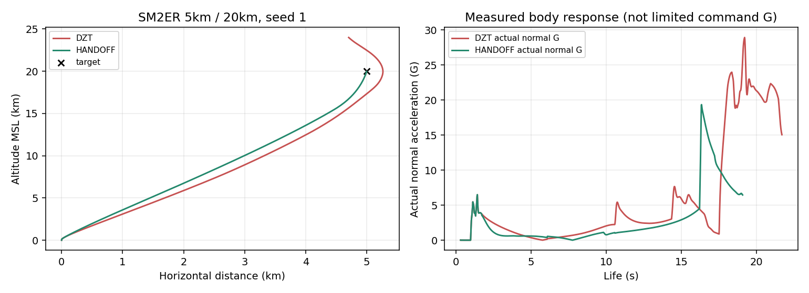
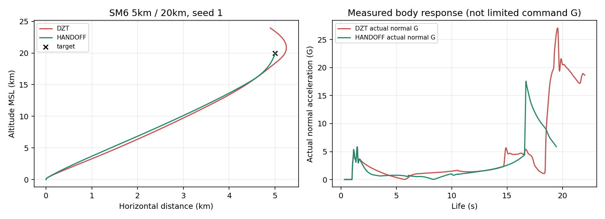
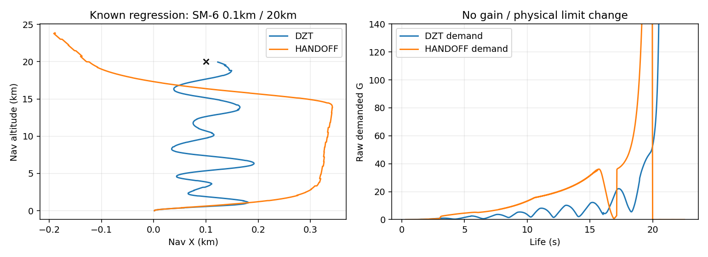

# LAUNCH_HANDOFF_A — 고각 발사 전환 / 제어권 인계

**판정: 인계 교착의 지정 재현 범위는 수정·검증했다. 전체 회귀 합격/안정판 승격은 보류한다.** 추가 시험에서 기존 성공→신규 실패 **3발(서로 다른 조건 2개)**, 기존 도메인 회귀에서 **6개 exact-state 비교 실패**가 남았다. 이 결과를 맞추기 위한 PN/Kappa/신관/물리 계수 조정은 하지 않았다. main 및 기존 브랜치 병합, release/tag 생성은 하지 않는다.

기준 `fuze-zem-a@7d863699c596c30b0df5e34734f17fe11cadc21e`, DZT HTML SHA `edc159fa347d721d61d80228e2512665f22da0adb4f02fdf4e2dbe82789e0c9c`. 별도 `launch-handoff-a` 작업 트리다. 원래 작업 트리와 기존 증거는 보존했다.

최종 `Aegis_SIM_v48_WIP_LAUNCH_HANDOFF_A.html`: **18,453,184 bytes**, SHA-256 **`e42a2e05b8ff2096dfb334e7b9427cd2cd6da46d567083f06620ffdf35729ed7`**. 아래 모든 HANDOFF 제품 검수는 이 revision2 bytes 대상이다. 임시 pitch-only/revision1은 참고 자료이며 제품 합격 수에 합산하지 않았다.

## 변경과 원인

기존 Standard의 절대 수평 경로각 제한 때문에 고각 사격이 `pitchoverPhase`에 남았다. deadline은 경고만이어서 해소되지 않았다. 5km/20km seed1에서 ER CPA270.975728315m /21.716666667s, SM-6 CPA223.444558551m /22.033333333s와 TRACKED_DIVERGENCE를 다시 재현했다.

기존 `updateMissileBodyB3` live-main 44837행의 준비 판정만 바꾸고 순수 보조 함수 하나를 추가했다. 원본 행은 [game-changes.json](game-changes.json)의 `line`, [decoded diff](game-change.diff)를 따른다. 예정 3D 발사 경로에 대한 자세·속도·받음각·전진 성분·안전 이격·최소 시간·하류 좌표계 조건으로 인계한다. [MODEL.md](MODEL.md)에 SI 단위와 기존 SIM_TUNED 상수 재사용을 명시했다.

Kappa/PN 이득, 기존 D/Z/T, 추진·항력·질량·최대 G·배터리·시커·신관·파편/Pk는 변경하지 않았다. 자산0–12 및 나머지 기존 실행 선언은 byte 동일하다. gzip 실행 main(asset13)과 그 메타데이터만 다시 패킹했다. [정적 증명](final-evidence/static.json), [복구 증명/빌드](build.json).

## 검수 수치

| 검사 | DZT → 최종 / 결과 | 범위와 판정 |
|---|---|---|
| 지정 고각 5km/20km, ER/SM-6×5시드 | 효과0/10 → KILL10/10 | ER 인계1.716667s, SM-6 1.750000s |
| 정상 30km/5km/접근250m/s, 각5시드 | KILL10/10 →10/10 | 궤적이 byte 동일하다는 의미 아님 |
| 공통180발/후보별 | 효과·lethal159→170 | 이 시험의 성공→실패0, 회복11 |
| 자연 RF/EKF, 고정 운동 ASM/함 cue | lethal21/28→24/28 | 신규 실패0. 전체 월드와 구분 |
| 추가 극단 고각, 후보별4발 | KILL3/4→2/4 | 신규 실패1, 아래 전수 목록 |
| 정상 종료기 ON/OFF240발 | 성공170→168 | 신규 실패2, 두 발 모두 native 기폭 후 AIR miss |
| 대체지원36 / RF12 / 배터리8 / 정식VLS4 | 성공32/6/0/4 유지 | 300발 전체 신규 실패2. 정상240과 중복 합산 금지 |
| 실제 자연 탐지→LOCK→정식VLS→전체tick/WebGL | 최종8발,29/29 assertions PASS | 원래 MR/ER 명중4 유지; SM-6/ESSM 기존 실패 잔존 |
| 실제 함수/private | 10조건, 전체 반환값 동일 | 좌표·속도·시간 최대 오차0; DZT280/최종281 함수 hash 일치 |
| 로그 detached / 결정적 재실행 | 8/8 검사 /4쌍 동일 | 나중 실행이 앞선 객체를 덮어쓰지 않음 |
| 대수상 실제 수동 발사 | 2기종×2후보=4발 동일 | AIR helper 호출0; native 접촉·궤적·RNG 동일 |
| 경계 fixture | low/high/near-vertical, 미이격·저속·후진·AoA·deadline·NaN 통과 | deadline 강제 해제 없음 |
| 기존 도메인15 suites | **414/420 PASS,6 FAIL** | 기존 실패 assertion 원문 유지 |
| UI 회귀 | 88/88 PASS | 최종 파일 대상 |
| 배속·2D/3D·사통 손상 | 8시나리오 PASS | 1/8/16 동일,64 물리 동일·호스트 비용 별도 |
| 무표적 전체 월드120초 | hash 동일 | `fb1fac63054a72db26cce4b4f4781288a7f07a28465ce5ac2aa5597760adffbc` |
| 전투 전체 월드120초 | hash 다름 | 변경된 비행 경로 결과, 아래 제한 명시 |
| 최종 core / console / 페이지 오류 | 0 /0 /0 | 최종 untouched HTML 재확인. 초기 메모리 실패는 무효 실행으로 별도 기록 |

모든 조건/시드는 [analysis](analysis/) CSV와 [final-results](final-results/) 원시 JSON.gz에 있다. 성공·DAMAGED·lethal·기폭·최종 실패를 구분한다. 단순 근접 접근을 명중으로 올리지 않는다. 과거 DZT release300 control은 지정 SHA의 **역사적 비교자료**이고 새 제품300발은 실제 재실행했다.

시드 세트는 사용자 지시의 다섯 쌍을 그대로 사용했다: `(1831565813,2047861954)`, `(305419896,2654435769)`, `(2271560481,1013904242)`, `(324508639,2779096485)`, `(610839776,1515870810)`. 순서는 게임 RNG/navigation seed다. 원래 release300의 고유 시드(예:12001)는 바꾸지 않았다.

## 성공→실패 전수 목록

| 조건 | DZT | 최종 | 분류 |
|---|---|---|---|
| SM-6 수평0.1km/20km 정지Kh-35U, 시드1 | KILL, 기록CPA31.199749m | TRACKED_DIVERGENCE,227.985890m /22.55s | 안전 인계 뒤 근수직 Kappa/종말 궤적 민감도; 미해결 유도/제어 회귀 |
| SM-6 240km/5km 접근250m/s,seed12001, 종료기OFF | AIR 명중, 기록CPA5.478075m | 기폭하지만 AIR 비명중,51.308397m | launch 이후 달라진 궤적의 종말 miss; 종료기 원인 아님 |
| 위와 동일, 종료기ON | 위와 동일 | 위와 동일 | ON/OFF 결과가 동일한 같은 기하 조건의 두 실행 |

240km의 인계는3.15→4.033333s로 바뀌었다. 최종 실제 기폭 miss49.009626m, ARH_RF_EKF 상태에서 기폭했다. DZT 실제 기폭 miss5.277591m. 기존 AIR 점 표적의 native 판정과 ASM 파편/Pk 판정은 다르므로 이 둘을 같은 확률로 설명하지 않는다. 계측 wrapper를 넣은4발도 원래300발 반환값과 완전히 같았다. [release 비교](final-evidence/release-comparison.json), [원인 계측](final-evidence/release-regression-analysis.json), [raw](final-results/release-regression.json.gz).

0.1km/20km는1.733333s에 이격·각도·속도 조건을 충족했다(경로 전진224.373m/s, 수평36.513m/s, 정렬오차9.775°, 받음각9.783°). 인계 후 launch overlap은 없다. 기존 Kappa의 최종 경로각은60°이고 실제 표적은 거의 직상방이다. ARH 관측은 유지됐지만,17.15s TERMINAL 진입 이후 raw 요구45~111G 대비 제한·실제 응답 차이가 커졌다. **발사 제어가 계속 섞여서 생긴 문제와 구별되는 잔여 궤적/응답 회귀**다. Kappa가 초기화되지 않았다는 설명은 계측과 맞지 않는다. 구체적인 최종 접근 손실의 단일 원인은 아직 확정하지 않았다. 이득·제한값 상향 대신 거의 직상방 PIP/최종속도각과 전환 연속성 검토가 다음 진입점이다.

ENDGAME17.75s 이후22.116667s의 TERMINAL 복귀는 최초 비명중 뒤다. 이를 최초 miss의 원인으로 기재하지 않았다. 10m/20km 일부 사격은 실제 미정렬로 인계하지 않았으며 타임아웃으로 억지 해제하지 않았다.

## 기존 420 회귀의 6개 실패

DDG/CG 각각 raid의 `samePhysicalState`, `raidInventoryDeltaBounded`, `sameExistingObserverState`가 false다. [원래 판정](final-evidence/domain-acceptance.json)과 [전수 실패](analysis/domain-failures.json)를 보존했다. 비교기준은 과거 VP_A의32초 exact-state다. 허용 오차나 재고 비교를 느슨하게 고치지 않았다.

32초 VLS 잔량은DDG91→90, CG116→115로 각각 한 발 더 사용했다. 같은8발 Kh-32 AUTO fixture를120초까지 연장한 별도 확인에서HP100 유지, 모듈 손상 동일, 최종 VLS 잔량DDG83/CG105로 다시 같아졌다. 전체 flooding DTO에는 동역학·캐시 차이가 있으므로 이를 피격 손상 증가로 해석하지 않는다. 침수량 비교는 [정규화 자료](analysis/raid-normalized-damage.json)를 따른다. native 추가 스폰이 있으므로120초의 적 수만으로 전체 raid 격퇴/전투 성능 동등을 주장하지 않는다. 이 추가 관찰이 원래6FAIL을 PASS로 바꾸지는 않는다.

## 제어 전달 계측

DZT ER12초의 가속도 bridge 피치0.062828169678rad/s가 launch overlap 이후 최종0.008128607720rad/s로 줄어드는 현상을 재현했다. 최종은 같은 시각 pitchover=false/Kappa이며0.008207503685rad/s가 그대로 소비된다. 서로 다른 궤적의 같은 시각을 비교한 것이며 같은 요구 가속도에 대한 출력 비교가 아니다.

`_v1GAchieved`는 **제한 후 명령 G**다. 실제 `sam6dofActualNormalG`와 명령 방향 `sam6dofDeliveredG`를 별도 기록했다. PN/APN/ZEM이 호출되지 않는 Kappa 틱에는 과거 캐시 명령을 현재 명령처럼 표기하지 않는다. [현재 틱 호출 CSV](analysis/pipeline-compact.csv.gz)에 `calledThisTick`, 마지막 호출 시각과 실제 소비 명령을 넣었다. 메인40발 raw의 캐시 값은 last-available임을 [계측 설명](REPRODUCE.md)에 표시했다.

## SM-6의 서로 다른 잔여 실패

1. **사용자 참고 실험 재현 — 제품 아님:** relative-pitch-only 후보는 ER4KILL+1DAMAGED, SM-6 1KILL+4PROX_MISS를 재현했다. SM-6 인계4.883333s, 기록 miss41.5668~41.7812m. seed1에서 파편 도달 시49.9776m, native Pk0.358561, 두 native draw0.484497/0.974384로 MISS다. 이것은 기존 피해 판정에서 자연스럽게 발생한 무효 기폭이며42m 접근=격추가 아니다. 5시드의 신관 신호·기폭·fragment/Pk·난수와 observer 불변은 [표](analysis/reference-only-native-pk.csv), [raw](final-results/reference-pk.json.gz)에 있다. 기존 난수 stream을 추가 소비하지 않았다.
2. **최종 후보의 5km/20km:** 5/5KILL, 기록CPA12.3~12.5m. 위 참고 실패4건이 최종 제품에 남았다고 쓰지 않는다.
3. **최종 전체 월드30km/5km 자연 항공기:** 인계3.35s 이후 IOG_MEM, ARH_REACQUIRE/SARH_SEARCH·DL없음 상태에서 최초 물리 접근도 약1192.051m다(사후 truth, 샘플 기준). 신관 획득·기폭이 없다. OFF LOW_SPEED79.416667s /ON POST_CROSS26.7s. [raw](final-results/sm6-residual-world.json.gz). freshness/source arbiter/시커 추적 손실 계측이 다음 진입점이며 신관·Pk 실패로 단정하지 않는다.
4. **최종 신규 실패3발:** 앞 표와 같이 별도 회귀로 보류한다. 240km는 기폭 있음, 근수직은 TRACKED_DIVERGENCE다.

사후 truth 진단은 비교·분류 전용이며 제어기에 되먹이지 않았다. 원래 내부 최근접 카운터와 사후 물리 거리도 서로 구분했다.

## 실제 소스/실행 경로 증명과 한계

`engine.cjs`는 지정 HTML의 실행 main에서 AST로 함수를 추출한다. 과거 ENV_D capsule은 선언 배치와 명시된 ideal RF/함 지원 boundary만 제공한다. 기존 A 엔진의 옛 ENV_D baseline에 패치를 덧입혀 새 제품인 것처럼 시험하지 않았다. 실제 browser lexical function280/281개와 private 복사본의 함수 해시가 전부 같고, ER/SM-6 고각·MR 정상·ESSM 횡단·SM-6 장거리의5조건×2후보 전체 반환값/궤적이 동일했다. private 실행은 실제 world/RNG/tick을 바꾸지 않았다. [ledger](final-evidence/native-source-ledger.json), [E3](final-evidence/equivalence.json).

이상 관측/private, native RF의 제어된 표적, 실제 전체 월드/WebGL은 서로 다른 증거다. 횟수를 합쳐 자연 시커 수백발을 검증했다고 쓰지 않는다. 120초 전투 해시는 달라졌고 최종 시점에서 DZT missile은 이미 종료, 최종 후보 missile은 비행 중이다.120초 결과만으로 그 사격의 최종 명중/실패를 추가 판정하지 않았다. 무표적 hash와 source byte 보존은 인계와 무관한 상태 변화가 없다는 별도 근거다.

최종 배속 검사는 실제 frame accumulator3840 fixed ticks, 1/8/16/64와 SPG 손상 전환/시점 전환을 사용했다.64× 호스트 소요는 [clock-view-damage.json](final-evidence/clock-view-damage.json)에 있으며 소프트웨어 Chromium/서버 결과다. 실제 폰 GPU/FPS·펜 하드웨어는 측정하지 않았다.

초기 E3 실행은 메모리로 exit137되어 무효다. 쌍별 스트리밍으로 재실행한 결과만 사용했다. 초기 빈 객체 비교 fixture와 잘못된 native Pk 인자 관찰기도 폐기/수정 이력을 남겼다. 이 도구 수정은 생산 판정이나 성공 조건을 완화하지 않는다. 로그는 tick마다 복제하고 불변성을 별도 확인했다.

## 보존·전달·다음 작업

- DZT 직전 전달7파일은 `archive/v48/WIP_FUZE_ZEM_A`에 같은 bytes/blob으로 보존했다. 기존 fuze-zem 증거를 수정하지 않았다.
- 실행 ZIP에는 새 HTML1개, REPORT ZIP에는 문서·raw·CSV·그림·재현 소스·파일별 hash가 있다. 보고서에 실행 HTML은 넣지 않는다.
- ENV_D120행은 HISTORICAL, status는 `match=false`/`recalculationRequired=true`. 전체175,955발 재측정, 신규 사거리표/지도·발사 판정 연결은 하지 않았다.
- Actions 실행·PR 생성·main/원본 브랜치 병합·release/tag 생성 없음. 업로드 후 독립 Git 원격 전체 readback은 `remote-publication.json` 영수증으로 추가한다.
- 다음 검토: 신규 SM-6 두 기하 조건의 인계 시점 변화와 Kappa→terminal 응답을 분리 설계. 420의6개 상태 차이 검토. 이번 WIP를 전면 안정판으로 취급하지 않는다.

