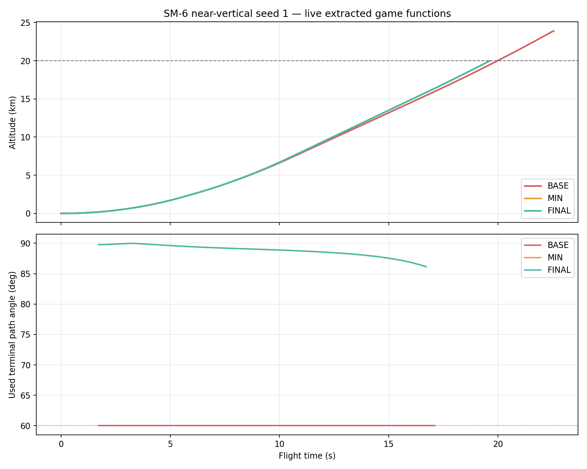

# NEAR_VERTICAL_PATH_FIX_A 보고서

## 판정

- **±60° 정책 제한 해제: PASS.** `_wip79KappaPipState()`의 목표 경로각 정책 clamp를 제거했다. 실제 받음각·구조 G·동압·구동기·시커 제한은 그대로다.
- **근수직 사례: PASS.** 최신 ARH 기준 BASE는 분리 fixture와 실제 제품 RF 경로 모두 0/5였고, 최종본은 양쪽 모두 5/5 KILL이다.
- **장거리 ARH 수정 보존: PASS.** SM-6 240 km 5시드×종료기 OFF/ON 10발이 모두 명중했고, 종료기 전체 300발에서 FIX_A 대비 성공→실패 0·상태 변경 0이다.
- **관련 회귀: PASS WITH KNOWN BASELINE FAILURES.** 공통 180발과 자연 RF 28조건의 성공→실패 0, UI 88/88, 실제 함수/사본 4조건 오차 0, 배속·시점·손상 검사가 통과했다. 도메인은 수정 전과 같은 raid exact-state 6건만 남아 414/420이다.

## 기준과 산출물

| 항목 | 값 |
|---|---|
| 기준 커밋 | `759fcd94bfa1081b268bfff9967f0f97088b7078` |
| 입력 | `Aegis_SIM_v48_WIP_ARH_MEASUREMENT_FIX_A.html` |
| 입력 크기 / SHA-256 | `18,453,432 bytes` / `900be4a2d146ecf33eff67f1719134b9a93eb58c3dc79fbc9b6a6cc813c3cfab` |
| 최종 | `Aegis_SIM_v48_WIP_NEAR_VERTICAL_PATH_FIX_A.html` |
| 최종 크기 / SHA-256 | `18,453,628 bytes` / `eb1f5cebbfe991732b2855df625030b0691ff7cdd8047e9a01cc2711010b6e5f` |
| 변경 함수 | `_wip79KappaPipState` 1개 |
| 변경 전/후 함수 SHA | `554775f6c4fcc3335170c9c3304a8f81940cf0d718889c74a2a75536cd32e480` → `19caa5ad7c13e1362fcde9fbff47e1017ffbf3ae0f30296db943bc12cbbfea4e` |

## 변경과 수치 계약

최소 비교본은 `gammaF=clamp(gammaF,deg(-60),deg(60))` 한 줄만 제거했다. 이 비교본만으로 원래 5시드는 0/5에서 5/5로 회복했다. 하지만 별도 실제 함수 기하 검사에서 기존 `Math.max(1,horizontalRange)` 보호가 수평거리 0.1 m의 유효 방향을 300 m/s가 아니라 30 m/s 벡터로 축소하고, 완전 중첩에서는 0벡터를 만드는 계약 실패가 재현됐다.

최종본은 실제 실패 지점만 추가로 정리했다. 수평 성분이 있으면 실제 크기로 정규화하고, 정확히 수직/중첩이면 현재 수평 진행방향을 유지한다. 수평속도도 없을 때만 결정적 +X를 사용한다. PIP_LOS 경로각은 `atan2(dz,horizontalRangeM)`의 자연 범위다. 임의 ±89° 상한이나 분모 보정은 넣지 않았다. 최소본과 최종본은 원래 근수직 5발 전체 결과가 exact 같다.

기하 검사는 59.9°/60.1°, 상승·하강 약 89.9°, 0.1 m 좌우, 정확한 수직과 완전 중첩을 포함한다. 최종 모든 출력은 유한하고, 정의된 방향에서 속력 상대오차는 1e-12 미만이다. `loftB4ShapeWaypoint`는 byte 동일하며 원래 100 m/20 km 경로에서 `waypointB4=false`였다. 따라서 이 사례의 60°는 후단 waypoint가 아니라 해당 정책 clamp가 실제 소비한 값이다.

## 근수직 비행 결과

분리 capsule은 선택 HTML에서 추출한 실제 281개 함수와 동일한 프로파일을 사용한다. BASE 최근접은 216.886–237.130 m, 최종은 0.00027–9.950 m이며 최종 5/5 KILL이다. 첫 Kappa tick은 모두 인계 직후 1.733–1.750 s로 동일하다. seed 1에서 BASE는 PIP LOS 89.763°를 60°로 소비했고, 최종은 89.763°를 그대로 소비했다. BASE의 최대 raw 요구는 36.106 G·포화 표본 117개, 최종은 21.601 G·포화 2개였다. 이득과 물리 한계 변경 없이 잘못된 목표방향이 사라진 결과다.

실제 브라우저 제품 경로는 정식 VLS release, 네이티브 RF/EKF, 60 Hz fixed tick, 기존 신관·피해를 사용했다. 함 사통 트랙과 Kh-35U 직선 운동만 fixture가 통제한다.

| 시드 | BASE 결과 / 최근접 m | 최종 결과 / 최근접 m | 최종 최대 사용각 |
|---:|---|---|---:|
| 1 | LOW_SPEED / 193.106 | PROX_DETONATION_KILL / 0.653 | 89.954° |
| 2 | LOW_SPEED / 147.846 | PROX_DETONATION_KILL / 0.441 | 89.889° |
| 3 | LOW_SPEED / 168.117 | PROX_DETONATION_KILL / 2.481 | 89.887° |
| 4 | LOW_SPEED / 141.812 | PROX_DETONATION_KILL / 1.288 | 89.952° |
| 5 | LOW_SPEED / 217.659 | PROX_DETONATION_KILL / 0.947 | 89.966° |

BASE는 5발 모두 RF TRACK을 얻었지만 이후 LOW_SPEED로 끝났다. 최종은 5발 모두 TRACK 상태에서 KILL했고 최근접 범위는 0.441–2.481 m다. 같은 최종 bytes/seed 1 재실행은 전체 반환값 exact 일치다.

## 회귀

| 검사 | 결과 |
|---|---|
| 공통 SAM | 180발, effects/lethal 170/170 유지, 성공→실패 0 |
| 자연 RF | 28조건, 성공→실패 0, 실패→성공 0, 오류 0 |
| 종료기·발사 | 300발, 성공→실패 0, 상태 변경 0, 오류 0 |
| SM-6 240 km | 5시드×OFF/ON 10/10 명중; seed12001 최근접 1.349768 m 유지 |
| 실제 함수/독립 사본 | 281 함수 해시 일치, 4조건 궤적·반환값 오차 0 |
| 도메인 | 414/420; 기존 raid exact-state 6건만 실패 |
| UI | 88/88, page error 0 |
| 고정 tick | 정상/사통손상 × 1/8/16/64, 3,840 tick exact; 2D/3D view read-only |
| 120초 world | idle hash 동일 `fb1fac63054a72db26cce4b4f4781288a7f07a28465ce5ac2aa5597760adffbc`; 대표 전투 hash도 동일 |
| smoke/core | page·console·core 오류 0 |

도메인 6건은 DDG/CG raid 각각의 `samePhysicalState`, `raidInventoryDeltaBounded`, `sameExistingObserverState`로 FIX_A와 동일하다. assertion을 완화하지 않았다.

## 보존과 남은 범위

ARH 측정 함수, RF 프로파일, PN/APN/ZEM/Kappa 이득·TGO, 발사 인계, 6DoF, 추진·항력·질량·G·받음각·구동기, 신관·피해·배터리·종료기는 byte 동일하다. 외부 shell과 자산도 payload manifest를 제외하면 동일하다.

전체 ENV_D 약 175,955발 재측정은 하지 않았다. 내장 사거리표는 `recalculationRequired=true`를 유지한다. 모든 극단 기하의 명중이나 실제 무장 성능을 주장하지 않는다. main 병합과 release/tag 생성은 하지 않았다.
