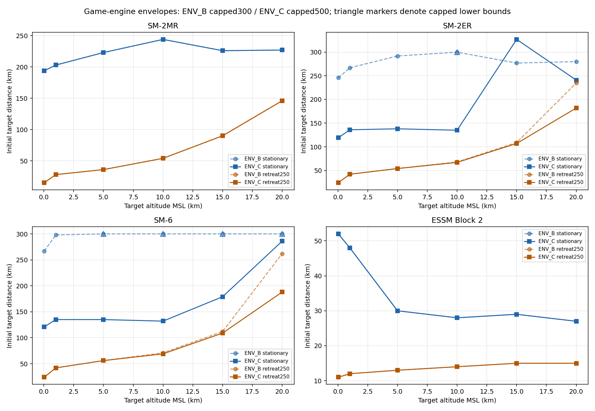

# RANGE_A + ENV_C — 최종 게임 엔진 보고

HTML `Aegis_SIM_v48_WIP_RANGE_A.html` · 18,283,304bytes · SHA-256 `8f504eb45c19c34e473d0d04f08180afde95a9c72b5ec935ec0204bd9d7246b5`

최신 ALL4_TERM `9a6838aade07c37262453e21cfe415d04d123d8c` 위 누적 작업이다. 0단계 측정·보고 뒤 지정한8개 설계 사거리 숫자만 정렬했다. 정렬 후6조건의 목표 최대 명중 거리는 달성하지 못했고 일부 정지 표적 최대 거리는 크게 줄었다. 이 결과를 보존하며 추진/항력/유도/배터리/해면 판정은 추가 조정하지 않았다. 모든 새 수치는 SIM_TUNED 게임 설계값이고 측정값은 GAME_ENGINE_COMPUTED다.

## 1. 변경 전500km 측정

SM-2ER/SM-6, 고도1/10/20km, 정지 표적. 실제 게임 native 비행/유도/신관 경로와 기존 이상 지원 경계를 사용했다. 1km 이분 탐색 뒤 더 먼 모든 정수km를 확인했다. 실제 장비 성능과 비교하지 않는다.

독립2회 각각 1,106사격, 19,690bytes 동일. SHA-256 `5137099780e8ab46a774690b2edf43d8eb5aa4be6ae95bb5dfc15c14bcf00e01`.
벽시계 492.545s / 491.711s. 다른 진단/브라우저 검사와 병행하여 단독 CPU 성능이 아니다.

| 기종 | 표적고도 | 최대 최초거리 | 실제 요격점거리 | 다음1km 실패 | 종말속도 | 최근접 |
|---|---:|---:|---:|---|---:|---:|
| SM2ER | 1km | 267km | 266.997930km | 268km: LOW_SPEED | 168.155m/s | 15.752m |
| SM2ER | 10km | 323km | 323.004233km | 324km: LOW_SPEED | 150.056m/s | 921.759m |
| SM2ER | 20km | 280km | 279.987734km | 281km: SEA_IMPACT | 535.487m/s | 158.950m |
| SM6 | 1km | 298km | 297.999655km | 299km: LOW_SPEED | 168.139m/s | 23.075m |
| SM6 | 10km | 368km | 368.003590km | 369km: LOW_SPEED | 149.831m/s | 70.790m |
| SM6 | 20km | 441km | 441.002128km | 442km: PROX_DETONATION_AIRCRAFT | 320.062m/s | 53.905m |

이 결과를 확정·보고한 뒤8개 설계 사거리 값을 변경했다. [baseline.json](../../../envelope/C/stage0/baseline.json)에 원본 HTML SHA와 source/inputs/private byte 동일성을 남겼다.

## 2. 변경값과 근거

| 레지스트리 | 기종 | 필드 | 이전→새 값(km) | 기준 |
|---|---|---|---:|---|
| SAM_LOFT_PROFILE_REGISTRY | SM2ER | nominalRmaxKm | 180→360 | 이상 조건 설계 기준을 Rmax 추정식의 기준 배율로 사용 · SIM_TUNED/USER_DESIGN_TARGET_RANGE_A |
| SAM_LOFT_PROFILE_REGISTRY | SM2ER | maxRmaxKm | 220→360 | 같은 설계 기준을 Rmax 추정값의 상한으로 사용 · SIM_TUNED/USER_DESIGN_TARGET_RANGE_A |
| SAM_LOFT_PROFILE_REGISTRY | SM6 | nominalRmaxKm | 200→450 | 이상 조건 설계 기준을 Rmax 추정식의 기준 배율로 사용 · SIM_TUNED/USER_DESIGN_TARGET_RANGE_A |
| SAM_LOFT_PROFILE_REGISTRY | SM6 | maxRmaxKm | 250→450 | 같은 설계 기준을 Rmax 추정값의 상한으로 사용 · SIM_TUNED/USER_DESIGN_TARGET_RANGE_A |
| SAM_LOFT_B4_PROFILES | SM2ER | rangeGoalKm | 240→360 | B4 계획·표시 목표를 같은 설계 기준으로 정렬 · SIM_TUNED/USER_DESIGN_TARGET_RANGE_A |
| SAM_LOFT_B4_PROFILES | SM2ER | fullLoftKm | 240→360 | 해당 설계 거리에서 기존 shelf 보간이 완전히 포화되도록 정렬 · SIM_TUNED/USER_DESIGN_TARGET_RANGE_A |
| SAM_LOFT_B4_PROFILES | SM6 | rangeGoalKm | 240→450 | B4 계획·표시 목표를 같은 설계 기준으로 정렬 · SIM_TUNED/USER_DESIGN_TARGET_RANGE_A |
| SAM_LOFT_B4_PROFILES | SM6 | fullLoftKm | 260→450 | 해당 설계 거리에서 기존 shelf 보간이 완전히 포화되도록 정렬 · SIM_TUNED/USER_DESIGN_TARGET_RANGE_A |

파생 계산은 기존 `_samEstimateRmaxKm`, `_samBuildAdaptiveTrajectoryPlan`, `loftB4UpdatePlan`, `gameB4ReplanShelf`가 같은8값을 읽는다. 함수나 다른 분모/계수는 바꾸지 않았다. `rangeGoalKm`는 B4 계획·표시 메타데이터이며 인위적인 비행 종료 반경이 아니다.

명명 네이티브 함수 3,884개와 나머지 live source는8숫자 역치환으로 동일함을 확인했다. 자함/NPC 문맥이 공유 레지스트리를 읽으며 중복 패치를 적용하지 않았다. SAM_MISSILE_PROFILES, 추진/항력/질량/연소/시커/Kappa/신관/배터리/종료기와 MR/ESSM 설정은 그대로다. MR/ESSM60궤적의 기존 필드도 ENV_B와 동일하다.

독립적인 AI/교전계획 `effectiveRangeKmGameplay`260km는 유지했다. 이는 지정된 로프트값에서 계산되는 필드가 아니며 이번에는 발사/교전계획 관문을 변경하지 않았다.

## 3. 정렬 후6조건 — 목표 부족분

SM-2ER/SM-6, 고도1/10/20km, 정지 표적. 실제 게임 native 비행/유도/신관 경로와 기존 이상 지원 경계를 사용했다. 1km 이분 탐색 뒤 더 먼 모든 정수km를 확인했다. 실제 장비 성능과 비교하지 않는다.

독립2회 각각 2,001사격, 20,811bytes 동일. SHA-256 `500c440695c1fb738013c5e2ac454fd6a3c0e0f09256d0c206167f4416b83582`.
벽시계 1864.529s / 1829.353s. 다른 진단/브라우저 검사와 병행하여 단독 CPU 성능이 아니다.

| 기종 | 표적고도 | 최대 최초거리 | 실제 요격점거리 | 다음1km 실패 | 종말속도 | 최근접 |
|---|---:|---:|---:|---|---:|---:|
| SM2ER | 1km | 136km | 135.999251km | 137km: LOW_SPEED | 168.169m/s | 34.777m |
| SM2ER | 10km | 135km | 135.004407km | 136km: LOW_SPEED | 149.886m/s | 153.550m |
| SM2ER | 20km | 241km | 240.989009km | 242km: SEA_IMPACT | 497.294m/s | 249.819m |
| SM6 | 1km | 135km | 134.997515km | 136km: LOW_SPEED | 168.235m/s | 21.848m |
| SM6 | 10km | 132km | 132.004523km | 133km: LOW_SPEED | 149.860m/s | 178.139m |
| SM6 | 20km | 286km | 286.000183km | 287km: PROX_DETONATION_AIRCRAFT | 320.746m/s | 54.361m |

| 기종 | 고도 | 변경 전→후 | 목표 | 부족분 |
|---|---:|---:|---:|---:|
| SM2ER | 1km | 267→136km | 360km | 224km |
| SM2ER | 10km | 323→135km | 360km | 225km |
| SM2ER | 20km | 280→241km | 360km | 119km |
| SM6 | 1km | 298→135km | 450km | 315km |
| SM6 | 10km | 368→132km | 450km | 318km |
| SM6 | 20km | 441→286km | 450km | 164km |

8개 수치를 올리면 같은 실제 거리의 R/Rmax와 B4 fullLoft 보간 비율이 줄어 기존 스케줄러의 초기 로프트·선반이 낮아진다. 함수나 추진이 바뀌지 않아도 경로와 에너지 소모가 바뀔 수 있다. 이 결과를 추진 자체의 부족으로 단정하지 않는다. 실제 궤적과 실패 사유를 보고하고 추가 튜닝은 하지 않는다.

표는 각 조건의 전역1km 격자 최대이며 그 안의 모든 거리에서 명중한다는 뜻이 아니다. 360/450km 자체 사격 결과도 별도로 보고한다.

## 4. ENV_C 전체 표·전후 비교·퇴행 재확인

프로파일/진단 경계 SHA-256: `a481e469fc7201c626c243b6669a215f0feafbd608b4af10ab65b4ebf5574a61`

현재 가상 게임 엔진의 SIM_TUNED 모델을 측정했다. 실물 성능과 비교하지 않는다. 정지 해면 발사함·수직 VLS, 오차 없는 지속 유도 정보, private1/60초/RNG 조건이다. 실제 게임 함수 그대로이며 결과는 지도/AI/발사 권한에 연결하지 않았다.

96조합 +120궤적을 독립적으로2회 실행. 각각 26,714사격, 원시 50,178,372bytes가 비트 동일하다.
원시 SHA-256 `8d8bf8296b20a4acf3bb61287546e502666f7bca83d84ec8eead70a6d8f9156a`.
벽시계 9138.282s / 8801.709s. 각4workers, CPU4core quota, 브라우저 회귀 우선 일시 중단/재개 및 두 실행 중첩을 포함한다. 전용 CPU 벤치마크가 아니다.

### 거리 정의

- 최초거리: 발사 시 표적과 발사점의 수평 거리.
- 요격점거리: 그 최대 최초거리 성공 사격에서 실제 신관/파괴 시점 미사일 위치와 발사점 사이 수평 거리. 별개의 최댓값을 다시 탐색한 표가 아니다.
- `≥500`은 측정 상한에서 성공했다는 하한이다. ENV_B `≥300`도 실제 최대라고 해석하지 않는다.
- 비단조 구간을 놓치지 않도록 coarse/이분 탐색 뒤 더 먼 모든 정수km를 검사했다. 표 안쪽 모든 거리의 명중을 보장하지 않는다.

### 설계 목표 대비 — 측정한 정지 표적6고도 중 최대

| 기종 | 목표 | 최대 명중 최초거리 | 해당 표적고도 | 부족분 | 최대기록의 목표 도달 |
|---|---:|---:|---:|---:|---|
| SM-2ER | 360km | 327km | 15km | 33km | 아니오 |
| SM-6 | 450km | 286km | 20km | 164km | 아니오 |

명중 구간이 비연속일 수 있으므로 최대기록 도달 여부와 목표거리 자체 사격의 성공 여부는 구분한다. 미측정 고도·사거리는 추정하지 않는다.

### 최대 발사 시 표적 거리 — km

#### SM-2MR

| 표적 고도 | 정지 | 접근250m/s | 접근680m/s | 이탈250m/s |
|---|---:|---:|---:|---:|
| 0.03km | 194 | 302 | 493 | 15 |
| 1km | 203 | 326 | ≥500 | 28 |
| 5km | 223 | 341 | ≥500 | 36 |
| 10km | 244 | 364 | ≥500 | 54 |
| 15km | 226 | 375 | ≥500 | 90 |
| 20km | 227 | 362 | ≥500 | 146 |

#### SM-2ER

| 표적 고도 | 정지 | 접근250m/s | 접근680m/s | 이탈250m/s |
|---|---:|---:|---:|---:|
| 0.03km | 119 | 356 | ≥500 | 24 |
| 1km | 136 | 393 | ≥500 | 42 |
| 5km | 138 | 416 | ≥500 | 54 |
| 10km | 135 | 456 | ≥500 | 67 |
| 15km | 327 | 491 | ≥500 | 107 |
| 20km | 241 | ≥500 | ≥500 | 182 |

#### SM-6

| 표적 고도 | 정지 | 접근250m/s | 접근680m/s | 이탈250m/s |
|---|---:|---:|---:|---:|
| 0.03km | 121 | 321 | ≥500 | 24 |
| 1km | 135 | 412 | ≥500 | 42 |
| 5km | 135 | 447 | ≥500 | 56 |
| 10km | 132 | 496 | ≥500 | 69 |
| 15km | 179 | ≥500 | ≥500 | 109 |
| 20km | 286 | ≥500 | ≥500 | 188 |

#### ESSM Block 2

| 표적 고도 | 정지 | 접근250m/s | 접근680m/s | 이탈250m/s |
|---|---:|---:|---:|---:|
| 0.03km | 52 | 99 | 179 | 11 |
| 1km | 48 | 99 | 179 | 12 |
| 5km | 30 | 58 | 111 | 13 |
| 10km | 28 | 41 | 66 | 14 |
| 15km | 29 | 40 | 62 | 15 |
| 20km | 27 | 36 | 53 | 15 |

### 같은 최대 사격의 실제 요격 지점 거리 — km

#### SM-2MR

| 표적 고도 | 정지 | 접근250m/s | 접근680m/s | 이탈250m/s |
|---|---:|---:|---:|---:|
| 0.03km | 193.998 | 226.218 | 255.780 | 21.471 |
| 1km | 203.006 | 241.854 | 258.578 | 43.266 |
| 5km | 223.000 | 253.458 | 261.124 | 56.042 |
| 10km | 244.014 | 270.697 | 264.530 | 85.096 |
| 15km | 225.994 | 280.491 | 266.969 | 139.320 |
| 20km | 226.996 | 273.054 | 266.683 | 218.011 |

#### SM-2ER

| 표적 고도 | 정지 | 접근250m/s | 접근680m/s | 이탈250m/s |
|---|---:|---:|---:|---:|
| 0.03km | 118.995 | 280.644 | 294.157 | 31.192 |
| 1km | 135.999 | 307.480 | 295.987 | 58.482 |
| 5km | 138.000 | 325.961 | 299.556 | 76.875 |
| 10km | 135.004 | 357.045 | 302.846 | 98.991 |
| 15km | 327.027 | 385.280 | 305.016 | 158.735 |
| 20km | 240.989 | 394.520 | 306.435 | 256.574 |

#### SM-6

| 표적 고도 | 정지 | 접근250m/s | 접근680m/s | 이탈250m/s |
|---|---:|---:|---:|---:|
| 0.03km | 120.995 | 249.144 | 299.370 | 31.309 |
| 1km | 134.998 | 323.246 | 301.331 | 59.370 |
| 5km | 135.000 | 351.915 | 304.704 | 80.753 |
| 10km | 132.005 | 390.349 | 307.611 | 101.549 |
| 15km | 179.005 | 397.833 | 309.579 | 160.059 |
| 20km | 286.000 | 400.130 | 310.936 | 264.566 |

#### ESSM Block 2

| 표적 고도 | 정지 | 접근250m/s | 접근680m/s | 이탈250m/s |
|---|---:|---:|---:|---:|
| 0.03km | 51.997 | 53.390 | 53.863 | 17.642 |
| 1km | 47.999 | 53.057 | 53.383 | 20.383 |
| 5km | 29.999 | 35.913 | 39.277 | 21.574 |
| 10km | 27.997 | 26.998 | 26.681 | 24.428 |
| 15km | 29.009 | 26.433 | 25.594 | 28.526 |
| 20km | 27.009 | 23.425 | 21.258 | 31.428 |

요격점 표의 ≥ 기호는 의도적으로 생략했다. 접근 표적의 최초거리 상한 성공이 요격점거리 자체의 상한/최대를 뜻하지 않기 때문이다. 각 사격과의 대응 및 상한 상태는 JSON/CSV에 보존했다.

ENV_B 원문은300km 측정 범위를 보존했다. 별도 stage0의6조건만 기준판도500km로 다시 측정했다. 아래 차이는 각 보고서에서 확인한 최대값 간 차이며, 나머지90조건의 기준판을500km까지 새로 계산했다고 주장하지 않는다. 비연속 구간이 있으므로 측정 밖 영역을 추정으로 채우지 않았다.

### ENV_B 대비 — 정지 표적

| 기종 | 고도 | ENV_B(300km 상한) | 같은 기준판500km 추가 측정 | ENV_C(500km 상한) | 기록값 차이 |
|---|---:|---:|---:|---:|---:|
| SM-2MR | 0.03km | 194 | — | 194 | 0 |
| SM-2MR | 1km | 203 | — | 203 | 0 |
| SM-2MR | 5km | 223 | — | 223 | 0 |
| SM-2MR | 10km | 244 | — | 244 | 0 |
| SM-2MR | 15km | 226 | — | 226 | 0 |
| SM-2MR | 20km | 227 | — | 227 | 0 |
| SM-2ER | 0.03km | 246 | — | 119 | -127 |
| SM-2ER | 1km | 267 | 267 | 136 | -131 |
| SM-2ER | 5km | 292 | — | 138 | -154 |
| SM-2ER | 10km | ≥300 | 323 | 135 | -188 |
| SM-2ER | 15km | 277 | — | 327 | 50 |
| SM-2ER | 20km | 280 | 280 | 241 | -39 |
| SM-6 | 0.03km | 267 | — | 121 | -146 |
| SM-6 | 1km | 298 | 298 | 135 | -163 |
| SM-6 | 5km | ≥300 | — | 135 | 상한 때문에 미확정 |
| SM-6 | 10km | ≥300 | 368 | 132 | -236 |
| SM-6 | 15km | ≥300 | — | 179 | 상한 때문에 미확정 |
| SM-6 | 20km | ≥300 | 441 | 286 | -155 |
| ESSM Block 2 | 0.03km | 52 | — | 52 | 0 |
| ESSM Block 2 | 1km | 48 | — | 48 | 0 |
| ESSM Block 2 | 5km | 30 | — | 30 | 0 |
| ESSM Block 2 | 10km | 28 | — | 28 | 0 |
| ESSM Block 2 | 15km | 29 | — | 29 | 0 |
| ESSM Block 2 | 20km | 27 | — | 27 | 0 |

### ENV_B 대비 — 이탈250m/s 표적

| 기종 | 고도 | ENV_B(300km 상한) | 같은 기준판500km 추가 측정 | ENV_C(500km 상한) | 기록값 차이 |
|---|---:|---:|---:|---:|---:|
| SM-2MR | 0.03km | 15 | — | 15 | 0 |
| SM-2MR | 1km | 28 | — | 28 | 0 |
| SM-2MR | 5km | 36 | — | 36 | 0 |
| SM-2MR | 10km | 54 | — | 54 | 0 |
| SM-2MR | 15km | 90 | — | 90 | 0 |
| SM-2MR | 20km | 146 | — | 146 | 0 |
| SM-2ER | 0.03km | 24 | — | 24 | 0 |
| SM-2ER | 1km | 42 | — | 42 | 0 |
| SM-2ER | 5km | 54 | — | 54 | 0 |
| SM-2ER | 10km | 68 | — | 67 | -1 |
| SM-2ER | 15km | 109 | — | 107 | -2 |
| SM-2ER | 20km | 235 | — | 182 | -53 |
| SM-6 | 0.03km | 24 | — | 24 | 0 |
| SM-6 | 1km | 42 | — | 42 | 0 |
| SM-6 | 5km | 56 | — | 56 | 0 |
| SM-6 | 10km | 71 | — | 69 | -2 |
| SM-6 | 15km | 112 | — | 109 | -3 |
| SM-6 | 20km | 262 | — | 188 | -74 |
| ESSM Block 2 | 0.03km | 11 | — | 11 | 0 |
| ESSM Block 2 | 1km | 12 | — | 12 | 0 |
| ESSM Block 2 | 5km | 13 | — | 13 | 0 |
| ESSM Block 2 | 10km | 14 | — | 14 | 0 |
| ESSM Block 2 | 15km | 15 | — | 15 | 0 |
| ESSM Block 2 | 20km | 15 | — | 15 | 0 |

### 지정한 퇴행2건

| 조건 | ENV_A | ENV_B | ENV_C | ENV_C 다음1km 실패 |
|---|---:|---:|---:|---|
| SM-2ER · 고도15km · 이탈250m/s | 221 | 109 | 107 | SEA_IMPACT |
| SM-6 · 고도15km · 이탈250m/s | 244 | 112 | 109 | PROX_DETONATION_AIRCRAFT |

SM-6 100km/5km/접근250m/s/seed12002: ALL4 기준 SEA_IMPACT 148.516667s → 정렬 후 종료기OFF3회/ON3회 모두 명중 83.183333s. 원래 RF/시커/INS 경로의 게임 시험이며, ENV 이상조건의 기본 seed와 구분한다.

### 설계 거리 자체 사격

| 기종 | 표적고도 | 목표거리 | 변경 전 | 정렬 후 | 정렬 후 최근접 / 종말속도 |
|---|---:|---:|---|---|---|
| SM-2ER | 1km | 360km | SEA_IMPACT | SEA_IMPACT | 39188.8m / 276.4m/s |
| SM-2ER | 10km | 360km | LOW_SPEED | LOW_SPEED | 13523.7m / 167.3m/s |
| SM-2ER | 20km | 360km | BATTERY_EXHAUSTED | BATTERY_EXHAUSTED | 745.4m / 332.1m/s |
| SM-6 | 1km | 450km | SEA_IMPACT | SEA_IMPACT | 41628.8m / 243.9m/s |
| SM-6 | 10km | 450km | BATTERY_EXHAUSTED | BATTERY_EXHAUSTED | 25473.9m / 252.7m/s |
| SM-6 | 20km | 450km | BATTERY_EXHAUSTED | BATTERY_EXHAUSTED | 7743.7m / 305.5m/s |

### 관찰한 로프트 변화 — 수정하지 않음

| ER150km/5km/정지 | 첫 B4선반 | 최고고도 | 결과 | 비행시간 | 종말속도 |
|---|---:|---:|---|---:|---:|
| ENV_B | 17736.669m | 15942.968m | INTERCEPT_SUCCESS | 157.817s | 467.486m/s |
| ENV_C | 13381.845m | 12266.231m | LOW_SPEED | 229.567s | 161.310m/s |

같은 사격에서 fullLoft 분모와 Rmax 기준이 커지면 정규화된 로프트 요구가 작아진다. 위처럼 선반·초기 궤적이 낮아지고 기존 항력에서 에너지를 더 잃는 결과가 관찰됐다. 수치만 목표 거리로 올렸다고 실제 최대가 늘어나지 않았다. 추진 자체의 부족으로 단정하지 않는다. 함수/추진/항력/배터리/시커/신관은 바꾸지 않았다.

120궤적 결과: {'INTERCEPT_SUCCESS': 84, 'SEA_IMPACT': 6, 'LOW_SPEED': 29, 'BATTERY_EXHAUSTED': 1}.
비단조 coarse 행: 11개. 전체 명중 구간은 연속 사거리 원으로 해석하지 않는다.

`LOW_SPEED`는 기존 Mach0.5 종료, `SEA_IMPACT`는 실제 해면 관통 후 종료, `BATTERY_EXHAUSTED`는 기존 비행 전원 수명 종료다. `PROX_DETONATION_AIRCRAFT`인데 성공=false인 경우 신관은 기폭했지만 기존 항공기 격추 판정을 만족하지 못했다. 신규 성공 기준을 추가하지 않았다.

[전체120궤적·10Hz·단계 구간](../../../envelope/C/results/REPORT_ENV_C.md) · [96행 전후 CSV](../../../envelope/C/results/comparison-env-b-c.csv) · [요약 JSON](../../../envelope/C/ENVELOPE_TABLE_C.json) · [저고도 이탈/횡단 조사](../../../envelope/C/results/LOW_ALT_INVESTIGATION.md) · [원본 ENV_B](../../../envelope/B/REPORT.md)

## 5. 저고도 해면 충돌 조사 — 수정 없음

실제 게임 함수/60Hz 적분을 그대로 사용한 분리 진단이다. 표적은 처음 +X에 두고 이탈은 +X250m/s, 횡단은 +Y250m/s(사격선과90°)로 이동한다. 레이더/데이터링크/조사기는 기존 ENV 이상 조건이다. 전장·센서 truth로 전술 정보를 생성하지 않는다. 진단의 실제 위치·속도는 사후 원인 분석 전용이다.

### 제시한 이탈3건

| 기종 | 최초거리 | 변경 전 속도/최근접 | 정렬 후 속도/최근접 | 결과 | 최초 하강: 시각/고도 | 당시 상태/명령 |
|---|---:|---:|---:|---|---|---|
| SM2 | 16km | 928.845m/s / 1066.110m | 928.845m/s / 1066.110m | SEA_IMPACT | 12.850000s / 3408.994m | DIRECT/DIRECT/KAPPA_MIDCOURSE · pitch-rate -0.095221rad/s · Kappa az -95.993m/s² |
| SM2ER | 25km | 1193.281m/s / 1544.594m | 1193.256m/s / 1544.303m | SEA_IMPACT | 12.566667s / 2853.236m | DIRECT/DIRECT/KAPPA_MIDCOURSE · pitch-rate -0.057059rad/s · Kappa az -78.796m/s² |
| SM6 | 25km | 1168.154m/s / 1434.678m | 1168.144m/s / 1434.550m | SEA_IMPACT | 12.816667s / 2845.709m | DIRECT/DIRECT/KAPPA_MIDCOURSE · pitch-rate -0.055092rad/s · Kappa az -74.280m/s² |

최초 하강은 vz가 양수/0에서 음수로 바뀐 첫60Hz 스텝으로 정의했다. 실제 하강 명령은 정점 이전부터 나오므로 하강 시작시각과 명령 시작은 같지 않다. 전체60Hz 명령/속도/자세 로그와 마지막2초는 raw JSON에 있다.

### 횡단18건

| 기종 | 표적고도 | 10km | 20km | 40km |
|---|---:|---|---|---|
| SM2 | 30m | INTERCEPT_SUCCESS · 1080.7m/s · CPA 2.9m | INTERCEPT_SUCCESS · 848.4m/s · CPA 1.7m | SEA_IMPACT · 502.1m/s · CPA 3109.9m |
| SM2 | 200m | INTERCEPT_SUCCESS · 1082.5m/s · CPA 2.9m | INTERCEPT_SUCCESS · 856.3m/s · CPA 2.9m | LOW_SPEED · 169.9m/s · CPA 678.7m |
| SM2ER | 30m | SEA_IMPACT · 1323.2m/s · CPA 211.1m | SEA_IMPACT · 1320.2m/s · CPA 494.7m | SEA_IMPACT · 815.2m/s · CPA 3040.3m |
| SM2ER | 200m | SEA_IMPACT · 1316.9m/s · CPA 184.5m | SEA_IMPACT · 1128.6m/s · CPA 185.3m | INTERCEPT_SUCCESS · 657.9m/s · CPA 2.7m |
| SM6 | 30m | SEA_IMPACT · 1293.8m/s · CPA 164.8m | SEA_IMPACT · 1306.4m/s · CPA 303.3m | SEA_IMPACT · 830.5m/s · CPA 3100.0m |
| SM6 | 200m | SEA_IMPACT · 1294.7m/s · CPA 161.2m | SEA_IMPACT · 1057.3m/s · CPA 162.5m | INTERCEPT_SUCCESS · 680.0m/s · CPA 0.5m |

횡단 결과: {'INTERCEPT_SUCCESS': 6, 'SEA_IMPACT': 11, 'LOW_SPEED': 1}. 30m뿐 아니라200m 횡단 표적 일부에서도 충돌한다. 정렬 전후21건의 성공/실패 사유는 모두 같았다. ER/SM-6의 launch 계획 정규화가 달라져 미세한 궤적 차이는 있으며 byte-identical 궤적이라고 주장하지 않는다.

### 코드 경로와 원인 추정

1. `_wip79KappaPipState`는 관측 예측점과 terminal velocity 조건을 구성한다. `PIP_LOS` 고각과 표적 수평 속도 반대 방향의 terminal vector를 사용한다. 이탈·횡단에서 이 terminal vector 요구는 큰 자세 변화를 요구할 수 있다. `computeKappaMidcourseAccelV2` → `applyAccelCommandToAutopilotV1` → `updateSamSixDofLiteDynamics`로 하강 명령이 전달된다. 측정된 실제 Kappa az와 cmdOmegaPit는 표/JSON에 있다. 이것만으로 terminal-vector 정책을 단일 원인이라고 확정하지 않는다.

2. 제시한3건은 `DIRECT`여서 B4 shelf/DIVE 전환으로 생긴 충돌이 아니다. 하강 시작은 KAPPA_MIDCOURSE이며, 충돌 직전에는 ENDGAME/PN 경로로 넘어가 이미 상승 명령을 내고 있다. 속도는 충분하지만 하강 속도를0으로 돌리기 전에 수면을 통과한다. 40m 아래 진입 때도 cmdOmegaPit는 양수다. 힘·모멘트·자세 응답 지연과 이전에 쌓인 하강 운동량을 함께 고려해야 한다.

3. `_samSeaClearanceRateGuard`의 예측 고도/seaMargin 보호는 `isESSM`인 경우에만 활성이다. SM2MR/ER/SM6는 해당 분기로 들어가지 않는다. 계획의 seaMarginM14 같은 값이 존재해도 이3종에 연속적인 해면 회피 보호를 제공하는 것은 아니다.

4. `applyAccelCommandToAutopilotV1`의 soft guard는 고도<40m, vz<-5m/s, time-to-sea<0.5s일 때 하강 pitch 명령만 감쇠한다. 이미 상승 명령인 상태에서는 적용되지 않으며, 강제 상승력/위치 보정은 없다. 이3건의 최종 softGuard=false는 이 조건과 일치한다.

5. `updateMissileBodyB3`의 실제 6DOF 경로는 적분 후 z<0 && !vlsPhase이면 즉시 SEA_IMPACT로 종료한다. 그 다음의 Math.max(0,z)는 사전 고도 하한이나 해면 회피가 아니다. target PIP z>=0 clamp도 미사일의 실제 궤적을0 위에 강제로 고정하지 않는다.

결론은 추적 정보 소실이나 속도 부족이 아닌, 해당 저고도 기하의 하강/회복과 기존 해면 보호 적용 범위 문제다. 정확한 제어법 보완 여부는 별도 사용자 결정 사항이며 이번에는 유도·고도하한·해면 판정을 변경하지 않았다.

원문 코드: [native-engine.js](../../../envelope/C/native-engine.js)에서 위 함수명을 검색하면 현재 게임에서 그대로 복사한 코드가 나온다. 모든 네이티브 함수의 변경0은 RANGE_A 정적 감사로 별도 확인했다.

## 6. 검수 R1–R5와 실행 시간

| 검수 | 결과 |
|---|---|
| R1 범위·코드 보존 | PASS ·8숫자만 변경 · 3,884명명 함수 byte 동일 · 자산0–12 동일 · MR/ESSM60기존 궤적 동일 |
| R2 독립 반복 | PASS · stage0 19,690bytes / stage1 20,811bytes / 전체ENV_C 50,178,372bytes 각각2회 동일 |
| R3 실제게임/진단 경로 | PASS · 6,806샘플 · 시간/x/y/z/속도/Mach 최대 오차0 |
| R4 기존 회귀 | PASS · 도메인420/420(15suites) + UI88/88 + 종료기16/16 · 자연탐지/전체월드/WebGL8발29검사 |
| R5 빈칸/원인 | PASS ·96조건/120궤적 완전 · 성공 시 실제요격점·실패 시 네이티브 사유 · 모든 궤적 유한값 |

최종 Chromium 경계 172건의 성공/실패·사유 일치. Node/Chromium 최대 최근접 차이 1.75537024916e-08m, 속도 차이 5.09317032993e-09m/s. 이는 R3의 동일 Chromium 네이티브/사본 오차0과 다른 비교다.

120초/7200ticks DDG 무표적 출항의 truth/RNG 해시는 기준/후보 동일 `84dfa39577abde1c1e8ff43cf8b3e1cf4302f780087790bf6e54781e956a2fa2`. 실제 미사일 궤적이 바뀐 조건은8개 설계값 변화에 따른 결과이며 정적 역치환과 전후 궤적으로 연결했다. 전투120초(자연 SPY/AI, SM-6 100km/5km, seed12002)에서는 기준 해시 `037d7b6666ce4efd53e34cb89bc098eba48924492af9b60e9b0691d62ebf73e8`와 정렬판 `e135dfdc2c4f7216bba50514083cab2e24c48e340a30796b92b8fbdefba410b8`가 달랐으며, 버리는 시험 페이지에서8값만 복원하자 `037d7b6666ce4efd53e34cb89bc098eba48924492af9b60e9b0691d62ebf73e8`로 기준판과 정확히 같았다. 이 전투 해시는 ownship 물리/재고/동역학·월드 엔티티 물리 스칼라·전역RNG의 명시된 투영이며 UI/표시/성능 캐시는 제외했다. 이 대조는 변화의 원인을 검증하며 해당 사격의 정상 명중을 주장하는 시험은 아니다. 같은 정렬판의 종료기OFF 반사실 사격도 끝까지 비격추(LOW_SPEED 114.450000s)였다. ON은 POST_CROSS 94.583333s로 먼저 정리됐다. 따라서 이 추가 실제AI 조건에서 OFF가 명중할 사격을 ON이 잘랐다고 해석하지 않는다.

정상240발은 OFF/ON 각각 85/85명중, 조기종료0. 기존 ALL4의83명중 보존+2명중 회복. 대체지원36발도 조기종료0. 추가60사격에서는 동일 조건 A/B22쌍을 식별해 조기종료0을 확인했다. 서로 다른 단독 고장 시나리오를 A/B쌍으로 비교하지 않았다.

RF 소실/재획득/미획득, 배터리8건, 정식VLS4건의 기존 판정을 유지했다. 배터리 경계 시험은 실제 비행 후 시계 체크포인트 방식이며 자연480초 비행 인증으로 부르지 않는다. ENV 목표거리 사격의 자연 배터리 소진과 구분한다. 자연 SPY 8발은 목표 AI를 유지하고 초기 채프 쿨다운만 길게 설정했다.

### 자연 탐지→정식 발사→전체 시뮬레이션

| 기종 | 종료기OFF | 종료기ON | 표적 결과 |
|---|---|---|---|
| SM2 | PROX_DETONATION_AIRCRAFT 25.483333s | PROX_DETONATION_AIRCRAFT 25.483333s | 양쪽 격추 |
| SM2ER | PROX_DETONATION_AIRCRAFT 20.866667s | PROX_DETONATION_AIRCRAFT 20.866667s | 양쪽 격추 |
| SM6 | LOW_SPEED 77.966667s | TERMINAL_MISS_POST_CROSS 31.616667s | 양쪽 비격추 |
| ESSM | LOW_SPEED 37.616667s | TERMINAL_MISS_POST_CROSS 33.950000s | 양쪽 비격추 |

### 실행 시간(벽시계)

| 계산 | 1차 | 2차 | 사격 수/회 |
|---|---:|---:|---:|
| 0단계 | 492.545s | 491.711s | 1,106 |
| 정렬 후6조건 | 1864.529s | 1829.353s | 2,001 |
| ENV_C96/120 | 9138.282s | 8801.709s | 26,714 |

두 실행의 중첩, CPU quota4core, 브라우저 회귀 우선 중단/재개를 포함한다. 게임 프레임 성능이나 단독 진단 실행 속도로 일반화하지 않는다. 시작 시 자동 계산하지 않으며 `window.__ENV_C__.run()` 명시 호출과 오프라인 실행만 제공한다.

브라우저 회귀 후보 SHA `fb72f7c01ad8c5bb31b76b6ca08f59e77f908a626cb629d4a70b4fe1b6e3a150`와 최종 SHA `8f504eb45c19c34e473d0d04f08180afde95a9c72b5ec935ec0204bd9d7246b5`는 다르다. 최종에서는 계산표 JSON과 gzip/loader integrity만 바뀌었고 live source·그 외 wrapper·진단 코드의 동일성을 별도 검증했다. 후보 영수증의 SHA를 바꾸지 않았다. 최종 표/native audit/해시 변경 경고/경계/R3는 최종 HTML에서 다시 검사했다.

### 자료·보존·후속

- [R1–R5 영수증](evidence/acceptance.json), [정적 대조](evidence/static-final.json), [후보/최종 차이](evidence/candidate-data-only.json), [종료기 검수](evidence/live-acceptance.json), [420회귀](evidence/domain-acceptance.json), [환경](TEST_ENVIRONMENT.md).
- [ENV_C 원본 보고](../../../envelope/C/REPORT.md), [재현](README.md), [별도 진단 재현](../../../envelope/C/README.md).
- 이전 ALL4_TERM8파일은 동일 bytes/Git blob archive했고 ENV_A/B 및 기존 종료기/kit 자료는 변경0이다.
- 실행 HTML1개 ZIP과 보고서/검증/그래프/CSV/JSON/재현 소스 ZIP을 분리한다. 보고 ZIP에는 실행 HTML이 없다. GitHub전체readback·ZIP CRC·파일 SHA·이전 heads 보존은 발행 후 `remote-publication.json`에 기록한다. Actions/PR/main·이전 브랜치 병합은 하지 않는다.
- 정렬 후6조건의 목표360/450km 미달과 정지 표적 사거리 퇴행, 저고도 해면 충돌을 숨기지 않고 WIP로 남긴다. 추가 추진·항력·유도·해면 보호 수정은 하지 않았다.
