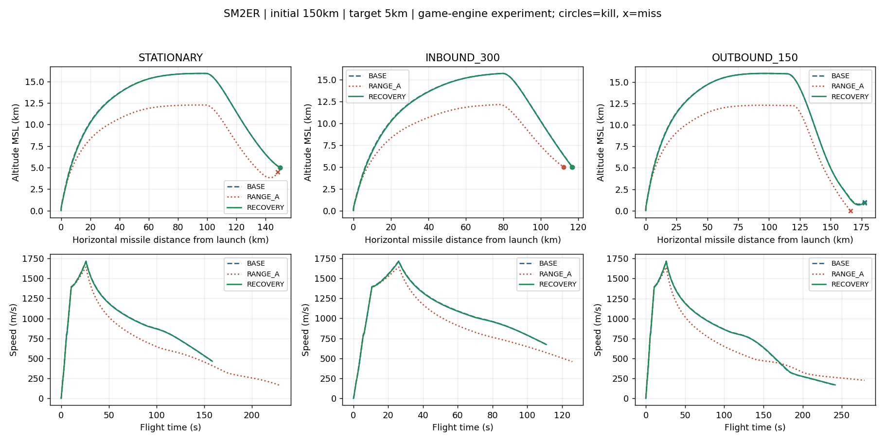
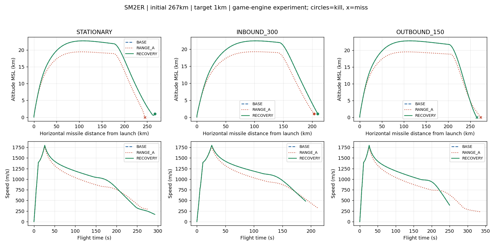
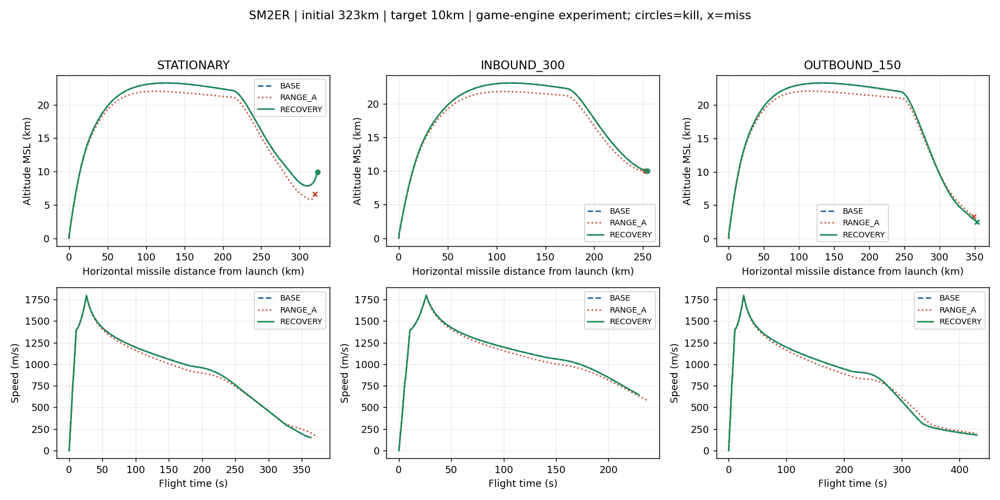
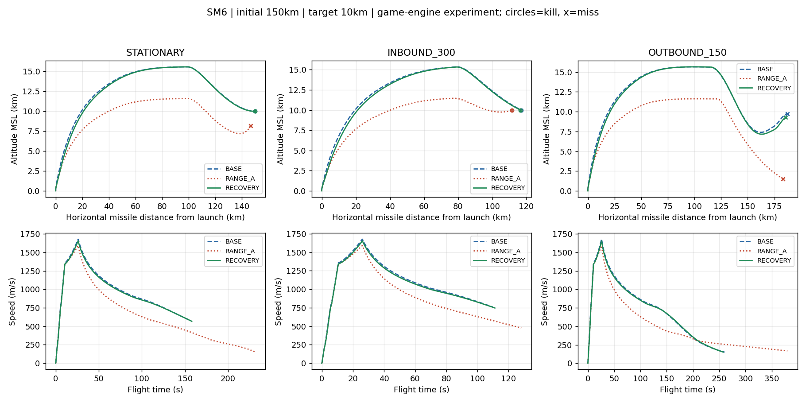
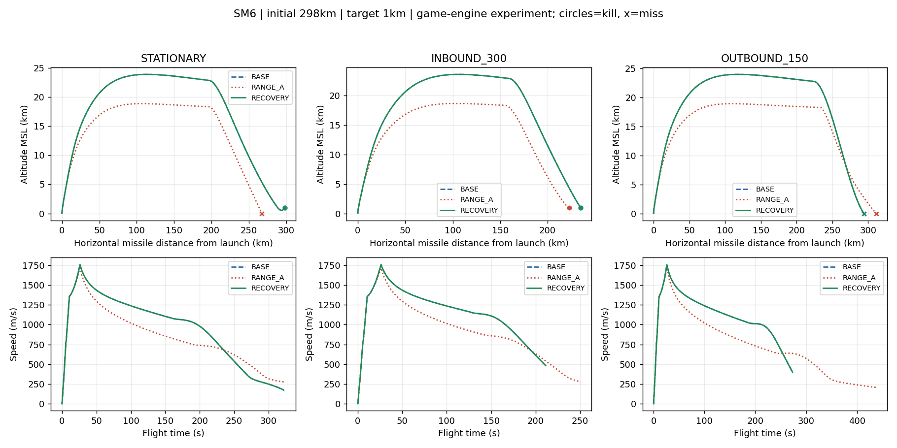
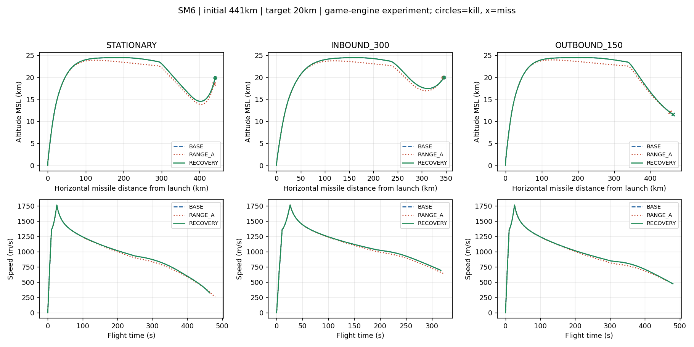

# RANGE_RECOVERY_A — 정지·접근·이탈 제한 복구 시험

**정지 6조건은 회복했지만, 이동 표적의 기존 성공 1건이 아직 회복되지 않았다. 전체 복구 완료로 판정하지 않는다.**

기준 RANGE_A `d42284ae4666914c604f77adbde25045a915e93f` 위 별도 `range-loft-recovery-a` 시험 브랜치. HTML `Aegis_SIM_v48_WIP_RANGE_RECOVERY_A.html` / 18,283,317bytes / SHA-256 `9ee346084b0c1a32cf303127aae74517f11fed79305ce84678d85385a25bc826`.

첨부 분석의 이전 50발 자료를 새 시험 결과로 재사용하지 않았다. 이번에 지정 6조건 × 운동 3종 × 버전 3종 =54발을 새로 계산하고, 장거리 이탈 실패를 구별하기 위한 60km 확인 6조건 ×3버전 =18발을 추가했다. 72개 조건을 독립적으로 두 번 실행했다. 같은 시드 한 조건당 결정적 반복이며 통계적 명중 확률이 아니다.

## 1. 변경 범위

| 항목 | SM-2ER | SM-6 |
|---|---:|---:|
| nominalRmaxKm / maxRmaxKm | 360 / 360 유지 | 450 / 450 유지 |
| rangeGoalKm | 360 유지 | 450 유지 |
| fullLoftKm | **360→240** | **450→260** |

두 수치는 SIM_TUNED 복구 시험값이다. 설계 거리와 로프트 강도 포화 거리를 분리한다. 명칭 변경이나 최적값 탐색은 하지 않았다. 추진·항력·질량·연소·Kappa·신관·배터리·종료기·UI 코드는 변경하지 않았다. SM-2MR/ESSM 설정도 보존했다.

RANGE_A 실행 스크립트의 게임 명명 함수 3,884개, 진단 포함 전체 3,893개가 byte-identical이다. 실행 스크립트 전체를 두 숫자 역치환하면 원본과 완전히 같다. wrapper는 버전명·gzip integrity 외 동일하며 내장 ENV_C와 기존 96행 결과표도 그대로다.

**기존 ENV_C 표는 복구 후보에 유효하지 않다.** 프로파일 해시가 달라 기존 ‘재계산 필요’ 경고가 켜짐을 실제 브라우저에서 확인했다. 새 최대 사거리나 360/450km 달성을 이 제한 사격으로 주장하지 않는다.

## 2. 시험 조건과 전체 결과

- 정지 해면 발사함, 네이티브 수직 VLS·비행·유도·로프트·근접신관 경로, 이상 지속 관측.
- 고정 1/60초, RNG seed `1831565813`. 접근은 사격선 방향으로 300m/s, 이탈은 반대 방향으로 150m/s. 표에는 기존 진단 부호 규약 +300/-150을 사용한다.
- BASE는 ALL4_TERM 설정, RANGE_A는 전체 정렬판, RECOVERY는 현재 RANGE_A에서 fullLoft 두 값만 복원한 후보다.
- 성공은 기존 신관·격추 판정 그대로. 미사일이 근처를 지나가거나 기폭만 했다고 성공으로 바꾸지 않았다.

| 운동 | BASE | RANGE_A | RECOVERY |
|---|---:|---:|---:|
| 정지 | 6/6 | 0/6 | 6/6 |
| 접근 300m/s | 6/6 | 6/6 | 6/6 |
| 이탈 150m/s | 0/6 | 0/6 | 0/6 |
| 60km 이탈 확인 | 6/6 | 5/6 | 5/6 |

### 지정 6조건 × 세 운동

| 기종 | 고도 | 발사 시 거리 | 운동 | BASE | RANGE_A | RECOVERY |
|---|---:|---:|---|---|---|---|
| SM2ER | 5km | 150km | 정지 | INTERCEPT_SUCCESS | LOW_SPEED | INTERCEPT_SUCCESS |
| SM2ER | 5km | 150km | 접근 300m/s | INTERCEPT_SUCCESS | INTERCEPT_SUCCESS | INTERCEPT_SUCCESS |
| SM2ER | 5km | 150km | 이탈 150m/s | LOW_SPEED | SEA_IMPACT | LOW_SPEED |
| SM2ER | 1km | 267km | 정지 | INTERCEPT_SUCCESS | SEA_IMPACT | INTERCEPT_SUCCESS |
| SM2ER | 1km | 267km | 접근 300m/s | INTERCEPT_SUCCESS | INTERCEPT_SUCCESS | INTERCEPT_SUCCESS |
| SM2ER | 1km | 267km | 이탈 150m/s | SEA_IMPACT | SEA_IMPACT | SEA_IMPACT |
| SM2ER | 10km | 323km | 정지 | INTERCEPT_SUCCESS | LOW_SPEED | INTERCEPT_SUCCESS |
| SM2ER | 10km | 323km | 접근 300m/s | INTERCEPT_SUCCESS | INTERCEPT_SUCCESS | INTERCEPT_SUCCESS |
| SM2ER | 10km | 323km | 이탈 150m/s | BATTERY_EXHAUSTED | BATTERY_EXHAUSTED | BATTERY_EXHAUSTED |
| SM6 | 10km | 150km | 정지 | INTERCEPT_SUCCESS | LOW_SPEED | INTERCEPT_SUCCESS |
| SM6 | 10km | 150km | 접근 300m/s | INTERCEPT_SUCCESS | INTERCEPT_SUCCESS | INTERCEPT_SUCCESS |
| SM6 | 10km | 150km | 이탈 150m/s | LOW_SPEED | LOW_SPEED | LOW_SPEED |
| SM6 | 1km | 298km | 정지 | INTERCEPT_SUCCESS | SEA_IMPACT | INTERCEPT_SUCCESS |
| SM6 | 1km | 298km | 접근 300m/s | INTERCEPT_SUCCESS | INTERCEPT_SUCCESS | INTERCEPT_SUCCESS |
| SM6 | 1km | 298km | 이탈 150m/s | SEA_IMPACT | SEA_IMPACT | SEA_IMPACT |
| SM6 | 20km | 441km | 정지 | INTERCEPT_SUCCESS | BATTERY_EXHAUSTED | INTERCEPT_SUCCESS |
| SM6 | 20km | 441km | 접근 300m/s | INTERCEPT_SUCCESS | INTERCEPT_SUCCESS | INTERCEPT_SUCCESS |
| SM6 | 20km | 441km | 이탈 150m/s | BATTERY_EXHAUSTED | BATTERY_EXHAUSTED | BATTERY_EXHAUSTED |

장거리 이탈 0/6은 세 버전 모두의 결과다. 원래 정지 표적 최대 거리 근처에 둔 표적이 계속 멀어지는 조건이며, 이 결과만으로 모든 이탈 표적에 대응 불가라고 해석하지 않는다.

### 60km 이탈 확인 사격

| 기종 | 표적고도 | BASE | RANGE_A | RECOVERY |
|---|---:|---|---|---|
| SM2ER | 5km | INTERCEPT_SUCCESS | INTERCEPT_SUCCESS | INTERCEPT_SUCCESS |
| SM2ER | 1km | INTERCEPT_SUCCESS | SEA_IMPACT | SEA_IMPACT |
| SM2ER | 10km | INTERCEPT_SUCCESS | INTERCEPT_SUCCESS | INTERCEPT_SUCCESS |
| SM6 | 10km | INTERCEPT_SUCCESS | INTERCEPT_SUCCESS | INTERCEPT_SUCCESS |
| SM6 | 1km | INTERCEPT_SUCCESS | INTERCEPT_SUCCESS | INTERCEPT_SUCCESS |
| SM6 | 20km | INTERCEPT_SUCCESS | INTERCEPT_SUCCESS | INTERCEPT_SUCCESS |

RECOVERY는 RANGE_A 대비 새로운 성공→실패를 만들지 않았지만, BASE의 성공을 완전히 보존하지도 못했다. ER 60km/1km/이탈 150m/s가 남아 있으므로 후보의 전체 복구 승인이나 기존 브랜치 병합은 하지 않는다.

## 3. 정지 조건의 비행 수치

첫 shelf는 네이티브 10Hz 샘플에서 처음 유효한 값과 시각이다. 이번 로그를 과거의 확인되지 않은 원인 분리 자료나 통계 시험으로 취급하지 않는다.

| 조건 | 버전 | 첫 shelf(km) / 시각(s) | 최고고도(km) | 종말속도(m/s) | 수명(s) | 결과 |
|---|---|---:|---:|---:|---:|---|
| ER150_5 | BASE | 17.737 / 0.300 | 15.943 | 467.486 | 157.817 | INTERCEPT_SUCCESS |
| ER150_5 | RANGE_A | 13.382 / 0.300 | 12.266 | 161.310 | 229.567 | LOW_SPEED |
| ER150_5 | RECOVERY | 17.737 / 0.300 | 15.943 | 464.258 | 158.533 | INTERCEPT_SUCCESS |
| ER267_1 | BASE | 24.000 / 0.300 | 22.706 | 171.077 | 292.850 | INTERCEPT_SUCCESS |
| ER267_1 | RANGE_A | 21.005 / 0.300 | 19.436 | 292.835 | 277.183 | SEA_IMPACT |
| ER267_1 | RECOVERY | 24.000 / 0.300 | 22.706 | 171.077 | 292.850 | INTERCEPT_SUCCESS |
| ER323_10 | BASE | 24.000 / 0.300 | 23.260 | 150.887 | 364.050 | INTERCEPT_SUCCESS |
| ER323_10 | RANGE_A | 23.457 / 0.300 | 22.019 | 156.936 | 373.633 | LOW_SPEED |
| ER323_10 | RECOVERY | 24.000 / 0.300 | 23.260 | 150.887 | 364.050 | INTERCEPT_SUCCESS |
| SM6_150_10 | BASE | 17.239 / 0.400 | 15.586 | 581.762 | 154.967 | INTERCEPT_SUCCESS |
| SM6_150_10 | RANGE_A | 12.502 / 0.400 | 11.601 | 153.565 | 231.483 | LOW_SPEED |
| SM6_150_10 | RECOVERY | 17.239 / 0.400 | 15.583 | 567.004 | 157.883 | INTERCEPT_SUCCESS |
| SM6_298_1 | BASE | 25.000 / 0.400 | 23.881 | 171.174 | 321.933 | INTERCEPT_SUCCESS |
| SM6_298_1 | RANGE_A | 20.248 / 0.400 | 18.853 | 275.192 | 323.367 | SEA_IMPACT |
| SM6_298_1 | RECOVERY | 25.000 / 0.400 | 23.881 | 171.174 | 321.933 | INTERCEPT_SUCCESS |
| SM6_441_20 | BASE | 25.000 / 0.400 | 24.501 | 324.302 | 464.683 | INTERCEPT_SUCCESS |
| SM6_441_20 | RANGE_A | 24.978 / 0.400 | 23.902 | 260.415 | 480.017 | BATTERY_EXHAUSTED |
| SM6_441_20 | RECOVERY | 25.000 / 0.400 | 24.501 | 324.302 | 464.683 | INTERCEPT_SUCCESS |

전체 72행 수치와 원래 10Hz 궤적은 [요약 CSV](results/summary-72.csv) / [궤적 CSV](results/trajectories-10hz.csv.gz)에 있다. 실패 조건의 실제 유도 단계 변화와 마지막 10초 60Hz 명령도 원시 JSON에 보존했다.

## 4. 남은 실패의 단계·종말 로그

| 조건/버전 | 첫 하강 시각·고도 | 당시 상태 | 종말 시각·고도 | 종말 vz / pitch 명령 | 종료 사유 |
|---|---|---|---|---|---|
| ER150_5_OUTBOUND_150/RECOVERY | 83.683s / 16034.6m | LOFT/CRUISE/KAPPA_MIDCOURSE | 241.500s / 910.82m | 13.281m/s / 0.058650017rad/s | LOW_SPEED |
| ER267_1_OUTBOUND_150/RECOVERY | 87.033s / 22842.9m | LOFT/CRUISE/KAPPA_MIDCOURSE | 250.100s / -0.62m | -79.028m/s / 0.033665818rad/s | SEA_IMPACT |
| ER323_10_OUTBOUND_150/RECOVERY | 103.717s / 23336.3m | LOFT/CRUISE/KAPPA_MIDCOURSE | 430.017s / 2472.55m | -14.163m/s / 0.054350739rad/s | BATTERY_EXHAUSTED |
| SM6_150_10_OUTBOUND_150/RECOVERY | 89.283s / 15659.6m | LOFT/CRUISE/KAPPA_MIDCOURSE | 257.567s / 9268.49m | 10.947m/s / 0.077617694rad/s | LOW_SPEED |
| SM6_298_1_OUTBOUND_150/RECOVERY | 91.850s / 24004.5m | LOFT/CRUISE/KAPPA_MIDCOURSE | 273.183s / -0.65m | -70.869m/s / 0.031113261rad/s | SEA_IMPACT |
| SM6_441_20_OUTBOUND_150/RECOVERY | 172.667s / 24506.5m | LOFT/CRUISE/KAPPA_MIDCOURSE | 480.017s / 11582.18m | -26.484m/s / 0.021119104rad/s | BATTERY_EXHAUSTED |
| ER60km/1km/BASE | 26.567s / 7331.5m | LOFT/DIVE/KAPPA_MIDCOURSE | 102.433s / 985.72m | 44.689m/s / -0.14991694rad/s | INTERCEPT_SUCCESS |
| ER60km/1km/RANGE_A | 26.833s / 7035.6m | LOFT/DIVE/KAPPA_MIDCOURSE | 118.933s / -0.26m | -126.676m/s / 1.771224e-06rad/s | SEA_IMPACT |
| ER60km/1km/RECOVERY | 26.850s / 7157.5m | LOFT/DIVE/KAPPA_MIDCOURSE | 117.283s / -0.13m | -123.602m/s / 1.6273485e-06rad/s | SEA_IMPACT |

ER 60km 확인 조건은 세 버전 모두 LOFT/DIVE 상태에서 KAPPA_MIDCOURSE 하강이 시작된다. RECOVERY는 종말에서 이미 ENDGAME으로 전환했지만 약 -123.6m/s의 하강 속도로 수면을 관통한다. 기존 예측 해면 보호는 비활성이고 soft guard도 false다. fullLoft 복원만으로는 이 기하가 회복되지 않았다. RMAX 정규화·초기 계획·유도/자세 응답의 남은 상호작용을 분리할 후속 조건이다. 단일 원인을 확정하거나 제어 계수를 조정하지 않았다.

기존 30m/200m 저고도 충돌 조사와 이 1km 표적의 추가 실패를 같은 재현 케이스라고 부르지 않는다. 이전 조사 자료는 수정하지 않았고 이번에도 해면 보호·고도 하한·충돌 판정은 변경하지 않았다.

## 5. 검증과 실행 시간

| 검사 | 결과 |
|---|---|
| 정적 변경 범위 | PASS · fullLoft 두 숫자만 · 게임 3,884개 명명 함수 동일 |
| 독립 반복 | PASS · 본시험 54조건 ×2, 확인 18조건 ×2 원시 JSON 각각 비트 동일 |
| 실제 월드/독립 진단 | PASS · 72조건 · 167,236개 샘플쌍, 시간/x/y/z/속도/Mach 최대 오차0 |
| 진단 격리 | PASS · 실제 월드/RNG/틱 전후 변화0 |
| 내장 계산표 상태 | PASS · BASE/RANGE_A 유효, RECOVERY는 재계산 필요 경고 · 변경된 네이티브 함수0 |
| 기존 종료기 단위 fixture | PASS · 원래 6조건 |
| 정지 6조건 회복 | 6/6 |
| 기준판의 기존 성공 보존 | **미달 · 60km 이탈 확인 1건이 여전히 실패** |

| 계산 | 1차 벽시계 | 2차 벽시계 | JSON SHA-256 |
|---|---:|---:|---|
| 본시험54조건 | 18.935s | 23.252s | `8e2b3fda4fcaef1fb83fe2119542ba91a373c8d72450426c071db096489b182e` |
| 60km확인18조건 | 4.543s | 4.717s | `f5d6b6af6976f6ee6c44bee9abc5cc6acbacd113c30bcd9807ec6d63f3ac212b` |

브라우저 동일 경로 검증 벽시계 335.540s. Node와 Chromium을 교차한 값은 작은 부동소수 차이가 가능하므로 독립 Node 2회 비트 동일성과 동일 Chromium 내 실제월드/사본 오차0을 구분한다. CPU quota와 다른 검사의 중첩을 포함하며 게임 프레임 성능 측정이 아니다.

**실행하지 않은 검사:** 전체 96조합 최대 사거리 스윕, 새로운 사거리 표, 확률적 명중률, 자연 레이더/기동 AI 종합 시험, 전체 420+UI88 회귀. 이번은 첨부 요청과 추가 운동 조건의 제한 시험이며, 과거 통과 기록을 이번 재실행으로 표기하지 않는다. UI·센서·발사 권한·기존 공통 함수는 정적 byte 비교로 보존을 확인했다.

## 6. 그래프·원시 자료·다음 경계

- [검증 기록](evidence/verification.json), [정적 검사](evidence/static.json), [실제 월드 비교](evidence/browser.json).
- [본시험 원시 JSON](results/primary.json.gz), [확인 사격 원시 JSON](results/controls.json.gz), [요약 CSV](results/summary-72.csv), [재현](README.md).
- 별도 시험 브랜치의 WIP 후보다. main, missile-b4-termination, range-a-env-c에 병합하지 않으며 Actions를 실행하지 않는다.
- 복구 후보에서는 기존 설계 목표 360/450km를 유지하지만 최대 명중 사거리는 재측정하지 않았다. 정지 6조건 회복을 전체 안정성으로 확대 해석하지 않는다.
- 다음 검토 대상으로 ER60km/1km/이탈150의 잔여 퇴행을 특정했다. RMAX/초기 로프트·종말 유도/자세 응답 분리는 별도 작업이며 이번에는 추가 수치를 변경하지 않는다.
