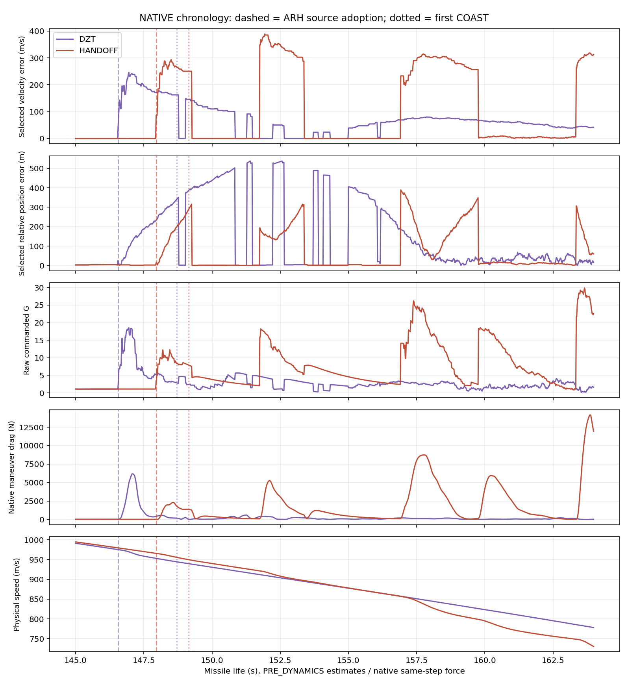
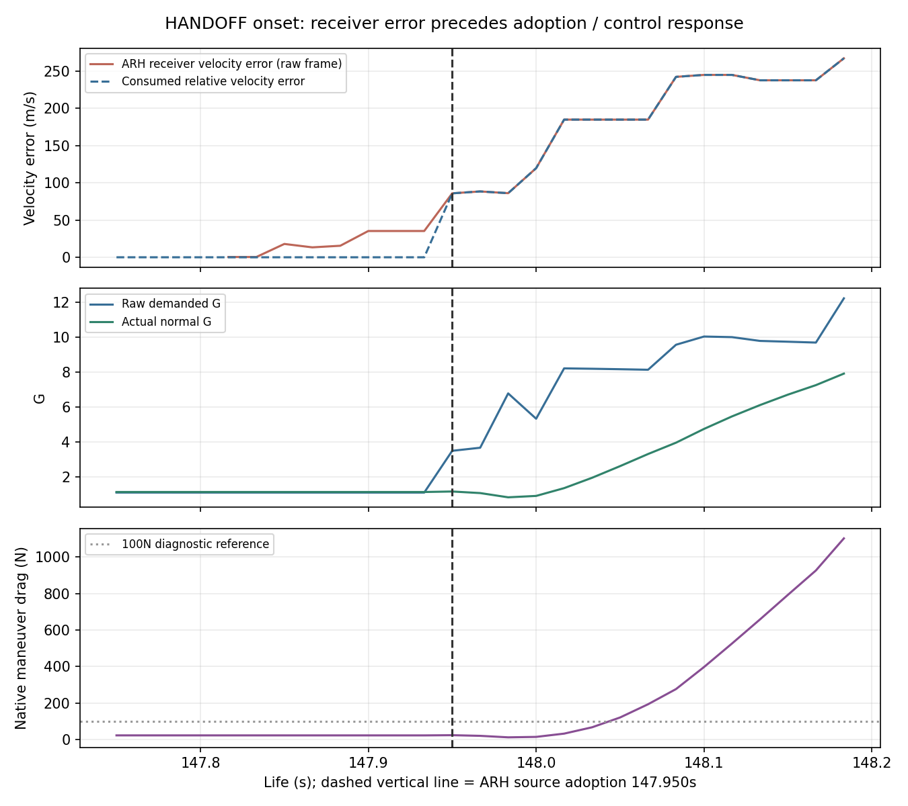
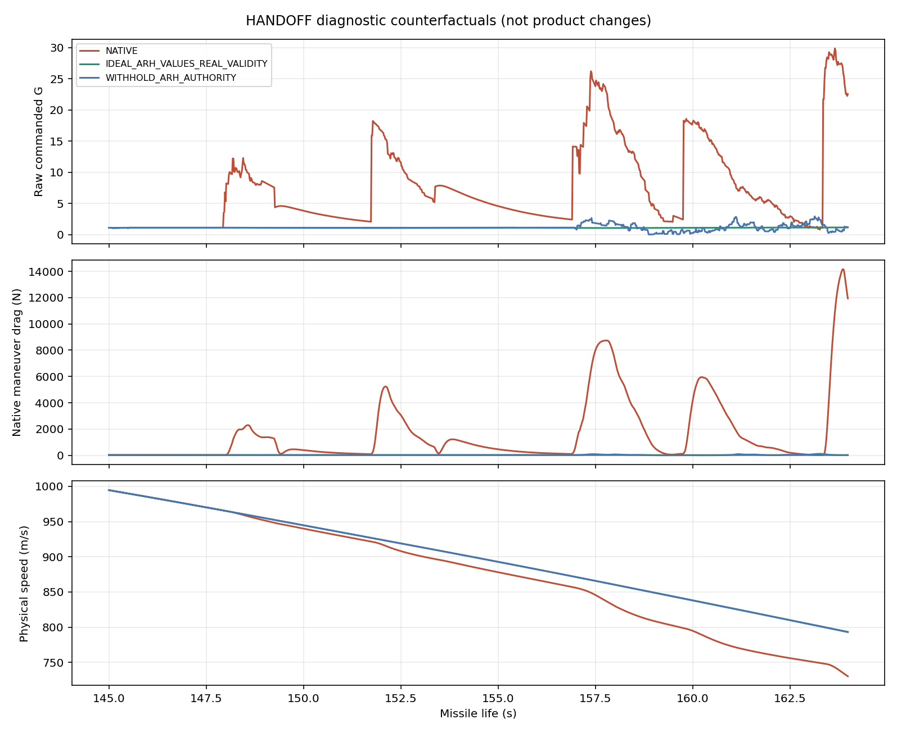

# SM6_240KM_RF_DIAGNOSTIC_A 결과

**이 조건에서 먼저 커지는 것은 ARH EKF의 추정 오차다.** 그 오차가 있는 값을 ARH 유도원 승격 시 소비하고, Kappa 명령이 바뀐 뒤 실제 기동·기동 항력이 커진다. 최초 COAST는 그 이후다. 관찰된 시간 순서와 두 반사실 실험은 이 연결을 지지한다. 제품 계수나 게임 코드는 바꾸지 않았다.

아직 측정 생성·연관·EKF 공분산 중 어느 세부 항목이 ARH 추정값을 처음 왜곡하는지 하나로 확정한 것은 아니다. 이 진단을 특정 임계값 조정이나 ARH 상시 비활성화의 승인으로 해석하지 않는다. 기존 LAUNCH_HANDOFF_A의 회귀 승인 보류도 유지한다.

## 실행 기준과 NATIVE 선행 검증

- 기준 `launch-handoff-a@99c2ef33e5256acbfb3aa557a01065669404de89`, 진단 전용 `sm6-240km-rf-diag-a`.
- 원래 `normal.json[152]`: SM-6, AIR/Su-35,240km/5km, 접근250m/s,seed12001, 종료기OFF. 입력 그대로다.
- DZT HTML SHA `edc159fa347d721d61d80228e2512665f22da0adb4f02fdf4e2dbe82789e0c9c`.
- HANDOFF HTML SHA `e42a2e05b8ff2096dfb334e7b9427cd2cd6da46d567083f06620ffdf35729ed7`.
- 첨부 kit5파일의 MANIFEST, JS/Python 문법, 첨부 stub 계약 검사 PASS. kit 원본을 수정하지 않았다.

먼저 `--native-only`로 두 후보를 모두 실행했다. 두 결과의 **전체 반환값**이 기존 각 후보의 `normals.json[152]`와 완전히 같았다. 이후 별도 출력 폴더에서 세 모드×두 후보를 실행했다. 여기서 반복한 NATIVE도 전체 반환값이 같고, **관찰 로그 JSON.gz bytes까지 첫 실행과 동일**했다. 총8발=선행 NATIVE2 + 세 모드6이며, 과거 참고 사격을 새 실행 수에 합산하지 않았다.

| 후보 / 모드 | 기존 AIR 판정 | 최근접 기록(m) | 비행시간(s) | 종료속도(m/s) |
|---|---|---:|---:|---:|
| DZT / NATIVE | 명중 | 5.478075 | 170.4000 | 698.8654 |
| DZT / 유효 ARH 위치·속도만 이상값 | 명중 | 0.703988 | 170.1833 | 712.2757 |
| DZT / ARH 권한만 차단 | 명중 | 1.014443 | 170.1833 | 711.9640 |
| HANDOFF / NATIVE | **기폭 비명중** | **51.308397** | **173.2833** | **588.3366** |
| HANDOFF / 유효 ARH 위치·속도만 이상값 | 명중 | 0.688687 | 171.8000 | 705.1549 |
| HANDOFF / ARH 권한만 차단 | 명중 | 0.648817 | 171.8000 | 705.2440 |

최근접 기록은 엔진이 실제 기폭/종료까지 기록한 값이다. 기폭이 없었다면 나왔을 가상의 최저 CPA가 아니다. 이 표는 원래 AIR 판정이며 ASM 파편/Pk 판정으로 바꾸지 않았다. `reason`만 같아도 성공 여부가 다를 수 있으므로 원래 `success`를 그대로 썼다.

`IDEAL_ARH_VALUES_REAL_VALIDITY`는 각 호출에서 실제 adapter의 유효성·신뢰도·획득 상태를 유지하고 유효 위치/속도만 바꾼다. `WITHHOLD_ARH_AUTHORITY`는 실제 RF 코어를 계속 돌리되 acquire/hold 권한만 차단한다. 두 모드 모두 격리된 진단이다. 경로가 달라진 뒤의 RF 관측열·난수 소비·유효 상태 이력이 NATIVE와 같다고 주장하지 않는다.

## 무엇이 먼저 커졌는가

시간은 미사일 life(s), 간격1/60s다. 추정 오차는 `before` PRE_DYNAMICS에서 **온보드 상대 상태 − 같은 경계의 물리 상대 상태**로 계산했다. INS 재기준화 오프셋을 표적 오차로 섞지 않았다. 실제 G/항력은 같은 틱의 native 동역학 응답이다.

HANDOFF의 순서:

| 시각(s) | 관찰 사실 | 순서상 의미 |
|---:|---|---|
| 147.8500 | ARH ACQUIRE의 속도 오차17.9845m/s. 소비 유도원은 아직DL이며 그 속도 오차0.1068m/s, 명령1.1098G, 기동 항력23.066N | ARH 추정값 변화가 과도한 기동보다 먼저 나타남 |
| 147.9500 | ARH TRACK을 유도원으로 채택. 소비 속도 오차85.8220m/s, 위치 오차15.0846m. 명령3.5011G, Y가속도31.8667m/s² | 새 추정값 소비와 제어 명령 변화가 같은 고정 틱 |
| 147.9833 | 명령6.7883G, 실제 normal G0.8381, 기동 항력12.388N | 요구와 실제 응답은 다르며 기체 응답에 지연이 있음 |
| 148.0500 | 실제 normal G2.6233, 기동 항력121.214N | 기동 항력100N 초과는 ARH 채택 약0.10s 뒤 |
| 148.1167 | 기동 항력526.464N | 항력 확대 지속 |
| 148.5000 | 속도 추정 오차293.851m/s, 실제 G11.1637, 기동 항력2185.872N | 아직ARH TRACK, COAST 전의 큰 기동 |
| 149.1333 | 첫COAST. 위치 오차286.850m, 속도 오차250.318m/s | 최초 원인으로 COAST를 지목할 수 없음 |
| 149.2667 | 유도원이DL로 복귀 | 이미 꺾인 경로를 다시 보정하는 후속 동작과 구분 |

수치 문턱(오차10/50/100m·m/s, 명령2/3/5/10G, 항력50/100/500/1000N)은 **진단용 여러 기준**이며 제품 문턱이 아니다. 전체 첫 통과 값은 [analysis.json](analysis/analysis.json)의 `onsets`에 있다. 특정 문턱 하나만 골라 순서를 만든 것이 아니다.

DZT도 같은 종류의 현상이 먼저 있었다. ARH 속도 오차10m/s 초과는146.4333s, ARH 채택146.5500s, 명령2G 초과146.5667s, 기동 항력100N 초과146.6333s, 첫COAST148.7000s다. **147초부터만 보면 DZT의 시작을 놓치므로145초까지 앞을 확장**했다. 이 문제를 HANDOFF가 새로 만든 ARH 필터 결함이라고 단정하지 않는다.

## 시간 순서를 뒷받침하는 개입 비교

NATIVE와 각 반사실의 공통 시간 구간을 틱별로 비교했다. HANDOFF는147.9500s까지 직전 물리 상태·ARH receiver 상태가 정확히 같다.147.9500s에 처음 소비 추정값/명령/최종 제어 입력이 달라지고, 같은 틱의 동역학 응답이 달라진다. **동역학 적용 전 물리 상태와 실제 receiver 값의 첫 차이는 다음 틱147.9667s**다. DZT도 동일한 순서이며 기준 시각은146.5500/146.5667s다.

따라서 이 비교에서는 개입 이전의 과도한 몸체 기동이 먼저 발생해 초기 ARH 오차를 만들었다는 설명을 지지하지 않는다. 다만 이후에는 몸체 운동이 실제 RF 관측과 다음 추정값을 바꾸므로 상호 증폭은 가능하다. [첫 차이의 원시 값](analysis/first-differences.json).

실제 호출 순서도 RF 갱신/유도원 선택 → 선택 상태를 쓰는 Kappa → 가속도 bridge → 기체 동역학이다. 같은 틱 안의 관찰을 무리하게 밀리초 단위로 분해하지 않고 이 호출 순서와 전/후 경계를 함께 사용했다.

## PN이 아니라 Kappa가 소비한 구간

147~163s에서 양 후보 모두 **960/960틱 KAPPA_MIDCOURSE**, Kappa 현재 틱 호출960회, PN/APN/ZEM 현재 틱 호출은각각0회다. `pitchover`는 끝나 있으며 launch 혼합이 지배하는 구간도 아니다. 이후 ENDGAME은DZT167.3833s/HANDOFF170.2667s다.

이번 구간의 명령 확대를 PN 배율 또는 Kappa→PN 단계 전환 탓으로 분류하지 않는다. 이것이 비행 전체에서 PN이 무관하다는 의미는 아니다. 과거 캐시 PN/APN/ZEM 값은 현재 명령으로 사용하지 않았다.

## 기동 항력과 속도 손실

| 후보 / 모드 | 147~163s 기동 항력 일(MJ) | 145~164s(MJ) | 147~163s 최대 기동 항력(N) |
|---|---:|---:|---:|
| DZT / NATIVE | 3.9871 | 4.9298 | 6176.56 |
| DZT / 이상값 | 0.3084 | 0.3706 | 62.08 |
| DZT / 권한 차단 | 0.3907 | 0.4465 | 123.58 |
| HANDOFF / NATIVE | **21.0692** | **25.4504** | **8734.05** |
| HANDOFF / 이상값 | 0.3135 | 0.3788 | 25.09 |
| HANDOFF / 권한 차단 | 0.3680 | 0.4599 | 95.88 |

일은 **기존 동역학이 출력한 기동 항력 × 적용 전 속력 × 고정dt**의 진단 적분이다. 새로운 비행 근사 모델이나 전체 에너지의 엄밀한 결산이 아니다. 기본항력·중력·고도·경로/비행시간 차이도 있으므로 최종 속도 차이 전부를 이16초의 기동 항력만으로 환산하지 않았다. HANDOFF는 구간 시작 속력이975.194m/s로 세 모드에서 같고, 구간 끝 속력은NATIVE751.547m/s, 이상값804.433m/s, 권한차단804.248m/s다.163초 이후에도 비행이 계속된다.

NATIVE의 후속 source 복귀/재획득과 경로 복구 기동은 첫 오차와 분리해야 한다. 예를 들어160초에는SARH를 소비하며 상대 속도 오차는약4.30m/s까지 작아졌지만 명령18.02G/기동 항력4.19kN이다. 이는 앞서 바뀐 자기 궤적·속도에 대한 보정 요구도 남는다는 뜻이며 그 순간의 작은 추정 오차만으로 전체 원인을 부정할 수 없다.

## 같은 거리·같은 단계 비교

ARH 최초 채택의 물리 경사거리는DZT25.7745km/HANDOFF25.8148km로 비슷하지만 절대시각은약1.4초 다르다. 같은 절대시각만 비교하면 한쪽은 이미ARH를 쓰고 다른쪽은DL을 쓰는 구간을 섞게 된다.30/25/20/18/15/12/10km 최근접 틱의 값은 `analysis.json.sameDistanceSamples`에 모두 남겼다.147~163s의 phase별 집계도 같은 파일의 `samePhase`다.

같은 Kappa 단계에서 HANDOFF NATIVE의 속도 추정 오차RMS는176.188m/s, 이상값0.0397m/s/권한차단2.9420m/s다. 평균 기동 항력은1552.30N→21.94/26.00N이다. 원래DZT도NATIVE 오차가 있으나 최종 명중으로 회복했다. launch 경로·타이밍 차이가 이후 RF/추정/중재 궤적을 다르게 만들었다는 범위까지는 확인되며, 단순히 같은 seed니까 관측열도 같다고 보지 않았다.

## 확정한 것과 아직 확정하지 않은 것

**확정한 범위:** 해당 시드/조건에서 ARH 추정 오차의 선행, 오차 있는 ARH 값의 채택과 Kappa 명령 변화, 뒤따르는 실제 기동/항력, 두 반사실의 명중 회복. 첫COAST나 PN 배율이 초기 확대의 선행 원인이라는 설명은 이 로그와 맞지 않는다.

**추가 분리가 필요한 범위:** RF_V2의 측정 생성/각도·속도 정보, 연관, 초기화/공분산·속도 관측성 중 오차를 키우는 세부 원인. 관찰기의 association/갱신 NIS와 EKF 전/후 상태는 있으나, 모든 비선택 후보와 실제 전자 수신 채널을 기록한 것은 아니다. 원래 관찰기의 모든 혁신 벡터 성분이 직접 계측된 것처럼 쓰지 않았다. 신호/측정 품질을 임의로 올려서 결론을 맞추지 않는다.

다음 진입점은 실제 실행된 `_arhV2MonopulseMeasurement → _arhAssociateMeasurements → _arhEkfUpdate`의 측정·불확실성 계약과 `_v1SourceMeets/_v1SelectGuidanceSource`의 승격 조건이다. 속도/기하 일관성 검사를 검토할 수 있지만, 이번에는 새 gate나 계수 변경을 넣지 않았다. 위치 오차와 속도 오차 중 어느 항 하나가 단독 원인인지도 두 값을 함께 바꾼 반사실만으로 확정하지 않는다.

## 실제 게임 경로·보존·검수

| 항목 | 결과 |
|---|---|
| 첨부 MANIFEST5파일·문법·stub 계약 | PASS |
| NATIVE 선행2발 vs 기존 전체 반환값 | 2/2동일 |
| 뒤의 NATIVE 반복2발 | 전체 반환값 및 관찰 JSON.gz bytes 동일 |
| 세 모드×두 후보 | 6/6결과·로그 생성, browser errors0 |
| 실제 live 함수 출처 | 후보별14개 text/hash를 실제 선택 HTML main에서 확인, RF_V2 |
| 추정/물리 경계·캐시 구분 | before비교, freshcall/timestamp 사용 |
| 제품/계수 변경 | **0** |
| 전체 ENV_D/420/UI 회귀 재실행 | 안 함: 제품 변경 없는 제한 진단 |
| main/기존 브랜치 병합·release/tag | 없음 |

kit는 실제 선택 HTML의 main에 읽기 전용 관찰기를 넣은 폐기 가능한 브라우저 페이지를 사용한다. 과거 ENV capsule이나 별도 운동 모델을 대신 실행하지 않았다. actual live 함수14개는 [출처](analysis/live-source-provenance-v2.json), [선택 main 존재 증명](analysis/source-equivalence.json)을 따른다. 이름만 보고 옛 helper 선언을 실행 경로로 가정하지 않았다.

이 시험은 원래 AIR fixture의 통제된 직선 표적/함 cue와 실제 RF/EKF·발사·유도·힘·신관 경로다. 새 자연 함 탐지→전체 월드→WebGL 종합 시험을 수행했다고 확대 해석하지 않는다. 이전 정상4시드 결과는 kit의 과거 참고자료이며 이번에 다시 실행한 것은 아니다. 제품 수정 후에는 그 시드와 주변 조건 회귀가 별도로 필요하다.

원본 HTML·공통 fixture·지원 코드의 기준 byte/SHA 보존은 [input-provenance.json](input-provenance.json), 전체 raw는 `native-first/`, `all-modes/`, 파생 CSV·그래프는 `analysis/`에 있다. [재현](REPRODUCE.md). REPORT ZIP에 실행 HTML은 넣지 않는다.

