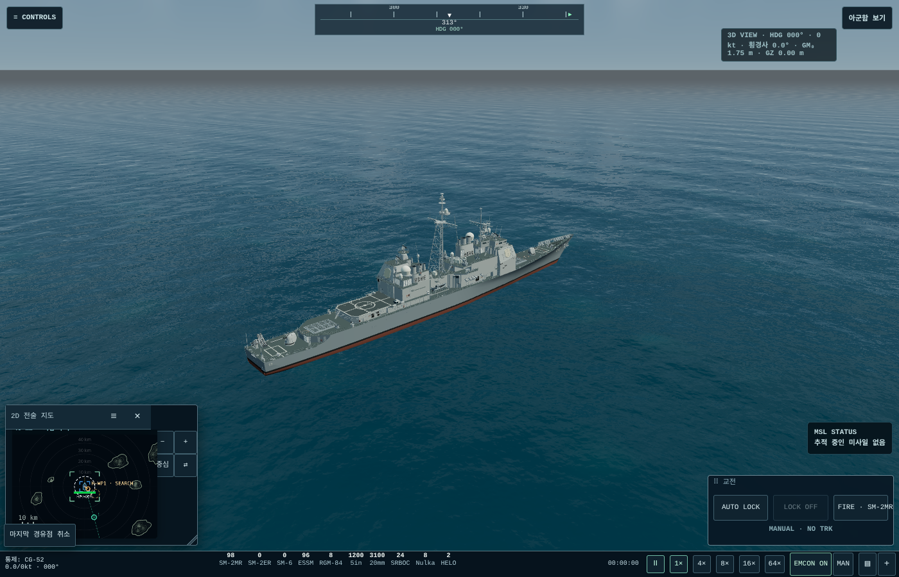
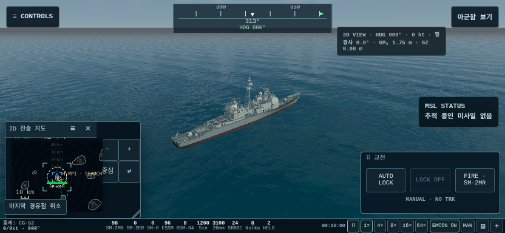
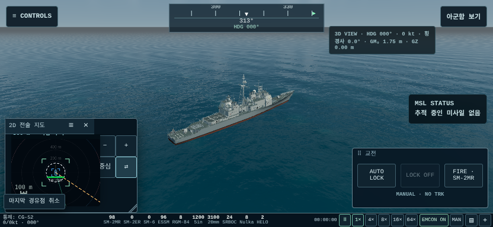
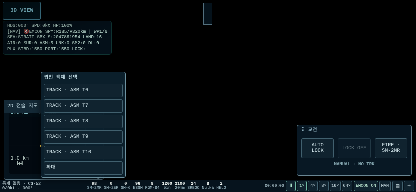
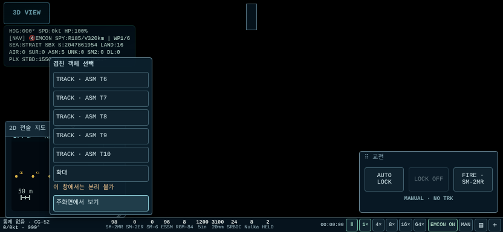
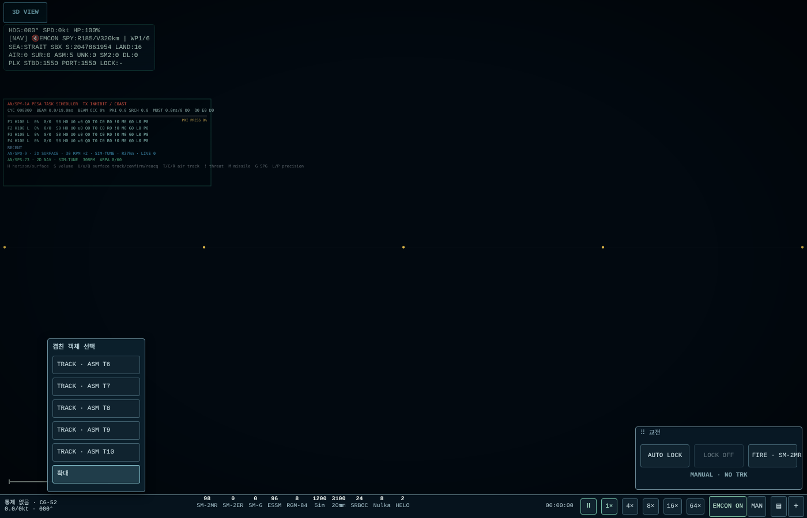
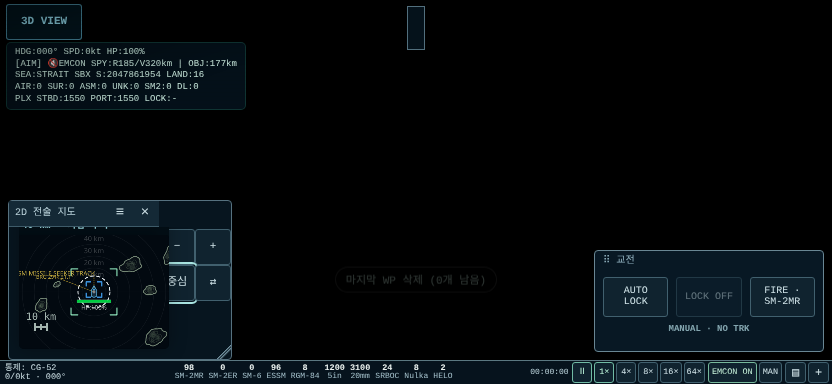
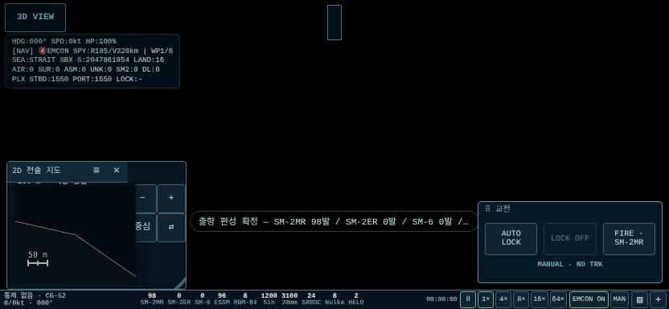

# PIP_A 결과 보고

## 1. 변경 요약

기존 ‘소형 전술도’를 메인 CIC와 같은 렌더/관측 정보/MAP_A 조작을 쓰는 2D 지도 PiP로 교체했다. 거리·중심·자함 추적만 독립이며 선택·조회·통제·계획은 하나다. 지도 안 드래그는 팬, 제목줄 드래그는 창 이동이다. 별도 트랙이나 진실 위치를 만들지 않는다.

PiP는 기본 40km/자함 추적/유휴 4Hz이며 SYS에서 2/4/10Hz를 고른다. 입력/선택 변경 후 다음 프레임에 그리고 입력 종료 후 1초까지 프레임별 갱신한다. `−/+`는 커서/중심 기준 단계 확대, 핀치는 연속 확대다. 기본 창/추적/거리 설정은 브라우저 저장에만 둔다. 기존 게임 저장 스키마는 그대로다.

확대 단계는 300/120/40/15/5/2/1/0.5km, 핀치 최솟값은 사용자 보정대로 0.1km다. 1km 미만은 m로 표시한다. ESM 판정은 관측 플랫폼에서 처음 40px를 제외하며 이후 선 12px 규칙을 사용한다.

위치 보고가 있는 후보에 적용하는 [확대]는 심볼을 자르지 않는 8px 여백 안에서 **전부 보임을 우선한 최대 연속 확대**다. 최소 반경에 걸리거나 창이 작아 40px 분리가 안 되면 ‘이 창에서는 분리 불가’와 [주화면에서 보기]를 제공한다. 같은 위치 보고도 별도로 알린다. 후보 목록은 유지하고 언제든 목록에서 선택할 수 있다. 주화면 전환도 기존 경로를 사용한다.

산출물은 `Aegis_SIM_v48_WIP_PIP_A.html`, 18,060,939bytes로 MAP_A보다 13,323bytes 증가했다. SHA-256: `76c77b5c80835f87654c8aa39cd6a82c1ad66de8bc408ebad675997157024847`.

## 2. A–J 수치표

최종 **1271/1271 assertions / 32 suites PASS, 페이지 오류 0**. 아래 수치의 원본은 [전체 집계](evidence/verification-summary.json) 및 항목별 JSON이다. 화면 좌표는 CSS px, 입력/기하 검사는 DPR 2.8125다. E의 유휴 Hz·ms 지연은 3D 활성 플래그만 사용하는 CPU 기하 fixture의 스케줄 검사이며 실제 WebGL 프레임 비용은 I에서 별도로 측정했다. PiP는 같은 RAF에서 그리므로 전체 프레임률이 설정 Hz보다 낮으면 그 프레임률이 갱신 상한이다. ‘동일 정보’는 같은 공통 프레임에서 그리기 대상인 트랙 집합이며 화면 바깥 트랙까지 보인다는 의미는 아니다.

| 항목 | 결과/수치 | 증거 |
|---|---|---|
| A 동일 정보 | 1400×900 / 832×384 / 384×832에서 메인·PiP 트랙 ID 집합 동일. PiP 페인트의 차단 truth getter 접근 0회 | [입력](evidence/input/input.json), [렌더](evidence/render/render.json) |
| B 부작용 | PiP ON/OFF 각 7200틱·120초 해시 동일. 페인트 전후 커서·선택·트레일·알림 변화 0 | [120초](evidence/invariance/invariance.json), [순수 페인트](evidence/precision/precision.json) |
| C PiP 조작 | 3크기 스침·19/21px·NAV·하푼·우클릭/550ms/펜 검수 통과. 휠/핀치 확대·축소 시 메인 거리 변화 0, 핀치 직후 탭·롱프레스 변화 0 | [88개 검사](evidence/input/input.json) |
| D 교체 유지 | 실제 WebGL에서 PC/폰 각각 5회 왕복, 조회·통제·도구·사격 슬롯·하푼 계획·자함 항로점 보존 | [실제 3D](evidence/visual/visual.json) |
| E 갱신 | 유휴 설정 2/4/10Hz → 실측 2.38/3.81/9.52Hz(각 2.1초). 입력 첫 재렌더 1프레임, 실측 2.4/14.5ms. 3D 메인 중 숨겨진 메인 2D 페인트 0회 | [주기](evidence/render/render.json), [실제 3D](evidence/visual/visual.json) |
| F 확대 | 아래 환산표와 실측 일치(오차 <0.001px). 0.1km 실제 해안·등고선·링 렌더, 비정상 수 0. 해안선 0.828px 유지 | [기하](evidence/render/render.json), [해안](evidence/precision/precision.json) |
| G ESM | 3개 방위선 상황에서 자함 즉시 조회/후보 목록 없음. 시작점 42px 바깥 선은 ESM 선택 | [3크기 입력](evidence/input/input.json) |
| H 후보 확대 | 2~5개·100m/2m/동일 위치 10배치: 전부 표시·심볼 여백 기준 최대 확대·목록 유지 통과. 분리 불가 안내/주화면 전환/전환 후 목록 선택 통과 | [113개 렌더/기하 검사](evidence/render/render.json) |
| I 성능 | 동일 CG/시드/LOW/832×384/DPR 2.8125, 직렬 소프트웨어 WebGL 비교. 아래 별도 표 | [프레임 표본](evidence/visual/visual.json) |
| J 회귀 | MAP_A 런타임 994건 재실행, 정적 48건은 새 핀/표시 패치 기준으로 재검사. 기존 입력 토글/no-arg LOCK/EMCON·하푼 INS 보존 포함 | [전체 집계](evidence/verification-summary.json) |

100m 간격의 기준은 `짧은 변 × 0.42 / 0.1km × 0.1km`다. 창의 제목/조작 공간을 제외한 실제 지도 사각형을 쓴다.

| 화면/지도 | 지도 짧은 변 | 계산값 | 실측 |
|---|---:|---:|---:|
| 메인 1400×900, 바 제외 | 859px | 360.78px | 360.78px |
| 메인 832×384, 바 제외 | 360px | 151.20px | 151.20px |
| 최소 PiP 200×160, PC 밀도 | 102px | 42.84px | 42.84px |
| 최소 PiP 200×160, 모바일 밀도 | 114px | 47.88px | 47.88px |

큰 좌표(±10,000,000 world units)에서 0.1km 화면↔월드 왕복 오차는 7.72×10⁻⁸px 이하였다. 소형 심볼/선/라벨은 기존 화면 px 규칙을 유지하고, 새 확대에서 과도하게 커지던 장식용 길이·메모리 브래킷 최소 크기만 px 환산으로 정리했다. 물리적 사거리·오차 타원은 실제 지도 거리대로 커진다.

5개 후보가 100m 간격으로 일렬일 때 최소 PiP에서는 전부 보임을 우선해 27.5px 간격이 된다. 이를 임의 분리하거나 트랙을 옮기지 않고 후보 목록/주화면으로 해결한다. 주화면 1400×900에서 위치 간격이 허용하는 배치는 40px 이상으로 분리된다.

### I. 전후 프레임 시간

같은 시드·CG·LOW·832×384·DPR 2.8125, WebGL 버퍼 832×384, 각 회차 2초 준비 후 90프레임을 측정했다. 순서는 MAP_A → PIP_A → PIP_A → MAP_A다. 다른 GPU 회귀 작업이 끝난 뒤 직렬 실행했다.

| 회차 | 빌드 | 표본 | 평균 ms/프레임 | p95 ms |
|---|---|---:|---:|---:|
| 1 | MAP_A | 90 | 1294.39 | 1533.20 |
| 2 | PIP_A | 90 | 1050.51 | 1216.60 |
| 3 | PIP_A | 90 | 1029.40 | 1200.00 |
| 4 | MAP_A | 90 | 1256.80 | 1483.20 |

| 합산 | 표본 | 평균 ms/프레임 | p95 ms |
|---|---:|---:|---:|
| MAP_A | 180 | 1275.60 | 1499.90 |
| PIP_A | 180 | 1039.96 | 1216.60 |

평균 프레임 시간은 이 환경에서 18.47% 감소했다. SwiftShader는 실제 GPU가 없는 소프트웨어 렌더러이며 이 수치를 실폰 성능으로 일반화하지 않는다. 전체 프레임이 약 1초 이상 걸리는 이 환경에서는 같은 RAF를 쓰는 PiP도 설정 4Hz에 도달할 수 없다. E의 4Hz 스케줄 검사는 GPU를 제외한 기하 fixture에서 검증했고, 실제 GPU 화면의 갱신 상한은 전체 프레임률이다.

## 3. drawRadar 부작용 감사

[전체 감사표](RENDER_AUDIT.md)에 원본 함수와 하위 호출의 캐시·DOM·품질 갱신, 데이터 출처, 기존 truth 누출 두 곳의 제거를 기록했다. 지연 초기화는 공통 준비에서만 수행하며 PiP 픽셀 함수는 읽기 전용이다. 숨겨진 메인 2D를 그리지 않아 중복 그림 비용도 없앴다. 비교용 간이 지도 함수는 삭제하지 않았다.

## 4. 스크린샷

실제 3D 주화면 + PiP:

0.5km 확대(실제 WebGL 주화면):

후보 확대 전/후와 주화면 전환(입력·기하용 CPU fixture, 뒤의 검은 주화면은 3D 렌더가 없는 검사 환경):

ESM 3개 상태 자함 조회와 실제 해안 0.1km 검사:

## 5. 2D 메인에서 3D PiP 비용 추정

이번에는 구현하지 않았다. 기존 씬/카메라를 재사용해 작은 RenderTarget 또는 별도 viewport로 두 번째 카메라를 그리면 모델·텍스처 중복 로딩은 피할 수 있다. 대신 추가 draw call, 해상도별 렌더 타깃, 효과/LOD별 가시성, UI·카메라 입력 격리, 창 크기/DPR 대응이 필요하다. 현재 3D 렌더 어댑터의 이벤트 소비·효과 갱신이 두 번 실행되지 않도록 공통 프레임 준비도 분리해야 한다.

초기 4Hz·200×160·LOW 제한과 기존 메인 전환 경로를 쓰는 최소 구현은 약 2~3 작업일, 효과 읽기 전용 분리/회귀/모바일 성능 확인까지 4~6 작업일로 추정한다. 실제 FPS/메모리 비용은 구현 후 GPU 계측이 필요하며 이번 2D PiP 측정에서 추정하지 않는다.

## 6. MAP_B

사격 지정 슬롯 UI, 무장 플라이아웃·단발/살보, 무장 사거리·동적 교전 가능 사유, 작은 발사 버튼, 하푼 트랙/INS 선택과 `MAP_A_LEGACY_CURSOR_BRIDGE` 제거가 남았다. 3D 객체 직접 클릭, 트랙 병합/분리 변경, ROE 단계, 별칭, 기존 창 제거는 이번에 추가하지 않았다.

실폰 GPU/FPS·회전 지연·펜 하드웨어는 미검증이다. 합성 pointer/고DPR와 SwiftShader 결과를 단말 실측으로 표기하지 않았다. 기준 4Hz 렌더·선택 상태 공유는 표시 정책이며 센서 갱신률이나 전투 시간 진행을 바꾸지 않는다.
