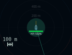
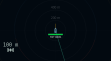
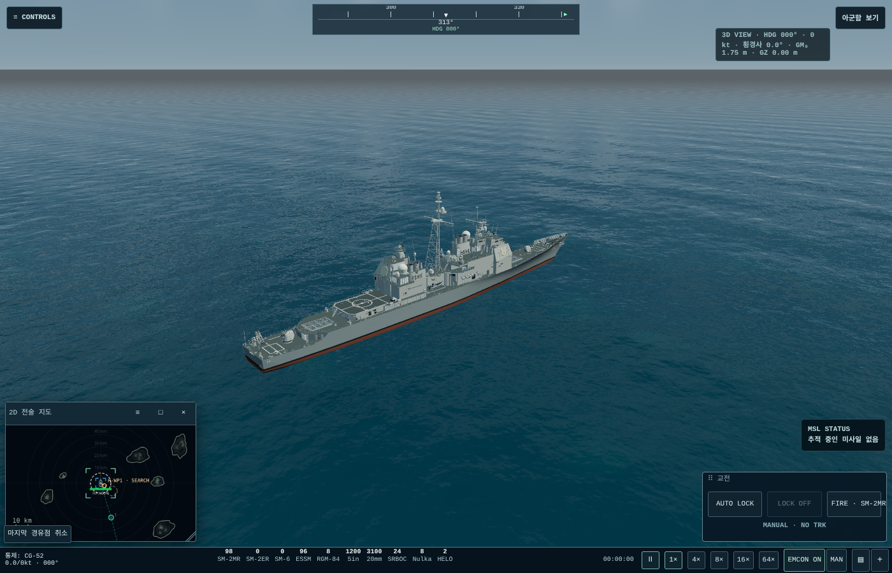
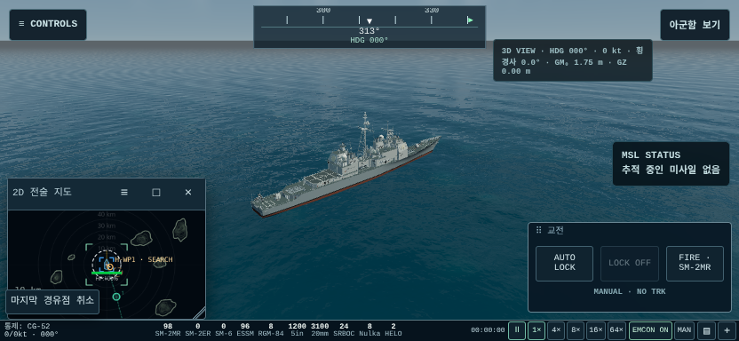
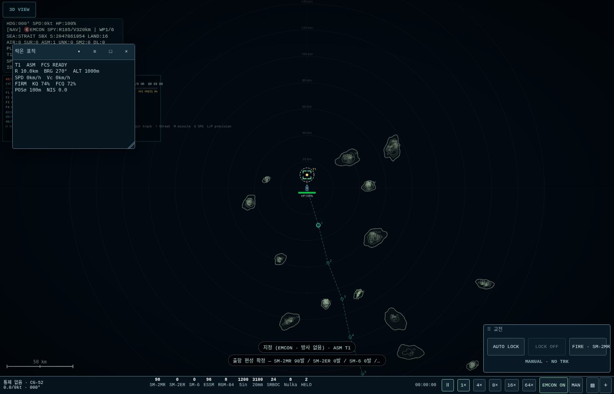
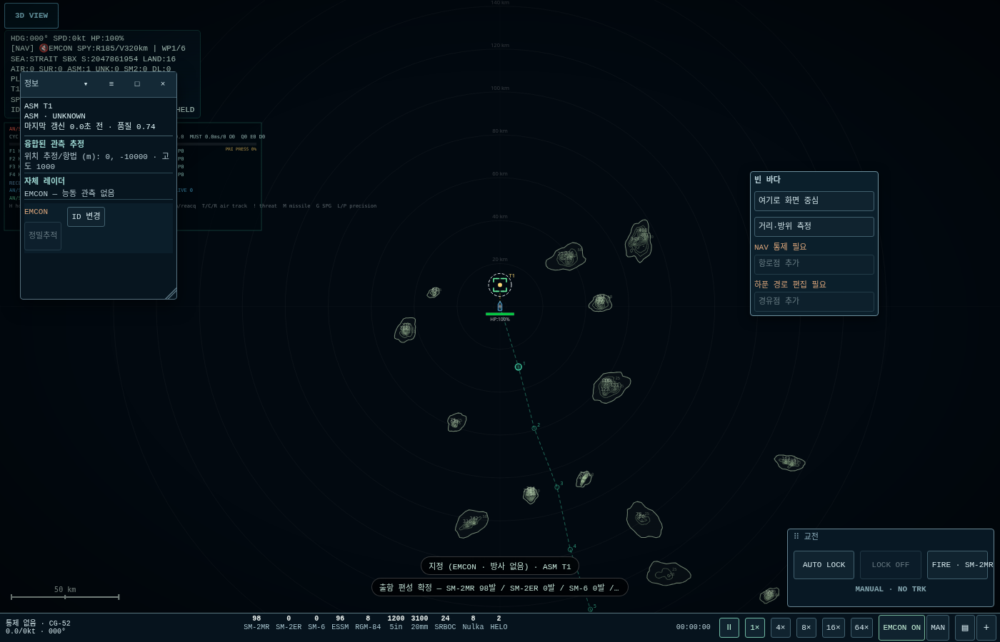
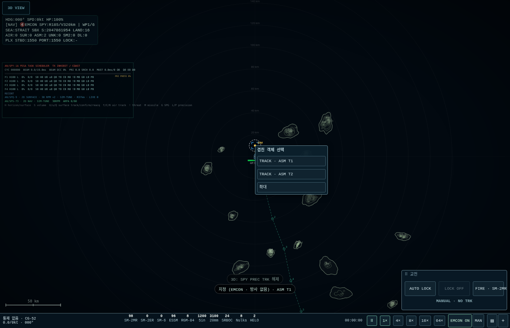

# PIP_B — PiP와 정보 창 정리

기준 PIP_A `76c77b5c…024847`. 산출물은 `Aegis_SIM_v48_WIP_PIP_B.html`이다. 센서·트랙·발사 권한·시간·게임 저장은 보존했다. ENV_A 결과는 별도 [비행 진단 보고서](../../envelope/A/REPORT.md)에 있다.

PiP에는 제목줄과 지도만 남겼다. 기존 중심/주화면 전환 버튼 노드와 리스너를 제목 ≡ 메뉴로 이동하고 빈 바다 상황 메뉴에도 같은 명령을 연결했다. 지도 팬·휠·핀치·메뉴·항로점·경유점은 그대로다. 기존 전체 캔버스가 창의 크기 조절 모서리를 가리는 문제도 해결했다.

기존 락온 카드의 모든 행을 일반 ‘락온 표적’ 창으로 옮겼다. 새 항목이나 판단은 추가하지 않는다. 락 때 자동 열림, 사용자가 닫은 같은 락에서는 재개방 억제, 해제하면 ‘락 없음’, 다음 락에서 다시 열린다. 지도에는 브래킷과 번호가 남는다. DOM 타이머는125ms이고 지도 갱신과 분리되어 있다.

정보·락 창/메뉴/후보/Undo/제목을11px·1.3행간으로 정리했다. 메뉴가 하단 바/교전 위젯에 가려지지 않도록 같은 메뉴 노드를 팝업 계층에 놓고 보이는 화면 안으로 제한한다. 창 배치와 UI 크기는 기존 UI_A 시스템을 사용한다.

SYS의 ‘2D 센서 빔 표시’는 기본 OFF이며 브라우저 설정으로 저장한다. SPY/보조 레이더/미사일 시커·SARH/조사 표시만 그리기에서 숨긴다. 트랙·ESM·항로점·거리 링·섬·3D 센서 표시는 보존한다.

## 청록색 원의 원인과 수정

**원은 자함 항적선이었다.** 기본 DDG 출항→3D→PiP 확대에서 재현했다. 원본 `shipNav.trail` 표시가 `ctx.lineWidth=1.5`를 world 단위로 사용했다. 정지한 선분의 둥근 끝이 겹쳐 원처럼 보였고, 확대할수록 두꺼워졌다. 센서 클러터나 무장 범위 표시가 아니다.

원본832×384/PiP 짧은 변114px에서 반경0.5km일 때 선 두께37.8px, 환산 반경 약197m였다. 0.1km에서는189px가 된다. 해당 stroke만 제외하자 원이 사라졌으며 다른 그리기는 그대로였다. [기본 출항 재현](evidence/cyan-native-default-500m.png), [호출 감사](evidence/cyan-native-trail-proof.json).

수정은 `screenPxToWorld(1.5)` 한 줄이다. 항적 데이터는 변경하지 않는다. 새 PiP에서40/0.5/0.1km 모두1.5px를 측정했다.

| 수정 전(PIP_A,0.5km) | 수정 후(PIP_B,0.5km) |
|---|---|
|  |  |

## P1–P5 검수

최종 수치·개별 assertion은 [검증 합계](evidence/verification-summary.json)와 각 JSON에 보존한다. 실제 WebGL 이미지와 CPU 캔버스 기반 좌표/입력 검사는 구분한다.

| 항목 | 결과·수치 |
|---|---|
| P1 | 1400×900/832×384/384×832 ×85/100/130% 9조합. 창 client−제목 대비 지도 오차 최대0.60px, 지도 영역 버튼0. 제목/상황 메뉴 중심·전환 정상 |
| P2 | 메인/PiP 카드 본문 canvas 출력0. 락 창8.0Hz(세 크기 모두), PiP4Hz와 독립. 닫기 억제/해제/재지정 검사 통과 |
| P3 | 글자11px, 행간14.3px, body/menu 여백5px. 정보 기본220px/메뉴180px/후보200px. 일반 버튼28px+상하4px hit=36px. 정밀추적40px, 제목36px·버튼28px+36px hit |
| P4 | 기본 beam group0. ON 상태17400개 그리기 명령이 PIP_A와 같음(별도 요청인 항적선 두께 교정만 비교 정규화). 트랙/ESM/섬 유지 |
| P5 | 고정7200tick/120초 상태 해시 비교 및 기존 동작 회귀. 아래 검증 범위 참조 |

## 화면 예시

PC/폰 이미지는 실제 SwiftShader WebGL이며 물리 단말 FPS 측정이 아니다.

## 검증 범위와 실행 환경

입력·기하·저장·선택/통제·기존 입력 모드·헬기/APS/ISAR/하푼/EMCON/손상·소브레멘니 회귀를 보존한다. 정적 검사는 14개 패킹 무결성, 원본 모델/저장/고정 tick 보존, 재빌드 동일성, 원본 함수 변경 범위(표시9개)를 확인한다. ENV_A의241개 복사 함수도 실제 함수 원문과 일치한다.

일부 구성 검사는 표 내장 전/항적 두께 교정 전 후보에서 수행했다. 각 영수증의 tested SHA를 유지하며 최종 빌드의 정적 함수 보존 감사·직접 UI/기하/입력/해시 검사와 함께 판정한다. 이전 후보 결과를 최종 HTML에서 실행한 것으로 바꾸어 적지 않는다.

처음 실제3D 검사에서는 소프트웨어 GPU의 가속2D 캔버스 한 프레임이8–9초 걸려 Playwright의 ‘두 프레임 안정’ 클릭 대기가 만료됐다. 실제 버튼 좌표는 계속 동일했다. 검사용 브라우저에 `--disable-accelerated-2d-canvas`를 적용하고 실제 SwiftShader WebGL은 유지해 재검사했다. 제품 실행 코드나 판정 허들을 바꾸지 않았다. 일부 과부하 롱프레스 재시도도 원래 assertion 그대로 수행했다. 실패 이력은 별도 retries 기록에 남긴다.

실폰 GPU/펜 하드웨어 성능은 미측정이다. MAP_B의 사격 지정·무장 플라이아웃·작은 발사 버튼·하푼 모드 전환, UI_B 창 분할/손상 창,2D 메인에서3D PiP는 이번에 구현하지 않았다.

120초/7200tick 비교 해시(PIP_A/PIP_B/일시정지 후 재개): `085812f497d54b66feb69e8bd15a53f0fe93e4199c95fdb4cc405b75518b6587`로 모두 같다.

최종 표시/입력/기존 기능 회귀 합계는 **1358/1358 assertions,35 suites PASS**다. 원래 PIP_A의 빌드 핀 전용 정적 검사는 새 기준으로 재정의했고, 넓어진 PiP에서 조건부 분리/주화면 fallback 분기가 줄어 기하 검사 수는113→103이 됐다. 실제WebGL 주화면 전환은 두 크기에서 각5왕복 통과했다. 부가 프레임 시간은12프레임씩4회이며 평균(ms)은 PIP_A 1948.54, PIP_B 1631.88, PIP_B 1673.54, PIP_A 1566.61였다. 대규모 ENV_A 동시 계산 중 소프트웨어 렌더링 측정으로, 성능 향상이나 실제 단말 FPS의 근거로 쓰지 않는다.

원격 전체 읽기 검증은 발행 후 [GitHub 발행 영수증](https://github.com/0-FLANDRE-0/Aegis_Project/blob/pip-b-env-a/docs/pip/B/remote-publication.json)에 별도로 남긴다. ZIP은 자기 자신의 발행 영수증을 포함하지 않는다. ZIP 내부 파일은 `DELIVERY_MANIFEST.json`, 저장소 지원 파일은 `REPOSITORY_SUPPORT.sha256`로 구분해 검사한다.
