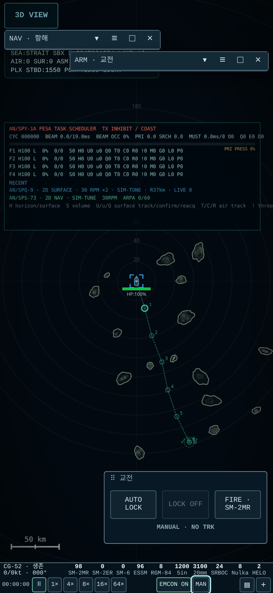
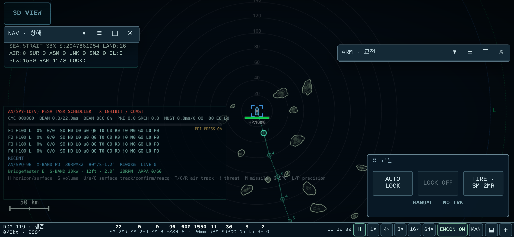
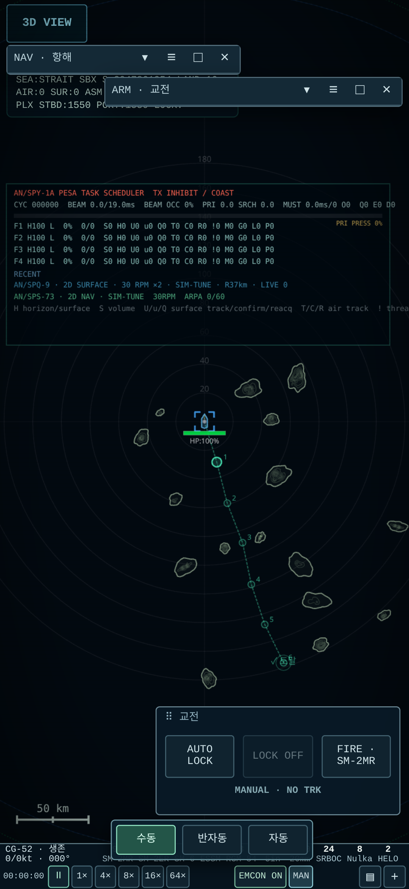

# UI_A1 모바일 압축 결과

UI_A `30428d6` 위 `ui-a1`. 사용자 후속 요청을 우선하여 모바일 밀도와 상태 칩 동작을 바꿨다. **456/456 assertions, 4 suites PASS, 페이지 오류 0**. 최종 HTML **18,029,844 bytes**, UI_A 대비 **+6,522 bytes**, SHA-256 `fd7079e9154e8778f7f5a340e6102c8843930b9865d4dc1135714c4847cdc3b8`.

## 변경

- 함 정보/재고와 시간/상태/창 아이콘을 두 묶음으로 압축했다. 세로는 2줄, 충분한 가로 폭은 1줄이다. 모든 설치 재고 항목을 유지하며 가로 스크롤·말줄임이 없다. 함명 전체는 title/NAV에서 확인한다.
- 모바일 창 기본 크기(CSS px, 100%): NAV 220×178, ARM 280×232, AIR 320×232, FLEET 284×240, SYS 260×230, 소형 CIC 224×170. NAV/ARM은 처음 제목줄만 표시한다. 누르면 전면화하고 제목줄 이동·우하단 크기 조절·겹침을 지원한다. 모바일 자동 스냅만 해제하며 명시 고정 메뉴와 PC 기본 오른쪽 ARM 도크를 유지한다.
- 일반 창 글자 10px, 일반 버튼 26px, 제목줄 28px다. 읽기 전용 상태 바 글자 8–8.5px, 시간/칩/창 아이콘 21px로 압축했다. FIRE/LOCK 등은 40px 보호 크기와 간격을 유지한다. 작은 고정 위젯의 긴 무장명은 버튼 안에서 줄바꿈한다.
- EMCON은 기존 native 버튼을 즉시 호출하며 창을 열지 않는다. 교전 칩은 바로 위에 수동/반자동/자동 세 선택을 띄운다. 선택은 기존 canonical 함수를 한 번 호출하고 팝업을 닫는다. 열기만 하면 모드는 바뀌지 않는다. Escape/바깥 탭으로 닫는다.
- 배치 schema 2는 순서와 펼칠 높이를 보존한다. 예전 배치는 새 프리셋으로 시작하고 UI 크기 설정은 유지한다. localStorage 차단·손상·구버전은 정상 기본값으로 복구한다. 게임 저장은 바꾸지 않았다.

## 하단 바 실측

DPR 2.8125, UI 100%. 수정 전 수치는 UI_A의 보존된 검수 원본, 수정 후는 최종 UI_A1의 실행값이다. PC 1400×900은 41px를 유지한다. UI 130%는 사용자 확대 설정에 따라 더 높아지며 384×832 최대 90.16px다.

| 함정 | 화면 CSS px | 이전 높이 px | 현재 높이 px | 감소 |
|---|---|---:|---:|---:|
| DDG-119 | 384×832 | 155.00 | 42.84 | 72.4% |
| DDG-119 | 832×384 | 79.00 | 24.00 | 69.6% |
| DDG-119 | 390×844 | 155.00 | 42.84 | 72.4% |
| DDG-119 | 844×390 | 95.00 | 24.00 | 74.7% |
| DDG-119 | 600×900 | 79.00 | 42.84 | 45.8% |
| DDG-119 | 1400×900 | 41.00 | 41.00 | 0.0% |
| CG-52 | 384×832 | 155.00 | 42.84 | 72.4% |
| CG-52 | 832×384 | 95.00 | 24.00 | 74.7% |
| CG-52 | 390×844 | 133.00 | 42.84 | 67.8% |
| CG-52 | 844×390 | 95.00 | 24.00 | 74.7% |
| CG-52 | 600×900 | 79.00 | 42.84 | 45.8% |
| CG-52 | 1400×900 | 41.00 | 41.00 | 0.0% |

## 검증 범위

| 검사 | 결과 |
|---|---|
| 정적/패킹/문법/스코프 | 46 PASS. 14 records 문법·SHA, 0–12 및 모델 자산 동일 |
| 모바일/PC 6크기 × 3 UI 배율 × 2 함정 | 36조합, 재고 잘림·가로 스크롤·id 중복 0, 메인 캔버스 zoom 1 |
| 2D 중심 | 최대 0.00000000px |
| 실제 창 조작 | 겹침·탭 전면화·위치 유지·제목줄 이동·모서리 resize·최대화 복원 PASS |
| 모바일 가장자리 | 자동 스냅 없음, 30회 무작위 크기 변경 뒤 제목줄 포함 PASS |
| EMCON/교전 | EMCON 양방향 전환·창 미개방·3모드·팝업 위치·Escape/바깥 닫기 PASS |
| 입력 격리 | 창/바/위젯/모드 팝업의 드래그·휠·합성 핀치로 지도·경로·lock 변화 0 |
| 저장/복원 | 위치·크기·겹침 순서 복원 및 차단·손상·구버전 fallback PASS |
| 3D | 832×384, 중심 오차 0.00000000px, EMCON/모드·입력 격리 PASS |
| 기존 native 핸들러 | {'NAV': 11, 'ARM': 29, 'FLEET': 21, 'AIR': 13, 'DEBUG': 10} 이동 전후 결과 일치 |
| 고정 교전 위젯 | 2D·3D 각각 AUTO LOCK→FIRE 실제 발사, UI_A와 결과 일치 |
| 시뮬 불변 | 같은 시드 120초/7,200틱 및 pause/resume 동일 |

120초 상태 1,764,132 bytes의 SHA는 `085812f497d54b66feb69e8bd15a53f0fe93e4199c95fdb4cc405b75518b6587`다. main의 UI shell 바깥은 버전명 정규화 뒤 완전히 동일하다. 센서·무장 권한·물리·유도·피해·게임 저장·전체화면 구현을 보존했다. 기존 DOM 노드를 계속 사용하며 복제/핸들러 교체를 하지 않았다.

UI_A 당시 1144건 전체를 이번에 다시 실행했다고 합산하지 않는다. 이번 작업에는 정적 범위 증명, 변경 부위 브라우저 검사, 탭별 기존 native 조작 비교와 상태 해시를 사용했다. 세부 원본은 [검증 색인](evidence/verification-summary.json)을 따른다.

## 스크린샷

[세로](evidence/compact/mobile-portrait.png) · [가로](evidence/compact/mobile-landscape.png) · [겹친 창](evidence/compact/mobile-overlapping-windows.png) · [교전 3선택](evidence/compact/mobile-mode-popup.png) · [모바일 3D](evidence/compact/mobile-3d.png) · [PC](evidence/compact/desktop.png).

## 남은 범위

실제 S24 Ultra GPU/FPS·브라우저 안전영역/OS 조합은 실기기 미측정이다. 작은 글자/21px 바 버튼은 이번 사용자 압축 요청에 따른 선택이며 UI 크기 115/130%로 확대할 수 있다. HUD/SPY 창 편입, 손상·침수 창 편입, ARM 분리와 진짜 지도 PIP는 UI_B다.

UI_A 네 파일은 동일 bytes/blob archive하며 `ui-a1`에 원본 HTML 전체를 올려 독립 readback한다. 기록은 `remote-publication.json`을 따른다. Actions dispatch/main·기존 브랜치 병합·새 PR은 하지 않는다.
